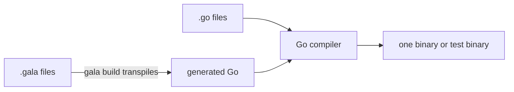

# Add GALA to an Existing Go Repository

You have a Go module and want to write some of its code in GALA. You don't have to convert anything: GALA transpiles to Go, so a GALA package *is* a Go package once it is built. `.gala` files sit next to your `.go` files, in the same module and even in the same package. Go code calls GALA through ordinary imports, and GALA calls Go the same way.

This walkthrough adds GALA to a small Go module in about ten minutes: one `.gala` file in an existing Go package, one new GALA package, calls in both directions, and the usual build and test commands. It ends with a larger worked example, a [cobra](https://github.com/spf13/cobra) command-line tool written in GALA.

For the full rules of mixing the two languages, see the [Go Interop Guide](GO_INTEROP.MD).

## Table of Contents

1. [What changes, and what doesn't](#what-changes-and-what-doesnt)
2. [Step 1: The Go module you start with](#step-1-the-go-module-you-start-with)
3. [Step 2: `gala mod init`](#step-2-gala-mod-init)
4. [Step 3: Add a `.gala` file to an existing Go package](#step-3-add-a-gala-file-to-an-existing-go-package)
5. [Step 4: Add a new GALA package that calls Go](#step-4-add-a-new-gala-package-that-calls-go)
6. [Step 5: Call GALA from Go](#step-5-call-gala-from-go)
7. [Step 6: Build, run and test](#step-6-build-run-and-test)
8. [What Go code sees of a GALA API](#what-go-code-sees-of-a-gala-api)
9. [Consumers without the GALA toolchain](#consumers-without-the-gala-toolchain)
10. [Building with Bazel](#building-with-bazel)
11. [What stays in Go](#what-stays-in-go)
12. [A larger example: a cobra CLI in GALA](#a-larger-example-a-cobra-cli-in-gala)

---

## What changes, and what doesn't

Your `.go` files, `go.mod` and Go tests stay as they are. What changes is the build command: `go build` does not understand `.gala` files, so the module is built with `gala build` (or Bazel), which transpiles the `.gala` files and compiles them together with your Go code.



The generated Go is written to a build workspace under `GALA_HOME`, never into your source tree.

Every file and command below is the `add_gala_to_go` fixture in [`tools/ci/cli_path/testdata/add_gala_to_go`](../tools/ci/cli_path/testdata/add_gala_to_go). CI copies it, runs `gala mod init`, `gala build`, `gala run` and `gala test ./...` with a CLI built from the same sources, compares the program's output, checks that the binary was built with the dependency version `go.mod` pins, and checks that `go.mod` was left alone. A doc test fails when a listing on this page stops matching its file.

---

## Step 1: The Go module you start with

A Go module, `example.com/inventory`, with a `main` package at its root and a package `stock`:

| File | What it is |
|------|------------|
| `go.mod` | `module example.com/inventory`, requiring `github.com/google/uuid` |
| `main.go` | the Go `main` package |
| `stock/stock.go` | Go code: a type `Item` and a parser `Parse` |
| `stock/stock_test.go` | a Go test |

<!-- doc-source: tools/ci/cli_path/testdata/add_gala_to_go/go.mod -->
```
module example.com/inventory

go 1.25

require github.com/google/uuid v1.3.0
```

<!-- doc-source: tools/ci/cli_path/testdata/add_gala_to_go/stock/stock.go -->
```go
// Item is one line of a stock list.
type Item struct {
	SKU string
	Qty int
}

// Parse reads a stock list of "SKU,QTY" lines.
func Parse(text string) ([]Item, error) {
```

## Step 2: `gala mod init`

[Install `gala`](https://gala.fyi/getting-started/) (it needs Go 1.25 or newer on `PATH`), then run in the module root:

```sh
gala mod init
```

```
Initialized gala.mod for module example.com/inventory
Copied 1 requirement(s) from go.mod as Go dependencies:
  github.com/google/uuid v1.3.0 // go
Added .gala/ to .gitignore
```

With no argument, `gala mod init` takes the module path from `go.mod`, so Go and GALA agree on import paths: the Go package `stock` is `example.com/inventory/stock` from both languages. It writes a `gala.mod` next to `go.mod`, whose `gala` line is the version of the `gala` that wrote it, and an empty `gala.sum`:

```
module example.com/inventory

gala <version>

require github.com/google/uuid v1.3.0 // go
```

`gala build` takes the versions of Go modules from `gala.mod`, not from `go.mod`, so `gala mod init` copies every `require` of `go.mod` into it, at the same version and marked `// go` (an indirect one stays indirect: `// indirect, go`). That keeps `gala build` on the versions `go build` uses, and lets the transpiler find the source of a Go package your `.gala` files import, which it reads to learn its types: that is how a `(T, error)` result becomes a `Try[T]`. The copy is made once: a Go dependency you add or upgrade later goes into `gala.mod` with `gala mod add path@version --go`, at the version `go.mod` names. A requirement `go.mod` replaces is not copied, since `gala build` does not apply replace directives to Go dependencies; `gala mod init` lists it. See [Go Dependencies](DEPENDENCY_MANAGEMENT.MD#6-go-dependencies).

It also adds `.gala/`, the cache directory the first build creates in the module, to `.gitignore`. `go.mod` is not changed. Commit `gala.mod` and `gala.sum`.

## Step 3: Add a `.gala` file to an existing Go package

A `.gala` file can join a Go package. It declares the same `package` name, and the two languages share one namespace: GALA sees the Go declarations of the package without an import, and Go sees the GALA ones.

[`stock/reorder.gala`](../tools/ci/cli_path/testdata/add_gala_to_go/stock/reorder.gala) uses the Go type `Item` from `stock.go`:

<!-- doc-source: tools/ci/cli_path/testdata/add_gala_to_go/stock/reorder.gala -->
<!-- doc-check: fragment -->
```gala
package stock

import . "martianoff/gala/collection_immutable"

// Reorder lists the SKUs of the items whose quantity is below threshold. It
// takes the package's Go type Item and returns a Go slice, so to Go callers
// it is an ordinary Go function of package stock.
func Reorder(items []Item, threshold int) []string =
    ArrayFromSlice(items).Collect({ case i if i.Qty < threshold => i.SKU }).ToGoSlice()
```

The package's Go test calls it like any function of the package:

<!-- doc-source: tools/ci/cli_path/testdata/add_gala_to_go/stock/stock_test.go -->
```go
func TestReorder(t *testing.T) {
	items, err := Parse("A-1,12\nB-2,3")
	if err != nil {
		t.Fatal(err)
	}
	got := Reorder(items, 5)
	if len(got) != 1 || got[0] != "B-2" {
		t.Fatalf("Reorder = %v, want [B-2]", got)
	}
}
```

Don't name a hand-written file `reorder.gen.go` next to `reorder.gala`: that is the name the build gives the generated file. [One package, two languages](GO_INTEROP.MD#part-3-one-package-two-languages) has the other rules for a mixed package.

## Step 4: Add a new GALA package that calls Go

A new directory with only `.gala` files is a GALA package. [`report/report.gala`](../tools/ci/cli_path/testdata/add_gala_to_go/report/report.gala) imports the Go package `stock` by its import path:

<!-- doc-source: tools/ci/cli_path/testdata/add_gala_to_go/report/report.gala -->
<!-- doc-check: fragment -->
```gala
package report

import (
    "strings"

    . "martianoff/gala/collection_immutable"
    "example.com/inventory/stock"
)

// Summary describes a stock list. Its fields are immutable: Go reads them
// with Get(), and builds a Summary with the generated NewSummary.
struct Summary(Items int, Units int, Reorder Array[string])

// Build parses a stock list with the Go parser and summarizes it. Parse
// returns ([]Item, error), which GALA sees as a Try[[]Item].
func Build(text string, threshold int) Try[Summary] = stock.Parse(text).Map((items) => Summary(
    Items = items.Size(),
    Units = ArrayFromSlice(items).FoldLeft(0, (acc, i) => acc + i.Qty),
    Reorder = ArrayFromSlice(stock.Reorder(items, threshold)),
))

// Describe declares Go's result list, so Go calls it as it would any Go
// function returning (string, error); the body gives a Try.
func Describe(text string, threshold int) (string, error) = Build(text, threshold).Map((s) =>
    s"${s.Items} items, ${s.Units} units, reorder: ${s.Reorder.MkString(", ")}"
)
```

`Build` is GALA-shaped and returns a `Try`; `Describe` is the Go-shaped form of the same call.

The package's tests are GALA tests, in `report/report_test.gala`:

<!-- doc-source: tools/ci/cli_path/testdata/add_gala_to_go/report/report_test.gala -->
<!-- doc-check: fragment -->
```gala
func TestBuild(t T) T = Build("A-1,12\nB-2,3\nC-3,0", 5) match {
    case Success(s) => Eq(Eq(Eq(t, s.Items, 3), s.Units, 15), s.Reorder.MkString(","), "B-2,C-3")
    case Failure(err) => t.Error(err.Error())
}
```

## Step 5: Call GALA from Go

Go imports the GALA package by its import path, like any Go package. Nothing is generated or declared on the Go side. From [`main.go`](../tools/ci/cli_path/testdata/add_gala_to_go/main.go):

<!-- doc-source: tools/ci/cli_path/testdata/add_gala_to_go/main.go -->
```go
	// A GALA function in the existing Go package stock.
	items, err := stock.Parse(list)
	if err != nil {
		panic(err)
	}
	fmt.Println("reorder:", stock.Reorder(items, 5))

	// A GALA function that declares Go's (string, error) result list.
	line, err := report.Describe(list, 5)
	fmt.Println(line, err)
	_, err = report.Describe("A-1", 5)
	fmt.Println("error:", err)

	// A GALA function returning Try[Summary]: Go tests it and reads the value.
	result := report.Build(list, 5)
	if result.IsSuccess() {
		summary := result.Get()
		fmt.Println(summary.Units.Get(), summary.Reorder.Get().MkString("+"))
	}

	// A Go dependency that go.mod requires.
	fmt.Println(uuid.MustParse("6ba7b810-9dad-11d1-80b4-00c04fd430c8").Version())
```

## Step 6: Build, run and test

The `gala` commands take the place of the `go` ones and build both languages together:

| Instead of | Run |
|------------|-----|
| `go build -o inventory .` | `gala build -o inventory .` |
| `go run .` | `gala run .` |
| `go test ./...` | `gala test ./...` (runs `_test.go` and `_test.gala` files) |

`gala run .` prints:

<!-- doc-source: tools/ci/cli_path/testdata/add_gala_to_go/expected.out -->
```
reorder: [B-2 C-3]
3 items, 15 units, reorder: B-2, C-3 <nil>
error: line "A-1": want SKU,QTY
15 B-2+C-3
VERSION_1
```

`gala test ./...` runs the Go test of `stock` and the GALA tests of `report`:

```
ok  	gala-build-workspace/gen/report	0.024s
ok  	gala-build-workspace/gen/stock	0.024s
```

---

## What Go code sees of a GALA API

The transpiler never renames an identifier: PascalCase is exported and camelCase is not, for Go too. A few GALA types look different from Go:

| In GALA | Go sees |
|---------|---------|
| `Try[T]`, `Option[T]`, `Either[L, R]` | `std.Try[T]` etc.: `IsSuccess()`, `Get()`, `GetError()`, `GetOrElse(x)` |
| a function declaring `(T, error)` | a Go function returning `(T, error)` |
| `struct Summary(Items int, ...)` | fields of type `std.Immutable[int]`, read with `.Get()`; a generated `NewSummary(...)` constructor |
| a `var` field, or a block-form `type X struct { var F T }` | a plain Go field |
| package-level `val X` | a `std.Immutable` variable, read with `X.Get()` |
| `sealed type` | one struct, with `NewT<Case>(...)` constructors and `Is<Case>()` predicates |
| a generic method, e.g. `opt.Map(f)` | a free function, `std.Option_Map(opt, f)` |
| `Array[T]`, `HashMap[K, V]` | `collection_immutable.Array[T]` etc.; `.ToGoSlice()` and `.ToGoMap()` convert |

To keep the Go side plain, take and return Go types (`[]Item`, `string`, `error`) in the functions Go calls, as `Reorder` and `Describe` do, and keep `Try`, `Option` and the immutable collections inside. The full table, with constructors, sealed types and `==`, is [Calling GALA from Go](GO_INTEROP.MD#part-2-calling-gala-from-go).

## Consumers without the GALA toolchain

Everyone who builds your module needs `gala` (or Bazel with rules_gala). If some consumers must keep using plain `go build`:

- **Publish a Go module.** `gala export --out ../inventory-go` writes the project as an ordinary Go module: generated and hand-written Go, a `go.mod` that requires `go.gala.fyi/stdlib`, the standard library published as a Go module. Go programs then `go get` it.
- **Commit the generated Go.** `gala transpile --stdlib-module go.gala.fyi/stdlib` writes one file's output with standard library imports a plain Go build can download; whoever edits the `.gala` file regenerates it.

Both are described, with their limits, in [Using GALA from a plain Go module](GO_INTEROP.MD#part-5-using-gala-from-a-plain-go-module).

## Building with Bazel

With Bazel, use [rules_gala](https://github.com/martianoff/rules-gala). A `gala_library` is a Go library to the rest of the build: a `go_library` lists it in `deps`, and a GALA target lists Go libraries, including third-party ones from Gazelle's `go_deps`, in its `deps`. A package that mixes both languages is one `gala_library` with its hand-written Go in `go_srcs`. `bazel run //:gazelle`, set up with the `gala_gazelle` macro, writes these targets for Go, GALA and mixed packages. The setup is in [Bazel Integration](DEPENDENCY_MANAGEMENT.MD#8-bazel-integration), and [Building a mixed project](GO_INTEROP.MD#with-bazel) shows the targets.

## What stays in Go

A few Go constructs have no GALA syntax. Keep the code that needs them in a `.go` file of the same package, where GALA can still call it:

| Go | In GALA |
|----|---------|
| struct tags, `` Name string `json:"name"` `` | none ([GALA-E0085](errors/GALA-E0085.md)); declare the type in Go, or set keys on a `Codec[T]` |
| embedded fields, `type T struct { sync.Mutex }` | none; declare the type in Go |
| anonymous struct types, `struct{ X int }` | GALA can use such a value but never write the type ([GALA-E0090](errors/GALA-E0090.md)) |
| `chan`, `select`, `go`, `defer` | none ([GALA-E0036](errors/GALA-E0036.md)); `Future`, `go_interop.Spawn`, `use` and the [signal helpers](GO_INTEROP.MD#signal-channels-and-anonymous-struct-types) cover most uses |
| `append`, `make`, `len`, `panic` and the other builtins | `go_interop` helpers and `.Size()` ([GALA-E0035](errors/GALA-E0035.md)) |
| cgo, `unsafe`, `//go:` directives, code from other generators | Go files; a directive in a `.gala` file is [GALA-E0119](errors/GALA-E0119.md) |

The [gotchas](GO_INTEROP.MD#gotchas-and-limitations) of the Go interop guide list the rest, and [From Go to GALA](PORTING_FROM_GO.MD) maps each Go construct to its GALA form, or to what stays in Go.

---

## A larger example: a cobra CLI in GALA

[`examples/cobra_cli`](../examples/cobra_cli) is `wordstat`, a command-line tool on [cobra](https://github.com/spf13/cobra): a root command with a persistent `--file` flag, and the subcommands `count` and `top`, each with its own flags. `bazel test //examples/cobra_cli/...` runs its table-driven tests, which drive the command tree through `SetArgs`, and checks the root command's help. The `cobra_cli` CLI fixture builds the same package with `gala build`, with cobra in `gala.mod`:

<!-- doc-source: tools/ci/cli_path/testdata/cobra_cli/gala.mod -->
```
require github.com/spf13/cobra v1.10.2 // go
```

<!-- doc-source: tools/ci/cli_path/testdata/cobra_cli/expected.out -->
```
$ wordstat top -n 2 the cat and the hat and the bat
3 the
2 and
$ wordstat count -u pages x
Error: unknown unit "pages": want words, lines or chars
```

A cobra command is a Go struct, built with named arguments. `RunE` is a field of Go function type, so a GALA lambda fills it and takes its parameter types from the field: `(cmd, args) => ...`, not a Go `func(cmd *cobra.Command, args []string) error { ... }` literal. Flags are bound the usual cobra way, to the address of a `var`. From [`wordstat/commands.gala`](../examples/cobra_cli/wordstat/commands.gala):

<!-- doc-source: examples/cobra_cli/wordstat/commands.gala -->
<!-- doc-check: fragment -->
```gala
func newCountCmd(input Input) *cobra.Command {
    var unit string
    val cmd = &cobra.Command(
        Use = "count [text...]",
        Short = "Count the words, lines or characters of a text",
        Example = "  wordstat count --unit chars hello world",
        RunE = (cmd, args) => report(cmd, count(unit, input(args))),
    )
    cmd.Flags().StringVarP(&unit, "unit", "u", "words", "what to count: words, lines or chars")
    cmd
}

// count parses the --unit value and counts the text, failing on either.
func count(unitName string, text Try[string]) Try[string] {
    bind unit = ParseUnit(unitName)
    bind t = text
    Success(s"${Count(t, unit)} ${unit.Label()}")
}
```

`unit` is read when the command runs, after cobra has parsed the command line into it. Errors travel as `Try` values: parsing the flag, reading `--file` (`fs.ReadFileString` returns a `Try[string]`), and ranking the words. Only at the edge, where cobra wants an `error`, does `report` turn the `Try` back into one:

<!-- doc-source: examples/cobra_cli/wordstat/commands.gala -->
<!-- doc-check: fragment -->
```gala
// report writes a successful result to the command's output, and hands a
// failure back to cobra as the error RunE returns.
func report(cmd *cobra.Command, result Try[string]) error = result match {
    case Success(text) => {
        fmt.Fprintln(cmd.OutOrStdout(), text)
        nil
    }
    case Failure(err) => err
}
```

The persistent flag lives in the root command, and a lambda over it gives each subcommand its input:

<!-- doc-source: examples/cobra_cli/wordstat/commands.gala -->
<!-- doc-check: fragment -->
```gala
    // cobra writes the flag's value into file when it parses the command line.
    var file string
    root.PersistentFlags().StringVarP(&file, "file", "f", "", "read the text from this file instead of the arguments")
    // The lambda reads file when a command runs, after parsing.
    val input = (args []string) Try[string] =>
        if (file == "") Success(strings.Join(args, " ")) else fs.ReadFileString(file)
    root.AddCommand(newCountCmd(input), newTopCmd(input))
```

The word counting itself, in [`wordstat/wordstat.gala`](../examples/cobra_cli/wordstat/wordstat.gala), is plain GALA with no cobra in it: a sealed `Unit` type, `ParseUnit` returning a `Try`, and `Top` ranking words with immutable collections. `main` is one line:

<!-- doc-source: examples/cobra_cli/main.gala -->
<!-- doc-check: fragment -->
```gala
func main() {
    FromError(wordstat.NewRootCmd().Execute()).OnFailure((_) => os.Exit(1))
}
```

In Bazel, cobra is one more entry in the `deps` of the `gala_library`, from the module's `go_deps`. From [`examples/cobra_cli/BUILD.bazel`](../examples/cobra_cli/BUILD.bazel):

<!-- doc-source: examples/cobra_cli/BUILD.bazel -->
```python
WORDSTAT_DEPS = [
    "//collection_immutable",
    "//fs",
    "@com_github_spf13_cobra//:cobra",
]
```
