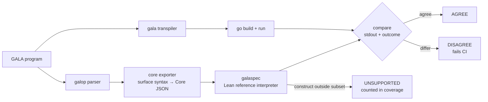
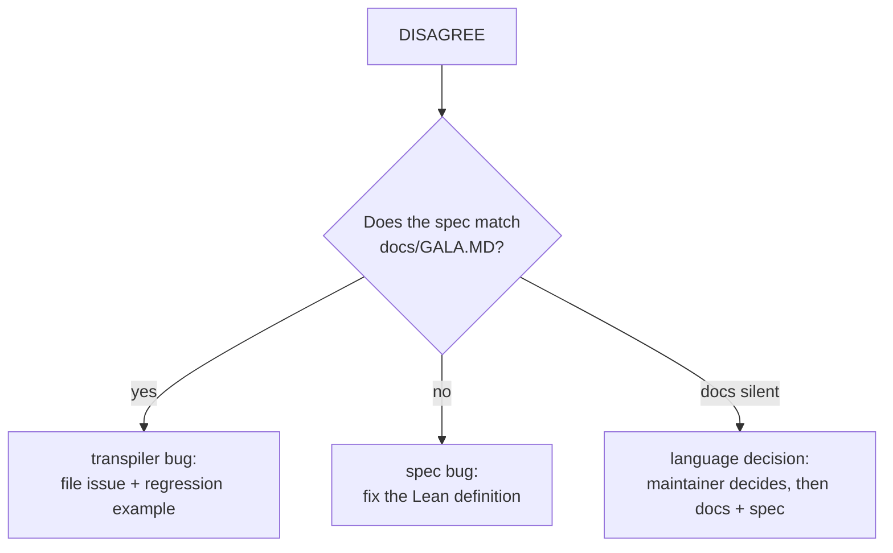
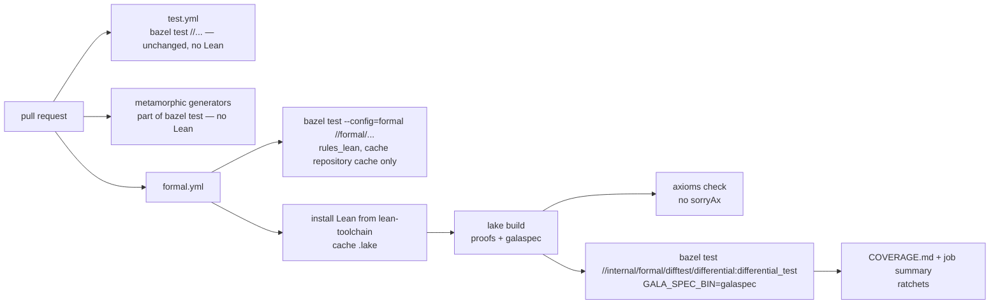
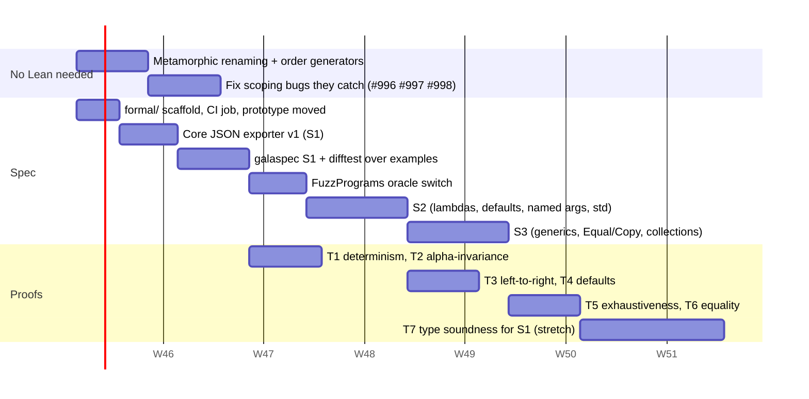

# Formal Semantics and Spec-Based Testing

Status: **design proposal**. Discussion: [#961](https://github.com/martianoff/gala/discussions/961).

This document describes how GALA gets an executable, machine-checked definition of what
programs mean, and how the transpiler is tested against it. Only the first step exists: the
`formal/` project with the match lowering model and its CI job.

## Summary

- We write **GALA's semantics in Lean 4**. A Lean definition says what every supported
  program means. Lean compiles that definition into a **reference interpreter**.
- We **do not model Go**. Generated code is tested by running it: the real transpiler and
  the real Go toolchain run the program, and the reference interpreter must print the
  same output.
- We **prove properties of the language**, not of the transpiler. Examples: names
  resolve to their nearest binding, evaluation runs left to right, and an exhaustive match
  on a constructed value never panics. Lean's kernel checks these proofs.
- **Coverage is partial and is published honestly.** The spec covers a stated subset of
  GALA. Every program outside that subset is counted and reported. It is never silently
  passed.

## Why

GALA has no formal definition. Its meaning is whatever the transpiler emits, and the
documentation describes that in prose. Tests compare against expected outputs that people
wrote, so a wrong expectation enshrines a bug.

A first Lean model of `match` (sealed types, arm order, pattern variables) took about an
hour to write. Writing the lowering down precisely showed that pattern variables leak into
later arms ([#996](https://github.com/martianoff/gala/issues/996)). A targeted search for
the same kinds of bug then found twelve more.

| Issue | Bug | Class |
|---|---|---|
| [#996](https://github.com/martianoff/gala/issues/996) | Match-arm pattern variables leak into later arms | wrong result, scoping |
| [#997](https://github.com/martianoff/gala/issues/997) | Match subject bound to a fixed Go name `obj` | wrong result, scoping |
| [#998](https://github.com/martianoff/gala/issues/998) | Sibling sub-patterns run their extractors after an earlier sibling failed | crash, evaluation |
| [#999](https://github.com/martianoff/gala/issues/999) | Default parameter values resolved in the caller's scope | wrong result, scoping |
| [#1000](https://github.com/martianoff/gala/issues/1000) | Named arguments evaluated in parameter order | wrong result, evaluation |
| [#1001](https://github.com/martianoff/gala/issues/1001) | Operand evaluation order unspecified | needs a decision |
| [#1002](https://github.com/martianoff/gala/issues/1002) | User names captured by generated code (`std`, `panic`, `string`, …) | rejected program, scoping |
| [#1003](https://github.com/martianoff/gala/issues/1003) | Generated declarations collide with user code | rejected program, scoping |
| [#1004](https://github.com/martianoff/gala/issues/1004) | Sealed `Copy` with another variant's field; `Equal` compares inactive fields | wrong result, values |
| [#1005](https://github.com/martianoff/gala/issues/1005) | `==` on a `comparable` type parameter is Go identity | wrong result, values |
| [#1006](https://github.com/martianoff/gala/issues/1006) | Expected type not passed to literals and empty constructors | rejected program, typing |
| [#1007](https://github.com/martianoff/gala/issues/1007) | `Try.Map` does not catch panics; `Try` of a GALA error function | wrong result, std |
| [#1008](https://github.com/martianoff/gala/issues/1008) | Programs that pass GALA's checks but fail in `go build` (collection) | rejected program |

Seven of the thirteen are about **names** or **evaluation order**. Those are exactly the
properties a formal semantics makes precise, and the existing fuzzer cannot see them: its
generator never reuses a name across scopes, and never orders side effects against each
other.

## Architecture



The only code both sides share is the parser. That parser is already fuzzed against the
ANTLR grammar. Everything after it is independent: the spec does its own name resolution,
desugaring and evaluation, and never sees the transformer's output.

### 1. Core JSON exporter (Go)

- **Package:** `internal/formal/coreexport`, a test-support library. It is not a `gala`
  subcommand, so the CLI does not grow.
- **Input:** the galop native tree of one or more files.
- **Output:** JSON for the *surface* syntax of the supported subset, with source positions.
- **It deliberately does not:**
  - resolve names;
  - fill in default arguments;
  - reorder named arguments;
  - desugar `match`.

  Those are the transpiler steps under test, and the spec redoes each of them itself.
- **Type annotations:** the analyzer's inferred types are attached only where meaning
  depends on a type: the width and kind of a numeric literal, and the type an untyped
  constant takes. The spec checks that each annotation is consistent with its own rules.
  This is a known trust point, listed under [What is trusted](#what-is-trusted).
- **Unsupported constructs:** a construct outside the subset is exported as
  `{"unsupported": "<construct>"}`, so the spec can name what is missing.
- **Versioning:** the schema is versioned (`"core": 1`). The Lean decoder rejects a
  version it doesn't know.

### 2. `galaspec`: the semantics in Lean

The semantics lives in a Lake project at `formal/`. Its
[README](../formal/README.md) says what exists today and how to build it. The planned
layout:

```
formal/
  lean-toolchain            pinned Lean version
  lakefile.toml             no Mathlib dependency at the start
  Gala.lean                 root module
  scripts/ProofCheck.lean   fails on sorry and non-standard axioms
  Gala/MatchLowering.lean   the match lowering model (exists today)
  Gala/Syntax.lean          surface AST (mirrors Core JSON)
  Gala/Json.lean            decoder, rejects unknown schema versions
  Gala/Scope.lean           name resolution: binders, shadowing, defaults
  Gala/Eval.lean            big-step semantics with fuel, outcomes below
  Gala/Std/*.lean           models of Option, Either, Try, Println formatting
  Gala/Main.lean            `galaspec run prog.json` → stdout + outcome line
  Gala/Theorems/*.lean      proofs about the semantics
  Gala/*Lowering.lean       optional: small models of individual lowerings
  COVERAGE.md               hand-written now, generated later; see "Coverage"
```

- **What evaluation produces:** printed output plus one outcome: `ok`, `panic <class>`, or
  `fuel`. `fuel` means the interpreter ran out of steps. Such a run is reported as
  inconclusive, never as agreement.
- **Errors are values:** an evaluation error is a result, not a crash. "No arm matched"
  becomes `panic match`, so it can be compared with the Go panic.
- **Executable and provable:** the evaluator is an ordinary Lean function. It runs fast
  enough to serve as an oracle, and theorems can be stated about it directly.
- **Precise where Go is loose:** where Go leaves something unspecified, the spec defines it
  (see [Decisions the spec forces](#decisions-the-spec-forces)).

### 3. Differential harness (Go, under Bazel)

- **Package:** `internal/formal/difftest`.
- **For each input program:**
  1. Export it to Core JSON and run `galaspec`.
  2. Transpile, build and run it with the machinery `FuzzPrograms` already uses.
  3. Compare stdout and outcome. Each comparison is one of four verdicts: `AGREE`,
     `DISAGREE`, `UNSUPPORTED` or `INCONCLUSIVE`.
- **Where `galaspec` comes from:** the `GALA_SPEC_BIN` environment variable. Without it,
  the target fails with a clear message. It never passes silently.
- **Plain `bazel test //...` stays Lean-free:** the target is tagged `manual`, and the
  formal CI job runs it explicitly.



### 4. Program sources

| Source | What it gives | Needs Lean |
|---|---|---|
| **Metamorphic: alpha-renaming.** Rename every local binder to hostile names (`obj`, `_tmp_1`, `std`, `panic`, `string`, `__p0`, and names of other binders in scope). Output must not change. | Catches #996, #997, #999, #1002, #1003 directly. | No |
| **Metamorphic: order tracing.** Wrap operands, named arguments, sub-patterns and guards in tracing calls. The trace must match left-to-right source order, and failed patterns must stop early. | Catches #998, #1000, #1001. | No |
| **`examples/*.gala` with `.out`.** Three-way comparison: spec, `.out` file, Go. | Spec conformance on 400+ real programs; finds `.out` files that enshrine bugs. | Yes |
| **`FuzzPrograms` generator.** Its hand-written model of expected output is replaced by `galaspec`. During the switch, all three are compared. | Endless random programs, with an oracle we can review. | Yes |

The two metamorphic generators are cheap and need no spec at all. They ship first. Their
correctness argument is also a theorem we prove about the spec: *renaming bound variables
does not change a program's meaning*. That ties the test to the proof.

### 5. Theorems

These are proved about the spec, in order of value:

| # | Statement (informal) | Guards against |
|---|---|---|
| T1 | Evaluation is deterministic. | spec bugs |
| T2 | **Alpha-invariance:** renaming bound variables apart does not change the outcome. | #996, #997, #999, #1002 |
| T3 | **Left-to-right:** the effects of operands, arguments (including named ones) and sub-patterns happen in source order. A failed sub-pattern stops the ones after it. | #998, #1000, #1001 |
| T4 | **Default arguments** are evaluated in the callee's scope, with earlier parameters bound. | #999 |
| T5 | **Exhaustiveness:** a well-typed exhaustive match on a value built by a constructor never ends in `panic match`. | match lowering |
| T6 | **Equality:** `Equal` on sealed values is an equivalence that depends only on the active variant's fields. | #1004, #1005 |
| T7 | **Type soundness** for the subset: well-typed programs do not get stuck (stretch goal). | typing bugs |

A theorem counts as **proved** only if it type-checks with no `sorry`, and
`#print axioms` lists only Lean's standard axioms (`propext`, `Quot.sound`,
`Classical.choice`). CI checks both.

### 6. Optional: lowering models

For the riskiest lowerings, a small Lean model of only the Go that GALA emits for them can
be proved correct against the spec. This is *not* a Go semantics. The existing prototype
does this for sealed `match`. It proves that a scoped lowering preserves meaning, and that
the current lowering does not. Candidates are `match`, default and named arguments, and
sealed `Equal`/`Copy`. Each model is about 100–300 lines, and each is opt-in.

## What is trusted

The table is honest about what the guarantees rest on.

| Component | Trusted because | Mitigation |
|---|---|---|
| Lean kernel | Small, widely used | none needed |
| The spec's definitions | They *are* the definition of GALA | Reviewable size; every definition cites its `docs/GALA.MD` section; the 400+ examples are a conformance suite |
| galop parser | Shared by both sides | Already fuzzed against the ANTLR grammar |
| Core JSON exporter | Shared by both sides | A plain syntax dump with no logic; round-trip test (export → print → parse → export) |
| Type annotations from the analyzer | Meaning depends on them | Limited to numeric literal kinds; the spec checks they are consistent |
| Go toolchain and runtime | We run it, not model it | Out of scope |
| The transformer | **Not trusted.** It is what we test | — |

## Coverage

Coverage is reported in three tiers, so nobody reads "tested" as "proved":

- **Modelled:** the construct is in the spec. Programs using it can run through `galaspec`.
- **Tested against the spec:** at least N programs using the construct (examples or
  generated) agree with the spec, and none that galaspec ran to the end disagrees or is
  inconclusive.
- **Proved:** a theorem from the table above covers it.

`formal/COVERAGE.md` is generated in CI and committed with each formal change. It holds:
- a per-construct table with the three tiers;
- the number of examples in each verdict;
- every `UNSUPPORTED` construct, with how often it occurs;
- the list of known disagreements.

The run writes this as the section between the `<!-- difftest:begin -->` and
`<!-- difftest:end -->` markers; `bazel run //internal/formal/difftest/splicecoverage`
puts it into the file and leaves the hand-written rest alone.

**Wording rules for docs, release notes and the README:**
- "Proved" is used only for kernel-checked theorems about the spec.
- "Tested against the spec" is used for differential results.
- Neither is used for constructs outside the subset.
- We never claim the transpiler is verified.

**Ratchets in CI:**
- The number of examples that run fully inside the subset and agree may not go down
  (`internal/formal/difftest/baseline.json`).
- A `DISAGREE` fails the build, unless that exact program appears in
  `internal/formal/difftest/known_disagreements.json` with an **open** issue number. When the issue is
  closed, the CI job requires the entry to be removed.

### Subsets

| Subset | Constructs | Out of scope until later |
|---|---|---|
| S1 | int/bool/string literals and operators; `val`/`var`; `if`; blocks; functions and recursion; structs; sealed types; `match` with nested, tuple, literal and wildcard patterns and guards; `Println`/`Print` with documented formatting | everything else |
| S2 | lambdas and closures; default and named arguments; `Option`/`Either`/`Try` (Lean models of the std behaviour); string interpolation | |
| S3 | generics (erased semantics); `Copy`/`Equal`/`==`; immutable `Array`/`List`/`HashMap` basics; partial functions | |
| Not planned | goroutines, `Future`, channels, Go interop, mutable collections, `use`/`defer`, reflection, performance | stated in COVERAGE.md |

## Decisions the spec forces

The spec must say what Go leaves open and what the docs don't cover. Each of these needs a
maintainer decision before the spec can encode it.

| Question | Decision | Issue |
|---|---|---|
| Operand evaluation order | **Strict left-to-right** for operands, arguments, interpolation parts and literals, as in Scala and Kotlin | [#1001](https://github.com/martianoff/gala/issues/1001) |
| Named arguments | **Source order**: evaluated in the order written, then passed in parameter order | [#1000](https://github.com/martianoff/gala/issues/1000) |
| Function and method defaults | **May refer to earlier parameters** (as in Kotlin). Evaluated in the callee's scope, left to right; the caller's locals are never visible | [#999](https://github.com/martianoff/gala/issues/999) |
| Struct and sealed-case field defaults | **May not refer to other fields**: a compile-time error, as in Scala. Every exported struct keeps its Go `New<T>` constructor | [#999](https://github.com/martianoff/gala/issues/999) |
| `Try(f())`, `Try(() => f())` and `Try(f)` where `f` returns `error` | **A non-nil error is a `Failure`**, whether `f` is a GALA or a Go function | [#1007](https://github.com/martianoff/gala/issues/1007) |
| Do `Try` combinators catch panics? | **Yes** for `Map`, `FlatMap`, `Filter`, `Recover`, `RecoverWith`, `Transform` (as Scala's `Try`); **no** for `ForEach`, `Fold`, `OnSuccess`, `OnFailure` | [#1007](https://github.com/martianoff/gala/issues/1007) |
| `Copy(field = ...)` on a sealed value | **Strict:** on a parent-typed value only fields every case has; otherwise a compile-time error | [#1004](https://github.com/martianoff/gala/issues/1004) |
| Identifiers starting with `_gala_` | **Reserved** for generated code: a compile-time error | [#1002](https://github.com/martianoff/gala/issues/1002) |
| How plain structs print under `Println` and interpolation | **Like sealed values and Scala case classes:** `Pt(1, 2.5)`; collections by contents, nested values recursively; a user `String()` wins | [#1008](https://github.com/martianoff/gala/issues/1008) |
| `if (c) 1 else 2.5` with no declared type | **An error** naming the int vs float64 mismatch, as `match` does (no implicit numeric conversion) | [#1008](https://github.com/martianoff/gala/issues/1008) |
| `%` inside `s"..."` | **Literal text.** Format specs exist only in `f"..."`, as in Scala | — |
| Lambda capture | **By reference**, as in Go, Scala and Kotlin: later assignments to a captured `var` are visible inside the lambda, and the lambda's assignments are visible outside | — |
| `std.Iterable` | **Self-typed** `Iterable[T, C]`: collection-returning methods return `C`, so `Array[T]` implements `Iterable[T, Array[T]]` | [#1011](https://github.com/martianoff/gala/issues/1011) |

## CI and build



- **Lake is the primary Lean build.** Every Go part (the exporter, the harness and the
  generators) is built and tested with Bazel, as AGENTS.md requires.
- **Bazel builds Lean too, opt-in.** [rules_lean](https://github.com/martianoff/rules_lean),
  a separate Bazel module with Windows support, is a dev dependency of the `gala` module
  (so modules that depend on gala never see it). `formal/BUILD.bazel` builds the same
  modules, runs a `lean_proof_test` and the galaspec fixture tests, and links
  `//formal:galaspec` (a `lean_binary`), so `difftest` can depend on it directly.
  `formal.yml` runs `bazel test --config=formal //formal/...` in a job next to the Lake
  one. Lake stays the primary path until the maintainer decides otherwise.
  - **Why opt-in:** a Lean toolchain is about 620 MB to download and 3.3 GB unpacked, and
    every Bazel output base gets its own copy. So:
    - Lean targets sit behind `--config=formal`: without it they are incompatible with
      the target platform, and `bazel build //...` skips them. `formal/lean.bzl` wraps
      the rules_lean rules so that no target can miss the gate;
    - a default `bazel build //...` or `bazel test //...` never fetches Lean;
    - agent worktrees never fetch it either.
  - **One Lean version:** `lean.toolchain(version = …)` in `MODULE.bazel` must match
    `formal/lean-toolchain`. `tools/check_repo_policy.sh` fails when they differ.
  - **Caching:** CI keeps only Bazel's repository cache between runs, which holds the
    downloaded Lean archive. It is private to the repository's CI; see Licensing.
- **Running only for formal changes:** `formal.yml` runs only on PRs that touch `formal/`
  or the Bazel setup the opt-in build depends on (`MODULE.bazel`, `.bazelrc`,
  `.bazelversion`, `.bazelignore`). Once `difftest` exists it also runs for
  `internal/formal/`, `internal/transpiler/` and `std/`, and it is required for those PRs
  once S1 is stable.
- **Local use:** `bazel test --config=formal //formal/...` needs nothing but Bazel. For
  Lake, install Lean with `elan` (it reads `formal/lean-toolchain`), then:

  ```shell
  cd formal && lake build && lake exe galaspec run prog.json
  GALA_SPEC_BIN=$PWD/.lake/build/bin/galaspec bazel test \
    //internal/formal/difftest/differential:differential_test --test_env=GALA_SPEC_BIN
  ```

## Licensing

- **Lean 4 is Apache 2.0**: the compiler, Lake, the core library and the runtime. That is
  the same license as GALA.
- **The release binaries bundle third-party components.** They are listed in the
  toolchain's `LICENSES` file:
  - LLVM/clang: Apache 2.0 with LLVM exceptions
  - CaDiCaL: MIT
  - **GNU MP: LGPL v3**
  - **the GNU C library: LGPL**, in Linux builds
- **The spec and proofs are our own code.** The files in `formal/` are licensed like the
  rest of the repository. Lean's license does not extend to programs written in Lean.

To keep our obligations at zero:

1. **`galaspec` and every other Lean-built binary is a development and CI tool only.**
   None of them ships in GALA releases, the CLI, Docker images or the playground. Shipping
   one would require Lean's Apache NOTICE, and would require letting users relink the
   runtime's LGPL GNU MP code. Any change to this rule needs a maintainer decision first.
2. **The Lean toolchain is never vendored, committed, mirrored or re-hosted.** That means
   no public mirror, no archive committed to the repository, and no published image,
   Bazel mirror or cache that others download from. CI and any Bazel integration fetch
   the pinned release from `releases.lean-lang.org` (GitHub releases as a fallback) and
   verify a pinned SHA-256. Re-hosting it would make us a distributor of its LGPL
   components. A CI-private cache, such as the repository's own GitHub Actions cache, is
   allowed: it is never served to anyone, so it is not distribution.
3. **New Lean dependencies (Lake packages) must be permissively licensed**: Apache 2.0,
   MIT or BSD. Mathlib is Apache 2.0. Check a package's license before adding it.

## Plan

The estimates assume one maintainer working with AI agents. Weeks 1–4 are the commitment;
weeks 5–6 are stretch goals.



| Week | Deliverable | Done when |
|---|---|---|
| 1 | The two metamorphic generators in `internal/transpiler/fuzz`. `formal/` scaffold with the match prototype; `formal.yml` builds it and checks axioms. | The generators reproduce #996–#1003 on `master`, and their failing cases are committed as seeds. |
| 2 | Core JSON exporter for S1; `galaspec` S1; `difftest` over `examples/`; first `COVERAGE.md`. Fixes for #996, #997, #998. | Baseline coverage published; zero unexplained `DISAGREE`. |
| 3 | `FuzzPrograms` uses `galaspec` as its oracle. Theorems T1 and T2. Decisions on #1000, #1001 and #999. | T1 and T2 proved; fuzzing runs against the spec in CI. |
| 4 | S2 in the spec. Theorems T3 and T4. Fixes for #999 and #1000. | Lambdas, defaults and named arguments are modelled, tested against the spec, and T3/T4 are proved. |
| 5–6 (stretch) | S3; theorems T5 and T6; T7 for S1; a lowering model for the fixed `match`. | As in the tables above. |

**Risks:**
- **The spec is wrong.** Mitigation: the three-way check against `.out` files; a reviewer
  reads every definition next to `docs/GALA.MD`.
- **Proof effort is underestimated.** Mitigation: theorems are optional per week, and
  testing against the spec delivers value without them.
- **Language churn.** Mitigation: the spec covers a stated subset; new features start as
  `UNSUPPORTED` and are reported, not hidden.
- **Lean expertise.** Mitigation: no Mathlib; plain functional definitions in the style
  of the prototype. AI agents write most proofs, and the kernel checks them.
