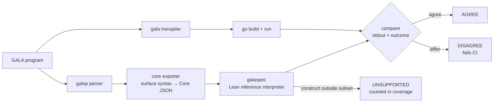
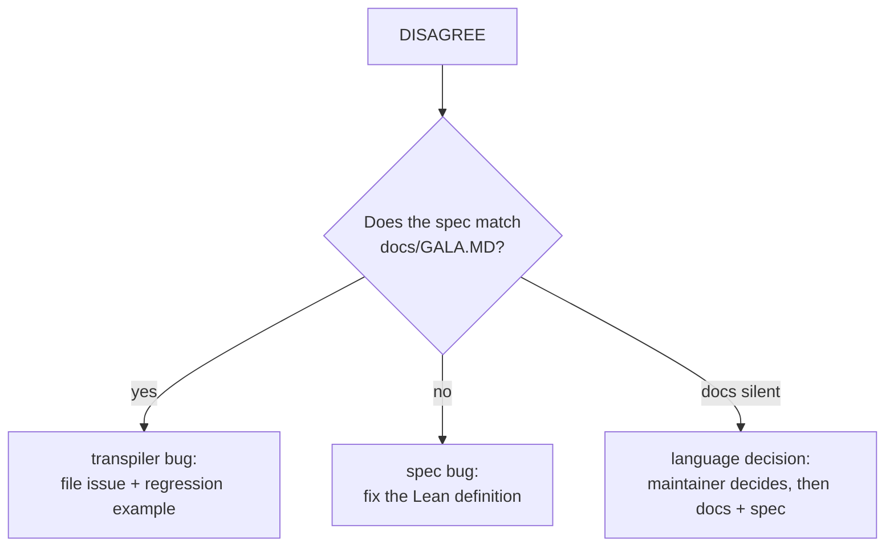
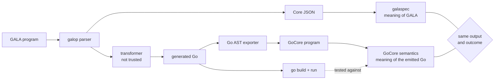
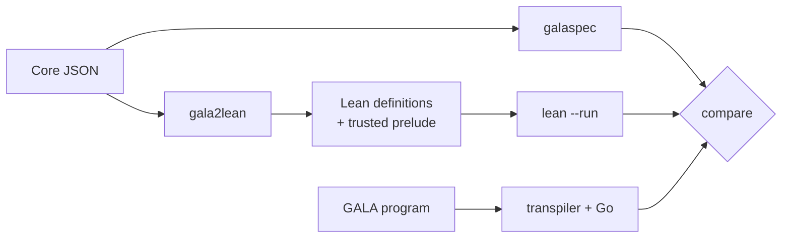
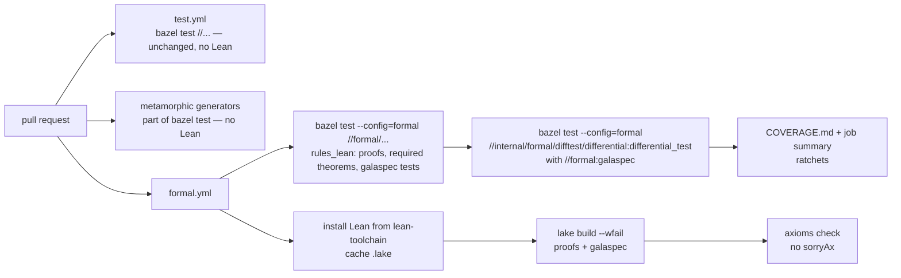
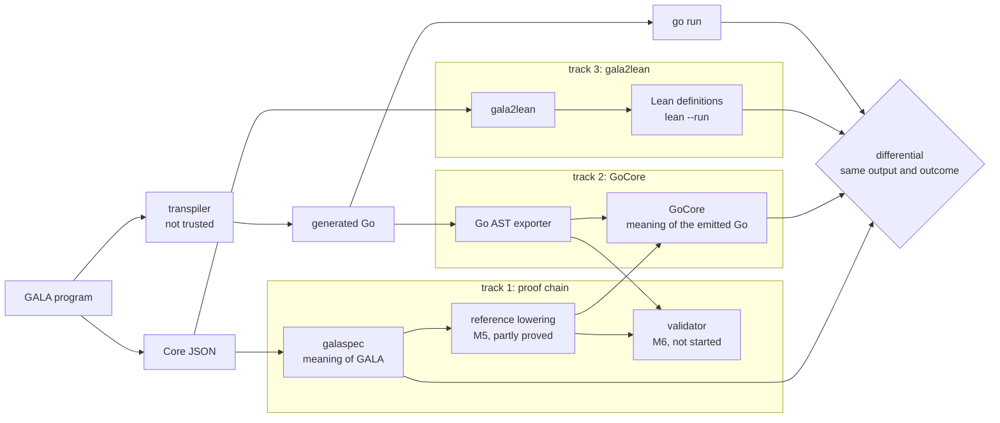
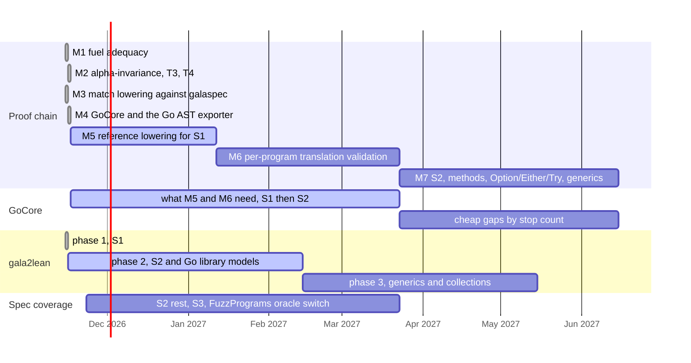

# Formal Semantics and Spec-Based Testing

Status: **design proposal, partly built**. Discussion: [#961](https://github.com/martianoff/gala/discussions/961).

This document describes how GALA gets an executable, machine-checked definition of what
programs mean, and how the transpiler is tested against it. What exists today (the
reference interpreter, the differential harness, gala2lean, and the theorems proved so
far) is listed in [formal/COVERAGE.md](../formal/COVERAGE.md).

## Summary

- We write **GALA's semantics in Lean 4**. A Lean definition says what every supported
  program means. Lean compiles that definition into a **reference interpreter**.
- **Today, generated code is tested by running it**: the real transpiler and the real Go
  toolchain run the program, and the reference interpreter must print the same output.
  We do not model Go as a whole.
- **The goal is a proof** that a GALA program and the Go the transpiler emits for it mean
  the same thing. We get there in milestones
  ([Theorems](#5-theorems-the-road-to-an-end-to-end-proof)): first properties of the
  spec itself, then a Lean model of only the Go subset the transpiler emits (GoCore), then
  a check of the transpiler's actual output against a lowering proved correct, one
  program at a time. Lean's kernel checks the proofs. Most of this is not done yet;
  [COVERAGE.md](../formal/COVERAGE.md) lists what is proved.
- **Coverage is partial and is published honestly.** The spec covers a stated subset of
  GALA. Every program outside that subset is counted and reported. It is never silently
  passed.

## Why

GALA has no formal definition. Its meaning is whatever the transpiler emits, and the
documentation describes that in prose. Tests compare against expected outputs that people
wrote, so a wrong expectation enshrines a bug.

A first Lean model of `match` (sealed types, arm order, pattern variables) took about an
hour to write. Writing the lowering down precisely showed that pattern variables leak into
later arms ([#996](https://github.com/martianoff/gala/issues/996)). A targeted search for
the same kinds of bug then found twelve more.

| Issue | Bug | Class |
|---|---|---|
| [#996](https://github.com/martianoff/gala/issues/996) | Match-arm pattern variables leak into later arms | wrong result, scoping |
| [#997](https://github.com/martianoff/gala/issues/997) | Match subject bound to a fixed Go name `obj` | wrong result, scoping |
| [#998](https://github.com/martianoff/gala/issues/998) | Sibling sub-patterns run their extractors after an earlier sibling failed | crash, evaluation |
| [#999](https://github.com/martianoff/gala/issues/999) | Default parameter values resolved in the caller's scope | wrong result, scoping |
| [#1000](https://github.com/martianoff/gala/issues/1000) | Named arguments evaluated in parameter order | wrong result, evaluation |
| [#1001](https://github.com/martianoff/gala/issues/1001) | Operand evaluation order unspecified | needs a decision |
| [#1002](https://github.com/martianoff/gala/issues/1002) | User names captured by generated code (`std`, `panic`, `string`, …) | rejected program, scoping |
| [#1003](https://github.com/martianoff/gala/issues/1003) | Generated declarations collide with user code | rejected program, scoping |
| [#1004](https://github.com/martianoff/gala/issues/1004) | Sealed `Copy` with another variant's field; `Equal` compares inactive fields | wrong result, values |
| [#1005](https://github.com/martianoff/gala/issues/1005) | `==` on a `comparable` type parameter is Go identity | wrong result, values |
| [#1006](https://github.com/martianoff/gala/issues/1006) | Expected type not passed to literals and empty constructors | rejected program, typing |
| [#1007](https://github.com/martianoff/gala/issues/1007) | `Try.Map` does not catch panics; `Try` of a GALA error function | wrong result, std |
| [#1008](https://github.com/martianoff/gala/issues/1008) | Programs that pass GALA's checks but fail in `go build` (collection) | rejected program |

Seven of the thirteen are about **names** or **evaluation order**. Those are exactly the
properties a formal semantics makes precise, and the existing fuzzer cannot see them: its
generator never reuses a name across scopes, and never orders side effects against each
other.

## Architecture



The only code both sides share is the parser. That parser is already fuzzed against the
ANTLR grammar. Everything after it is independent: the spec does its own name resolution,
desugaring and evaluation, and never sees the transformer's output.

### 1. Core JSON exporter (Go)

- **Package:** `internal/formal/coreexport`, a test-support library. It is not a `gala`
  subcommand, so the CLI does not grow.
- **Input:** the galop native tree of one or more files.
- **Output:** JSON for the *surface* syntax of the supported subset, with source positions.
- **It deliberately does not:**
  - resolve names;
  - fill in default arguments;
  - reorder named arguments;
  - desugar `match`.

  Those are the transpiler steps under test, and the spec redoes each of them itself.
- **Type annotations:** the analyzer's inferred types are attached only where meaning
  depends on a type: the width and kind of a numeric literal, and the type an untyped
  constant takes. The spec checks that each annotation is consistent with its own rules.
  This is a known trust point, listed under [What is trusted](#what-is-trusted).
- **Unsupported constructs:** a construct outside the subset is exported as
  `{"unsupported": "<construct>"}`, so the spec can name what is missing.
- **Versioning:** the schema is versioned (`"core": 1`). The Lean decoder rejects a
  version it doesn't know.

### 2. `galaspec`: the semantics in Lean

The semantics lives in a Lake project at `formal/`. Its
[README](../formal/README.md) says what exists today and how to build it. The planned
layout:

```
formal/
  lean-toolchain            pinned Lean version
  lakefile.toml             no Mathlib dependency at the start
  Gala.lean                 root module
  scripts/ProofCheck.lean   fails on sorry and non-standard axioms
  Gala/GoCore.lean          the Go fragment M3's match lowering targets
  Gala/GoCore/*.lean        GoCore for whole programs (M4): the Go subset the transpiler emits
  GoCoreMain.lean           `gocore run prog.json` → stdout + outcome line
  Gala/MatchLower.lean      M3: the match lowering into GoCore, proved against galaspec
  Gala/Syntax.lean          surface AST (mirrors Core JSON)
  Gala/Json.lean            decoder, rejects unknown schema versions
  Gala/Scope.lean           name resolution: binders, shadowing, defaults
  Gala/Eval.lean            big-step semantics with fuel, outcomes below
  Gala/Std/*.lean           models of Option, Either, Try, Println formatting
  Gala/Main.lean            `galaspec run prog.json` → stdout + outcome line
  Gala/Theorems.lean        proofs about the semantics
  Gala/Fuel.lean            T1, fuel adequacy
  Gala/Statements.lean      the pinned statements of the theorems COVERAGE.md calls proved
  Gala/*Lower*.lean         models of individual lowerings; they become the reference lowering (M3, M5)
  COVERAGE.md               hand-written now, generated later; see "Coverage"
```

- **What evaluation produces:** printed output plus one outcome: `ok`, `panic <class>`, or
  `fuel`. `fuel` means the interpreter ran out of steps. Such a run is reported as
  inconclusive, never as agreement.
- **Errors are values:** an evaluation error is a result, not a crash. "No arm matched"
  becomes `panic match`, so it can be compared with the Go panic.
- **Executable and provable:** the evaluator is an ordinary Lean function. It runs fast
  enough to serve as an oracle, and theorems can be stated about it directly.
- **Precise where Go is loose:** where Go leaves something unspecified, the spec defines it
  (see [Decisions the spec forces](#decisions-the-spec-forces)).

### 3. Differential harness (Go, under Bazel)

- **Package:** `internal/formal/difftest`.
- **For each input program:**
  1. Export it to Core JSON and run `galaspec`.
  2. Transpile, build and run it with the machinery `FuzzPrograms` already uses.
  3. Compare stdout and outcome. Each comparison is one of four verdicts: `AGREE`,
     `DISAGREE`, `UNSUPPORTED` or `INCONCLUSIVE`. A run that stops `unsupported` after
     printing (galaspec's, gala2lean's or GoCore's) is `UNSUPPORTED` only when what it
     printed is a prefix of what Go printed, and `DISAGREE` otherwise, so a stop cannot
     hide an earlier wrong line. The check is skipped, and the stop is `UNSUPPORTED`,
     only where Go's output is missing or may be cut short: a rejected program, a
     time-out, a crash for lack of stack or memory, or a kill by a signal.
  4. From M4, for a program that compiles: export the Go it ran, with the Go of the GALA
     packages it imports, to GoCore JSON, run `gocore`, and compare it with `go run` of the
     same Go: stdout, and how it ends, a panic by the exact text Go prints. This is GoCore's
     own lane, with one more verdict, `RESOURCE`: a run Go aborted for lack of stack or
     memory, or that ran past its time limit, reported and never compared. A GoCore
     `DISAGREE` is a GoCore or exporter bug, never listed as a known disagreement: it fails
     the run until it is fixed or the construct is reported as unsupported.
     `//formal:gocore` comes in as `//formal:galaspec` does, or from `GALA_GOCORE_BIN`.
- **Where `galaspec` comes from:** under `--config=formal`, `//formal:galaspec`, built with
  rules_lean, is a data dependency of the target. Without the config, the
  `GALA_SPEC_BIN` environment variable names one instead, e.g. a Lake-built galaspec
  (it also wins under the config). With neither, the target fails with a clear message.
  It never passes silently.
- **Plain `bazel test //...` stays Lean-free:** the target is tagged `manual`, it refers
  to `//formal:galaspec` only under `--config=formal`, and the formal CI job runs it
  explicitly.



### 4. Program sources

| Source | What it gives | Needs Lean |
|---|---|---|
| **Metamorphic: alpha-renaming.** Rename every local binder to hostile names (`obj`, `_tmp_1`, `std`, `panic`, `string`, `__p0`, and names of other binders in scope). Output must not change. | Catches #996, #997, #999, #1002, #1003 directly. | No |
| **Metamorphic: order tracing.** Wrap operands, named arguments, sub-patterns and guards in tracing calls. The trace must match left-to-right source order, and failed patterns must stop early. | Catches #998, #1000, #1001. | No |
| **`examples/*.gala` with `.out`.** Three-way comparison: spec, `.out` file, Go. | Spec conformance on 400+ real programs; finds `.out` files that enshrine bugs. | Yes |
| **`FuzzPrograms` generator.** Its hand-written model of expected output is replaced by `galaspec`. During the switch, all three are compared. | Endless random programs, with an oracle we can review. | Yes |

The two metamorphic generators are cheap and need no spec at all. They ship first. Their
correctness argument is also a theorem we plan to prove about the spec (T2): *renaming bound variables
does not change a program's meaning*. That ties the test to the proof.

### 5. Theorems: the road to an end-to-end proof

The goal is a proof, not a test, that a GALA program and the Go program the transpiler
emits for it mean the same thing: the same output and the same outcome. We get there in
milestones. Each one makes a claim that is true on its own, names what it still trusts,
and removes something from that list or widens the subset.

Three semantics are involved:

- **galaspec** (`Gala/Eval.lean`): what a GALA program means. It is the definition, so
  it is trusted by construction; it is checked against `docs/GALA.MD` by review and
  against Go by the differential run.
- **GoCore** (`formal/Gala/GoCore.lean`; M3 adds the fragment `match` lowers to, M4 and
  M5 the rest): a Lean semantics of the *subset of Go the transpiler emits* for
  the covered GALA subset. It is not a semantics of Go. That real Go behaves as GoCore
  says is an assumption, tested by running GoCore on the transpiler's output next to
  `go run` (a fourth oracle).
- **The transformer's actual output**, read back from the generated Go (`go/ast`) into
  GoCore syntax by a small exporter.



#### The theorems

These are the properties of the spec the milestones prove (T1–T7), with the bugs each
guards against. T1 is proved for all of galaspec (`run_fuel_adequate` in
`formal/Gala/Fuel.lean`), T2 for renamings of local binders (`run_alpha` in
`formal/Gala/AlphaProg.lean`, see M2), T3 given what each part does (`formal/Gala/Order.lean`, see M2),
and T4 for the defaults phase of a call (`bindDefaults_callerLocals` and
`defaultFrame_lookup`, see M2). M3's `match` lowering is proved against galaspec
(`lowerMatch_correct` in `formal/Gala/MatchLower.lean`);
[formal/COVERAGE.md](../formal/COVERAGE.md#what-is-proved) lists what is proved.

| # | Statement (informal) | Guards against | Milestone |
|---|---|---|---|
| T1 | **Fuel adequacy and monotonicity:** if a run with fuel `n` ends in anything but `fuel`, every run with more fuel ends the same way and prints the same output. (Plain determinism holds of any Lean function and says nothing.) | an `AGREE` or `DISAGREE` verdict that changes with more fuel | M1 |
| T2 | **Alpha-invariance:** a capture-avoiding renaming of bound variables does not change the output or the outcome (see M2 for the side conditions). | #996, #997, #999, #1002 | M2 |
| T3 | **Left-to-right**, stated on what a program does, not on the evaluator's definition: the output and effects of an operand list, a call (named arguments included), a compound assignment and a pattern are those of its parts, in source order. A failed sub-pattern stops the ones after it, and a failed `match` arm leaves only its guard's effects. | #996, #998, #1000, #1001 | M2 |
| T4 | **Default arguments** are evaluated in the callee's scope, with earlier parameters bound. | #999 | M2 |
| T5 | **Exhaustiveness:** a well-typed exhaustive match on a value built by a constructor never ends in `panic match`. Needs a typing judgment, which the spec does not have. | match lowering | not scheduled |
| T6 | **Equality:** `Equal` on sealed values is an equivalence that depends only on the active variant's fields. | #1004, #1005 | M7 |
| T7 | **Type soundness** for the subset: well-typed programs do not get stuck. Needs a typing judgment too. | typing bugs | not scheduled |

A theorem counts as **proved** only if it type-checks with no `sorry`, and
`#print axioms` lists only Lean's standard axioms (`propext`, `Quot.sound`,
`Classical.choice`). CI checks both. Its statement is pinned in
`formal/Gala/Statements.lean`.

#### The milestones

Throughout, galaspec's definitions and Lean's kernel are trusted. The "Also trusted"
column lists what each milestone's claim rests on beyond them.

| # | Milestone | Claim it lets us make | Also trusted | Size |
|---|---|---|---|---|
| M1 | Fuel adequacy (T1) | galaspec's answer for a program never depends on the fuel budget, except that too little fuel ends in `fuel` | nothing | 2–3 weeks |
| M2 | Alpha-invariance, left-to-right, defaults (T2–T4) | for the subset galaspec models (S1 plus lambdas, closures, named arguments and defaults), renaming bound variables apart never changes what galaspec says a program does, its effects happen in source order, and a default sees only the callee's earlier parameters | nothing | 6–8 weeks |
| M3 | Match lowering against galaspec | the scoped `match` lowering, into a first fragment of GoCore, is correct with respect to galaspec itself (not a separate toy semantics), for every S1 pattern form | that the lowering describes what the transformer emits; that the subject, guards and bodies are lowered correctly (M5); that the subject has the inferred static type (T7) | 3–4 weeks |
| M4 | GoCore and the Go AST exporter | for every S1 program in the corpus, GoCore run on the transformer's *actual* output agrees with galaspec and with `go run` (tested, not proved) | parser, interpolation splitter, analyzer annotations, both exporters, GoCore's fidelity to Go | 5–8 weeks |
| M5 | Reference lowering for all of S1 | a lowering from galaspec's syntax to GoCore, covering everything the transformer emits for S1, is proved to preserve meaning for every program it lowers (how many it lowers is reported) | that the lowering describes what the transformer emits; GoCore's models and `stdExcerpt` (see M5) | 6–9 weeks |
| M6 | Per-program translation validation | for each S1 program the validator accepts, every run of it that galaspec ends `ok` or in a panic is proved to have the same output and outcome as the Go the transformer emitted, run in GoCore | as M4, plus the validator's run (kernel or compiled Lean) | 8–12 weeks |
| M7 | Widening the subset | M6's claim for S2 (lambdas, defaults, named arguments, interpolation), then methods, `Option`/`Either`/`Try` and generics | as M6 | 2–4 weeks per construct family |

#### M1: fuel adequacy (an oracle we can trust)

- **Claim:** galaspec's result does not depend on the fuel budget once it is large
  enough; `fuel` only ever means "not enough fuel".
- **Statement:** for every program `p` and fuels `n ≤ m`, if `(run p n).1` is not
  `.fuel` then `run p m = run p n`. `run` passes the same number to `runM` as the
  recursion depth of `eval` and as its step count, so the lemma for each function of
  `eval`'s mutual block says: unless the smaller budget ran out, more depth and more
  steps give the same result and the same final state, except for the steps left.
- **What it gives:** an `AGREE` or `DISAGREE` verdict is about the program's meaning, not
  about the budget the harness chose. It says nothing about a run that ends in `fuel`:
  `INCONCLUSIVE` stays inconclusive, since more fuel might end it any way.
- **Status: done.** `run_fuel_adequate` in `formal/Gala/Fuel.lean`, pinned in
  `Statements.lean`, covers all of `run`: `eval`'s mutual block, `initGlobals` and
  `runM`. The code that cannot spend steps runs in a monad without them (`H` in
  `Eval.lean`), so it acts the same whatever the fuel by its type, the heap included;
  `tick` is the only code that spends steps; and `runIn`'s `return` handler is shown to
  pass `fuel` on, which catching needs.

#### M2: alpha-invariance, left-to-right and defaults

- **Claim:** for the subset galaspec models (S1 plus lambdas, closures, named arguments
  and defaults), renaming bound variables apart never changes galaspec's output or
  outcome; operands, arguments and sub-patterns take effect in source order; a default
  value sees only the callee's earlier parameters.
- **Statement (T2):** `run (rename σ p) n ≈ run p n`, where `≈` means the same output and
  the same outcome up to the text of `stuck` and `unsupported` messages (those name
  variables, so renaming changes them). `σ` renames each binder together with the
  occurrences it binds, and must be capture-avoiding: no occurrence ends up bound by a
  different binder, and no free name (a builtin such as `Println` included) ends up bound
  by one. Shadowing is allowed, so two binders in different scopes may get one
  name. In addition, galaspec's name resolution needs:
  - a binder is never renamed to `_`, which binds nothing;
  - a binder is never renamed to the name of a package-level declaration (function,
    `val`/`var`, struct or sealed case): pattern names count as mentions when
    galaspec orders package-level initialization (`mentions`), and a bare pattern name
    that names a case of the subject's type is a case test;
  - the renaming keeps every name capitalized exactly when it was: a capitalized
    pattern name with a binding in scope is a stable identifier (`classifyPatName`),
    so a lowercase binder renamed to a capitalized one could turn a later pattern
    binder into a comparison;
  - renaming a function's parameter renames the named arguments at its call sites too,
    since `bindArgs` resolves `name = value` by parameter name;
  - binders inside a struct or sealed case field's default value are not renamed, and such
    a default may not pass a named argument whose name the callee's parameter renaming
    changes (it is evaluated in each program's own declarations, so equal text is not
    enough);
  - only the shapes the parser produces are related: a declaration as a block statement,
    a named argument as a call's argument.

  Renaming top-level declarations consistently is a separate lemma, not proved.
- **What it gives:** a renaming the metamorphic generator makes that meets these
  conditions cannot change galaspec's answer (the generator is checked against them on
  generated programs, see T2 below, not proved to meet them). It gives a
  binder a hostile name (another binder's in scope, `std`, `panic`, …) only where every
  reference still resolves to its own binder, which is capture avoidance; M2 also checks
  its renamings against the remaining conditions above. A renaming that changes Go's
  output is then a transpiler bug, never a spec artefact.
- **T2: done** (`formal/Gala/AlphaProg.lean`). `run_alpha`: for programs related by
  `AlphaProgram` and every fuel, `run` gives exactly the same output and the same outcome
  up to the text of `unsupported` and `stuck`. `AlphaProgram` relates the declarations
  `run` sees in order (files and declarations correspond one to one) and states the
  conditions above; renamed binders are lowercase on both sides, which is stricter than
  keeping the capitalization. Not covered: renaming top-level declarations, binders inside
  a struct or case field's default, and shapes the parser does not produce. galaspec's
  `alpha` command runs a checker, `alphaCheck`, proved sound (`alphaCheck_sound`): a pair
  it accepts is related, so it runs the same way. A test runs the generator's renamings of
  local binders through it, on a fixed batch of generated programs
  (`internal/transpiler/fuzz/alpha_check_test.go`: `FuzzAlphaRenaming`'s generator with
  the top-level names kept), and checks it rejects a capturing renaming. So the
  generator's local renamings are tested against T2's conditions, not proved to meet them
  for every input; its renaming of top-level functions to builtin names is not covered by
  T2. Making galaspec's initialization order provable needed
  `mentions` to be total; it now expands each default value at most once per chain of
  defaults, which gives the same names, since a default is expanded in a scope fixed by
  its callee and slot (#1200).
- **T3: done** (`formal/Gala/Order.lean`): given what each part does, a compound does its
  parts in source order, for operand lists, `&&`/`||`, a call's arguments, compound
  assignment, sub-patterns and `match` arms (#996). `if`, blocks, declarations and calls of
  function values have no theorem.
  [formal/COVERAGE.md](../formal/COVERAGE.md#what-is-proved) states each one and what is
  not covered.
- **T4: done.** The defaults phase of a call (`bindDefaults`) does not read the caller's
  locals (`bindDefaults_callerLocals`), and the frame `defaultFrame` binds exactly the
  parameters it is given (`defaultFrame_lookup`). That `bindDefaults` gives it the earlier
  parameters, with the values the call gave them, is `bindDefaults`'s definition, not a
  theorem; so is that the written arguments come before the defaults, and an ordering
  claim is T3's.
  [formal/COVERAGE.md](../formal/COVERAGE.md#what-is-proved) states both in full.
- **Risk:** the renaming must commute with `resolve`, pattern classification, closures'
  captured scopes and default frames. A state relation (environments renamed, heap equal)
  carries the induction. Needs M1's lemmas.

#### M3: the match lowering against galaspec

- **Claim:** the scoped lowering of `match` (the transformer's shape: a temporary for the
  subject, an `Unapply` per arm, binders scoped to their arm, a panic at the end) is
  correct with respect to galaspec, for every S1 pattern form: nested, literal,
  wildcard, tuple and extractor patterns, bare case names, stable identifiers, and
  guards.
- **Statement:** a lowering `lowerMatch` from galaspec's syntax to a first fragment of
  GoCore, and `GoCore.geval (lowerMatch e) ≈ Spec.eval e` under an environment relation.
- **What it removed:** the earlier prototype, `MatchLowering.lean`, proved a match
  lowering correct against a separate toy source semantics that no theorem tied to
  galaspec. It is gone, with its theorems `compile_correct` and `program_correct`.
- **Status: proved** (`formal/Gala/MatchLower.lean`, `lowerMatch_correct`), relative to
  the match's parts, as T3 is: *given that the subject, guards and bodies are lowered
  correctly*, the scoped lowering into GoCore is correct with respect to galaspec, as
  forward simulation from galaspec's values and panics, for every S1 pattern form and
  guards. The `Part` hypotheses on the parts, which are holes in GoCore, are also what keep
  a call's evaluation order relative to a variable read unobservable (Go fixes the order
  only among calls); M5 has to establish them. A `return` inside an arm is left to M5. By
  M1, "not out of fuel" is a property of the program, so no fuel corollary is needed.
  `lowerMatch_instance` meets every hypothesis on a match with literal, binder and wildcard
  patterns (a guard or a body that reads a pattern variable needs typed locals, T7), and
  `leaky_not_correct` restates #996 against galaspec (10 against 6).
  [formal/COVERAGE.md](../formal/COVERAGE.md#what-is-proved) states each theorem in full.
- **Stated gap:** the subject has the static type the transformer inferred (`HasTy`);
  galaspec classifies a bare pattern name at run time, the transformer statically.
  Discharging it needs a typing judgment (T7).
- **Still trusted:** that the lowering describes what the transformer emits, up to the
  six normalizations M6 has to prove (see M6).

#### M4: GoCore and the Go AST exporter

- **Claim (tested, not proved):** for each S1 program in the corpus, GoCore run on the
  transformer's actual output prints what galaspec prints and ends the same way, and
  prints what `go run` prints.
- **What is built:**
  - GoCore: int64 arithmetic with Go's wrapping, division and shift rules; `if`; blocks
    and `:=`; function calls; structs; the sealed parent struct with its variant tag;
    `Unapply` returning an `Option`; `panic`; package-level initialization; and `fmt`'s
    printing of the values S1 has.
  - An exporter from the generated Go's `go/ast` to GoCore JSON. Nothing is dropped; a
    construct outside GoCore is reported by GoCore when a run reaches it.
- **What it changes:** the link to the real transformer exists; until M6 it is tested.
- **Status: done (tested, not proved).** Here the S1 corpus is the examples galaspec runs
  to the end. On all 29 examples where galaspec agrees with `go run`, GoCore run on the
  transformer's output agrees with `go run` too, and GoCore disagrees with `go run` on no
  program. Widening GoCore beyond S1 is the GoCore track of
  the [Plan](#plan).
  - **The exporter is built:** `internal/formal/gocoreexport`. It is a syntax dump in
    which every Go construct has its own kind. Which of them GoCore runs is decided on
    the Lean side alone.
  - **GoCore for whole programs is built:** `formal/Gala/GoCore/*.lean`, in the namespace
    `Gala.GoCore.Full`, run by the `gocore` binary.
    - It runs the exported Go as Go: the program's sealed types, `Unapply`, `Equal` and
      `String` methods, and the standard library's generated Go (`Option`, `Immutable`,
      tuples).
    - Each construct cites the Go spec section it follows.
    - Its evaluator is total, by structural fuel.
    - Only `fmt` and the hand-written, reflective standard-library functions it names
      are models. A few files of Go's standard library (`errors.go`, `strconv/atoi.go`, `quote.go`, `isprint.go`,
      `unicode/utf8/utf8.go`, `slices/sort.go`, `zsortanyfunc.go`, `cmp/cmp.go`, `math/bits/bits.go`,
      `bits_tables.go`), which import only each other or packages fmt depends on whose own
      initialization does nothing, are not modelled at all: their own source, from the pinned
      toolchain, runs with the program (`gocoreexport.RunnableStdlib`). A name those files
      lack ends the run `unsupported`, never stuck. This is tested, not proved, by
      `TestPartialPackageUnsupported` on a call of `errors.Is`, on `errors.Is` as a
      function value, and on `bits.Div` reaching `divideError` of the omitted
      `bits_errors.go`, with the document built from the pinned toolchain at test time.
      Running only some of a package's files leaves its other initializers out, which is
      right for a package whose initialization prints nothing and cannot panic. So GoCore's
      list of such packages (`quietInitPackages`) holds galaspec's (`noOutputInitImports`)
      and also `cmp`, `math/bits` and `slices`. Its comment gives the evidence for those
      three. The spec runs none of their code and does not trust them.
    - Floats are IEEE 754, one rounding per operation to the type's width, with untyped
      constants exact; Lean's `Float` is opaque to its kernel, so float code is tested
      only, never proved (see [What is trusted](#what-is-trusted)).
    - Slices, arrays and variadic calls are Go's: slices share their underlying array,
      index and slice expressions panic with Go's text. What the spec leaves to the
      implementation, the capacity a growing `append` gives, is gc's, in a module of
      its own (`formal/Gala/GoCore/GcRuntime.lean`; see [What is trusted](#what-is-trusted)).
    - Maps of integer, string and boolean keys are Go's: shared by reference, nil maps
      read as empty and panic on a store, `fmt` prints them sorted by key as
      `internal/fmtsort` does. Go leaves the order of a `range` over a map unspecified, so
      GoCore never picks one. A range over a map of two or more entries ends the run
      `unsupported`, and so does one that adds a key while it ranges. gc builds a map
      literal by storing its constant entries first, then the others, which its order
      pass may move ahead of the statement. GoCore does not model that move, so it runs
      only literals whose entries are all constants. Other key types are unsupported too.
    - Types declared in a function body are Go's: each declaration is one type, however
      often it runs, named by where its name is written (the exporter's `namePos`, which
      `//line` directives do not move), and in a generic function one type per
      instantiation. A local type's name is in scope from its spec on and shadows outer
      names. GoCore prints it as Go does, without its site. A generic local type, which
      gc 1.25.5 accepts, is not modelled: the run stops `unsupported` at its declaration.
    - Type inference is a subset of Go's: every equation GoCore uses is one Go has, so
      when it binds every type parameter it reaches the type arguments Go does; where it
      cannot, the run stops `unsupported` (Go's joint step over a generic function
      argument and an untyped constant, constraint type inference through a core type
      or through methods). Tested, not proved.
  - **The differential lane is built** (see [Differential harness](#3-differential-harness-go-under-bazel)):
    every compiled program's Go runs through GoCore and is compared with `go run`. In the
    CI run that set the baselines, GoCore agrees with `go run` on 388 programs that
    compile (354 examples, 34 generated), and on 29 examples galaspec agrees with
    `go run` too. It stops `unsupported` on the rest, naming the construct, and none
    disagrees. Tested, not proved. Both counts are ratchets (`gocore_fidelity_agreeing`,
    `gocore_agreeing_examples`); the current numbers are in the "GoCore" part of
    [COVERAGE.md](../formal/COVERAGE.md#differential-testing).
  - **Two GoCore semantics until M5:** `formal/Gala/GoCore.lean`, the fragment M3's
    `match` lowering targets, with abstract sealed values and pattern primitives, and
    this one, with the flat layout. M5's reference lowering targets this one, and M3's
    fragment is retired then, as the toy match model was. No theorem links the two
    before that.
- **Risk:** the transformer emits incidental shapes (helper calls, immutability wrappers,
  generated `String` methods) that GoCore must cover; `fmt` is the largest single model.
  GoCore has no stack limit, while Go aborts a deep recursion with a fatal stack
  overflow: a run Go aborts for lack of stack or memory is outside every claim here, and
  the differential run reports such runs instead of comparing them.

#### M5: the reference lowering for all of S1

- **Claim:** a lowering `lower : Spec.Program → Option GoCore.Program` that produces the
  shapes the transformer emits (M4 shows which) preserves meaning for every S1 program
  it lowers. It is partial (see [the target](#the-target)); how much of S1 it lowers is
  reported, not assumed.
- **Statement:** for every S1 program `p` whose galaspec run ends `ok` or in a panic,
  `GoCore.run (lower p)` ends the same way with the same output, and a program that runs
  out of every fuel budget in one runs out in the other. It generalizes M3 from `match`
  to arithmetic, `if`, blocks, calls, structs, sealed values, package-level
  initialization and printing. [The statement](#the-statement) below makes this precise:
  GoCore's run without its depth cap, relative to `stdExcerpt`, for every operand order
  Go allows.
- **Risk:** printing and initialization order are the largest proofs; GoCore's `fmt`
  model has to be exact for the theorem to say anything about real output.
- **Status: in progress.** Step 2a is proved: call-free expressions
  (`expr_correct` in `formal/Gala/M5/Expr.lean`, with `eval_pure` in
  `formal/Gala/M5/SpecPure.lean`). From related states, galaspec's evaluation of a
  call-free expression the lowering accepts leaves the state the program sees as it was
  (it spends steps), and wherever it ends with a value or a panic, GoCore's evaluation of
  the lowering, at every depth from a bound on, gives a related value of the
  expression's kind or the same panic, leaving GoCore's state as it was. Nothing is
  claimed when galaspec runs out of fuel or stops `stuck` or `unsupported`.
  `expr_correct_instance` meets every hypothesis, on `x + 1`. It covers
  literals, locals, parentheses, unary `-` `+` `^` `!`, `+ - * / %` and comparisons on
  `int`s, the bitwise `& | ^ &^` on `int`s, `==` and `!=` on one kind, string `+`, the
  orderings `< <= > >=` on strings, `&&` and `||`. galaspec and GoCore both order
  strings by code point; that Go's byte order agrees on UTF-8 is GoCore's model, not
  proved, tested against `go run` on the strings of the GoCore fixture `string_order`.
  galaspec
  computes the bitwise operators through Lean's `Int64`, GoCore
  exactly and then reduced to `int`; core's `BitVec` lemmas show they agree
  (`formal/Gala/M5/Bits.lean`). Shifts `<<` and `>>` of a typed `int` by an `int` count
  are covered, counts of 64 or more and negative counts included; a shift of a literal
  is not lowered (Go gives an untyped constant shifted by a variable count the type
  its context would give it), nor is a negative constant count (Go does not compile
  it). The relation on `int`s requires a value in int64's range
  (`VRel`), so the theorems assume each local `int` is in range, as galaspec's always
  are. The lowering is type-directed, as
  the transformer is: without types, galaspec's `x == "a"` on an `int` is `false` where
  Go rejects the program. The run-time panics in this subset are an integer division by
  zero and a negative shift count, each with one text. The claim is proved for GoCore's
  order, left to right, which is galaspec's; where a division and a shift both fail, the
  first in that order decides on both sides. The fixtures `panic_order_divide` and
  `panic_order_shift` pin gc 1.25.5 to the same order on the shapes they test; that gc's
  order agrees in general (with its `&&`/`||` temporaries) is carried to M6.
  Step 2b is proved: `val`/`var`, `if` statements and blocks (`stmts_correct` and
  `block_correct` in `formal/Gala/M5/Stmt.lean`). A local `val x = e` or `var x = e`
  lowers to Go's `var x = e`, an `if` with block branches (an `else` a block or another
  `if`) to Go's `if`/`else if`, a block to Go's block, as the transformer emits them.
  From related states, wherever galaspec's run of a lowered statement list ends
  normally, GoCore's run of the lowering, at every depth from a bound on, ends normally
  in related states (galaspec's locals only extended, both sides' cells only added to);
  wherever galaspec's panics, GoCore's panics the same way, with equal outputs.
  `stmts_correct_instance` meets every hypothesis on a body GALA and Go accept, and
  `inst_gocore_ok` shows galaspec's run of it ends normally, so GoCore's does too. It is
  stated for GoCore's evaluator as it is. The order hypothesis step 3's theorem will take,
  `RunsStep2AsWritten`, is met by left to right and by GoCore's model of gc's order
  (`gc_runsStep2`, `leftToRight_runsStep2`; see [Evaluation order](#evaluation-order)).
  Assignments and expression statements are later steps.
  Step 3a is proved: direct calls and `return` (`calls_correct`, `body_correct` and
  `stmts3_correct` in `formal/Gala/M5/Call.lean`). A call is of a top-level function whose
  parameters and result are `int`, `bool` or `string`, with positional arguments, one for
  each parameter: a call that names an argument or leaves a defaulted one out is not
  lowered (later steps). A function `= e` lowers to `return e`, a block body to its
  statements and `return` of its last element, and `return e` to Go's `return`. `FunRel`
  says GoCore's package declares each function the lowering calls as the lowering of
  galaspec's. From related states, with no more galaspec steps than GoCore steps,
  wherever galaspec's run ends with a value, GoCore's run of the lowering ends with a
  related value, both states only gaining cells and GoCore's otherwise unchanged, and
  GoCore spends no more steps than galaspec: its one step per call is paid by galaspec's
  step at the call node. A panic is the same panic with equal outputs, a `return` the
  same value, and an expression never ends with a `return`. The claim is for every GoCore
  depth from `K * d` on, `d` galaspec's depth and `K` a constant of the program. A
  recursive call's GoCore depth is not bounded by the program's text, and each galaspec
  level costs GoCore at most `K` levels when `K` is at least 11 (an IIFE, step 3b, takes
  the most) and at least the depth of each call-free part. The lowering at `K` checks the
  second; a larger `K` lowers the same (`lowerC_mono`, `lowerBody_mono`), so `K` excludes
  no program. Nothing is claimed when galaspec runs out of fuel or depth or stops `stuck`
  or `unsupported`; GoCore never runs out at the depths claimed.
  `calls_correct_instance` meets every hypothesis on `inc(5)`, and `inc_gocore_ok` shows
  GoCore's run of it ends with a related value, galaspec's having been computed to end
  with `6`. The order result (`gc_runs3`) holds for bodies that fit the scope gc's
  rewrite gives them; step 3d's `lowerProg` checks that each lowered body fits (see
  [Evaluation order](#evaluation-order)).
  Step 3b is proved: `if` used as a value (the same theorems, the lowering widened). The
  transformer emits such an `if` as Go's function literal called at once (an IIFE),
  `func() T { if c { .. } else { .. } }()`, and the reference lowering does the same: each
  arm is a tail (`tailOf`), its statements and then `return` of its last value, an arm
  that is itself an `if` as `{ if .. }`; a function's last value that is an `if` is that
  tail directly, with no IIFE. Both arms have one kind, and the IIFE's value has its type,
  never an untyped constant. A `return` inside an arm is not lowered: GALA's leaves the
  function, Go's would leave only the literal (`retInArm_not_lowered`). A body that would declare
  a name twice in one Go scope is not lowered either: a block whose last element is a
  block (`nestedBlock_not_lowered`), or a `val` named as a parameter at the body's top
  (`paramShadow_not_lowered`): the lowering checks that no Go scope declares a name twice
  (`scopeOK`), which Go rejects and GoCore does not check, and refuses bodies that do. The
  check rejects a second `t` in one `if` arm and accepts one `t` in each of two arms
  (`scopeOK_redecl_in_arm`, `scopeOK_sibling_arms`). The statement
  lowering takes the kind `return` may have, none inside an IIFE. GoCore's IIFE adds a
  closure to the state and takes one step for the call, which galaspec's step at the `if`
  pays for. On five functions the lowering gives exactly the transpiler's Go
  (`formal/Gala/M5/IifeInst.lean`, each next to `gala transpile`'s output, compared
  as GoCore syntax with the exporter's; the fixture `iife_shapes` runs that Go against
  `go run`); `iife_gocore_ok` runs `(if (true) 1 else 2) + 3` to a typed `4`. `match`
  used as a value is step 4's.
  Step 3c is proved: the self-tail-call loop (the same theorems, now covering callees that
  loop). Where the transformer loops a function (its body an `if` used as a value, through
  nested `if`s, with a leaf that calls the function itself with an argument per
  parameter), it emits `for { .. }`: an `if` is `if c { .. } else { .. }`, the self-call
  leaf stores each argument in a temporary (`_tmp_1 := ..`), assigns the parameters from
  them at once and `continue`s, and any other leaf is `return` of its value. The reference
  lowering of a function, `lowerFun`, does the same where the transformer's gate fires,
  and nothing where the gate fires but its loop lowering does not apply (a named
  argument, an `if` in a step's argument, a parameter named as a temporary, ...): never
  the recursive lowering the transformer did not emit. Elsewhere it is step 3b's
  `lowerBody`. On `sw(a, b, n) = if (n == 0) a - b else sw(b, a, n - 1)` the lowering is
  exactly the transpiler's Go (`sw_lowerFun`), `sw_spec_ok` computes galaspec's run of
  `sw(1, 2, 2)` to end with `-1` after two iterations that swap the parameters (assigning
  them in place without the temporaries would give `0`), and `sw_gocore_ok` draws the
  conclusion for GoCore's loop; the fixture `tail_loop` runs that Go, a loop whose
  argument panics partway through included, against `go run`. **A tail loop is proved to
  agree for as many iterations as galaspec's depth allows**: each iteration is a galaspec
  call one level deeper, so the theorems speak of runs galaspec ends within its depth.
  That a galaspec run diverging at every depth is a GoCore run that never ends normally
  (the divergence theorem) is step 3d's. Of the 194 functions of `examples/` with
  signatures of the three kinds, 49 lower: 33 directly, 10 through step 3b and 6 as
  self-tail-call loops (step 3c). Before step 3c those 6 counted as step 3b's, lowered as
  recursion, which is not the Go the transpiler emits for them (`formal/COVERAGE.md`
  gives the reasons for the rest).
  Step 3d's first part is proved: GoCore's fuel adequacy, its M1. Every function of
  GoCore's evaluator, started with `k` more steps and at any larger depth, ends a run that
  does not run out of either the same way, in the same state, with `k` more steps left
  (`simAll`: one induction over the 71 functions of the mutual block that take a depth in
  `formal/Gala/GoCore/Eval.lean`; `tick` and `forLoop`'s bound on its iterations are the
  only readers of the steps, every handler of a `Stop` passes `fuel` on, and `recover`
  reads how many deferred-call frames are open, not the evaluator's depth). For a whole
  program, `runProgramAt_adequate`: a run that does not end in `fuel` ends the same way
  and prints the same output with any larger depth and fuel; `runProgram_adequate` is the
  same for `runProgram`, whose depth is the fuel capped. The same kind of induction shows
  that every state a run reaches from a state with as many cell types as cells has as
  many (`syncAll`), and so do package initialization and the run as a whole
  (`initPkg_sync`, `runProgramAt_sync`): `Inv3.sync` holds of `runProgram`'s states,
  which start empty.
  Lean's kernel does not evaluate a whole program's GoCore run (`buildCtx` builds hash
  maps keyed by strings, whose hash it does not compute), so these are pinned on step
  3c's run of `sw(1, 2, 2)` (`sw_gocore_more`, `sw_gocore_sync`); for concrete whole
  programs, `runProgramAt_adequate`'s hypothesis is discharged by step 5's instances.
  Step 3d's second part is proved: the lowering of a whole program. `lowerProg K ds`
  lowers every function of the lowered kinds into one package `main`, with the program's
  own signatures (`progSigs`); a function whose signature is of no lowered kind (`main`,
  one returning nothing) is skipped, and step 5 widens that to `main`. It refuses a
  program whose function names repeat, or whose declared functions are named as the
  lowering's constants and types (`true`, `false`, `int`, `bool`, `string`), `init` or a
  temporary, or whose lowered bodies are not `Body3`; and `lowerProg` checks that each
  body fits gc's scope (`fitsSs`, proved sound by `fitsSs_sound`) and refuses bodies that
  don't. For what it
  lowers, the context GoCore builds (`buildCtx`) meets every side condition of `FunRel`
  (`lowerProg_funRel`, through `buildPkg`'s tables, not a hand-built context), and gc's
  model leaves the program as written (`lowerProg_gc : Order.gc p = p`). The hand-built
  contexts of 3a and 3c are now what `buildCtx` gives (`sw_buildCtx`, `inc_buildCtx`), and
  their `FunRel` follows from `lowerProg_funRel`; `isEven` and `isOdd`, calling each other,
  meet it too (`evenOdd_funRel`, `evenOdd_gc`). Of the 93 example files with a function
  of the lowered kinds, `lowerProg` lowers 21 whole; the 72 others each have a function
  that does not lower yet (none is refused for its names or for a body that does not
  fit). `Inv3`'s hypothesis that no galaspec global is named after a lowered
  function stays a hypothesis, which step 5 discharges from the initial state.
  Of step 1, the uncapped run and the order parameter are in place: GoCore runs in
  gc's order of evaluation, and `runProgramAt` takes the order (see [Evaluation
  order](#evaluation-order)); fuel adequacy is step 3d's, above.
  The rest of the plan below is not proved yet.

##### The target

`lower` targets GoCore for whole programs (`Gala.GoCore.Full`), not M3's fragment. Its
result is a `Full.Program` of two packages: `main`, lowered from the source, and
`stdExcerpt`, a fixed Lean term holding only the declarations of the generated
`martianoff/gala/std` the lowered code reaches: `Immutable` with `NewImmutable` and
`Get`; `Option` with its `Value` field and `IsDefined`; `Some[T]{}.Apply` and
`None[T]{}.Apply`; the tuple types. They are copied from the exported Go, and a test
checks that each is exactly the declaration of the same name in the exported standard
library, as GoCore syntax. The theorems hold relative to `stdExcerpt`, and say so. The
real standard library has more declarations, and package-level variables of its own;
that adding them changes no run is a lemma M6 owes.
GoCore's models are trusted as GoCore is: `fmt`, the five `libFuncs` (`FormatStruct`,
`Copy`, `Equal`, `EvalOperand`, `recoveredError`), `Immutable.Format` (hand-written in
`std/types.go`), through which `FormatStruct` prints a struct's `Immutable` fields, and
`(*panicError).Format`, through which a Try Failure's error prints.

`lower` is partial, `Spec.Program → Option Full.Program`, because some shapes need a
static type the source does not write (an `if` expression's result type, a local's
type in a function literal's signature). It computes those with a small S1 type
inference of its own and returns `none` where that fails. The theorems are about every
`p` with `lower p = some q`; how many programs that covers is reported, not assumed.

##### The shapes

Each is what the transformer emits for S1 today; the lowering emits it the same way, so
M6's validator has as few normalizations as possible to prove.

| Source | Lowered Go |
|---|---|
| `int`, `bool`, `string` literal | the Go literal (an untyped constant) |
| unary and binary operators, `&&`, `\|\|` | the same operator; `/` and `%` panic on zero with Go's runtime error |
| local `val x = e`, `var x = e` | `var x = e` |
| package-level `val g = e` | `var g = std.NewImmutable(e)`, read as `g.Get()` |
| package-level `var g = e` | `var g = e` |
| local `val (a, b) = e` | a `var` block: a temporary `__tuple_n = e`, then `a = __tuple_n.V1.Get()`, ... |
| tuple `(a, b)` | `std.Tuple[A, B]{V1: std.NewImmutable(a), V2: std.NewImmutable(b)}` |
| `if (c) a else b` as an expression | `func() T { if c { return a } else { return b } }()` |
| `if` statement, block | the Go `if`, the Go block |
| function, `= e` body | `func f(params) R { return e }`, except that an `if` or `match` body returns from each branch directly, in a block, with no function literal; a block body ends in `return` of its last expression |
| `= if (c) a else f(args)`, a direct self-tail call | a `for {}` loop that reassigns the parameters and `continue`s (`internal/transpiler/transformer/tco.go`) |
| struct declaration | `type S struct { ... }`: a `val` field `f std.Immutable[T]`, a `var` field plain `T`; with its `Copy`, `Equal` and `String` methods |
| `S(a, b)` | `S{f: std.NewImmutable(a), g: b}` (`NewImmutable` on `val` fields only); `s.f` is `s.f.Get()` for a `val` field, `s.g` for a `var` one |
| sealed declaration | one struct holding each distinct field once: cases that declare a field of one name and type share its slot, and a name used with different types (or clashing with a method) gets a slot per case, prefixed with the case's name (`internal/transpiler/analyzer/field_method_names.go`); a field of the sealed type itself is a pointer `*T`; `_variant uint8` (case `i` is `i + 1`) with a `_T_C` constant per case; per case `C{}.Apply`, `C{}.Unapply` (a `bool` for a case without fields, an `Option` otherwise), `isC`/`IsC` and `NewTC`; and the type's `Copy`, `Equal` and `String` methods |
| `C(a)` of a sealed case | `C{}.Apply(a)`; `Apply` stores a recursive field as `&t` |
| `match` | M3's scoped shape on this layout: `_subj` once, per arm `C{}.Unapply(_subj)`, `IsDefined()`, `Value.Get()`, the binders' values in `_tmp_<binder>`, binders scoped to their branch, the guard in its own block, a final `panic` |
| `Println(a, b)`, `Print(a)` | `fmt.Println(a', b')`, `fmt.Print(a')` |
| an operand that reads storage a later operand's call could change | `std.EvalOperand(x)` (`internal/transpiler/transformer/eval_order.go`) |

##### The relations

- **Values.** `Enc ds cells v w`, a relation between a galaspec value and a GoCore value
  over GoCore's cells, typed as Go types them. It is a relation, not a function,
  because a recursive sealed field is a pointer to a cell. An `int` is `int`; a struct
  is the named struct, a `val` field `Immutable[T]{value: w}` and a `var` field `w`
  itself, with `Enc` of the field's value and `w`; a sealed value is the flat struct:
  the slots of its active case hold its fields (a recursive one a pointer to a cell
  holding it), every other slot Go's zero value of its type, `_variant` the case's
  tag. This is where M3's
  abstract layout meets the flat one: M3's `Unapply` primitive is replaced by the
  generated `Unapply` body run in GoCore, and a lemma shows that body returns `Some` of
  exactly the active case's fields and `None` otherwise (`true` or `false` for a case
  without fields). With it, M3's
  `lowerPat_correct` and `lowerMatch_correct` are re-proved against `Full`, and the
  fragment (`formal/Gala/GoCore.lean`) is deleted with the M3 proofs that only it used.
- **States.** `R c g` between galaspec's `Core` and GoCore's `St`: the outputs are equal;
  every local galaspec binds is bound in GoCore's innermost-first scopes to a cell
  holding a value it encodes (a `var`'s through galaspec's heap); every package-level
  variable `x` is the cell `main.x`, holding a value `v` encodes, wrapped in `Immutable`
  for a `val`. GoCore's own temporaries (`_subj`, `_tmp_n`, `_tmp_<binder>`,
  `__tuple_n`) and the closures, types and defers of its
  state are unconstrained. The lowering names its temporaries apart from every name
  of the program, so no source program is excluded. The transformer does the same
  for the names in scope (a `match` inside a function that declares `_subj` gets
  `_subj2`); its names differ from the lowering's only by a renaming, which is M6's
  first normalization.
- **Outcomes.** `ok` matches `ok`. A galaspec panic matches a GoCore panic whose text
  has the same class; for `divide` the texts are also equal. The outputs are equal byte
  for byte. The class is a Lean function that mirrors the differential run's
  `panicClass` (`internal/formal/difftest/outcome.go`), and a test keeps the two equal on
  the texts S1 programs panic with: a mismatch would let the theorem and the
  differential run judge by different classifiers.

##### The statement

GoCore's `runProgram` caps its depth at the constant `maxDepth`, while galaspec bounds
its depth by the fuel alone, so a deep recursion galaspec finishes would be `fuel` in
GoCore for every budget, and the statement above would be false. The theorems are therefore stated for `runProgramAt ord q depth fuel`,
the same run without the cap (`runProgram q fuel` is `runProgramAt .gc q (min fuel maxDepth)
fuel`). The differential run uses the capped run, which can only turn an agreement into
`fuel` (inconclusive), never into another verdict; a run Go aborts for lack of stack is
outside every claim already. For every `p` and `q` with `lower p = some q`, relative to
`stdExcerpt` and for every operand order Go allows (see below):

1. **Forward.** If `Spec.run p n` ends `ok` or in a panic, there is an `m` such that
   `runProgramAt ord q m m` ends the same way, with the same output.
2. **Divergence.** If `Spec.run p n` ends in `fuel` for every `n`, then
   `runProgramAt ord q m m` ends in `fuel` for every `m`. Conversely, if the GoCore run is
   `fuel` for every `m`, galaspec never ends `ok` or in a panic (it may end `stuck` or
   `unsupported`, where nothing is claimed).

The forward direction composes sub-runs, which needs GoCore's version of M1: a run that
does not run out of steps or depth gives the same result, with the extra budget left,
under any larger budget. It is proved first, for GoCore's whole mutual block, as M1 was
for galaspec's. The divergence direction is a counting argument on GoCore's steps, each
a call or a loop iteration: the source has no loops, but the emitted Go does. Between
two source calls galaspec spends at most `K` steps, `K` fixed by the program's size, and
each source call costs GoCore at least one step (its call, or an iteration of a
self-tail-call loop; the lowering's other calls, `Get`, `Apply`, the function literals,
only add steps); so `Spec.run p (K * (m + 1))` ending in `fuel` forces
`runProgramAt ord q m m` to end in `fuel` too. That needs, besides, that the lowered program
does not stop `stuck` or `unsupported` in GoCore while galaspec is still running, which
the lock-step lemma (step 3) carries as part of its state relation.

##### Evaluation order

Go's spec orders calls, method calls and receive operations among themselves, left to
right, and leaves every other operand unordered against them. GoCore's evaluator takes
every operand list left to right; gc does not: its order pass
(`cmd/compile/internal/walk/order.go`) evaluates calls, builtins (`len`, `append`, ...),
slice expressions, type assertions and `&&`/`||` at their place, and the other
operands (variables, fields, index expressions, arithmetic) after them. So `a + f()`,
with `f` changing `a`, reads the new `a` under gc. The transformer wraps such reads in
`std.EvalOperand` when GALA's left-to-right order needs them first.

- **Fidelity (M4), done.** A run takes the order as a parameter (`runProgramAt ord`, an
  `Order` being a rewrite of the program before it runs), and `runProgram` uses gc's:
  `Order.gc` in `formal/Gala/GoCore/Hoist.lean`, a gc 1.25.5 choice kept apart as
  `GcRuntime` keeps append growth, under the same version check. It rewrites a
  statement only where the two orders can be told apart: a late operand that a call
  could change, or that could panic, before an operand gc evaluates at its place that
  can change state, or a panicking late operand before such an operand that panics with
  another text. There it hoists those operands into temporaries as order.go does;
  every other statement is left as it is. That gc's order and left to right give the
  same outcome and output on the statements left alone is a lemma a later step owes
  (`untriggered_orders_agree`, carried to M6, since it needs a model of real gc's
  copying, which `Order.gc` does not have: step 2's statements are left alone by the
  rewrite, which is proved, but real gc still copies an `&&` or `||` in them into a
  temporary); the differential run tests it meanwhile.
  One choice of gc depends on static types GoCore's syntax does not carry: a value converted to an interface is copied early or
  read late by its type; the rewrite settles it from the declared types the syntax shows
  (a declared function's parameters, a composite literal's fields) where it can. Where
  it cannot and the difference could be observed, and where the rewrite needs a place
  for statements that the statement does not have (a `for` condition, a `switch` case, a
  package-level initializer), the run ends `unsupported`
  (`eval-order-*`), not guessed. The fixtures `eval_order` to `eval_order4` and `eval_order_call` pin it
  against `go run`.
- **The theorem.** Proved for gc's order alone, it would hold for that gc release only;
  a later gc may pick any order the spec allows. So M5's theorems are stated for the
  order parameter, constrained to the orders the spec allows; the harness runs gc's.
  `Order` itself is any rewrite of the program: the theorems carry the constraint as a
  hypothesis on `ord`, a predicate step 2 defines with the statements it covers, and
  show it holds of `Order.gc` and `Order.leftToRight`. Step 2's predicate,
  `RunsStep2AsWritten`, is narrower than "every order the spec allows": it admits the
  orders that run step 2's lowered function bodies without a shift as written, and
  constrains nothing else in the program. A shift can panic with another text than a
  division, so a statement with both can trigger gc's rewrite; bodies with a shift are
  covered for GoCore's evaluator; whether gc's model runs them as written is carried to
  step 3, whether real gc does to M6. Both of GoCore's orders meet it: left to right and GoCore's model
  of gc 1.25.5's order (`gc_runsStep2`, `leftToRight_runsStep2`). Real gc copies an `&&`
  or `||` into a temporary before the statement (order.go), which rewrites these bodies
  and is outside the predicate, although in them the copy cannot be observed (they
  change no state, and their only panic, an integer division by zero, has one text).
  That such full hoisting agrees with left to right is an obligation M6 carries (it needs
  a model of real gc's copying, which `Order.gc` does not have). No
  theorem takes the predicate as a hypothesis yet: tying a function body to a run of the
  program (`runProgramAt ord`) needs calls, and step 3's theorem will take it, widened
  to the whole program.
  Step 3a's predicate, `Body3` (`formal/Gala/M5/CallOrder.lean`), admits bodies with
  calls: no statement in which an operand that may panic (`/` or `%` by a non-literal, a
  shift by a non-literal count) precedes a call in the same operand list, a call's
  arguments being a list of their own. So `x / z + f(x)` and `g(x / z, f())` are out
  (gc calls first; the fixture `eval_order_call` pins it against `go run`: `f` prints
  before the division panics), and `f(x / z) + g()` is in. It is computed on `canon`,
  the events GoCore's model of gc reads in a scope the body fits, and `canon_eq` proves
  the two agree there: a scope fits when no name the body reads may be changed by a call
  and every name it calls is a call of a single-result function. `gc_runs3` shows
  `Order.gc` leaves in place every `Body3` body that fits the scope the rewrite gives it;
  `lowerProg` (step 3d) checks that each lowered body fits gc's scope (`fitsSs`, proved
  sound) and refuses bodies that don't, so `lowerProg_gc` shows gc's model leaves a lowered
  program as written. `ordProg_gc` meets it on a
  recursive `fact` and `fact(x) + 1`, in the scopes the rewrite really builds. Like step
  2's, this is about GoCore's model of gc, not real gc, which copies every call into a
  temporary; that full hoisting agrees with left to right is carried to M6, which needs
  a model of that copying.
  Step 3b widens `Body3` to IIFEs: the call of a function literal is a call like any
  other, so `x / z + func() int { .. }()` is out (the fixture `eval_order_iife` pins it:
  the literal's body prints before the division panics), and the IIFE's body is checked
  the same way, a level of its own, in the scope the rewrite gives it. `iifeProg_gc`
  meets `gc_runs3` on `pick`'s lowering, the transpiler's own Go. An IIFE body that
  changed a variable of the function around it would make that variable one a call may
  change, so the body would not fit; the lowering has no assignment, so no lowered body
  does this.
  Step 3c widens `Body3` to the loop's statements: `for { .. }` with no init, condition
  or post; `:=` and `=` with names on the left (so the right side is the top-level
  operand list, as gc's rewrite reads it), whose operands are checked like any other;
  and `continue`, which has no operands. A parameter the loop assigns is assigned outside
  every function literal, so no call can change it and the body still fits (on the corpus
  no lowered body is excluded this way).
  `swProg_gc` meets `gc_runs3` on `sw`'s loop, the transpiler's own Go.
  Then `EvalOperand` carries weight: without it, some allowed order breaks the theorem,
  which is how a #996-class bug shows. If the parameter proves too heavy, the theorems
  fall back to gc's order and say "for gc 1.25.5's operand order".

##### Steps

Each step is its own pull request with a theorem.

1. GoCore: the run without the depth cap (`runProgramAt`), gc's operand order with
   the order as a parameter, and fuel adequacy for `Full`'s mutual block.
2. Pure expressions, `val`/`var`, `if` and blocks, with no calls: the forward simulation
   for one function body.
3. Calls and recursion, the IIFE and self-tail-call loop shapes, and the divergence
   theorem. The counting argument above is a backward fact, which the forward
   simulation (it starts from a run galaspec finished) cannot give: it is proved as a
   fuel-indexed lock-step lemma, galaspec given `K * (m + 1)` steps simulating GoCore's
   first `m` steps with related states. 3a (direct calls and `return`) and 3b (the IIFE)
   are proved, and 3c (the self-tail-call loop); 3d is GoCore's M1 with the lock-step lemma
   and the whole-program theorems. 3d also owes what 3a to 3c leave open. Proved: fuel
   adequacy, and that `Inv3.sync` (as many cell types as cells) holds of `runProgram`'s
   states, and the whole-program lowering (`lowerProg`), whose context meets `FunRel` and
   whose bodies fit gc's scope. Open: the divergence theorem for the tail loop: a
   galaspec run that diverges at every depth is a GoCore run that does not end normally.
   That full hoisting agrees with left to right is M6's, not 3d's: it needs a model of
   real gc's copying of every call.
4. Structs and sealed values on the flat layout; `match` re-proved against `Full`; the
   M3 fragment retired.
5. Package-level initialization (galaspec's `mentions` order against GoCore's
   `varDeps` order: they agree on S1 programs, which has to be proved, not assumed) and
   printing (`fmt`'s `%v` of each S1 value through the generated `String` methods and
   `FormatStruct`, against galaspec's `Print`), then the theorems above for whole
   programs.

#### M6: per-program translation validation

- **Claim:** for each S1 program it accepts, the validator proves that the Go the
  transformer emitted, run in GoCore, means the same as the program: for every run that
  galaspec ends `ok` or in a panic, the same output and outcome, and divergence in one
  exactly when in the other.
- **Statement:** a checker `validate : Spec.Program → GoCore.Program → Bool` and one
  soundness theorem, proved once: if `validate p q = true` then `q` is equivalent to
  `lower p` in GoCore, so by M5, for every `n` where `(Spec.run p n).1` is `ok` or a
  panic, some `m` gives `GoCore.run q m ≈ Spec.run p n`, and the same in the other
  direction. Per program, `validate p q = true` is then evaluated, by the kernel
  (`decide`) where that is fast enough, or by compiled Lean, which then joins the
  trusted base and is named as such.
- **What it does not cover:** a run galaspec ends `stuck` or `unsupported`. `stuck` marks a
  program GALA's type checker should reject; ruling it out statically needs T7, which is
  not scheduled, so the claim is stated per run, not per program.
- **How the checker works:** it compares the emitted Go with `lower p` up to the renaming
  of temporaries and the normal forms of incidental shapes, so a transformer change that
  keeps the reference shapes needs no new proof, and one that breaks them is rejected
  with the construct named. Its soundness needs alpha-invariance of GoCore for
  temporaries and a correctness lemma for each normalization rule; both are part of
  M6's size.
- **The lowering's shapes fit gc's scope.** M5's `lowerProg` checks each lowered body
  against gc's scope (`fitsSs`); that every body the lowering produces passes, as a theorem
  about the lowering's shapes, is M6's: the validator needs the same shape facts.
- **Real gc's order.** M5's order results are about GoCore's model of gc's order
  (`Order.gc`), which hoists only where its trigger fires. Real gc copies every call, and
  every `&&` or `||` operand, into a temporary before the statement. That this full
  hoisting agrees with left to right on the statements the model leaves alone
  (`untriggered_orders_agree`, carried from M5 steps 2a to 3) is M6's: it needs a model
  of that copying, which GoCore does not have; the differential run tests it meanwhile.
- **Normalizations M3 left to prove.** M3's reference lowering of `match` differs from what
  the transformer emits in six deliberate ways. Each is a normalization lemma M6 has to
  prove against the transformer's actual code; they are where #996- and #998-class bugs
  would hide.
  1. *Temporaries inlined and renamed.* The transformer names an arm's intermediate
     results (`_tmp_1 := C{}.Unapply(_subj)`, `_tmp_2 := _tmp_1.IsDefined()`), keeps some
     of them alive with `_ = _tmp_3`, adds copies (`_tmp_y := _tmp_3`), and calls the
     subject `_subj`; M3 writes the expressions inline and numbers its temporaries.
  2. *Nested extractors evaluated eagerly.* The transformer runs a nested extractor's
     statements under the conditions before it (`if ok { ... }`, with `var` hoists); M3
     runs them unconditionally. This is valid only because generated extractors are pure
     and total; a user-defined `Unapply` (the #998 class) is outside it.
  3. *All pattern variables rebound.* The transformer binds, in a branch, only the pattern
     variables that branch reads (Go rejects unused variables); M3 binds all of them.
  4. *The general guard form.* When a guard reads no pattern variable, the transformer
     emits `if cond && guard`; M3 always evaluates the guard in a block of its own into a
     flag. The transformer decides this with a syntactic check ("the guard reads no
     binder"); if that check got scoping wrong it would be a #996 bug, so M6 must prove the
     rule against the real check.
  5. *A function literal or a direct return.* In a function's tail position the transformer
     returns from the function directly; M3 always uses a function literal called at once.
  6. *The final panic.* When no arm matches, M3 panics with class `match`, as galaspec
     does. The transformer ends an exhaustive match with another panic
     (`panic("unreachable")`, or a message naming a sealed type's zero value), whose class
     differs. That branch is unreachable only if the match is exhaustive for the subject's
     value, so this lemma needs T5 (exhaustiveness) or a check that the program's matches
     are exhaustive.
- **Normalizations M5 adds.**
  1. *Temporary renaming (program-wide numbering vs per-step).* The transformer
     numbers a self-tail-call loop's temporaries across the program (`_tmp_5`, `_tmp_6`
     in the program's third loop, and on through each later step of the same loop); M5's
     lowering numbers each step's from `_tmp_1` (step 3c).
- **What it removes:** the transformer from the trusted base, for each validated program.
- **Risk:** the transformer's output must be normalized before comparison; a validator
  that is too strict rejects correct output and stalls coverage.

#### M7 and later: widening

Each family of constructs extends galaspec, GoCore, the reference lowering and the
validator together: S2 first (closures capture by reference, so GoCore needs heap cells),
then methods and the generated `Copy`/`Equal`/`String` (with T6), `Option`/`Either`/`Try`,
and erased generics. A verified lowering, the transformer replaced by Lean code proved
correct, is not planned: per-program validation gives the same guarantee for the
programs it accepts, without rewriting the transformer. T5 and T7 need a typing judgment
for the subset, which none of M1–M6 requires; they are scheduled only if the validator
comes to need typing facts.

**What stays trusted at the end:** the galop parser and the interpolated-string splitter
(shared by both sides), the analyzer's type annotations, the Core JSON and Go AST
exporters, galaspec's definitions (the meaning of GALA, checked against `docs/GALA.MD`),
GoCore's fidelity to the Go compiler and runtime (tested), and Lean's kernel (and the
Lean compiler, if the validator runs compiled). [What is trusted](#what-is-trusted) lists
each with its mitigation.

### 6. gala2lean: a third oracle

galaspec is written by hand. Discussion #961 asked for a model that is derived
mechanically instead. `internal/formal/gala2lean` is that: a deterministic translator
from a program's Core JSON to ordinary Lean 4 definitions, one per GALA function. It does
not replace galaspec, which stays GALA's definition; it is a third account of each
program, and the differential harness compares all three.



- **Provable from the start.** Every function lives in a monad with a divergence outcome
  (`ExceptT Panic (StateT St Option)`, as Aeneas does), and recursion is
  `partial_fixpoint`, so every definition has equations. No definition is `partial`. A
  function `partial_fixpoint` cannot handle is reported by name. A proof about generated
  code, unedited, is part of the proof check (`eval_total`).
- **Deterministic.** The same input gives byte-identical Lean.
- **Honest.** Code it does not translate is reported with the construct named, never
  dropped. A translated program that agrees with Go is reported as "translated" and
  "agrees", nothing stronger.
- **What it trusts:** the translator, its Lean prelude and the front end it shares with
  galaspec ([formal/README.md](../formal/README.md#what-gala2lean-trusts)).
- **Trusted Go models.** A function of Go's standard library that a program calls
  through its package is translated only where a trusted model says what it does,
  after the Go source of the release the repository pins (Go 1.25.5): prelude code, or
  a stated assumption that it matches a model the prelude already has. Each is tested,
  on the examples the differential run compares with `go run` and on edge cases whose
  output the gala CLI printed; none is proved. Modelled so far: `fmt.Println` and
  `fmt.Print`, as statements, with `int`, `string` and `bool` operands, by the
  assumption that Go's `%v` of those prints as GALA's `Println` and `Print` do, with
  the same spacing. Any other operand, or the call used as a value, is reported.
  And `strings.HasPrefix`, `HasSuffix`, `TrimPrefix`, `TrimSuffix`, `Contains`,
  `ReplaceAll` and `Repeat`, and `strconv.Itoa`, as prelude code. Those match
  characters where Go matches bytes; the two agree because every string a translated
  program holds is valid UTF-8 (a literal that is not is reported, `invalid-utf8`, and
  nothing in the subset builds a string from bytes), and on valid UTF-8 a byte match
  starts only where a character does. `strings.ToLower` and `ToUpper` are not modelled:
  Go's case mapping follows the full Unicode tables. And
  `strings.NewReplacer(oldnew...).Replace(s)`, built and used at once: at each position
  the earliest pair whose old string starts there wins, which on valid UTF-8 with
  non-empty old strings is what each of the four algorithms Go picks does. Where an empty old
  string's match is followed by a character beyond ASCII that no other old string
  takes, Go writes inside that character; there the Lean run
  stops with the outcome `unsupported:replacer-empty-old`, which the harness counts as
  unsupported, never as a verdict.
- **Phases:** gala2lean is the third track of the [Plan](#plan), which lists its phases
  and how its progress is measured.

### 7. Lowering models and the reference lowering

A lowering model is a Lean model of only the Go that GALA emits for one construct, with a
proof that the lowering preserves meaning. It is *not* a Go semantics. The first one,
`formal/Gala/MatchLower.lean` (M3), does this for `match`: it lowers galaspec's `match`
into GoCore in the transformer's shape, proves that this scoped lowering preserves
galaspec's meaning (given correctly lowered parts), and that the leaky lowering of #996
does not. It is about a model of the transformer's output, not the output itself.

The roadmap above turns these models into the **reference lowering**. M3 stated the
`match` model against galaspec, with a first fragment of GoCore as its target; M5 extends
it to all of S1; M6's validator checks the transformer's actual output against it,
program by program. Each further construct (closures, default and named arguments,
sealed `Equal`/`Copy`) gets its reference lowering when M7 reaches it.

## What is trusted

The table is honest about what the guarantees rest on.

| Component | Trusted because | Mitigation |
|---|---|---|
| Lean kernel | Small, widely used | none needed |
| The spec's definitions | They *are* the definition of GALA | Reviewable size; every definition cites its `docs/GALA.MD` section; the 400+ examples are a conformance suite |
| galop parser | Shared by both sides: the transpiler and the exporter both parse with galop alone | Held to ANTLR's parser on the same grammar by galop's own differential tests and fuzzing |
| Interpolated-string splitter (`internal/interpolation`) | Shared by both sides: it splits `s"..."` into text and embedded expressions | Small and lexical; the expressions it finds are parsed and checked like any other |
| Core JSON exporter | Shared by both sides | A plain syntax dump with no logic; golden and schema tests (a round-trip test, export → print → parse → export, is planned) |
| Type annotations from the analyzer | Meaning depends on them | Limited to numeric literal kinds; the spec checks they are consistent |
| gala2lean's translator and prelude | They decide what its Lean definitions mean | Mechanical rules; independent of galaspec; compared with galaspec and Go on every translated program |
| Go toolchain and runtime | GoCore models the subset the transpiler emits: M3's fragment (`formal/Gala/GoCore.lean`) and, from M4, whole programs (`formal/Gala/GoCore/*.lean`). That real Go behaves as GoCore says is assumed | GoCore runs next to `go run` on the transformer's output for every program in the corpus, and on fixtures whose expectations come from `go run` (`formal/tests/gocore`); runs Go aborts for lack of stack or memory are outside every claim |
| GoCore's models of `fmt` and of the standard library's hand-written functions | GoCore runs the exported Go, but not Go's own standard library, nor the reflective functions of GALA's (`std/types.go`). `fmt`'s `Println`, `Print`, `Sprint`, `Printf`, `Sprintf` and `Errorf` (without `%w`, `errors.New` of its text; with `%v %d %s %t %x %X %e %E %f %F %g %G %c %T %%`, and flags, width and precision on integers, floats, booleans and strings, except `#` and `%+v` on floats; `%T` prints a type as `reflect` does, naming type arguments' packages by import path, except an interface type with methods or a struct type with fields in it, which `error` and tags make ambiguous to GoCore, a local type in a type argument (gc numbers it, `main.L·1`), and outside type arguments a package whose name GoCore cannot tell from its path) are modelled, and so are `slices.Clip`, `internal/stringslite.Clone` (a copy of a string, which is the string: strings are immutable; internal/stringslite/strings.go), `FormatStruct`, `Copy`, `Equal`, `EvalOperand`, `recoveredError` (a Try Failure's error, with its recorded stack left nil; a panic value neither an error nor a string gets `fmt.Errorf("panic: %v", r)`, which is `errors.New` of its text. Only `PanicStack` reads the stack, through `runtime.CallersFrames`, which GoCore does not run; `TestRecoveredErrorShape` and `TestPanicErrorPcsReaders` pin both), `Immutable.Format` and `(*panicError).Format`, replaced by name (`libFuncs` in `formal/Gala/GoCore/Eval.lean`); `fmt.Stringer` is the defined interface type of `fmt/print.go` (`libType?`). A map prints its entries sorted by key, in `internal/fmtsort`'s order. Anything `fmt` would print as `%!verb(...)` or as an address is unsupported, never imitated | Each model cites the code it follows; the differential run against `go run` tests them |
| GoCore's layout of a sealed value | M3's fragment holds a sealed value as its type, its active case and that case's fields; the generated Go holds every case's fields in one struct with a tag | From M4, GoCore for whole programs runs the flat struct, `_variant` included, through the generated `Unapply`, `Equal` and `String` bodies, so the layout is tested against `go run`. M3's abstract layout against the flat one: a proof is owed by M5, whose reference lowering targets the flat layout |
| gc runtime model (append growth, size classes) | The Go spec leaves the capacity a growing `append` gives a slice to the implementation. GoCore takes gc's: `growslice`'s growth, the allocator's size classes and amd64 type layout, as Go 1.25.5 has them (`formal/Gala/GoCore/GcRuntime.lean`), and nothing outside that module encodes them. Where gc's choice depends on its escape analysis (a 32-byte stack buffer for a slice grown from empty), GoCore keeps both capacities and stops `unsupported` when a run would tell them apart | Tested against the pinned toolchain: `tools/check_repo_policy.sh` keeps the modelled release equal to MODULE.bazel's Go SDK and to the formal workflow's, the differential test refuses any other `go`, and fixtures from `go run` cover growth across the 256-element threshold, aliasing after growth, pointerful elements over 512 bytes and zero-size elements. No proof may rely on the policy's numbers, only on what the spec guarantees (capacity at least the length; growth allocates a fresh array; an append within capacity shares it), so proofs hold across Go releases |
| gc's order of evaluation | The Go spec orders only calls, method calls and receives among themselves. GoCore's run takes gc's order (`Order.gc`, `formal/Gala/GoCore/Hoist.lean`): a rewrite modelling Go 1.25.5's order pass, which evaluates calls, builtins, slice expressions, type assertions and `&&`/`\|\|` at their place and the other operands after them. Where gc's choice depends on static types (a value converted to an interface) and could be observed, the run stops `unsupported` | Read from order.go of the pinned toolchain and tested against it: the same version check as the gc runtime model, and `go run` fixtures (`eval_order` to `eval_order4`, `eval_order_call`). That the rewrite leaves alone exactly the statements on which the two orders agree is argued, not yet proved; the differential run tests it. M5's theorems take the order as a parameter, so they do not rest on gc's |
| Lean's `Float` and `Float32` (GoCore's floats, M4) | GoCore's float arithmetic is Lean's `Float`: the IEEE 754 binary64 of the build, C `double` under SSE on x86-64, with `Float32` its binary32. Trusted like the Lean compiler. Lean's kernel cannot see inside `Float`, so no theorem of M5 or M6 says anything about float values until an IEEE 754 specification is added: a proof covering a program says nothing about its float code | The rounding to and from exact values, the shortest digits and the conversions are computed exactly with `Nat` (`formal/Gala/GoCore/Float.lean`). The arithmetic is tested against `go run` by the differential run, and by fixtures whose results would differ with a fused multiply-add or without binary32 rounding (`formal/tests/gocore/src/floats.go`), on the x86-64 build of `gocore` |
| Go AST exporter (`internal/formal/gocoreexport`, M4) | It decides which GoCore program the emitted Go is | A plain syntax dump of `go/ast`: every Go construct has a kind of its own and GoCore alone decides which it runs; literals are read as the Go type checker reads them; nothing but comments is dropped. A round-trip test prints every exported file back as Go and checks that it parses to the source's syntax tree, over the Go output of every example and of the GALA packages they import |
| The validator's run (planned, M6) | Evaluated by Lean's kernel, or by compiled Lean when the kernel is too slow | The kernel needs no mitigation; compiled Lean is named as trusted where it is used |
| The transformer | **Not trusted.** It is what we test, and from M6 what we validate per program | — |

## Coverage

Coverage is reported in three tiers, so nobody reads "tested" as "proved":

- **Modelled:** the construct is in the spec. Programs using it can run through `galaspec`.
- **Tested against the spec:** at least N programs using the construct (examples or
  generated) agree with the spec, and none disagrees or is inconclusive. A run galaspec
  stopped `unsupported` after printing a line Go did not counts as disagreeing for every
  construct the program uses.
- **Proved:** a theorem from the table above covers it.

`formal/COVERAGE.md` is generated in CI and committed with each formal change. It holds:
- a per-construct table with the three tiers;
- the number of examples in each verdict;
- every construct galaspec stopped at, with how often it occurs (an `UNSUPPORTED`
  run, or a `DISAGREE` one that stopped after printing a line Go did not);
- the list of known disagreements.

The run writes this as the section between the `<!-- difftest:begin -->` and
`<!-- difftest:end -->` markers; `bazel run //internal/formal/difftest/splicecoverage`
puts it into the file and leaves the hand-written rest alone.

**Wording rules for docs, release notes and the README:**
- "Proved" is used only for kernel-checked theorems, and always with what they are
  about: the spec, a lowering model, or (from M5) GoCore and the reference lowering.
- "Tested against the spec" is used for differential results.
- Neither is used for constructs outside the subset.
- For gala2lean, "translated" and "agrees" are used only where true; neither means
  verified.
- We never claim the transpiler is verified. From M6, a program is "validated" when the
  validator proved its Go output equivalent to it, and the word always comes with what
  it is relative to: GoCore, runs galaspec ends `ok` or in a panic, and the trusted base.

**Ratchets in CI:**
- The number of examples that run fully inside the subset and agree may not go down
  (`internal/formal/difftest/baseline.json`).
- A `DISAGREE` fails the build, unless that exact program appears in
  `internal/formal/difftest/known_disagreements.json` with an **open** issue number. When the issue is
  closed, the CI job requires the entry to be removed.
- The number of programs GoCore agrees with `go run` on may not go down
  (`gocore_fidelity_agreeing` in `baseline.json`), so GoCore cannot quietly turn agreeing
  programs into unsupported ones. Nor may the number of examples that agree three ways,
  GoCore with `go run` and galaspec with `go run` (`gocore_agreeing_examples`).
- A GoCore `DISAGREE` always fails the build: it is a GoCore or exporter bug, and the
  known-disagreements list is only for transpiler bugs.

### Subsets

| Subset | Constructs | Out of scope until later |
|---|---|---|
| S1 | int/bool/string literals and operators; `val`/`var`; `if`; blocks; functions and recursion; structs; sealed types; `match` with nested, tuple, literal and wildcard patterns and guards; `Println`/`Print` with documented formatting | everything else |
| S2 | lambdas and closures; default and named arguments; `Option`/`Either`/`Try` (Lean models of the std behaviour); string interpolation | |
| S3 | generics (erased semantics); `Copy`/`Equal`/`==`; immutable `Array`/`List`/`HashMap` basics; partial functions | |
| Not planned | goroutines, `Future`, channels, Go interop, mutable collections, `use`/`defer`, reflection, performance | stated in COVERAGE.md |

## Decisions the spec forces

The spec must say what Go leaves open and what the docs don't cover. Each of these needs a
maintainer decision before the spec can encode it.

| Question | Decision | Issue |
|---|---|---|
| Operand evaluation order | **Strict left-to-right** for operands, arguments, interpolation parts and literals, as in Scala and Kotlin | [#1001](https://github.com/martianoff/gala/issues/1001) |
| Named arguments | **Source order**: evaluated in the order written, then passed in parameter order | [#1000](https://github.com/martianoff/gala/issues/1000) |
| Function and method defaults | **May refer to earlier parameters** (as in Kotlin). Evaluated in the callee's scope, left to right; the caller's locals are never visible | [#999](https://github.com/martianoff/gala/issues/999) |
| Struct and sealed-case field defaults | **May not refer to other fields**: a compile-time error, as in Scala. Every exported struct keeps its Go `New<T>` constructor | [#999](https://github.com/martianoff/gala/issues/999) |
| `Try(f())`, `Try(() => f())` and `Try(f)` where `f` returns `error` | **A non-nil error is a `Failure`**, whether `f` is a GALA or a Go function | [#1007](https://github.com/martianoff/gala/issues/1007) |
| Do `Try` combinators catch panics? | **Yes** for `Map`, `FlatMap`, `Filter`, `Recover`, `RecoverWith`, `Transform` (as Scala's `Try`); **no** for `ForEach`, `Fold`, `OnSuccess`, `OnFailure` | [#1007](https://github.com/martianoff/gala/issues/1007) |
| `Copy(field = ...)` on a sealed value | **Strict:** on a parent-typed value only fields every case has; otherwise a compile-time error | [#1004](https://github.com/martianoff/gala/issues/1004) |
| Identifiers starting with `_gala_` | **Reserved** for generated code: a compile-time error | [#1002](https://github.com/martianoff/gala/issues/1002) |
| How plain structs print under `Println` and interpolation | **Like sealed values and Scala case classes:** `Pt(1, 2.5)`; collections by contents, nested values recursively; a user `String()` wins | [#1008](https://github.com/martianoff/gala/issues/1008) |
| `if (c) 1 else 2.5` with no declared type | **An error** naming the int vs float64 mismatch, as `match` does (no implicit numeric conversion) | [#1008](https://github.com/martianoff/gala/issues/1008) |
| Arithmetic on literals only, `(1 << 70) >> 68` | **Go's untyped constants:** evaluated exactly, at compile time; only the result takes a type, where Go gives it one, and a value that does not fit it is a compile-time error, never wrapped. galaspec folds such expressions before it runs a program (`formal/Gala/Const.lean`) | [#1237](https://github.com/martianoff/gala/issues/1237) |
| `%` inside `s"..."` | **Literal text.** Format specs exist only in `f"..."`, as in Scala | — |
| Lambda capture | **By reference**, as in Go, Scala and Kotlin: later assignments to a captured `var` are visible inside the lambda, and the lambda's assignments are visible outside | — |
| `std.Iterable` | **Self-typed** `Iterable[T, C]`: collection-returning methods return `C`, so `Array[T]` implements `Iterable[T, Array[T]]` | [#1011](https://github.com/martianoff/gala/issues/1011) |
| Generic constraints | **Any type may be a constraint**, including generic interfaces that name other type parameters (`[T any, C Iterable[T, C]]`). Methods of a type parameter come from its constraint | [#1046](https://github.com/martianoff/gala/issues/1046) |
| A pointer to a Go struct inside a printed value | **Prints what it points to** (`Some(&{…})`), not an address; cycles print `<cycle>` | [#1044](https://github.com/martianoff/gala/issues/1044) |
| A struct whose `String()` has a pointer receiver | **Legal.** Printing a plain value uses that `String()` through the value's address | [#1044](https://github.com/martianoff/gala/issues/1044) |
| A positional argument after a named one, `f(a = 1, 2)` | **A compile-time error** for every call form (GALA-E0105): once an argument is named, the rest must be too | — |
| Do the initializers of an imported package that the file does not use run? | **Rejected at compile time** (GALA-E0120): an import that the file's source does not refer to is an error, as in Go; use is read from the source, never from the generated Go. Dependency modules are not checked yet: there an import the generated Go does not refer to is dropped, whether the source does not use it or uses it only in a way that lowers away (a type), and its initializers do not run. A blank import, `import _ "pkg"`, imports a package for its initialization only, and its initializers run, before the importer's | — |

## CI and build



- **Lake is the primary Lean build.** Every Go part (the exporter, the harness and the
  generators) is built and tested with Bazel, as AGENTS.md requires.
- **Bazel builds Lean too, opt-in.** [rules_lean](https://github.com/martianoff/rules_lean),
  a separate Bazel module with Windows support, is a dev dependency of the `gala` module
  (so modules that depend on gala never see it). `formal/BUILD.bazel` builds the same
  modules under the same rules as Lake (warnings fail; a `lean_proof_test` checks every
  declaration but compiler auxiliaries, private ones included, and the theorems
  COVERAGE.md calls proved), runs the galaspec fixture and command-line tests, and links
  `//formal:galaspec` (a `lean_binary`), which the differential test uses under the
  config. In `formal.yml` the differential job runs
  `bazel test --config=formal //formal/...` and then the differential run, so Lean is
  fetched and galaspec built once; the Lake job runs next to it. Lake stays the primary
  path until the maintainer decides otherwise.
  - **Why opt-in:** a Lean toolchain is about 620 MB to download and 3.3 GB unpacked, and
    every Bazel output base gets its own copy. So:
    - Lean targets sit behind `--config=formal`: without it they are incompatible with
      the target platform, and `bazel build //...` skips them. `formal/lean.bzl` wraps
      the rules_lean rules so that no target can miss the gate;
    - a default `bazel build //...` or `bazel test //...` never fetches Lean;
    - agent worktrees never fetch it either.
  - **One Lean version:** `lean.toolchain(version = …)` in `MODULE.bazel` must match
    `formal/lean-toolchain`. `tools/check_repo_policy.sh` fails when they differ.
  - **Caching:** the differential job keeps Bazel's repository cache, which holds the
    downloaded Lean archive, and a disk cache. Both are private to the repository's CI;
    see Licensing.
- **Running only for formal changes:** `formal.yml` runs only on PRs that can move a
  verdict (`formal/`, `internal/formal/`, `internal/transpiler/`, the standard library
  packages and `examples/`) or touch the Bazel setup the opt-in build depends on
  (`MODULE.bazel`, `.bazelrc`, `.bazelversion`, `.bazelignore`). It is required for those
  PRs once S1 is stable.
- **Local use:** with nothing but Bazel:

  ```shell
  bazel test --config=formal //formal/...
  bazel test --config=formal //internal/formal/difftest/differential:differential_test
  ```

  For Lake, install Lean with `elan` (it reads `formal/lean-toolchain`), then:

  ```shell
  cd formal && lake build && lake exe galaspec run prog.json
  GALA_SPEC_BIN=$PWD/.lake/build/bin/galaspec bazel test \
    //internal/formal/difftest/differential:differential_test --test_env=GALA_SPEC_BIN
  ```

## Licensing

- **Lean 4 is Apache 2.0**: the compiler, Lake, the core library and the runtime. That is
  the same license as GALA.
- **The release binaries bundle third-party components.** They are listed in the
  toolchain's `LICENSES` file:
  - LLVM/clang: Apache 2.0 with LLVM exceptions
  - CaDiCaL: MIT
  - **GNU MP: LGPL v3**
  - **the GNU C library: LGPL**, in Linux builds
- **The spec and proofs are our own code.** The files in `formal/` are licensed like the
  rest of the repository. Lean's license does not extend to programs written in Lean.

To keep our obligations at zero:

1. **`galaspec` and every other Lean-built binary is a development and CI tool only.**
   None of them ships in GALA releases, the CLI, Docker images or the playground. Shipping
   one would require Lean's Apache NOTICE, and would require letting users relink the
   runtime's LGPL GNU MP code. Any change to this rule needs a maintainer decision first.
2. **The Lean toolchain is never vendored, committed, mirrored or re-hosted.** That means
   no public mirror, no archive committed to the repository, and no published image,
   Bazel mirror or cache that others download from. CI and any Bazel integration fetch
   the pinned release from `releases.lean-lang.org` (GitHub releases as a fallback) and
   verify a pinned SHA-256. Re-hosting it would make us a distributor of its LGPL
   components. A CI-private cache, such as the repository's own GitHub Actions cache, is
   allowed: it is never served to anyone, so it is not distribution.
3. **New Lean dependencies (Lake packages) must be permissively licensed**: Apache 2.0,
   MIT or BSD. Mathlib is Apache 2.0. Check a package's license before adding it.

## Plan

This is the one plan for the formal work. It has three tracks:

1. **The proof chain** (M1–M7): the critical path to a per-program proof that the Go the
   transpiler emits means what the GALA program means.
2. **GoCore fidelity and coverage:** the Lean model of the emitted Go, tested against
   `go run`. The proof chain stands on it.
3. **gala2lean:** a third oracle, and a route to proofs about users' own programs.

Done so far: M1 (T1, fuel adequacy), M2 (T2, T3 and T4), M3 (the `match` lowering proved
against galaspec), M4 (GoCore and the Go AST exporter, tested), the metamorphic
generators, the Core JSON exporter, galaspec for S1 and part of S2, the differential
harness over `examples/`, and gala2lean's phase 1.

**Priority.** A `DISAGREE` in any lane comes first: it is fixed, or the construct is
reported as unsupported, before other work goes on. After that, when work competes:

1. the proof chain's next step;
2. the GoCore work that step, or M6, needs;
3. gala2lean's current phase;
4. the cheap GoCore gaps; costly ones are deferred.



The differential run compares galaspec, GoCore and gala2lean with `go run` on every
program; that is testing. The proofs run along track 1. M5 proves that the reference
lowering from galaspec into GoCore preserves meaning; so far that is proved for call-free
expressions and for `val`/`var`, `if` and blocks (gc's order for them rests on
obligations M6 carries). M6 will prove, program by program, that
the transpiler's Go is that lowering up to proved normalizations. Both claims are about
GoCore, so GoCore's fidelity to Go (track 2) is what connects them to real Go.

### Track 1: the proof chain (critical path)

The milestones are described in [The milestones](#the-milestones) and sized in the table
below; this is their order and where they stand.

- **M1–M4: done.** M4's claim is tested, not proved.
- **M5: in progress.** Its [steps](#steps):
  - Step 1: the uncapped run (`runProgramAt`) and the order parameter are in place, with
    GoCore running gc's order of evaluation (#1264). Fuel adequacy is proved in step 3d.
  - Step 2a, call-free expressions (`expr_correct`, #1249): proved, for every operator in
    the subset, the bitwise operators and shifts (#1278) and the string orderings (#1282)
    included.
  - Step 2b, `val`/`var`, `if` statements and blocks (`stmts_correct`, #1276): proved.
  - Step 3, calls and recursion, the function-literal and self-tail-call shapes, and the
    divergence theorem: in progress; 3a (direct calls and `return`), 3b (`if` used as a
    value, Go's IIFE) and 3c (the self-tail-call loop, for as many iterations as
    galaspec's depth allows; divergence is 3d's) are proved, and of 3d, GoCore's fuel
    adequacy (`runProgramAt_adequate`), `Inv3.sync` for every state a run reaches, and
    the whole-program lowering (`lowerProg_funRel`, `lowerProg_gc`).
    The order obligations steps 2a and 2b left open (gc's `&&`/`||` temporaries,
    `untriggered_orders_agree`) are M6's.
  - Step 4: structs and sealed values on the flat layout; `match` re-proved against
    GoCore for whole programs; M3's fragment retired.
  - Step 5: package-level initialization and printing, then the theorems for whole
    programs.
- **M6:** per-program translation validation, with the six normalization lemmas M3 left,
  the temporaries' renaming M5 step 3c adds, and the order obligations M5 leaves (real
  gc's copying, below).
- **M7:** widening, S2 first, each construct family in galaspec, GoCore, the reference
  lowering and the validator together.

galaspec's own coverage (the rest of S2, then S3, and switching `FuzzPrograms` to
galaspec as its oracle) runs alongside; M7 needs it for each family it widens to.

### Track 2: GoCore fidelity and coverage

GoCore is tested, not proved: the differential run compares it with `go run` on the
transformer's output for every program that compiles. In the CI run that set the current
baseline it agrees on 371 programs, disagrees on none, and stops `unsupported` on 80,
naming the construct; 29 examples agree three ways (GoCore and galaspec each with
`go run`). [COVERAGE.md](../formal/COVERAGE.md#differential-testing) has the current
numbers.

**Rules:**
- A GoCore `DISAGREE` is never parked: it fails the run until GoCore or the exporter is
  fixed, or the construct is reported as unsupported.
- The ratchets (`gocore_fidelity_agreeing`, `gocore_agreeing_examples`) only go up.
- Go's standard library is never committed to the repository. Where GoCore runs a
  package's own code, it reads the files from the pinned toolchain; otherwise it uses a
  model that cites the source it follows.

**Order:**
1. What M5 and M6 need for S1, then for S2: every shape the transformer emits for them,
   so that a program in the subset never stops in GoCore.
2. Then the cheap gaps, by how many programs stop at each construct (the "GoCore stopped
   at" table in COVERAGE.md): more of the standard library, `math`, generic functions
   used as values, and the like.
3. Costly long-tail items, where a construct is hard to model for the few programs that
   reach it, are deferred. They stay reported as `unsupported`; nothing pushes for 100%.

**Target:** the deterministic Go the transpiler emits for typical GALA programs runs in
GoCore, with the costly gaps above left for later. Some Go is excluded by design; these exclusions are
accepted, not open gaps. A run that reaches one ends `unsupported`, so it is reported,
never guessed, and the "GoCore stopped at" table in COVERAGE.md counts the programs that
stop at each (map range order: 2 in the current baseline):
- the order of a `range` over a map of two or more entries, which Go randomizes;
- goroutines, channels and `select`, whose output depends on scheduling;
- a slice capacity that depends on gc's escape analysis;
- reflection and `unsafe`;
- Go code GoCore does not load: third-party Go modules, and parts of the standard
  library GoCore neither runs from source nor models.

So agreement on 100% of the corpus is not a goal: the corpus includes programs that use
these, and some that reach a deferred construct. Progress is the agreeing count, and an
unsupported program that stops at an excluded construct is the expected result for it.

### Track 3: gala2lean

gala2lean ([gala2lean: a third oracle](#6-gala2lean-a-third-oracle)) translates a
program into ordinary Lean definitions. It is a third account of each program in the
differential run, and its definitions have equations, so it is also a route to proofs
about users' own programs. So far there is one: `eval_total`, about gala2lean's
translation of a single test program ([COVERAGE.md](../formal/COVERAGE.md#what-is-proved)).
Such a proof is about the translation under gala2lean's prelude, not about the Go the
transpiler emits.

| Phase | Covers | Status |
|---|---|---|
| 1 | S1 with provable output | done |
| 2 | lambdas and closures (a captured `var` becomes a reference cell in the state), interpolation, `Option`/`Either`/`Try`, and trusted models of the Go library functions programs call | in progress (placeholder lambdas, #1323) |
| 3 | generics and the immutable collections, modelled in the prelude | planned |

**Metrics:**
- **Primary:** the examples gala2lean translates whose Lean run agrees with Go: 75 in the
  current baseline. It is a ratchet, and only goes up.
- **Secondary:** how much of a real GALA code base it translates, measured on the
  galop parser generator's sources: 259 of 604 functions and methods translate at the
  last measurement. This measures reach only: a function that translates is not thereby
  compared with Go.

### Schedule

The proof-chain estimates are in weeks of one maintainer working with AI agents, and the
chart runs the proof milestones one after another (M3 needed only M1, so it finished just
ahead of M2). The GoCore and gala2lean bars show order only and carry no estimate; they
run alongside the proof chain. The dates are placeholders that show order and length, not
commitments; a done bar's length shows nothing.



| Milestone | Size | Done when |
|---|---|---|
| M1 | 2–3 weeks | Done: T1 is proved, pinned in `Statements.lean` and listed in COVERAGE.md. |
| M2 | 6–8 weeks | Done: T2, T3 and T4 are proved for the subset galaspec models, and the metamorphic renaming generator's local renamings are checked against T2 by a checker proved sound. |
| M3 | 3–4 weeks | Done: the toy source semantics is gone; the `match` lowering is proved against galaspec for every S1 pattern form (`lowerMatch_correct`). |
| M4 | 5–8 weeks | Done: GoCore runs the transformer's actual output for the S1 corpus and agrees with galaspec and with `go run` on it (tested). |
| M5 | 6–9 weeks | The reference lowering covers everything the transformer emits for S1, and its correctness theorem is proved for every program it lowers. |
| M6 | 8–12 weeks | The validator's soundness theorem is proved, and CI validates every S1 program in the corpus, listing the ones it rejects and why. |
| M7 | 2–4 weeks per construct family | Each family is in galaspec, GoCore, the reference lowering and the validator. |

**Risks:**
- **The spec is wrong.** Mitigation: the three-way check against `.out` files; a reviewer
  reads every definition next to `docs/GALA.MD`.
- **Model drift.** galaspec, GoCore, the reference lowering and the transformer can each
  change without the others. Mitigation: the differential run compares galaspec and
  GoCore with `go run` on every formal-relevant PR; the validator rejects output that no
  longer fits the reference lowering, naming the construct, instead of passing it.
  Until M5 there are two GoCore semantics, M3's fragment and M4's whole-program one,
  with no theorem relating them; M5 retires the fragment.
- **GoCore's fidelity to Go is assumed, not proved.** Mitigation: GoCore runs next to
  `go run` on the transformer's output for every program in the corpus, and the
  assumption is listed in [What is trusted](#what-is-trusted).
- **Proof effort is underestimated.** Mitigation: each milestone states its claim on its
  own, and testing against the spec delivers value without the proofs.
- **Language churn.** Mitigation: the spec covers a stated subset; new features start as
  `UNSUPPORTED` and are reported, not hidden.
- **Lean expertise.** Mitigation: no Mathlib; plain functional definitions in the style
  of the prototype. AI agents write most proofs, and the kernel checks them; statements
  are pinned so a proof cannot be quietly weakened.
