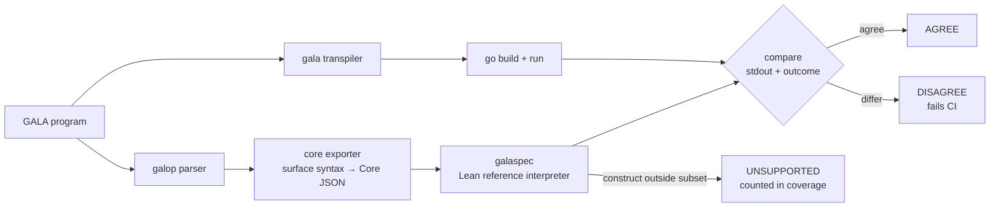
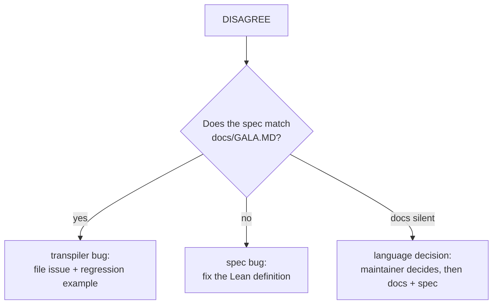
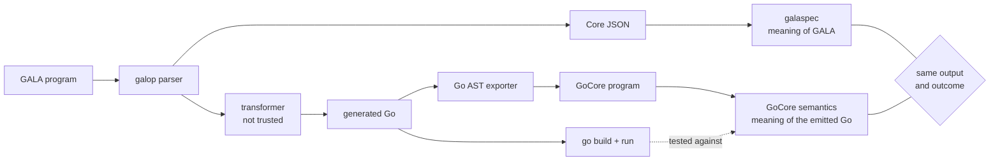
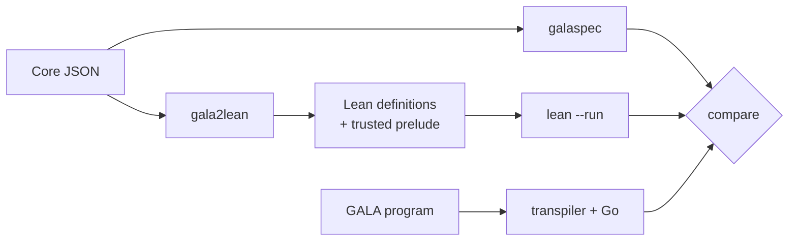
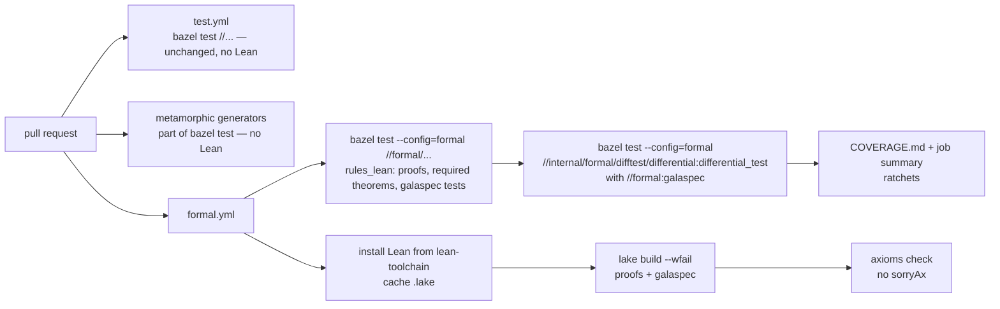
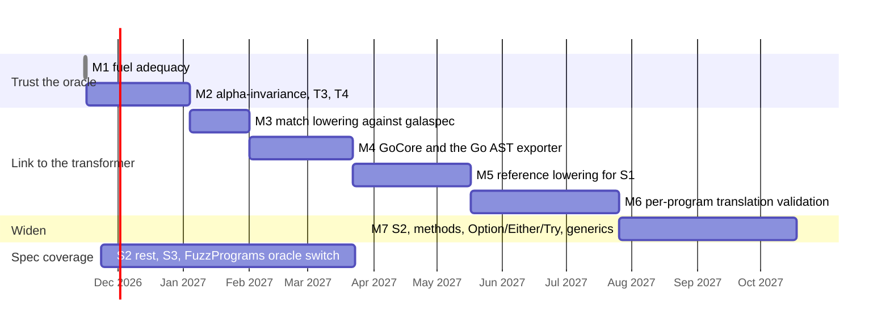

# Formal Semantics and Spec-Based Testing

Status: **design proposal, partly built**. Discussion: [#961](https://github.com/martianoff/gala/discussions/961).

This document describes how GALA gets an executable, machine-checked definition of what
programs mean, and how the transpiler is tested against it. What exists today (the
reference interpreter, the differential harness, gala2lean, and the theorems proved so
far) is listed in [formal/COVERAGE.md](../formal/COVERAGE.md).

## Summary

- We write **GALA's semantics in Lean 4**. A Lean definition says what every supported
  program means. Lean compiles that definition into a **reference interpreter**.
- **Today, generated code is tested by running it**: the real transpiler and the real Go
  toolchain run the program, and the reference interpreter must print the same output.
  We do not model Go as a whole.
- **The goal is a proof** that a GALA program and the Go the transpiler emits for it mean
  the same thing. We get there in milestones
  ([Theorems](#5-theorems-the-road-to-an-end-to-end-proof)): first properties of the
  spec itself, then a Lean model of only the Go subset the transpiler emits (GoCore), then
  a check of the transpiler's actual output against a lowering proved correct, one
  program at a time. Lean's kernel checks the proofs. Most of this is not done yet;
  [COVERAGE.md](../formal/COVERAGE.md) lists what is proved.
- **Coverage is partial and is published honestly.** The spec covers a stated subset of
  GALA. Every program outside that subset is counted and reported. It is never silently
  passed.

## Why

GALA has no formal definition. Its meaning is whatever the transpiler emits, and the
documentation describes that in prose. Tests compare against expected outputs that people
wrote, so a wrong expectation enshrines a bug.

A first Lean model of `match` (sealed types, arm order, pattern variables) took about an
hour to write. Writing the lowering down precisely showed that pattern variables leak into
later arms ([#996](https://github.com/martianoff/gala/issues/996)). A targeted search for
the same kinds of bug then found twelve more.

| Issue | Bug | Class |
|---|---|---|
| [#996](https://github.com/martianoff/gala/issues/996) | Match-arm pattern variables leak into later arms | wrong result, scoping |
| [#997](https://github.com/martianoff/gala/issues/997) | Match subject bound to a fixed Go name `obj` | wrong result, scoping |
| [#998](https://github.com/martianoff/gala/issues/998) | Sibling sub-patterns run their extractors after an earlier sibling failed | crash, evaluation |
| [#999](https://github.com/martianoff/gala/issues/999) | Default parameter values resolved in the caller's scope | wrong result, scoping |
| [#1000](https://github.com/martianoff/gala/issues/1000) | Named arguments evaluated in parameter order | wrong result, evaluation |
| [#1001](https://github.com/martianoff/gala/issues/1001) | Operand evaluation order unspecified | needs a decision |
| [#1002](https://github.com/martianoff/gala/issues/1002) | User names captured by generated code (`std`, `panic`, `string`, …) | rejected program, scoping |
| [#1003](https://github.com/martianoff/gala/issues/1003) | Generated declarations collide with user code | rejected program, scoping |
| [#1004](https://github.com/martianoff/gala/issues/1004) | Sealed `Copy` with another variant's field; `Equal` compares inactive fields | wrong result, values |
| [#1005](https://github.com/martianoff/gala/issues/1005) | `==` on a `comparable` type parameter is Go identity | wrong result, values |
| [#1006](https://github.com/martianoff/gala/issues/1006) | Expected type not passed to literals and empty constructors | rejected program, typing |
| [#1007](https://github.com/martianoff/gala/issues/1007) | `Try.Map` does not catch panics; `Try` of a GALA error function | wrong result, std |
| [#1008](https://github.com/martianoff/gala/issues/1008) | Programs that pass GALA's checks but fail in `go build` (collection) | rejected program |

Seven of the thirteen are about **names** or **evaluation order**. Those are exactly the
properties a formal semantics makes precise, and the existing fuzzer cannot see them: its
generator never reuses a name across scopes, and never orders side effects against each
other.

## Architecture



The only code both sides share is the parser. That parser is already fuzzed against the
ANTLR grammar. Everything after it is independent: the spec does its own name resolution,
desugaring and evaluation, and never sees the transformer's output.

### 1. Core JSON exporter (Go)

- **Package:** `internal/formal/coreexport`, a test-support library. It is not a `gala`
  subcommand, so the CLI does not grow.
- **Input:** the galop native tree of one or more files.
- **Output:** JSON for the *surface* syntax of the supported subset, with source positions.
- **It deliberately does not:**
  - resolve names;
  - fill in default arguments;
  - reorder named arguments;
  - desugar `match`.

  Those are the transpiler steps under test, and the spec redoes each of them itself.
- **Type annotations:** the analyzer's inferred types are attached only where meaning
  depends on a type: the width and kind of a numeric literal, and the type an untyped
  constant takes. The spec checks that each annotation is consistent with its own rules.
  This is a known trust point, listed under [What is trusted](#what-is-trusted).
- **Unsupported constructs:** a construct outside the subset is exported as
  `{"unsupported": "<construct>"}`, so the spec can name what is missing.
- **Versioning:** the schema is versioned (`"core": 1`). The Lean decoder rejects a
  version it doesn't know.

### 2. `galaspec`: the semantics in Lean

The semantics lives in a Lake project at `formal/`. Its
[README](../formal/README.md) says what exists today and how to build it. The planned
layout:

```
formal/
  lean-toolchain            pinned Lean version
  lakefile.toml             no Mathlib dependency at the start
  Gala.lean                 root module
  scripts/ProofCheck.lean   fails on sorry and non-standard axioms
  Gala/MatchLowering.lean   the match lowering model (exists today)
  Gala/Syntax.lean          surface AST (mirrors Core JSON)
  Gala/Json.lean            decoder, rejects unknown schema versions
  Gala/Scope.lean           name resolution: binders, shadowing, defaults
  Gala/Eval.lean            big-step semantics with fuel, outcomes below
  Gala/Std/*.lean           models of Option, Either, Try, Println formatting
  Gala/Main.lean            `galaspec run prog.json` → stdout + outcome line
  Gala/Theorems.lean        proofs about the semantics
  Gala/Fuel.lean            T1, fuel adequacy
  Gala/Statements.lean      the pinned statements of the theorems COVERAGE.md calls proved
  Gala/*Lowering.lean       models of individual lowerings; they become the reference lowering (M3, M5)
  COVERAGE.md               hand-written now, generated later; see "Coverage"
```

- **What evaluation produces:** printed output plus one outcome: `ok`, `panic <class>`, or
  `fuel`. `fuel` means the interpreter ran out of steps. Such a run is reported as
  inconclusive, never as agreement.
- **Errors are values:** an evaluation error is a result, not a crash. "No arm matched"
  becomes `panic match`, so it can be compared with the Go panic.
- **Executable and provable:** the evaluator is an ordinary Lean function. It runs fast
  enough to serve as an oracle, and theorems can be stated about it directly.
- **Precise where Go is loose:** where Go leaves something unspecified, the spec defines it
  (see [Decisions the spec forces](#decisions-the-spec-forces)).

### 3. Differential harness (Go, under Bazel)

- **Package:** `internal/formal/difftest`.
- **For each input program:**
  1. Export it to Core JSON and run `galaspec`.
  2. Transpile, build and run it with the machinery `FuzzPrograms` already uses.
  3. Compare stdout and outcome. Each comparison is one of four verdicts: `AGREE`,
     `DISAGREE`, `UNSUPPORTED` or `INCONCLUSIVE`.
- **Where `galaspec` comes from:** under `--config=formal`, `//formal:galaspec`, built with
  rules_lean, is a data dependency of the target. Without the config, the
  `GALA_SPEC_BIN` environment variable names one instead, e.g. a Lake-built galaspec
  (it also wins under the config). With neither, the target fails with a clear message.
  It never passes silently.
- **Plain `bazel test //...` stays Lean-free:** the target is tagged `manual`, it refers
  to `//formal:galaspec` only under `--config=formal`, and the formal CI job runs it
  explicitly.



### 4. Program sources

| Source | What it gives | Needs Lean |
|---|---|---|
| **Metamorphic: alpha-renaming.** Rename every local binder to hostile names (`obj`, `_tmp_1`, `std`, `panic`, `string`, `__p0`, and names of other binders in scope). Output must not change. | Catches #996, #997, #999, #1002, #1003 directly. | No |
| **Metamorphic: order tracing.** Wrap operands, named arguments, sub-patterns and guards in tracing calls. The trace must match left-to-right source order, and failed patterns must stop early. | Catches #998, #1000, #1001. | No |
| **`examples/*.gala` with `.out`.** Three-way comparison: spec, `.out` file, Go. | Spec conformance on 400+ real programs; finds `.out` files that enshrine bugs. | Yes |
| **`FuzzPrograms` generator.** Its hand-written model of expected output is replaced by `galaspec`. During the switch, all three are compared. | Endless random programs, with an oracle we can review. | Yes |

The two metamorphic generators are cheap and need no spec at all. They ship first. Their
correctness argument is also a theorem we plan to prove about the spec (T2): *renaming bound variables
does not change a program's meaning*. That ties the test to the proof.

### 5. Theorems: the road to an end-to-end proof

The goal is a proof, not a test, that a GALA program and the Go program the transpiler
emits for it mean the same thing: the same output and the same outcome. We get there in
milestones. Each one makes a claim that is true on its own, names what it still trusts,
and removes something from that list or widens the subset.

Three semantics are involved:

- **galaspec** (`Gala/Eval.lean`): what a GALA program means. It is the definition, so
  it is trusted by construction; it is checked against `docs/GALA.MD` by review and
  against Go by the differential run.
- **GoCore** (planned): a Lean semantics of the *subset of Go the transpiler emits* for
  the covered GALA subset. It is not a semantics of Go. That real Go behaves as GoCore
  says is an assumption, tested by running GoCore on the transpiler's output next to
  `go run` (a fourth oracle).
- **The transformer's actual output**, read back from the generated Go (`go/ast`) into
  GoCore syntax by a small exporter.



#### The theorems

These are the properties of the spec the milestones prove (T1–T7), with the bugs each
guards against. T1 is proved for all of galaspec (`run_fuel_adequate` in
`formal/Gala/Fuel.lean`), and T4 for the defaults phase of a call
(`bindDefaults_callerLocals` and `defaultFrame_lookup`, see M2);
[formal/COVERAGE.md](../formal/COVERAGE.md#what-is-proved) lists what is proved.

| # | Statement (informal) | Guards against | Milestone |
|---|---|---|---|
| T1 | **Fuel adequacy and monotonicity:** if a run with fuel `n` ends in anything but `fuel`, every run with more fuel ends the same way and prints the same output. (Plain determinism holds of any Lean function and says nothing.) | an `AGREE` or `DISAGREE` verdict that changes with more fuel | M1 |
| T2 | **Alpha-invariance:** a capture-avoiding renaming of bound variables does not change the output or the outcome (see M2 for the side conditions). | #996, #997, #999, #1002 | M2 |
| T3 | **Left-to-right**, stated on what a program does, not on the evaluator's definition: the output and effects of an operand list, a call (named arguments included), a compound assignment and a pattern are those of its parts, in source order. A failed sub-pattern stops the ones after it. | #998, #1000, #1001 | M2 |
| T4 | **Default arguments** are evaluated in the callee's scope, with earlier parameters bound. | #999 | M2 |
| T5 | **Exhaustiveness:** a well-typed exhaustive match on a value built by a constructor never ends in `panic match`. Needs a typing judgment, which the spec does not have. | match lowering | not scheduled |
| T6 | **Equality:** `Equal` on sealed values is an equivalence that depends only on the active variant's fields. | #1004, #1005 | M7 |
| T7 | **Type soundness** for the subset: well-typed programs do not get stuck. Needs a typing judgment too. | typing bugs | not scheduled |

A theorem counts as **proved** only if it type-checks with no `sorry`, and
`#print axioms` lists only Lean's standard axioms (`propext`, `Quot.sound`,
`Classical.choice`). CI checks both. Its statement is pinned in
`formal/Gala/Statements.lean`.

#### The milestones

Throughout, galaspec's definitions and Lean's kernel are trusted. The "Also trusted"
column lists what each milestone's claim rests on beyond them.

| # | Milestone | Claim it lets us make | Also trusted | Size |
|---|---|---|---|---|
| M1 | Fuel adequacy (T1) | galaspec's answer for a program never depends on the fuel budget, except that too little fuel ends in `fuel` | nothing | 2–3 weeks |
| M2 | Alpha-invariance, left-to-right, defaults (T2–T4) | for the subset galaspec models (S1 plus lambdas, closures, named arguments and defaults), renaming bound variables apart never changes what galaspec says a program does, its effects happen in source order, and a default sees only the callee's earlier parameters | nothing | 6–8 weeks |
| M3 | Match lowering against galaspec | the scoped `match` lowering, into a first fragment of GoCore, is correct with respect to galaspec itself (not a separate toy semantics), for every S1 pattern form | that the lowering describes what the transformer emits | 3–4 weeks |
| M4 | GoCore and the Go AST exporter | for every S1 program in the corpus, GoCore run on the transformer's *actual* output agrees with galaspec and with `go run` (tested, not proved) | parser, interpolation splitter, analyzer annotations, both exporters, GoCore's fidelity to Go | 5–8 weeks |
| M5 | Reference lowering for all of S1 | a lowering from galaspec's syntax to GoCore, covering everything the transformer emits for S1, is proved to preserve meaning | that the lowering describes what the transformer emits | 6–9 weeks |
| M6 | Per-program translation validation | for each S1 program the validator accepts, every run of it that galaspec ends `ok` or in a panic is proved to have the same output and outcome as the Go the transformer emitted, run in GoCore | as M4, plus the validator's run (kernel or compiled Lean) | 8–12 weeks |
| M7 | Widening the subset | M6's claim for S2 (lambdas, defaults, named arguments, interpolation), then methods, `Option`/`Either`/`Try` and generics | as M6 | 2–4 weeks per construct family |

#### M1: fuel adequacy (an oracle we can trust)

- **Claim:** galaspec's result does not depend on the fuel budget once it is large
  enough; `fuel` only ever means "not enough fuel".
- **Statement:** for every program `p` and fuels `n ≤ m`, if `(run p n).1` is not
  `.fuel` then `run p m = run p n`. `run` passes the same number to `runM` as the
  recursion depth of `eval` and as its step count, so the lemma for each function of
  `eval`'s mutual block says: unless the smaller budget ran out, more depth and more
  steps give the same result and the same final state, except for the steps left.
- **What it gives:** an `AGREE` or `DISAGREE` verdict is about the program's meaning, not
  about the budget the harness chose. It says nothing about a run that ends in `fuel`:
  `INCONCLUSIVE` stays inconclusive, since more fuel might end it any way.
- **Status: done.** `run_fuel_adequate` in `formal/Gala/Fuel.lean`, pinned in
  `Statements.lean`, covers all of `run`: `eval`'s mutual block, `initGlobals` and
  `runM`. The code that cannot spend steps runs in a monad without them (`H` in
  `Eval.lean`), so it acts the same whatever the fuel by its type, the heap included;
  `tick` is the only code that spends steps; and `runIn`'s `return` handler is shown to
  pass `fuel` on, which catching needs.

#### M2: alpha-invariance, left-to-right and defaults

- **Claim:** for the subset galaspec models (S1 plus lambdas, closures, named arguments
  and defaults), renaming bound variables apart never changes galaspec's output or
  outcome; operands, arguments and sub-patterns take effect in source order; a default
  value sees only the callee's earlier parameters.
- **Statement (T2):** `run (rename σ p) n ≈ run p n`, where `≈` means the same output and
  the same outcome up to the text of `stuck` and `unsupported` messages (those name
  variables, so renaming changes them). `σ` renames each binder together with the
  occurrences it binds, and must be capture-avoiding: no occurrence ends up bound by a
  different binder, and no free name (a builtin such as `Println` included) ends up bound
  by one. Shadowing is allowed, so two binders in different scopes may get one
  name. In addition, galaspec's name resolution needs:
  - a binder is never renamed to `_`, which binds nothing;
  - a binder is never renamed to the name of a package-level declaration (function,
    `val`/`var`, struct or sealed case): pattern names count as mentions when
    galaspec orders package-level initialization (`mentions`), and a bare pattern name
    that names a case of the subject's type is a case test;
  - the renaming keeps every name capitalized exactly when it was: a capitalized
    pattern name with a binding in scope is a stable identifier (`classifyPatName`),
    so a lowercase binder renamed to a capitalized one could turn a later pattern
    binder into a comparison;
  - renaming a function's parameter renames the named arguments at its call sites too,
    since `bindArgs` resolves `name = value` by parameter name.

  Renaming top-level declarations consistently is a separate, simpler lemma.
- **What it gives:** a proof that the metamorphic renaming generator is sound. It gives a
  binder a hostile name (another binder's in scope, `std`, `panic`, …) only where every
  reference still resolves to its own binder, which is capture avoidance; M2 also checks
  its renamings against the remaining conditions above. A renaming that changes Go's
  output is then a transpiler bug, never a spec artefact.
- **Statement (T3):** T3 relates the output and state of each compound construct to
  those of its parts in source order.
- **T4: done.** `bindArgs` evaluates the arguments a call writes, in the caller's scope,
  and then passes their values to `bindDefaults`, which fills each left-out parameter
  with its default. `bindDefaults_callerLocals` (`formal/Gala/Defaults.lean`): the
  defaults phase does not read the caller's locals. Run with any other locals, it gives
  the same values or `Stop` and the same output, heap, package-level variables and
  steps, and when it succeeds the caller's locals are back. `defaultFrame_lookup`: each
  default's frame binds exactly the earlier parameters, a name to the latest of them.
  The first theorem was false until a by-name default's bare name was resolved in the
  default's frame rather than among the caller's locals. That the written arguments come
  before the defaults is `bindArgs`'s definition; an ordering claim is T3's.
- **Risk:** the renaming must commute with `resolve`, pattern classification, closures'
  captured scopes and default frames. A state relation (environments renamed, heap equal)
  carries the induction. Needs M1's lemmas.

#### M3: the match lowering against galaspec

- **Claim:** the scoped lowering of `match` (the transformer's shape: a temporary for the
  subject, an `Unapply` per arm, binders scoped to their arm, a panic at the end) is
  correct with respect to galaspec, for every S1 pattern form: nested, literal,
  wildcard, tuple and extractor patterns, bare case names, stable identifiers, and
  guards.
- **Statement:** a lowering `lowerMatch` from galaspec's syntax to a first fragment of
  GoCore, and `GoCore.eval (lowerMatch e) ≈ Spec.eval e` under an environment relation,
  as `compile_correct` does today for a separate toy language.
- **What it removes:** the separate source semantics `seval` in `MatchLowering.lean`,
  which no theorem ties to galaspec today. `compile_correct`, `program_correct` and the
  #996 counterexample `leaky_not_correct` are restated against galaspec and GoCore, and
  their pinned statements in `Statements.lean` change with them.
- **Risk:** galaspec's match runs in a monad with state, fuel and a heap; the simulation
  needs M1's fuel lemmas.

#### M4: GoCore and the Go AST exporter

- **Claim (tested, not proved):** for each S1 program in the corpus, GoCore run on the
  transformer's actual output prints what galaspec prints and ends the same way, and
  prints what `go run` prints.
- **What is built:**
  - GoCore: int64 arithmetic with Go's wrapping, division and shift rules; `if`; blocks
    and `:=`; function calls; structs; the sealed parent struct with its variant tag;
    `Unapply` returning an `Option`; `panic`; package-level initialization; and `fmt`'s
    printing of the values S1 has.
  - An exporter from the generated Go's `go/ast` to GoCore JSON. A construct outside
    GoCore is reported, never dropped, as Core JSON does.
- **What it changes:** the link to the real transformer exists; until M6 it is tested.
- **Risk:** the transformer emits incidental shapes (helper calls, immutability wrappers,
  generated `String` methods) that GoCore must cover; `fmt` is the largest single model.
  GoCore has no stack limit, while Go aborts a deep recursion with a fatal stack
  overflow: a run Go aborts for lack of stack or memory is outside every claim here, and
  the differential run reports such runs instead of comparing them.

#### M5: the reference lowering for all of S1

- **Claim:** a lowering `lower : Spec.Program → GoCore.Program` that produces the shapes
  the transformer emits (M4 shows which) preserves meaning for every S1 program.
- **Statement:** for every S1 program `p` whose galaspec run ends `ok` or in a panic,
  `GoCore.run (lower p)` ends the same way with the same output, and a program that runs
  out of every fuel budget in one runs out in the other. It generalizes M3 from `match`
  to arithmetic, `if`, blocks, calls, structs, sealed values, package-level
  initialization and printing.
- **Risk:** printing and initialization order are the largest proofs; GoCore's `fmt`
  model has to be exact for the theorem to say anything about real output.

#### M6: per-program translation validation

- **Claim:** for each S1 program it accepts, the validator proves that the Go the
  transformer emitted, run in GoCore, means the same as the program: for every run that
  galaspec ends `ok` or in a panic, the same output and outcome, and divergence in one
  exactly when in the other.
- **Statement:** a checker `validate : Spec.Program → GoCore.Program → Bool` and one
  soundness theorem, proved once: if `validate p q = true` then `q` is equivalent to
  `lower p` in GoCore, so by M5, for every `n` where `(Spec.run p n).1` is `ok` or a
  panic, some `m` gives `GoCore.run q m ≈ Spec.run p n`, and the same in the other
  direction. Per program, `validate p q = true` is then evaluated, by the kernel
  (`decide`) where that is fast enough, or by compiled Lean, which then joins the
  trusted base and is named as such.
- **What it does not cover:** a run galaspec ends `stuck` or `unsupported`. `stuck` marks a
  program GALA's type checker should reject; ruling it out statically needs T7, which is
  not scheduled, so the claim is stated per run, not per program.
- **How the checker works:** it compares the emitted Go with `lower p` up to the renaming
  of temporaries and the normal forms of incidental shapes, so a transformer change that
  keeps the reference shapes needs no new proof, and one that breaks them is rejected
  with the construct named. Its soundness needs alpha-invariance of GoCore for
  temporaries and a correctness lemma for each normalization rule; both are part of
  M6's size.
- **What it removes:** the transformer from the trusted base, for each validated program.
- **Risk:** the transformer's output must be normalized before comparison; a validator
  that is too strict rejects correct output and stalls coverage.

#### M7 and later: widening

Each family of constructs extends galaspec, GoCore, the reference lowering and the
validator together: S2 first (closures capture by reference, so GoCore needs heap cells),
then methods and the generated `Copy`/`Equal`/`String` (with T6), `Option`/`Either`/`Try`,
and erased generics. A verified lowering, the transformer replaced by Lean code proved
correct, is not planned: per-program validation gives the same guarantee for the
programs it accepts, without rewriting the transformer. T5 and T7 need a typing judgment
for the subset, which none of M1–M6 requires; they are scheduled only if the validator
comes to need typing facts.

**What stays trusted at the end:** the galop parser and the interpolated-string splitter
(shared by both sides), the analyzer's type annotations, the Core JSON and Go AST
exporters, galaspec's definitions (the meaning of GALA, checked against `docs/GALA.MD`),
GoCore's fidelity to the Go compiler and runtime (tested), and Lean's kernel (and the
Lean compiler, if the validator runs compiled). [What is trusted](#what-is-trusted) lists
each with its mitigation.

### 6. gala2lean: a third oracle

galaspec is written by hand. Discussion #961 asked for a model that is derived
mechanically instead. `internal/formal/gala2lean` is that: a deterministic translator
from a program's Core JSON to ordinary Lean 4 definitions, one per GALA function. It does
not replace galaspec, which stays GALA's definition; it is a third account of each
program, and the differential harness compares all three.



- **Provable from the start.** Every function lives in a monad with a divergence outcome
  (`ExceptT Panic (StateT St Option)`, as Aeneas does), and recursion is
  `partial_fixpoint`, so every definition has equations. No definition is `partial`. A
  function `partial_fixpoint` cannot handle is reported by name. A proof about generated
  code, unedited, is part of the proof check (`eval_total`).
- **Deterministic.** The same input gives byte-identical Lean.
- **Honest.** Code it does not translate is reported with the construct named, never
  dropped. A translated program that agrees with Go is reported as "translated" and
  "agrees", nothing stronger.
- **What it trusts:** the translator, its Lean prelude and the front end it shares with
  galaspec ([formal/README.md](../formal/README.md#what-gala2lean-trusts)).
- **Phases:** S1 with provable output first; then lambdas and closures (a captured `var`
  becomes a reference cell in the state), interpolation and `Option`/`Either`/`Try`;
  then generics and the immutable collections, modelled in the prelude.

### 7. Lowering models and the reference lowering

A lowering model is a Lean model of only the Go that GALA emits for one construct, with a
proof that the lowering preserves meaning. It is *not* a Go semantics. The existing
prototype, `formal/Gala/MatchLowering.lean`, does this for sealed `match`. It proves, for a
small model of `match` and of the Go it lowers to (not for the transpiler's output), that
a scoped lowering preserves meaning and that the leaky lowering of #996 does not.

The roadmap above turns these models into the **reference lowering**. M3 restates the
`match` model against galaspec, with a first fragment of GoCore as its target; M5 extends
it to all of S1; M6's validator checks the transformer's actual output against it,
program by program. Each further construct (closures, default and named arguments,
sealed `Equal`/`Copy`) gets its reference lowering when M7 reaches it.

## What is trusted

The table is honest about what the guarantees rest on.

| Component | Trusted because | Mitigation |
|---|---|---|
| Lean kernel | Small, widely used | none needed |
| The spec's definitions | They *are* the definition of GALA | Reviewable size; every definition cites its `docs/GALA.MD` section; the 400+ examples are a conformance suite |
| galop parser | Shared by both sides: the transpiler and the exporter both parse with galop alone | Held to ANTLR's parser on the same grammar by galop's own differential tests and fuzzing |
| Interpolated-string splitter (`internal/interpolation`) | Shared by both sides: it splits `s"..."` into text and embedded expressions | Small and lexical; the expressions it finds are parsed and checked like any other |
| Core JSON exporter | Shared by both sides | A plain syntax dump with no logic; golden and schema tests (a round-trip test, export → print → parse → export, is planned) |
| Type annotations from the analyzer | Meaning depends on them | Limited to numeric literal kinds; the spec checks they are consistent |
| gala2lean's translator and prelude | They decide what its Lean definitions mean | Mechanical rules; independent of galaspec; compared with galaspec and Go on every translated program |
| Go toolchain and runtime | Today we run it, not model it. From M4, GoCore models the subset the transpiler emits, and that real Go behaves as GoCore says is assumed | GoCore runs next to `go run` on the transformer's output for every program in the corpus; runs Go aborts for lack of stack or memory are outside every claim |
| Go AST exporter (planned, M4) | It decides which GoCore program the emitted Go is | A plain syntax dump; constructs outside GoCore are reported, never dropped |
| The validator's run (planned, M6) | Evaluated by Lean's kernel, or by compiled Lean when the kernel is too slow | The kernel needs no mitigation; compiled Lean is named as trusted where it is used |
| The transformer | **Not trusted.** It is what we test, and from M6 what we validate per program | — |

## Coverage

Coverage is reported in three tiers, so nobody reads "tested" as "proved":

- **Modelled:** the construct is in the spec. Programs using it can run through `galaspec`.
- **Tested against the spec:** at least N programs using the construct (examples or
  generated) agree with the spec, and none that galaspec ran to the end disagrees or is
  inconclusive.
- **Proved:** a theorem from the table above covers it.

`formal/COVERAGE.md` is generated in CI and committed with each formal change. It holds:
- a per-construct table with the three tiers;
- the number of examples in each verdict;
- every `UNSUPPORTED` construct, with how often it occurs;
- the list of known disagreements.

The run writes this as the section between the `<!-- difftest:begin -->` and
`<!-- difftest:end -->` markers; `bazel run //internal/formal/difftest/splicecoverage`
puts it into the file and leaves the hand-written rest alone.

**Wording rules for docs, release notes and the README:**
- "Proved" is used only for kernel-checked theorems, and always with what they are
  about: the spec, a lowering model, or (from M5) GoCore and the reference lowering.
- "Tested against the spec" is used for differential results.
- Neither is used for constructs outside the subset.
- For gala2lean, "translated" and "agrees" are used only where true; neither means
  verified.
- We never claim the transpiler is verified. From M6, a program is "validated" when the
  validator proved its Go output equivalent to it, and the word always comes with what
  it is relative to: GoCore, runs galaspec ends `ok` or in a panic, and the trusted base.

**Ratchets in CI:**
- The number of examples that run fully inside the subset and agree may not go down
  (`internal/formal/difftest/baseline.json`).
- A `DISAGREE` fails the build, unless that exact program appears in
  `internal/formal/difftest/known_disagreements.json` with an **open** issue number. When the issue is
  closed, the CI job requires the entry to be removed.

### Subsets

| Subset | Constructs | Out of scope until later |
|---|---|---|
| S1 | int/bool/string literals and operators; `val`/`var`; `if`; blocks; functions and recursion; structs; sealed types; `match` with nested, tuple, literal and wildcard patterns and guards; `Println`/`Print` with documented formatting | everything else |
| S2 | lambdas and closures; default and named arguments; `Option`/`Either`/`Try` (Lean models of the std behaviour); string interpolation | |
| S3 | generics (erased semantics); `Copy`/`Equal`/`==`; immutable `Array`/`List`/`HashMap` basics; partial functions | |
| Not planned | goroutines, `Future`, channels, Go interop, mutable collections, `use`/`defer`, reflection, performance | stated in COVERAGE.md |

## Decisions the spec forces

The spec must say what Go leaves open and what the docs don't cover. Each of these needs a
maintainer decision before the spec can encode it.

| Question | Decision | Issue |
|---|---|---|
| Operand evaluation order | **Strict left-to-right** for operands, arguments, interpolation parts and literals, as in Scala and Kotlin | [#1001](https://github.com/martianoff/gala/issues/1001) |
| Named arguments | **Source order**: evaluated in the order written, then passed in parameter order | [#1000](https://github.com/martianoff/gala/issues/1000) |
| Function and method defaults | **May refer to earlier parameters** (as in Kotlin). Evaluated in the callee's scope, left to right; the caller's locals are never visible | [#999](https://github.com/martianoff/gala/issues/999) |
| Struct and sealed-case field defaults | **May not refer to other fields**: a compile-time error, as in Scala. Every exported struct keeps its Go `New<T>` constructor | [#999](https://github.com/martianoff/gala/issues/999) |
| `Try(f())`, `Try(() => f())` and `Try(f)` where `f` returns `error` | **A non-nil error is a `Failure`**, whether `f` is a GALA or a Go function | [#1007](https://github.com/martianoff/gala/issues/1007) |
| Do `Try` combinators catch panics? | **Yes** for `Map`, `FlatMap`, `Filter`, `Recover`, `RecoverWith`, `Transform` (as Scala's `Try`); **no** for `ForEach`, `Fold`, `OnSuccess`, `OnFailure` | [#1007](https://github.com/martianoff/gala/issues/1007) |
| `Copy(field = ...)` on a sealed value | **Strict:** on a parent-typed value only fields every case has; otherwise a compile-time error | [#1004](https://github.com/martianoff/gala/issues/1004) |
| Identifiers starting with `_gala_` | **Reserved** for generated code: a compile-time error | [#1002](https://github.com/martianoff/gala/issues/1002) |
| How plain structs print under `Println` and interpolation | **Like sealed values and Scala case classes:** `Pt(1, 2.5)`; collections by contents, nested values recursively; a user `String()` wins | [#1008](https://github.com/martianoff/gala/issues/1008) |
| `if (c) 1 else 2.5` with no declared type | **An error** naming the int vs float64 mismatch, as `match` does (no implicit numeric conversion) | [#1008](https://github.com/martianoff/gala/issues/1008) |
| `%` inside `s"..."` | **Literal text.** Format specs exist only in `f"..."`, as in Scala | — |
| Lambda capture | **By reference**, as in Go, Scala and Kotlin: later assignments to a captured `var` are visible inside the lambda, and the lambda's assignments are visible outside | — |
| `std.Iterable` | **Self-typed** `Iterable[T, C]`: collection-returning methods return `C`, so `Array[T]` implements `Iterable[T, Array[T]]` | [#1011](https://github.com/martianoff/gala/issues/1011) |
| Generic constraints | **Any type may be a constraint**, including generic interfaces that name other type parameters (`[T any, C Iterable[T, C]]`). Methods of a type parameter come from its constraint | [#1046](https://github.com/martianoff/gala/issues/1046) |
| A pointer to a Go struct inside a printed value | **Prints what it points to** (`Some(&{…})`), not an address; cycles print `<cycle>` | [#1044](https://github.com/martianoff/gala/issues/1044) |
| A struct whose `String()` has a pointer receiver | **Legal.** Printing a plain value uses that `String()` through the value's address | [#1044](https://github.com/martianoff/gala/issues/1044) |
| A positional argument after a named one, `f(a = 1, 2)` | **A compile-time error** for every call form (GALA-E0105): once an argument is named, the rest must be too | — |
| Do the initializers of an imported package that the file does not use run? | **Rejected at compile time** (GALA-E0120): an import that the file's source does not refer to is an error, as in Go; use is read from the source, never from the generated Go. Dependency modules are not checked yet: there an import the generated Go does not refer to is dropped, whether the source does not use it or uses it only in a way that lowers away (a type), and its initializers do not run. A blank import, `import _ "pkg"`, imports a package for its initialization only, and its initializers run, before the importer's | — |

## CI and build



- **Lake is the primary Lean build.** Every Go part (the exporter, the harness and the
  generators) is built and tested with Bazel, as AGENTS.md requires.
- **Bazel builds Lean too, opt-in.** [rules_lean](https://github.com/martianoff/rules_lean),
  a separate Bazel module with Windows support, is a dev dependency of the `gala` module
  (so modules that depend on gala never see it). `formal/BUILD.bazel` builds the same
  modules under the same rules as Lake (warnings fail; a `lean_proof_test` checks every
  declaration but compiler auxiliaries, private ones included, and the theorems
  COVERAGE.md calls proved), runs the galaspec fixture and command-line tests, and links
  `//formal:galaspec` (a `lean_binary`), which the differential test uses under the
  config. In `formal.yml` the differential job runs
  `bazel test --config=formal //formal/...` and then the differential run, so Lean is
  fetched and galaspec built once; the Lake job runs next to it. Lake stays the primary
  path until the maintainer decides otherwise.
  - **Why opt-in:** a Lean toolchain is about 620 MB to download and 3.3 GB unpacked, and
    every Bazel output base gets its own copy. So:
    - Lean targets sit behind `--config=formal`: without it they are incompatible with
      the target platform, and `bazel build //...` skips them. `formal/lean.bzl` wraps
      the rules_lean rules so that no target can miss the gate;
    - a default `bazel build //...` or `bazel test //...` never fetches Lean;
    - agent worktrees never fetch it either.
  - **One Lean version:** `lean.toolchain(version = …)` in `MODULE.bazel` must match
    `formal/lean-toolchain`. `tools/check_repo_policy.sh` fails when they differ.
  - **Caching:** the differential job keeps Bazel's repository cache, which holds the
    downloaded Lean archive, and a disk cache. Both are private to the repository's CI;
    see Licensing.
- **Running only for formal changes:** `formal.yml` runs only on PRs that can move a
  verdict (`formal/`, `internal/formal/`, `internal/transpiler/`, the standard library
  packages and `examples/`) or touch the Bazel setup the opt-in build depends on
  (`MODULE.bazel`, `.bazelrc`, `.bazelversion`, `.bazelignore`). It is required for those
  PRs once S1 is stable.
- **Local use:** with nothing but Bazel:

  ```shell
  bazel test --config=formal //formal/...
  bazel test --config=formal //internal/formal/difftest/differential:differential_test
  ```

  For Lake, install Lean with `elan` (it reads `formal/lean-toolchain`), then:

  ```shell
  cd formal && lake build && lake exe galaspec run prog.json
  GALA_SPEC_BIN=$PWD/.lake/build/bin/galaspec bazel test \
    //internal/formal/difftest/differential:differential_test --test_env=GALA_SPEC_BIN
  ```

## Licensing

- **Lean 4 is Apache 2.0**: the compiler, Lake, the core library and the runtime. That is
  the same license as GALA.
- **The release binaries bundle third-party components.** They are listed in the
  toolchain's `LICENSES` file:
  - LLVM/clang: Apache 2.0 with LLVM exceptions
  - CaDiCaL: MIT
  - **GNU MP: LGPL v3**
  - **the GNU C library: LGPL**, in Linux builds
- **The spec and proofs are our own code.** The files in `formal/` are licensed like the
  rest of the repository. Lean's license does not extend to programs written in Lean.

To keep our obligations at zero:

1. **`galaspec` and every other Lean-built binary is a development and CI tool only.**
   None of them ships in GALA releases, the CLI, Docker images or the playground. Shipping
   one would require Lean's Apache NOTICE, and would require letting users relink the
   runtime's LGPL GNU MP code. Any change to this rule needs a maintainer decision first.
2. **The Lean toolchain is never vendored, committed, mirrored or re-hosted.** That means
   no public mirror, no archive committed to the repository, and no published image,
   Bazel mirror or cache that others download from. CI and any Bazel integration fetch
   the pinned release from `releases.lean-lang.org` (GitHub releases as a fallback) and
   verify a pinned SHA-256. Re-hosting it would make us a distributor of its LGPL
   components. A CI-private cache, such as the repository's own GitHub Actions cache, is
   allowed: it is never served to anyone, so it is not distribution.
3. **New Lean dependencies (Lake packages) must be permissively licensed**: Apache 2.0,
   MIT or BSD. Mathlib is Apache 2.0. Check a package's license before adding it.

## Plan

Done so far: M1 (T1, fuel adequacy), the metamorphic generators, the Core JSON exporter,
galaspec for S1 and part of S2, the differential harness over `examples/`, gala2lean, and
the match lowering model.
The estimates are in weeks of one maintainer working with AI agents, and the chart runs
the proof milestones one after another (M3 needs only M1, so M2 and M3 could overlap with
a second person). The spec-coverage lane, the rest of S2 and S3 in galaspec and
switching `FuzzPrograms` to galaspec as its oracle, is separate work run by other agents
and is drawn alongside. The dates are placeholders that show order and length, not
commitments.



| Milestone | Size | Done when |
|---|---|---|
| M1 | 2–3 weeks | Done: T1 is proved, pinned in `Statements.lean` and listed in COVERAGE.md. |
| M2 | 6–8 weeks | T2, T3 and T4 are proved for the subset galaspec models, and the metamorphic renaming generator is checked against T2's conditions. |
| M3 | 3–4 weeks | `MatchLowering.lean`'s separate source semantics is gone; the `match` lowering is proved against galaspec for every S1 pattern form. |
| M4 | 5–8 weeks | GoCore runs the transformer's actual output for the S1 corpus and agrees with galaspec and with `go run` on it (tested). |
| M5 | 6–9 weeks | The reference lowering covers everything the transformer emits for S1, and its correctness theorem is proved. |
| M6 | 8–12 weeks | The validator's soundness theorem is proved, and CI validates every S1 program in the corpus, listing the ones it rejects and why. |
| M7 | 2–4 weeks per construct family | Each family is in galaspec, GoCore, the reference lowering and the validator. |

**Risks:**
- **The spec is wrong.** Mitigation: the three-way check against `.out` files; a reviewer
  reads every definition next to `docs/GALA.MD`.
- **Model drift.** galaspec, GoCore, the reference lowering and the transformer can each
  change without the others. Mitigation: the differential run compares galaspec and
  GoCore with `go run` on every formal-relevant PR; the validator rejects output that no
  longer fits the reference lowering, naming the construct, instead of passing it.
- **GoCore's fidelity to Go is assumed, not proved.** Mitigation: GoCore runs next to
  `go run` on the transformer's output for every program in the corpus, and the
  assumption is listed in [What is trusted](#what-is-trusted).
- **Proof effort is underestimated.** Mitigation: each milestone states its claim on its
  own, and testing against the spec delivers value without the proofs.
- **Language churn.** Mitigation: the spec covers a stated subset; new features start as
  `UNSUPPORTED` and are reported, not hidden.
- **Lean expertise.** Mitigation: no Mathlib; plain functional definitions in the style
  of the prototype. AI agents write most proofs, and the kernel checks them; statements
  are pinned so a proof cannot be quietly weakened.
