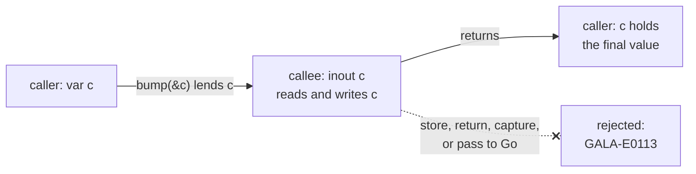
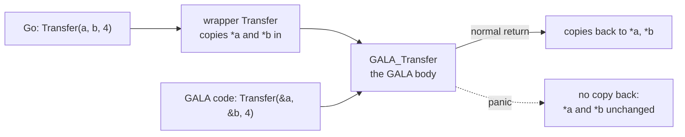

# Ownership: `inout` Parameters

GALA values are immutable by default, and a function that changes its
caller's data used to need a `Ptr[T]`. A pointer can be stored, shared,
passed twice or handed to Go, so nothing in a `Ptr` signature tells the caller
what the callee does with it. An `inout` parameter is the narrow alternative:
it **lends the caller's place to the callee for one call**. The callee reads
and writes it, the caller sees the final value when the call returns, and the
compiler checks that nothing else reaches the place meanwhile and that nothing
keeps it afterwards.

This guide covers the feature as it works today. The reference summary is
[`inout` Parameters](GALA.MD#inout-parameters) in the language reference, and
each rule has an error page with a repro and a fix. Every listing below is an
excerpt of a tested program in [`examples/`](../examples), or a snippet the
documentation check compiles.

## Table of Contents

1. [Why ownership](#why-ownership)
2. [`inout` basics](#inout-basics)
3. [What can be lent](#what-can-be-lent)
4. [The rules, and how to fix each error](#the-rules-and-how-to-fix-each-error)
5. [Interfaces with `inout` methods](#interfaces-with-inout-methods)
6. [Go interop](#go-interop)
7. [What the IDE and `gala doc` show](#what-the-ide-and-gala-doc-show)
8. [`inout`, `Ptr` or a value?](#inout-ptr-or-a-value)
9. [Moving `Ptr` code to `inout`](#moving-ptr-code-to-inout)
10. [Limitations](#limitations)
11. [See also](#see-also)

---

## Why ownership

Go passes pointers freely. A function that takes a `*Buffer` might fill it and
return, or keep it in a struct, share it with a goroutine, or receive the same
pointer twice. The caller can't tell which from the signature, and the
compiler doesn't check.

An `inout` parameter makes the common case, "change this value for me", a
checked contract:

- **The call site shows it.** An `inout` argument is written `&place`, so a
  reader sees which arguments a call may change.
- **The borrow is exclusive.** One call never lends the same place twice, so
  the callee may treat its `inout` parameters as distinct values.
- **The borrow ends with the call.** The callee can't store the place, return
  it, capture it in a lambda or hand it to Go code that might keep it.
- **It costs nothing in Go.** `inout x T` is the Go parameter `x *T`, the same
  code a programmer writes with a pointer.

Because an `inout` place has exactly one user at a time, a function that only
mutates through `inout` parameters behaves as if it took a value and returned
the new one. That is what lets GALA's formal tooling translate such functions
to value semantics. For your code, it means a mutation is local and visible:
no other path to the value can observe it halfway.



## `inout` basics

Mark a parameter `inout`, and lend a place to it with `&`. A method with an
`inout` receiver is called like any method, with no `&`. Inside the body the
parameter is a mutable place: write its `var` fields, replace it as a whole,
or lend it on to another `inout` parameter.

<!-- doc-source: examples/inout_params.gala -->
```gala
package main

struct Counter(var n int, label string)

// An inout receiver: called as c.inc() on a var, an inout parameter or a Ptr.
func (inout c Counter) inc() int {
    c.n = c.n + 1
    c.n
}

// A value receiver only reads.
func (c Counter) show() string = s"${c.label}=${c.n}"

// An inout parameter: the argument is `&place`.
func bump(inout c Counter, by int) {
    c.n = c.n + by
}

// Lending on: an inout parameter is lent further with `&`.
func bumpTwice(inout c Counter) {
    bump(&c, 1)
    c.inc()
}

// Every field of Point is val: the place is updated by replacing the value.
struct Point(X int, Y int)

func moveRight(inout p Point) {
    p = p.Copy(X = p.X + 1)
}

func main() {
    var c = Counter(0, "c")
    bump(&c, 5)
    val r = c.inc()
    bumpTwice(&c)
    Println(c.show(), r)

    var p = Point(1, 2)
    moveRight(&p)
    moveRight(&p)
    Println(p.X, p.Y)
}
```

Output:

```
c=8 6
3 2
```

`Point` has no `var` field, yet `moveRight` changes it: an `inout` place can
always be replaced as a whole. The value itself stays immutable. The caller's
`var p` now holds a new `Point`.

`inout` works with any type, including primitives, generics, `Option` and
sealed types. A `match` on an `inout` place reads a copy; to change the case,
assign a new value:

<!-- doc-source: examples/inout_params.gala -->
```gala
package main

func swap(inout a int, inout b int) {
    val tmp = a
    a = b
    b = tmp
}

// Generic: T is any type.
func replace[T any](inout slot T, v T) T {
    val old = slot
    slot = v
    old
}

sealed type Shape {
    case Circle(R int)
    case Square(S int)
}

// Matching reads a copy; the case changes by replacing the value.
func grow(inout s Shape) {
    s = s match {
        case Circle(r) => Circle(r + 1)
        case Square(x) => Square(x + 1)
    }
}

func tick(inout n int) {
    n++
    n += 10
}

func main() {
    var x = 1
    var y = 2
    swap(&x, &y)
    Println(x, y)

    var s = "old"
    val was = replace(&s, "new")
    Println(was, s)

    var shape Shape = Circle(1)
    grow(&shape)
    grow(&shape)
    Println(shape)

    var n = 0
    tick(&n)
    Println(n)
}
```

Output:

```
2 1
old new
Circle(3)
11
```

`inout` also appears in function types. `func(inout Counter)` is a type of its
own, and a lambda fills it when its parameter is `inout` too. Disjoint fields
of one place can be lent to the same call, and a `Ptr[T]` lends its pointee
without a `&`:

<!-- doc-source: examples/inout_params.gala -->
```gala
package main

struct Counter(var n int, label string)

func (inout c Counter) inc() int {
    c.n = c.n + 1
    c.n
}

func (c Counter) show() string = s"${c.label}=${c.n}"

func bump(inout c Counter, by int) {
    c.n = c.n + by
}

// Disjoint fields of one place may be lent to one call.
struct Pair(var left Counter, var right Counter)

func transfer(inout from Counter, inout to Counter) {
    to.n = to.n + from.n
    from.n = 0
}

func (inout p Pair) settle() {
    transfer(&p.left, &p.right)
    p.left.inc()
}

// A function value whose parameter is inout.
func applyTo(inout c Counter, f func(inout Counter)) {
    f(&c)
    f(&c)
}

func main() {
    var pair = Pair(Counter(3, "l"), Counter(4, "r"))
    pair.settle()
    Println(pair.left.show(), pair.right.show())

    // A Ptr lends its pointee.
    val ptr = &Counter(10, "ptr")
    bump(ptr, 1)
    ptr.inc()
    Println(ptr.show())

    var d = Counter(0, "d")
    applyTo(&d, (inout k Counter) => { k.n = k.n + 10 })
    applyTo(&d, (inout k) => k.inc())
    Println(d.show())
}
```

Output:

```
l=1 r=7
ptr=12
d=22
```

The full program, with named arguments, loops and evaluation order, is
[`examples/inout_params.gala`](../examples/inout_params.gala).

## What can be lent

A **place** is something that can be lent to an `inout` parameter:

| Place | Lent as | Receiver call |
|---|---|---|
| a `var` local, `var` parameter or package-level `var` | `&c` | `c.inc()` |
| an `inout` parameter of the calling function | `&c` | `c.inc()` |
| a `var` field of a place | `&pair.left` | `pair.left.inc()` |
| the pointee of a `Ptr[T]` | `p` (no `&`) | `p.inc()` |

Anything else is not a place: a `val`, a `val` field, a parameter not declared
`var`, a call result, a literal. To lend one, copy it into a `var` first:
`var tmp = mk()`, then `bump(&tmp)`.

`inout` is allowed on function and method parameters, receivers, lambda
parameters, parameters of function types, and interface methods. It is not a
type: a local, a field, a result or a type argument can't be `inout`.

## The rules, and how to fix each error

Each rule below is a compile error with its own page. The snippets are the
smallest programs that trigger it.

| Code | Rule | Usual fix |
|---|---|---|
| [GALA-E0111](errors/GALA-E0111.md) | An `inout` argument is `&` of a mutable place | Add the `&`, or copy the value into a `var`; drop it for a place that holds a `Ptr` |
| [GALA-E0112](errors/GALA-E0112.md) | One call never lends overlapping places | Lend disjoint places, or copy one into a `var` |
| [GALA-E0113](errors/GALA-E0113.md) | An `inout` place doesn't outlive its call | Copy the value out, or make the callee `inout` |
| [GALA-E0114](errors/GALA-E0114.md) | An `inout`-receiver method runs on a place | Call it on a `var`, an `inout` parameter or a `Ptr` |
| [GALA-E0115](errors/GALA-E0115.md) | `Try` doesn't touch an `inout` place | Work on a copy, assign the place after `Try` succeeds |
| [GALA-E0116](errors/GALA-E0116.md) | An `inout` interface method is implemented `inout` | Declare the method with an `inout` receiver |
| [GALA-E0110](errors/GALA-E0110.md) | A mutating `Ptr` method doesn't run on a copy | Declare the value `var`, or hold a `Ptr` |

### Lend with `&` (E0111)

An `inout` argument is marked at the call site. Leaving out the `&`, or
writing `&` of a call result or a literal, is GALA-E0111. `&` of a `val` is
[GALA-E0076](errors/GALA-E0076.md). An `inout` parameter can't be variadic or
have a default, and a field can't be `inout`: none of them would lend one
place of the caller.

<!-- doc-check: error GALA-E0111 -->
```gala
package main

struct Counter(var n int)

func bump(inout c Counter) {
    c.n = c.n + 1
}

func main() {
    var c = Counter(0)
    bump(c)
    Println(c.n)
}
```

**Fix:** write `bump(&c)`.

### Lend each place once (E0112)

For the duration of a call, a lent place belongs to the callee. Two `inout`
arguments naming the same place, or a place and one of its fields
(`f(&p, &p.lex)`), are GALA-E0112. So is an `inout` receiver lent again as an
argument, and a lambda argument that reads a place the same call lends.
Disjoint fields are fine: `transfer(&p.left, &p.right)` above.

<!-- doc-check: error GALA-E0112 -->
```gala
package main

struct Counter(var n int)

func both(inout a Counter, inout b Counter) {
    a.n = a.n + b.n
}

func main() {
    var c = Counter(1)
    both(&c, &c)
    Println(c.n)
}
```

**Fix:** lend disjoint places. To pass the same value twice, copy it first:
`var other = c`, then `both(&c, &other)`.

### Don't keep the place (E0113)

Inside the callee, an `inout` place is borrowed. GALA-E0113 fires on anything
that could keep a reference to it past the call:

- `&c` used for anything but another `inout` argument: bound to a `val`,
  returned, or passed to a `Ptr[T]` or `*T` parameter, to Go, or to `Println`;
- `c` captured by a lambda, a partial function or a by-name argument;
- a method value taken on it (`c.inc` without a call);
- a pointer-receiver method called on it that may keep its receiver (see
  [Which methods an `inout` place can call](#which-methods-an-inout-place-can-call)).

<!-- doc-check: error GALA-E0113 -->
```gala
package main

struct Counter(var n int)

func later(inout c Counter) func() int = () => c.n

func main() {
    var c = Counter(1)
    Println(later(&c)())
}
```

**Fix:** read the value while the place is lent, and let the lambda keep the
copy: `val n = c.n`, then `() => n`.

The capture rule holds even when the lambda is only called during the call,
as `ForEach`'s is:

<!-- doc-check: error GALA-E0113 -->
```gala
package main

import . "martianoff/gala/collection_immutable"

struct Counter(var n int)

func addAll(inout c Counter, xs Array[int]) {
    xs.ForEach((x) => { c.n = c.n + x })
}

func main() {
    var c = Counter(0)
    addAll(&c, ArrayOf(1, 2, 3))
    Println(c.n)
}
```

**Fix:** compute the new value without capturing the place, then assign it:
`c.n = xs.FoldLeft(c.n, (acc, x) => acc + x)`. Or give the lambda its own
`inout` parameter and lend the place to it, as `applyTo` does above.

#### Which methods an `inout` place can call

| Method | On an `inout` place |
|---|---|
| a value-receiver method, `func (c T) m()` | allowed: it gets a copy |
| an `inout`-receiver method, `func (inout c T) m()` | allowed: the place is lent on |
| a `Ptr`-receiver method of the same package | GALA-E0113: declare its receiver `inout` |
| a `Ptr`-receiver method of another package | allowed when its inferred summary shows the receiver is only borrowed, otherwise GALA-E0113 |
| a Go pointer method | allowed only when it is on the [no-retain allow-list](#gala-calls-go), otherwise GALA-E0113 |

The summary of another package's method is inferred by the compiler's
ownership analysis: a method that only reads or writes through its receiver,
and never stores, returns or captures it, borrows it.

### Call `inout` methods on a place (E0114)

A method with an `inout` receiver borrows a place, so it never runs on a
hidden copy. Calling it on a `val`, a `val` field, a call result or a literal
is GALA-E0114, even when the method only reads.

<!-- doc-check: error GALA-E0114 -->
```gala
package main

struct Counter(var n int)

func (inout c Counter) bump() {
    c.n = c.n + 1
}

func main() {
    val c = Counter(0)
    c.bump()
    Println(c.n)
}
```

**Fix:** declare it `var c = Counter(0)`. A method that only reads its
receiver needs no `inout`: give it a value receiver.

### No half-updated places (E0115)

`Try` catches a panic. A write to an `inout` place made before the panic would
stay in the caller's value while the call reports a failure, so the thunk of
`Try(...)` may not read or write an `inout` place.

<!-- doc-check: error GALA-E0115 -->
```gala
package main

struct Counter(var n int)

func step(inout c Counter) = Println(Try(() => {
    c.n = c.n + 1
    c.n
}))

func main() {
    var c = Counter(1)
    step(&c)
    Println(c.n)
}
```

**Fix:** copy what `Try` needs into a `val`, and write the place once `Try`
has succeeded:
`Try(() => start + 1) match { case Success(n) => c.n = n ... }`.

### `inout` interface methods (E0116)

See [Interfaces with `inout` methods](#interfaces-with-inout-methods) below.

### The related check for `Ptr` receivers (E0110)

`Ptr` receivers have their own form of the same guarantee. A `Ptr`-receiver
method that can change its receiver, called on a value Go can't address (a
`val`, a field reached through a `val`, a call result, a literal), would run
on a copy and the change would be lost. That is GALA-E0110:

<!-- doc-check: error GALA-E0110 -->
```gala
package main

struct Counter(var n int)

func (c Ptr[Counter]) Bump() {
    c.n = c.n + 1
}

func main() {
    val c = Counter(0)
    c.Bump()
    Println(c.n)
}
```

**Fix:** declare it `var`, or hold a `Ptr` (`val p = &Counter(0)`). A
`Ptr`-receiver method that only reads its receiver is still accepted on a
`val`. The [error page](errors/GALA-E0110.md) covers printing, which calls
`String`.

## Interfaces with `inout` methods

An interface may require a method to be `inout`. A type fills it only when it
implements that method with an `inout` receiver, so code calling the interface
method knows the receiver is borrowed, not kept:

<!-- doc-source: examples/inout_interfaces.gala -->
```gala
package main

import (
    "bytes"
    . "martianoff/gala/collection_immutable"
)

// An interface may require an inout method: implementations take the
// receiver's place for the call.
type Stepper interface {
    inout Step() int
}

struct Counter(var n int)

func (inout c Counter) Step() int {
    c.n = c.n + 1
    c.n
}

struct Doubler(var n int)

func (inout d Doubler) Step() int {
    d.n = d.n * 2
    d.n
}

func runAll(steppers Array[Stepper]) Array[int] = steppers.Map((s) => s.Step())

type Sink interface {
    inout WriteString(s string) (int, error)
}

func main() {
    val c = &Counter(0)
    val d = &Doubler(1)
    val all = ArrayOf[Stepper](c, d, c)
    Println(runAll(all))
    Println(c.n, d.n)
    val buf = &bytes.Buffer{}
    var sink Sink = buf
    sink.WriteString("on the allow-list")
    Println(buf.String())
}
```

Output:

```
Array(1, 2, 2)
2 2
on the allow-list
```

An `inout` method has a pointer receiver in Go, so a value is stored in the
interface as a `Ptr` (`&Counter(0)`), as for any pointer method. A type whose
method has a `Ptr`, `*T` or value receiver doesn't fill the interface
([GALA-E0116](errors/GALA-E0116.md)):

<!-- doc-check: error GALA-E0116 -->
```gala
package main

type Stepper interface {
    inout Step() int
}

struct Counter(var n int)

func (c Ptr[Counter]) Step() int {
    c.n = c.n + 1
    c.n
}

func run(s Stepper) int = s.Step()

func main() {
    Println(run(&Counter(0)))
}
```

**Fix:** declare it `func (inout c Counter) Step() int`.

The same rule holds for a type argument. A type parameter that an `inout`
interface constrains, as in `func run[T Stepper](s T) int`, accepts only a type
that could fill the interface, whether the type argument is written or
inferred. A type parameter used as one is judged by its own constraint, which
must declare the method `inout` too.

A typed pattern, `case s: Stepper =>`, is accepted only on a value whose
static type already guarantees the `inout` methods: Go's dynamic type test
can't tell an `inout` receiver from a `Ptr` receiver. On an `any`, match the
concrete type instead (`case p: *Counter`) and call the method on
`RequirePtr(p)`.

A Go type fills an `inout` interface method only when its method is on the
[no-retain allow-list](#gala-calls-go), as `bytes.Buffer`'s `WriteString` is
above. To use another Go type, wrap it in a GALA type whose method has an
`inout` receiver. A value that is already an interface, built in GALA or
received from Go, fills an `inout` interface as it is: its methods are
trusted.

## Go interop

`inout x T` is the Go parameter `x *T`, and an `inout` receiver is a pointer
receiver. Go sees ordinary pointer functions and methods. The guarantees
still hold at the boundary, in both directions.

### Go calls GALA

Go code may pass a pointer it keeps, shares with a goroutine, or passes twice.
So an exported `inout` function or method keeps its Go signature, but the
function Go calls is a wrapper: it copies each `inout` argument into a fresh
local, lends that to the GALA body, and copies the result back when the body
returns normally.



The GALA side declares ordinary `inout` functions and methods:

<!-- doc-source: examples/inout_go_wrapper/ledger.gala -->
```gala
package inout_go_wrapper

import "martianoff/gala/go_builtins"

struct Account(var Balance int)

// Deposit adds amount to the account. A negative amount panics after the
// balance has changed.
func (inout a Account) Deposit(amount int) int {
    a.Balance = a.Balance + amount
    if (amount < 0) {
        Println(s"rejecting $amount")
        go_builtins.Panic("negative amount")
    }
    a.Balance
}

// Transfer moves amount from one account to another.
func Transfer(inout from Account, inout to Account, amount int) {
    from.Balance = from.Balance - amount
    to.Balance = to.Balance + amount
}
```

Go code in the same package calls them with pointers, as Go does:

<!-- doc-source: examples/inout_go_wrapper/ledger.go -->
```go
// GoTransferToSelf transfers between an account and itself, which only Go
// can do. Each argument is a copy, copied back from left to right, so the
// result is the balance after the deposit to the second copy.
func GoTransferToSelf(balance int) int {
	a := &Account{Balance: balance}
	Transfer(a, a, 5)
	return a.Balance
}

// GoDepositRecovered deposits a negative amount, recovers the panic, and
// returns the balance: the copy back is skipped, so it is unchanged.
func GoDepositRecovered(balance int) (after int) {
	a := &Account{Balance: balance}
	defer func() {
		_ = recover()
		after = a.Balance
	}()
	a.Deposit(-1)
	return a.Balance
}
```

GALA code, in this package or another, calls the body directly and pays no
copies:

<!-- doc-source: examples/inout_go_wrapper_test.gala -->
```gala
package main

import (
    "martianoff/gala/examples/inout_go_wrapper"
)

func main() {
    // Go calls the wrappers.
    Println(inout_go_wrapper.GoTransferToSelf(100))
    Println(inout_go_wrapper.GoDepositRecovered(7))

    // GALA calls the bodies, across packages.
    var a = inout_go_wrapper.Account(10)
    var b = inout_go_wrapper.Account(20)
    inout_go_wrapper.Transfer(&a, &b, 4)
    Println(a.Balance, b.Balance)
}
```

Output:

```
105
rejecting -1
7
6 24
```

What a Go caller gets:

- **Aliased arguments are copies.** `Transfer(a, a, 5)` copies `*a` twice and
  copies both back, left to right: the last write wins (`105` above).
- **A panic changes nothing.** The copy back is skipped, so a Go caller that
  recovers sees its value unchanged (`7` above).
- **A callback sees the old value.** Go code that reads `*a` through its own
  pointer while the body runs sees the value from before the call.
- **The copy is shallow.** A slice, map or pointer field still shares its
  target with whatever Go holds.
- **It costs two copies per call.** A Go-facing API called in a hot loop with
  large structs can take a `Ptr[T]` instead.

The body is exported as `GALA_Transfer`, or `GALA_Account_Deposit` for a
method. The `GALA_` prefix is reserved ([GALA-E0097](errors/GALA-E0097.md)),
so it never clashes with your names. [GO_INTEROP.MD](GO_INTEROP.MD#inout-functions-and-methods)
shows the generated wrapper and lists the calls that go through it.

### GALA calls Go

An `inout` place is lent to Go only where Go provably keeps no reference to
it: a Go pointer method on the compiler's **no-retain allow-list**. Each entry
is checked in CI against the escape analysis of the pinned Go compiler, and
programs can't add entries.

| Type | Methods on the allow-list |
|---|---|
| `bytes.Buffer` | `WriteString`, `WriteByte`, `Grow`, `Len`, `Cap`, `Reset`, `Truncate` |
| `strings.Builder` | `Grow`, `Len`, `Cap`, `Reset` |

Methods that return memory the receiver holds (`bytes.Buffer.Bytes`,
`strings.Builder.String`) are not on the list, nor are `strings.Builder`'s
write methods, which store the builder's own address. Any other Go call that
would get the place's address is GALA-E0113:

<!-- doc-check: error GALA-E0113 -->
```gala
package main

import "strings"

func emit(inout sb strings.Builder, s string) {
    sb.WriteString(s)
}

func main() {
    var sb = strings.Builder{}
    emit(&sb, "x")
    Println(sb.String())
}
```

**Fix:** for a value that is safe to copy, copy the place, call Go on the
copy and assign it back (`var tmp = b`, then `b = tmp`). For a type that must
not be copied, such as `strings.Builder`, take a `Ptr[strings.Builder]`
parameter instead of `inout`.

## What the IDE and `gala doc` show

The ownership checks above need no annotations beyond `inout`. The compiler
also infers facts about every function, and the tools show the ones that
matter to a caller.

- **`inout` in signatures.** Hover, completion, signature help in
  [`gala lsp`](https://gala.fyi/features/ide-support/) and `gala doc` show an `inout`
  parameter as `inout c Counter` and an `inout` receiver as
  `func (inout Counter) inc()`, not as the `*Counter` Go sees.
- **Non-escaping function parameters.** A function parameter that the callee
  only calls during the call (or passes to another such parameter) and never
  stores, returns or sends is *non-escaping*. Hovering a function or method of
  an imported package adds a line naming them:

  > *Non-escaping: `f` is only called during the call.*

  `gala doc` marks them after the signature:

  ```
  $ gala doc collection_immutable.Array
  ...
      Filter(p func(T) bool) collection_immutable.Array[T]  (non-escaping: p)
      ForEach(f func(T))  (non-escaping: f)
  ```

  A library that starts storing a callback changes this line, so the change
  is visible without reading its source. Today the fact is informational: a
  lambda passed to a non-escaping parameter still may not capture an `inout`
  place.
- **Borrowed receivers and parameters.** The same analysis decides whether a
  `Ptr` receiver or parameter is only borrowed. It is what lets an `inout`
  place call a `Ptr`-receiver method of another package
  ([see above](#which-methods-an-inout-place-can-call)). It adds no syntax and
  no errors of its own.

## `inout`, `Ptr` or a value?

| You want to | Use |
|---|---|
| compute a new value from an old one | a value parameter and a result |
| change the caller's value during a call | `inout` |
| keep a reference, share mutable state, build a linked structure | `Ptr[T]` |
| hand a value to Go that Go stores | `Ptr[T]` (or `*T`) |
| change a value that must not be copied (`sync.Mutex`, `strings.Builder`) across Go calls | `Ptr[T]` |

`inout` and `Ptr` meet at the call site: a `Ptr[T]` lends its pointee to an
`inout T` parameter as it is, so existing `Ptr` code can call `inout`
functions. The reverse does not hold: an `inout` place can't be passed to a
`Ptr[T]` parameter, which could keep it. `func(inout T)` and `func(Ptr[T])`
are distinct function types for the same reason, though both are Go's
`func(*T)`.

## Moving `Ptr` code to `inout`

`gala fix inout` rewrites a `Ptr[T]` receiver or parameter to `inout T` when
the ownership analysis finds it **borrowed**. A borrowed pointer is only read
through, written through, dereferenced, or lent on to another borrowed
parameter. It is never stored, compared, captured or passed to Go. The fix
rewrites its uses too: `*p` becomes `p`, and `p` passed on whole becomes `&p`.
Call sites need no change, because `&x` and a `Ptr` both fill an `inout`
parameter.

Before:

<!-- doc-source: examples/inout_fix_before.gala -->
```gala
// Lent whole to another converted parameter: `c` becomes `&c`.
func bumpTwice(c Ptr[Counter]) {
    bump(c, 1)
    bump(c, 2)
}

// Read and written as a whole: `*c` becomes `c`.
func reset(c Ptr[Counter]) {
    val old = *c
    *c = Counter(0, old.label + "'")
}
```

After:

<!-- doc-source: examples/inout_fix_after.gala -->
```gala
// Lent whole to another converted parameter: `c` becomes `&c`.
func bumpTwice(inout c Counter) {
    bump(&c, 1)
    bump(&c, 2)
}

// Read and written as a whole: `*c` becomes `c`.
func reset(inout c Counter) {
    val old = c
    c = Counter(0, old.label + "'")
}
```

Both programs print the same.

- **It leaves some pointers alone.** A `Ptr` stays when its function is used as
  a function value, when its package has hand-written Go, or when it is `*T`, a
  `var` parameter, variadic or has a default.
- **It converts lends together.** An `inout` place can only be lent on to an
  `inout` parameter, so a pointer is converted only if every same-package
  parameter it is lent to is converted too.
- **Public API keeps its `Ptr` by default.** That covers an exported function
  or method of a package other than `main`. Pass `--public` to convert those
  too, since the change alters the package's API.
- **It checks its rewrite.** It transpiles the rewritten package, and a
  function whose rewrite the compiler rejects keeps its `Ptr`. It does not
  build the generated Go, so run `gala build` afterwards.
- **The flags.** `--dry-run` prints the diff, and `--report` lists every
  pointer with its verdict.
- **Running it twice is safe.** A second run changes nothing.

## Limitations

These are deliberate limits of the design, not missing checks:

- **`inout` is second-class.** It marks parameters, receivers and interface
  methods only. There are no `inout` locals, fields or results, no
  `Array[inout T]`, and no `inout` pattern bindings: a `match` on a place reads
  a copy.
- **A lambda can't capture an `inout` place,** even one passed to a
  non-escaping parameter. Lend the place to a lambda with its own `inout`
  parameter, or compute the value outside the lambda.
- **Function types and interface methods can't declare a parameter
  non-escaping.** The property is inferred from a function's body, so a call
  through a function value has none.
- **`Try` and `inout` don't mix.** A `Try` thunk can't read an `inout` place,
  even without writing it.
- **The no-retain allow-list is fixed.** Only the compiler's verified entries
  are accepted. A Go method that keeps no reference but isn't listed is
  rejected.
- **Go callers pay two copies per call,** and get a shallow copy: `inout` makes
  no promise about memory a slice, map or pointer field shares with Go.
- **A Go interface value is trusted.** An interface value received from Go
  fills an `inout` interface without a check of its methods.
- **Ownership doesn't cross goroutines.** `inout` borrows last for one call;
  sending a value to another goroutine is governed by
  [`Sendable`](CONCURRENCY_SAFETY.MD), which accepts only shareable values.

## See also

- [`inout` Parameters](GALA.MD#inout-parameters) in the language reference
- [`inout` functions and methods](GO_INTEROP.MD#inout-functions-and-methods) in the Go interop guide
- [Type inference for `inout` parameters](TYPE_INFERENCE.MD#inout-parameters)
- Error pages: [E0110](errors/GALA-E0110.md), [E0111](errors/GALA-E0111.md),
  [E0112](errors/GALA-E0112.md), [E0113](errors/GALA-E0113.md),
  [E0114](errors/GALA-E0114.md), [E0115](errors/GALA-E0115.md),
  [E0116](errors/GALA-E0116.md)
