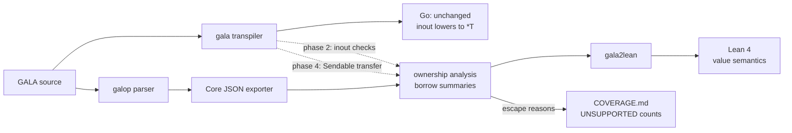
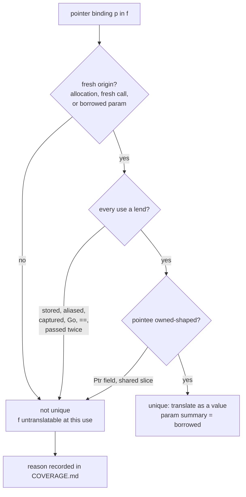
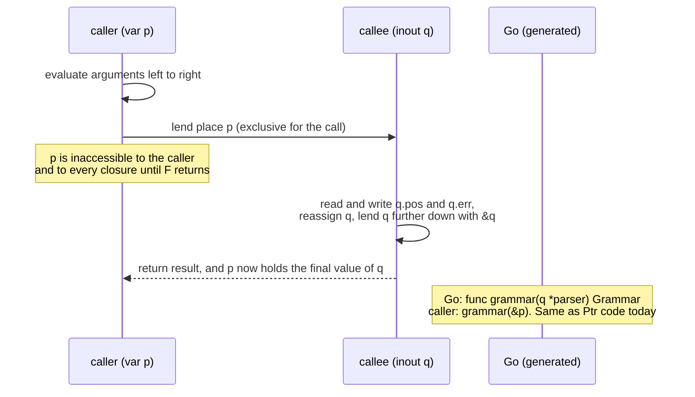
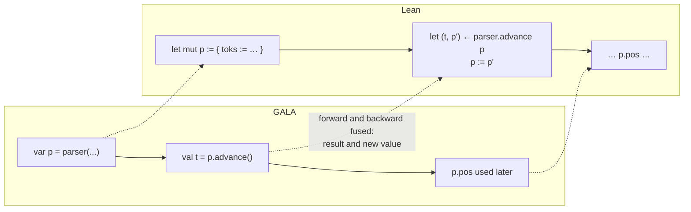
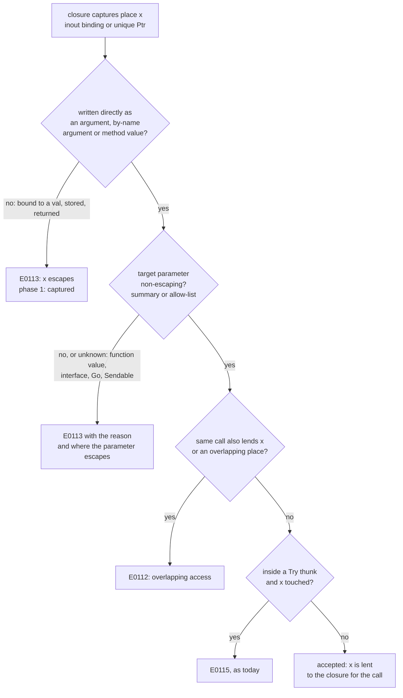
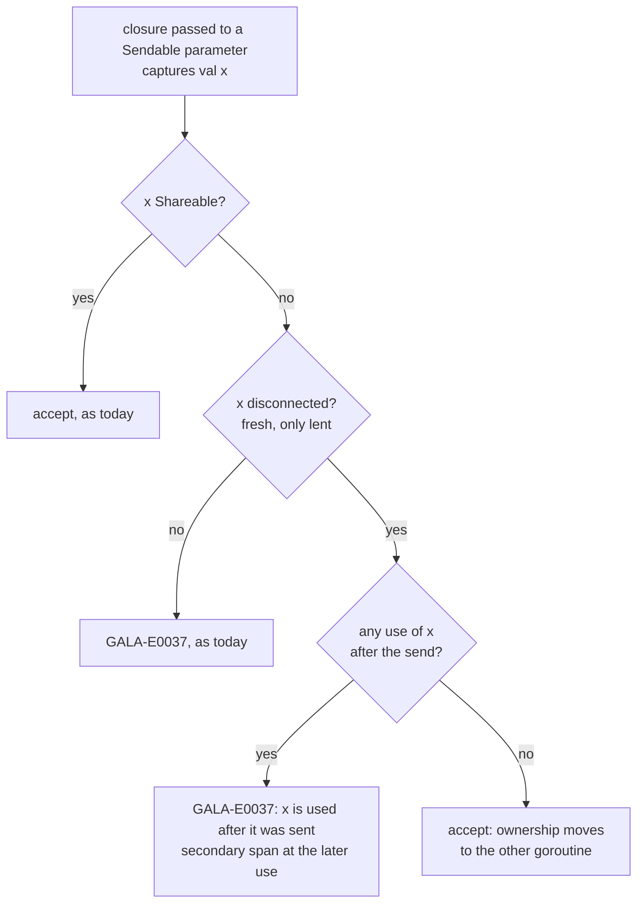
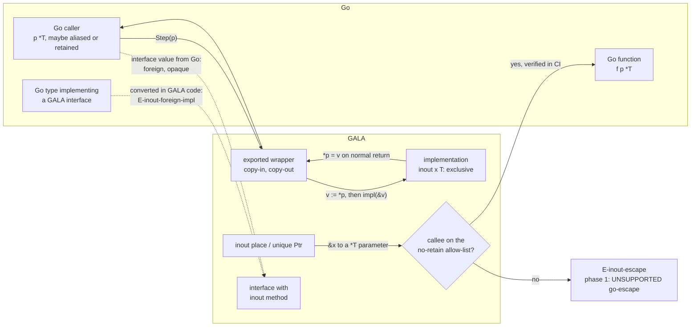
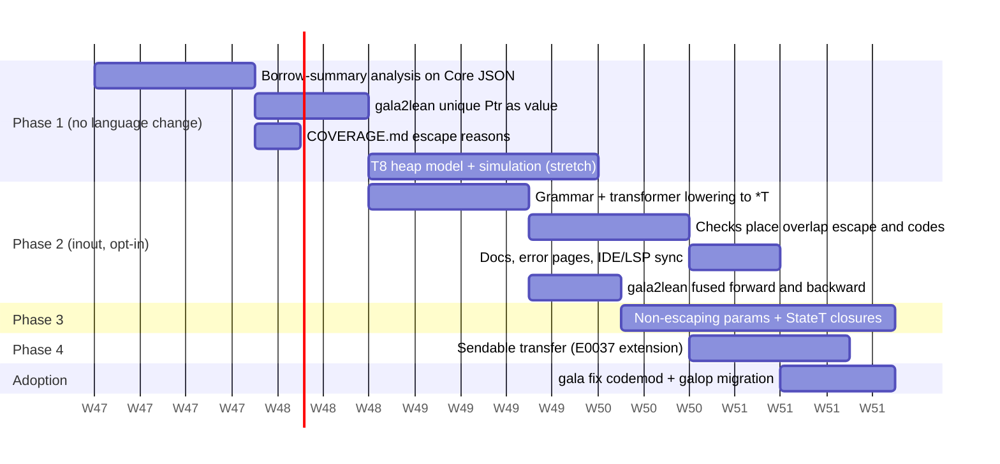

# Ownership: Inferred Uniqueness and `inout` Parameters

Status: phase 1 (inferred uniqueness) and phase 2 (`inout`) are implemented. Phase 4 is a
proposal decided in section 7. Phase 3 is designed in 3.3 and decided in section 9;
its analysis part is being built. Adoption (section 10): the `gala fix inout` codemod is
implemented; its public API changes and the builder redesign await the maintainer.
Discussion: [#961](https://github.com/martianoff/gala/discussions/961).
Related: [FORMAL_SEMANTICS.MD](FORMAL_SEMANTICS.MD), [CONCURRENCY_SAFETY.MD](CONCURRENCY_SAFETY.MD).

This document proposes an ownership discipline for GALA. It exists for two reasons:

1. A deterministic GALA → Lean translator (`gala2lean`) can translate a function only if
   every mutable value it touches has a single owner. Shared mutable state behind a
   pointer has no faithful value-semantics translation.
2. The `Sendable` boundary ([GALA-E0037](errors/GALA-E0037.md)) rejects every
   non-`Shareable` capture, even a freshly built buffer that the sending goroutine never
   touches again. Ownership can prove such a hand-off safe.

Ownership is a language-level decision, so this is a design to review. No code changes
come with it.

## Summary

- **Phase 1: inferred uniqueness.** This is an analysis with no syntax and no new
  errors. It decides which `Ptr[T]` values have a single owner and are only lent
  downward, and gives each function a *borrow summary*. The translator and the coverage
  report use it. On the measured code it recovers about **209 functions (3.1% of 6,669)**.
- **Phase 2: `inout` parameters.** These are opt-in, second-class and have no lifetimes,
  in the style of Swift and Hylo. In Go they lower to `*T`, exactly the Go a programmer
  writes with `Ptr[T]` today. They turn the inferred summary into a checked contract.
  They also cover what inference cannot see: function types and fields such as
  gala-tui's `Render func(Rect, *Buffer, *HitRegistry)`.
- **Phase 3: non-escaping closures may capture an `inout` place.** This is what
  `rules.ForEach((r) => b.add(r))` needs. Measured again in
  [3.3.1](#331-what-is-blocked-today-measured):
  - it recovers **17 galop functions**, taking galop from 82.3% to 85.3% and the total by
    0.4 points;
  - it recovers nothing in std or the examples;
  - it adds nothing to gala2lean's `-stats` until collections, `Option` and types from
    other packages translate.
- **Phase 4: transfer across `Sendable`.** A capture of a disconnected value is accepted
  when nothing uses it after the send. E0037 accepts more programs, and nothing it
  accepts is unsafe.
- **Not proposed:** Rust lifetimes, borrowed results, destructors, or any change to Go's
  GC or to the Go generated for existing programs.
- **Coverage, measured:** translatable functions go from **72.0% to about 75.2%** after
  phases 1 and 2, and **76.2%** after phase 3. With models for owned Go slices and
  captured `var`s, the upper bound is about **79%**. The research estimate of "about 80%"
  was optimistic. Its "about 7%" of pointer-blocked functions includes persistent
  collection internals, escaping pointers, and functions that have a second blocker.
- **Interop guarantees ([3.5](#35-interop-guarantees)):** `inout`'s guarantees also hold
  at the Go boundary, in both directions:
  - Go calls into an exported `inout` function through a copy-in/copy-out wrapper.
  - GALA may pass an `inout` place to Go only when the callee is on an allow-list of
    functions that don't retain pointers. CI checks the list against the pinned Go
    compiler's escape analysis.



## 1. Goals and non-goals

**Goals**

| # | Goal | Measure |
|---|---|---|
| G1 | **Faithful Lean translation of single-owner mutable state.** A function that mutates state through a uniquely owned pointer translates to a pure Lean function `T → M (R × T)`, with no heap model. | Share of functions that gala2lean translates, reported in `formal/COVERAGE.md`. |
| G2 | **Safe moves across `Future`/`Sendable`.** A freshly built mutable value may be handed to another goroutine when the sender never uses it again. | Programs E0037 rejects today that are race-free by construction. |
| G3 | **No change to the generated Go or to Go's GC.** Existing programs transpile byte for byte as today. `inout` lowers to the `*T` code that `Ptr[T]` produces. The one addition is a copy-in/copy-out wrapper on Go-visible `inout` functions (3.5.1). | Unchanged golden outputs; no new runtime package. |
| G4 | **Opt-in.** No existing program changes meaning or stops compiling. | Zero source changes required in std, galop, gala-tui, gala-team and gala-acp. |

**Non-goals**

- Lifetimes, lifetime annotations, or borrows that outlive a call.
- Functions that return a borrow (`&mut` results, Swift `_modify`, Hylo subscripts).
  Section 3.8 explains why leaving them out keeps the Lean translation closure-free.
- Deterministic destruction, linear types or move-only types. Resources keep `use`
  and `defer`.
- Translating Go interop (10% of functions) or concurrency (3%). Ownership does not help
  either one.
- Translating mutable collections. `collection_mutable` is *modelled* in Lean, not
  translated.
- Changing what `Ptr[T]`, `*T` or `&x` mean in existing code.

## 2. Measurement

The research scan classifies each of the 6,669 non-test functions in galop, std, the
examples, gala-team, gala-tui and gala-acp by the first feature that blocks a translation.
72% need no ownership. The `pointer` class (438 functions, 6.6%) is the target here.

To size each phase, the scan was extended. For every `pointer` function, it now decides
which mechanism would fix it:

| Sub-class | Meaning |
|---|---|
| `uniq-local` | Every pointer is allocated in the function and only lent downward. |
| `uniq-return` | Same as `uniq-local`, but the fresh pointer is returned (a constructor such as `newBuilder`). |
| `inout` | The pointers are parameters or receivers, used only downward: field reads and writes, method calls, and arguments to GALA calls. |
| `inout-closure` | Same as `inout`, but a lambda or a method value (`p.alternative`) captures the pointer. |
| `escape` | The pointer is stored in a field, collection, constructor or `Option`, aliased into another binding, returned while it is a parameter, or passed to Go. |
| `go-ptr` / `other` | The pointee is a Go type, or no named pointer binding was found (a heuristic miss). |

A function counts as **fixed** only when the pointer is its sole blocker. With the
pointer ignored, it must classify as pure, local-var, go-pure or ptr-read.

| Tree | Funcs | Pointer | uniq | inout | inout-closure | escape | other / go-ptr | Fixed by P1+P2 | Fixed by P3 | Second blocker (Go slice, mutable coll.) |
|---|---|---|---|---|---|---|---|---|---|---|
| galop | 575 | 96 | 0 | 58 | 30 | 6 | 2 | 57 | 30 | 1 |
| gala-tui | 1,363 | 101 | 1 | 57 | 31 | 6 | 6 | 51 | 29 | 12 |
| std | 1,122 | 127 | 1 | 89 | 7 | 18 | 12 | 77 (46 net) | 6 (4 net) | 27 |
| examples | 2,290 | 112 | 5 | 56 | 6 | 14 | 31 | 55 | 6 | 32 |
| gala-team, gala-acp, concurrent | 874 | 2 | 0 | 0 | 0 | 0 | 2 | 0 | 0 | 2 |
| **Total** | **6,669** | **438** | **7** | **260** | **74** | **44** | **53** | **240 (209 net)** | **71 (69 net)** | **74** |

"Net" subtracts 31 + 2 functions in `collection_immutable`'s persistent trees (`Array`,
`TreeMap`, `TreeSet`). Their nodes are shared by structural sharing, so they are not
single-owner. A translation models these collections with Lean's own structures and does
not translate their internals.

| Tree | Today | After P1+P2 | After P3 |
|---|---|---|---|
| galop | 75.3% | 85.2% | 90.4% |
| gala-tui | 86.7% | 90.5% | 92.6% |
| std | 68.4% | 72.5% | 72.8% |
| examples | 75.1% | 77.5% | 77.7% |
| **All** | **72.0%** | **75.2%** | **76.2%** |

Two further steps raise the upper bound to about 79%:

- Captured `var`s (106 functions, 1.6%) were expected to need phase 3's
  non-escaping-closure rule. That expectation is withdrawn: gala2lean keeps a captured
  `var` in a reference cell and translates it whether or not the closure escapes
  ([3.3.1](#331-what-is-blocked-today-measured)).
- Owned Go slices inside owned structs (74 functions) can be modelled as Lean `Array`
  under the freshness rule in section 2.4.

The scan is textual and heuristic. The galop and gala-tui figures were checked by reading
the code. The findings below are what the counts alone do not show.

### 2.1 galop: the ideal case

All of galop's mutable state lives in eight private types: `parser`, `lexer`, `builder`,
`configSet`, `rng`, `memory`, `usage` and `buffer`. Each is allocated once and lent down a
recursive-descent call tree.

- `Lex` allocates `&lexer{...}` locally and calls `Ptr[lexer]` methods. It never stores,
  returns or captures the pointer. This is uniqueness plus borrowed receivers, so the
  whole lexer translates. `lexer.data` is a `[]byte` that is only read, and it is
  modelled as a `ByteArray`.
- `Parse` allocates `&parser{...}` inside a `FlatMap` lambda, local to that lambda.
  `sepBy1(p, "|", p.alternative)` passes `p` and also a method value that captures `p`.
  Under phase 1 that is an alias, and under phase 2 it is an exclusivity error.
  Section 3.9 shows the rewrite: `item func(inout parser) T`. Phase 3 does not help
  here either, because the closure argument captures the place that the same call
  borrows `inout`.
- `newBuilder` returns a fresh `Ptr[builder]` (`uniq-return`). Its
  `rules.ZipWithIndex().ForEach((ri) => { b.ruleStart = ... })` is a non-escaping
  closure that captures `b`, so it needs phase 3. 13 `builder` methods have this shape.
- `sample.walker` stores `Rand Ptr[rng]` and `Used Ptr[usage]` in a value struct. That is
  a real escape. To translate it, `walker` must hold `rng` and `usage` by value and be
  passed `inout`.

### 2.2 gala-tui: inference is not enough

- `Buffer` holds `var cells []Cell` and writes `b.cells[idx] = c`. `NewBuffer` builds a
  fresh slice and `Clone` copies one. A translation needs the owned-slice rule (2.4).
- The widget tree is a public API that passes pointers through **function values**:
  `case CustomW(MinW int, MinH int, Render func(Rect, *Buffer, *HitRegistry))` and the
  backend's `Paint func(*Buffer, *Buffer)`. Inference has no body to summarise behind a
  function value, so a call through one counts as an escape. `renderToInternal` is
  blocked until the function type can say `func(Rect, inout Buffer, inout HitRegistry)`.
  This is the strongest case for phase 2.
- `HitRegistry` entries carry `Payload func(int, int) any`. The registry's own state
  translates, but `any` payloads remain Go interop.

### 2.3 std

- **`json` encoder and decoder (39 functions):** private `Ptr[...Impl]` receivers, lent
  downward. The encoder holds a `bytes.Buffer`, which needs a model for an owned
  `bytes.Buffer`.
- **`strings.StringBuilder`:** its fluent API returns the receiver
  (`func (sb Ptr[StringBuilder]) Append(s Str) Ptr[StringBuilder]`). A second-class
  `inout` cannot return its borrow, so fluent builders stay `Ptr`. This is a deliberate
  limitation. See open question Q9.
- **`lazy.Lazy`:** memoisation through a shared pointer, which is a genuine escape.

### 2.4 Owned Go slices

A Go slice field of an owned struct is modelled as a Lean `Array` only if the field is
**fresh**: every assignment to it is from `SliceWithCapacity`, `SliceEmpty`, a copy, or
`SliceAppend(field, …)` of the field itself. Otherwise two structs could share a backing
array, and the field stays `go-mutable`. This is a modelling trust point. Its Lean model
(`Array.set!`, `Array.push`) belongs in the prelude.

## 3. Design

### 3.1 Phase 1: inferred uniqueness

The analysis runs on the Core representation the exporter already produces. It is part of
the formal tooling, not of `gala build`, so it costs nothing in normal compilation.

**Definitions.** A *place* is a `var` local, an `inout` parameter (phase 2), or a field
path `x.f.g` through `var` fields of a place. A pointer binding is `p: Ptr[T]`, or a `*T`
that is known not to be nil.

A pointer binding `p` in function `f` is **unique** when both of these hold:

1. **Fresh origin.** `p` is bound to one of:
   - an allocation: `&T{…}` or `&T(…)`;
   - a call whose summary is *returns fresh*;
   - a borrowed parameter of `f`, which is unique for the duration of the call (see
     below).

   `&v` of a local `var` is fresh only when `v` is never used directly again. Otherwise
   `v` and `p` are two access paths to the same value.
2. **Every use is a lend.** Each occurrence of `p` is one of:
   - a field read `p.f`, or a field write `p.f = e` where `e` does not mention `p` as a
     whole;
   - a deref read `*p`, which yields a copy;
   - a method call `p.m(…)` whose receiver summary is *borrowed*;
   - an argument to a GALA function whose summary for that parameter is *borrowed*;
   - a `return p` that makes `f`'s summary *returns fresh*. This applies only when `p`
     came from an allocation.

**What counts as escaping.** Any other use is an escape. The table lists them.

| Escape | Example | Why it breaks single ownership |
|---|---|---|
| Stored | `w.Rand = rand`, `walker(…, rand, …)`, `Some(p)`, `(p, 1)` | A second path to the pointee outlives the call. |
| Aliased through a collection | `xs.Append(p)`, `ArrayOf(p)`, `m.Put(k, p)` | Same as stored. |
| Aliased into a binding | `val q = p` | Two names. The analysis could track this, but phase 1 does not. |
| Returned (when not fresh) | `func f(p Ptr[T]) Ptr[T] = p` | The caller now holds a second path. |
| Captured | `() => p.x`, `xs.ForEach((x) => p.add(x))`, the method value `p.alternative` | Go closures capture by reference, and the closure may outlive the call. Phase 3 relaxes this for non-escaping closures. |
| Passed to Go | `bufio.NewWriter(p)`, an `any` or interface conversion, a Go `func(*T)` slot | Go may store it. Ownership does not cross the interop boundary. |
| Compared | `p == q` | Pointer identity has no value-semantics meaning. |
| Passed twice | `f(p, p)`, `p.blit(p)` | The callee sees two aliases. This is an exclusivity violation. |
| Global | a package-level `var` holding a `Ptr` | It is reachable from anywhere. |
| Unknown callee | calling a function value with `p` as an argument | No summary is available. Phase 2's `inout` function types fix this. |

**Shape restriction.** The pointee type `T` must itself be owned-shaped. Every field must
be a value: a primitive, a GALA value type, an immutable collection, or a fresh Go slice
(section 2.4). A `Ptr` or `*U` field makes the pointee a graph, not a tree, and the binding
cannot be translated.

**Summaries and the fixed point.** Every function gets a summary in two parts:

- one bit per pointer parameter and receiver: *borrowed* or *escapes*;
- one bit for the result: *returns fresh*.

Summaries are computed per strongly connected component of the call graph, as a
*greatest* fixed point. Recursive calls start optimistic (borrowed) and are demoted until
nothing changes. The lattice has height 2 per bit, so the cost is linear in program size
times a small constant. Exported functions get summaries too, and they are written into
package metadata, as the non-nil property of a `Ptr` receiver already is. A caller in
another package can then use them.



**Exclusivity at a call site.** A callee with two borrowed parameters assumes they are
disjoint. A caller meets this by construction: an argument must be a unique local or a
borrowed parameter of the caller, and the same binding may not appear twice. A unique
binding has never been stored, so no other argument can reach it.

**Soundness argument.** Take a unique binding `p`. At every program point, the only live
access path to its pointee is `p`, or the borrowed parameter that `p` was lent to while
that call is active. Borrowed parameters follow a stack discipline: a callee cannot store,
return, capture or pass on its parameter except by lending it further down. So a write
through `p` is observable only through `p`.

The proof is a simulation. Relate the heap semantics, where the pointee is a cell, to the
value semantics, where the cell's content is a value threaded through the function and
returned from each borrowing call. The relation holds after every step, by induction on
evaluation: a field write updates the cell and the threaded value identically, and a
borrowing call returns the updated value, which the caller rebinds. Nothing else reads
the cell, so nothing can tell the two semantics apart.

In Lean this becomes a stretch theorem, **T8**: for a program the analysis accepts,
galaspec's evaluation with a heap agrees with the translation in value semantics. T8 needs
galaspec to grow a heap model for `Ptr` (open question Q12).

**Panics.** Go keeps writes made before a panic. If the panic is caught (`Try`, its
combinators, `recover`) while a borrowed place is still live, Go shows the partial update.
A translation that threads the value through the *result* would drop it. Phase 1
therefore treats a borrowing call inside a panic-catching construct as an escape when the
borrowed place is used after the catch. Q5 discusses keeping such places in the monad's
state instead. The prototype's `EStateM` keeps its state when an error is raised.

**Diagnostics.** Phase 1 issues no compile errors and no warnings. It does not change the
language. Its output is translator-facing:

- an `UNSUPPORTED ptr-escape` verdict per function, with the reason and position, for
  example `p captured by method value p.alternative at parser.gala:291`;
- counts per reason in `COVERAGE.md`;
- optionally, an LSP hover line: `Ptr[parser] p: unique (borrowed by 31 methods)`.

**What it covers.** Uniqueness alone covers 4 function bodies. The borrow summaries it
infers cover the 205 net `inout`-class functions, provided the whole call graph is
visible. galop's `parser`, `lexer`, `builder` and `configSet` qualify entirely. Phase 1
does not cover function values, closures, or a gala-tui widget written by a user in
another package.

**Implementation.** Phase 1 lives in `internal/transpiler/ownership`. It reads the native
parse tree and the analyzer's metadata rather than Core JSON, because Core JSON does not
export methods, pointers or imports. When the analyzer loads a package, it records each
function's and method's borrow summary in the package metadata
(`FunctionMetadata.Borrow`, `MethodMetadata.Borrow`, analysis cache v44), so a caller in
another package reads them. No part of the transpiler reads them, and the generated Go does
not change. At the Go boundary the analysis is conservative in both directions: any flow of
a pointer, or of a reference inside its pointee, into Go is the escape `passed-to-go`, and
a pointer received from Go is `from-go`, never unique. `bazel run
//internal/formal/ownershipcov/update` writes the escape reasons for the repository's
libraries and examples into [formal/COVERAGE.md](../formal/COVERAGE.md).

### 3.2 Phase 2: `inout` parameters

Inference is silent and fragile. One edit to a body, such as storing `p` in a debug
field, makes a whole call tree untranslatable without a single compile error. An `inout`
parameter turns the summary into a checked contract, and it adds three things inference
cannot give:

- `inout` in function types and fields;
- mutation of value types with no `Ptr` in the API;
- precise errors at the line that breaks ownership.

#### 3.2.1 Syntax options

| Option | Declaration | Call site | Assessment |
|---|---|---|---|
| **A. `inout` modifier (recommended)** | `func advance(inout l lexer)`, `func (inout l lexer) advance()` | `advance(&l)`; receiver calls stay `l.advance()` | Mirrors the existing `var n int` parameter modifier. Swift readers know it. `&` at the call site is the Go that gets generated. |
| B. Marker type `Mut[T]` | `func advance(l Mut[lexer])` | `advance(&l)` | Consistent with `Sendable[F]` and `Ptr[T]`, but a type invites `Array[Mut[T]]`, `Option[Mut[T]]` and `Mut` fields, which would all need bans. A second-class *type* is a contradiction. |
| C. `Ptr[T]` parameters are non-escaping by default | unchanged | unchanged | No new syntax, but **mandatory and breaking**. It rejects the 44 escaping functions, std's persistent-node internals, fluent builders, and every Go-facing `*T`. Rejected. |
| D. Reuse `var` parameters | `func advance(var l lexer)` | `advance(&l)` | `var n` already means "a local mutable copy". Changing it changes the meaning of valid programs. Rejected. |
| E. `mut` / `ref` modifier | `func advance(mut l lexer)` | `advance(&l)` or `advance(ref l)` | Equivalent to A. `mut` suggests Rust's `&mut` and its lifetimes; `ref` suggests C#'s, with no exclusivity. A matter of taste (Q2). |

The rest of this section uses option A.

```gala
type parser struct {
    toks Array[Token]
    var pos int
    var err Option[Diagnostic]
}

// A value receiver: reads only.
func (p parser) peek() Token = p.toks.Get(p.pos)

// An inout receiver: the caller's parser is updated in place.
func (inout p parser) advance() Token {
    val t = p.peek()
    if !t.Kind.isTokEOF() {
        p.pos = p.pos + 1
    }
    t
}

func Parse(toks Array[Token]) Either[Diagnostic, Grammar] {
    var p = parser(toks = toks, pos = 0, err = None[Diagnostic]())
    val g = grammar(&p)          // an explicit argument needs &
    p.err match {
        case Some(d) => Left(d)
        case None() => Right(g)
    }
}
```

#### 3.2.2 Flow of an `inout` call



#### 3.2.3 Typing rules

| Rule | Statement |
|---|---|
| **Binding** | `inout x T` binds `x` as a *mutable place* of type `T` in the body. `x` can be read, its `var` fields can be written, and `x = e` reassigns it, even when every field of `T` is `val`. This is Hylo's mutable value semantics: an immutable struct is updated by replacement (`p = p.Copy(pos = p.pos + 1)`). |
| **Argument** | At an `inout` position the argument is `&e`, where `e` is a mutable place: a `var` local, an `inout` parameter, a `var` field path of a place, or the pointee of a `Ptr` (`p`, `p.f`). A `val`, a `val` field, a call result, a literal, a collection element or a value receiver is an error. |
| **Receiver** | `func (inout x T) m()` is called as `v.m()` on a `var` (auto-`&`, as a `Ptr` receiver is today), on an `inout` parameter, or on a `Ptr[T]`. On a `val`, a call result or a literal it is an **error**. Compare `Ptr` receivers, which silently mutate a copy through `AddrOfCopy` (Q4). |
| **Exclusivity** | No two `inout` arguments of one call, the receiver included, may name overlapping places: the same root, or a path where one is a prefix of the other (`&p` and `&p.lex`). Disjoint fields of the same `var` (`&p.a`, `&p.b`) are allowed. No other argument of that call may be a closure that captures an overlapping place. Plain reads of the place in other arguments are allowed: they run before the call, left to right, and produce copies. |
| **No escape** | An `inout` binding `x` may be read and lent (`&x` to another `inout` position) but not captured by a lambda or method value (phase 3 allows non-escaping closures). `&x` may not be stored, returned, put in a collection or `Option`, converted to `any` or an interface, passed to a `Ptr[T]` or `*T` parameter, or passed to Go. |
| **Second-class** | `inout` appears only on parameters, receivers and the parameters of function types. It is not a type. A field, local, result or type argument cannot be `inout`. |
| **Function types** | `func(inout T, A) R` is a GALA function type distinct from `func(Ptr[T], A) R`. Both lower to Go's `func(*T, A) R`. A function with an `inout` parameter fills a `func(inout T…)` slot. It can also fill a Go `func(*T)` slot, where it is wrapped in the copy-in/copy-out adapter of [3.5.1](#351-go-calls-gala), because Go may call it with an aliased pointer. A `func(*T)` value never fills a `func(inout T)` slot, because it may store its argument. |

**Interactions**

- **`val` / `var`:** only a `var` (or a place reached from one) can be lent. To lend a
  `val`, copy it first: `var c = v; f(&c)`. That is E0076's existing advice.
- **`Ptr[T]`:** a `Ptr` can be lent to an `inout T` with `&*p` or just `p`. This is the
  bridge from existing code. The program compiles either way. Whether the *caller*
  translates depends on phase 1 proving `p` unique.
- **Lambdas:** `(inout b Buffer) => b.Fill(r, c)` is a lambda with an `inout` parameter.
  It fills a `func(inout Buffer)` slot. A lambda may not capture an outer `inout` binding
  until phase 3.
- **Generics:** `inout x T` with `T` a type parameter is allowed. `inout` is not a type,
  so a generic `func(A) R` cannot be instantiated with an `inout` `A`. A higher-order
  function that lends state says so: `func sepBy1[T any](inout p parser, sep string,
  item func(inout parser) T) Array[T]`.
- **Pattern matching:** `x match { … }` on an `inout` binding matches a copy. Pattern
  variables are `val`s. To change the case, assign `x = Some(n + 1)`. `inout` pattern
  bindings (projections into a case) are not part of this proposal (Q10).
- **`Shareable` / `Sendable`:** an `inout` binding can never be captured by a `Sendable`
  closure, because the no-escape rule already forbids the capture. A `Shareable` value
  may be lent `inout`: the *binding* changes, and the old value stays immutable.
- **Method values:** `x.m` where `m` has an `inout` receiver captures `x`, so it is an
  escape unless called on the spot.
- **Interfaces:** an `inout`-receiver method is a Go pointer-receiver method, so the
  method-set rules of `Ptr` receivers apply unchanged (the E0080 family). Q8 asks whether
  an interface may declare that a method is `inout`.
- **Go interop:** `inout x T` lowers to the Go parameter `x *T`:
  - a whole read of `x` becomes `*x`, and `x = e` becomes `*x = e`;
  - `x.f` stays `x.f`, and `&v` stays `&v`;
  - an exported function checks its `inout` parameters for nil on entry, as it does for
    `Ptr` parameters.

  Go code may hold, share or alias the pointer it passes. An exported function or method
  with an `inout` parameter is therefore reached from Go through a copy-in/copy-out
  wrapper ([3.5.1](#351-go-calls-gala)). Passing an `inout` place *to* Go is limited to
  allow-listed callees ([3.5.2](#352-gala-calls-go)).

#### 3.2.4 Error codes

New codes get the next free numbers when they are implemented. Each needs a page in
`docs/errors/` and `website/docs/errors/`.

| Code (to allocate) | Error | Example |
|---|---|---|
| E-inout-place | an `inout` argument is not a mutable place | `advance(&v)` for a `val v`; `advance(&f())` |
| E-inout-amp | an `inout` argument is missing its `&` | `advance(p)` for a `var p parser` |
| E-inout-overlap | overlapping access in one call | `blit(&b, &b)`; `sepBy1(&p, "\|", p.alternative)` |
| E-inout-escape | an `inout` binding escapes | `w.Rand = &r`; `() => r.next()`; `bufio.NewWriter(&w)` |
| E-inout-receiver | an `inout`-receiver method is called on a non-place | `parser(…).advance()`; on a `val` |
| E-inout-position | `inout` where only a parameter may have it | a field, local, result or type argument (a parse error, if the grammar allows) |
| E0037 (extended, phase 4) | a value is used after it was sent | see 3.4 |

#### 3.2.5 Lean translation

Aeneas translates a Rust function that takes `&mut T` into a *forward* function, which
computes the result, and a *backward* function, which computes the final value of the
borrowed input. Current Aeneas fuses the two: the function returns its result together
with the updated input. Because `inout` borrows are second-class and never returned, every
GALA case is the simple one:

```
func f(inout x T, a A) R      ⟶      def f (x : T) (a : A) : M (R × T)
```

`M` is the prototype's monad, `EStateM Panic St`. With several `inout` parameters the
tuple grows: `M (R × T₁ × T₂)`. A call rebinds every lent place, as in Lean's `do`
notation with `let mut`.



**Worked example 1: an `inout` receiver.** The GALA code is `parser.advance` from 3.2.1.

```lean
structure parser where
  toks : Array Token
  pos  : Int64
  err  : Option Diagnostic

-- a value receiver: a pure forward function
def parser.peek (p : parser) : M Token := arrayGet p.toks p.pos

-- an inout receiver: forward and backward fused
def parser.advance (p : parser) : M (Token × parser) := do
  let mut p := p
  let t ← parser.peek p
  if !(t.Kind.isTokEOF) then
    p := { p with pos := p.pos + 1 }
  return (t, p)

def Parse (toks : Array Token) : M (Either Diagnostic Grammar) := do
  let mut p : parser := { toks := toks, pos := 0, err := none }
  let (g, p') ← grammar p
  p := p'
  match p.err with
  | some d => return .left d
  | none   => return .right g
```

**Worked example 2: field projection and two `inout` places.**

```gala
type front struct {
    var lex lexer
    var par parser
}

func step(inout l lexer, inout p parser) { … }

func (inout f front) pump() {
    step(&f.lex, &f.par)       // disjoint fields of one place: allowed
    f.lex.advance()            // auto-& on a field path
}
```

```lean
def front.pump (f : front) : M (Unit × front) := do
  let mut f := f
  let ((), l', p') ← step f.lex f.par
  f := { f with lex := l', par := p' }
  let ((), l'') ← lexer.advance f.lex
  f := { f with lex := l'' }
  return ((), f)
```

**Worked example 3: a loop.** `for p.ok() && p.acceptPunct(sep) { items = items.Append(item(&p)) }`
becomes a `while` in `do` notation. `let mut p` and `let mut items` are reassigned after
each call. This is the rule the prototype already uses for local `var`.

**Why the translation stays closure-free.** A Rust function that *returns* `&mut U` into
its argument needs a backward function that is a closure (`U → T`). That closure is what
makes Aeneas's output and proofs heavier. Leaving out borrowed results (a non-goal) means
every backward part is a plain returned value. Lean's own runtime then helps: a value
threaded this way has reference count 1, so `{ p with pos := … }` and `Array.set!` update
in place (see Prior art). The translated Lean is efficient as well as faithful.

### 3.3 Phase 3: non-escaping closures may capture `inout` places

Status: designed and decided ([§9](#9-phase-3-decisions)). The analysis is implemented:
3a ([#1126](https://github.com/martianoff/gala/pull/1126)) and 3b
([#1132](https://github.com/martianoff/gala/pull/1132)). The language change and the Lean
translation wait for gala2lean (Q19).

Phase 3 lets a closure capture a place that is lent: an `inout` binding, or a pointer that
phase 1 proves unique. The closure may do this only if it cannot outlive the call it is
passed to. galop's `builder` is the typical case:

```gala
rules.ZipWithIndex().ForEach((ri) => {
    b.ruleStart = b.ruleStart.Append(b.state(ri.V2, RuleStartState()))
})
```

#### 3.3.1 What is blocked today, measured

The measurement uses master, galop at `main`, the phase 1 analysis (`ownershipcov/update -json`),
the textual scanner from section 2, and `gala2lean -library` and `-stats` on every galop
package and every example. Each count below was taken from those tools' output, not estimated.

**gala2lean's own verdicts.** `gala2lean -stats` translates 50 of galop's 580 functions
(8.6%) and 321 of the examples' 1,738 functions (18.5%).

- **Lambda capture is the first blocker of none of them.** gala2lean reports one construct
  per function that it does not translate. In galop these are:
  - an immutable collection or `Option` type (167 functions);
  - a type from another galop package (143);
  - another generic type (52);
  - a method call (22);
  - an import (21);
  - a `Ptr[T]` type (6).
- **A captured `var` already translates.** gala2lean keeps it in a reference cell in the
  program state, so `twice(() => { n = n + 1 })` translates and runs today.
- **What capture does block is narrower: `ptr-escape`.** gala2lean reports it for a
  pointer or `inout` receiver used inside a lambda, and for a pointer method called on a
  captured `var`.

So phase 3 adds nothing to `-stats` until gala2lean translates immutable collections,
`Option`, types from other packages and `Ptr[T]` receivers. Its gain is real only after
that work.

**The phase 1 analysis.** The `captured` reason appears on these bindings:

| Tree | Bindings with `captured` | Fixed when captures are allowed | Remaining blockers |
|---|---|---|---|
| galop | 49 bindings (of 128), at 75 capture sites in 55 closures | 18 (strict rule) to 28 (every capture) | Go slices in the pointee (`lexer`, the mutable collections), `rand` stored in `walker` |
| std and other libraries | 119 | 0 | Each one also has `shape`, `from-go` or `passed-to-go` |
| examples | 19 | 0 under the strict rule, 2 for by-name arguments | the same |

Here is what galop's 55 closures do with what they capture, counted by hand from the 75
sites:

- **44 are passed directly to a std higher-order function:** `ForEach`, `Map`, `FlatMap`,
  `Filter`, `FoldLeft`, `ForAll`, `Find` or `ArrayTabulate`, or to a terminal `ForEach` on
  a stream. All of these call the closure during the call, and only then.
- **6 are first bound to a local `val`** (`val visit = (c) => …`) and then called or passed
  on.
- **3 conflict with a lend in the same call:** `sepBy1(p, "|", p.alternative)`,
  `sepBy1(p, ",", p.command)` and `sepBy1(p, ".", () => p.expectId(…))`. Each argument
  list both lends `p` and captures it. E0112 already rejects this for `inout`, and phase 3
  does not change that.
- **1 is a false positive of phase 1:** `Parse` declares `p` inside the lambda, so
  nothing is captured.
- **1 is a method value passed to `Find`:** `l.hasPrefix`.

**The scanner, for comparison with section 2.** It counts a function as recovered when
every pointer binding becomes unique and the rest of its body is translatable. Phase 1
measured 65.9% overall and 82.3% for galop.

| Rule | galop recovered | galop | All trees |
|---|---|---|---|
| Phase 1 (today) | 40 | 82.3% | 65.9% |
| Phase 3, strict rule: closures passed directly as arguments, no overlapping lend | 57 (+17) | 85.3% | 66.3% |
| …plus `sepBy1` taking `item func(inout parser) T` (an adoption edit, section 2.1) | 67 (+27) | 87.0% | 66.5% |

The 17 functions are:

- `newBuilder` and 11 `builder` methods;
- `Sim.closure`, `Sim.Start` and `Sim.Reach` (on `Ptr[configSet]`);
- `parser.rejectRulePrequel`;
- `render`.

`Parse` falls just outside the strict rule: its lambda's call to `p.grammar()` reaches the
`sepBy1` chain.

The scanner's `captured-var` class holds 91 functions: 38 in `collection_immutable`, 35 in
the examples, 10 in `stream`, 3 in galop and 5 elsewhere. They are not a phase 3 target,
because gala2lean translates them already (see above). Section 2's earlier upper bound,
"captured `var`s (106 functions) use the same rule as phase 3", is withdrawn.

**Expected gain.** Up to +17 galop functions, raising galop from 82.3% to 85.3%. Adopting
`sepBy1` adds 10 more. Nothing is gained in std or the examples, and the total rises by
0.4 points. All of this becomes visible in `-stats` only once gala2lean's prerequisites
above are in place. The earlier estimate in this section (+69 functions, 1.0 point) was
too high by a factor of about four. It counted gala-tui, which is now external (Q11), and
the persistent-collection internals.

#### 3.3.2 Capture rules

GALA closures capture by reference, as Go does. Phase 3 keeps this. A copying capture
would change what valid programs print.

| Captured binding | Today | Phase 3 |
|---|---|---|
| `val` | by reference, which is the same as a copy | unchanged |
| local `var` | by reference; gala2lean uses a reference cell | unchanged; escaping closures stay legal |
| `inout` binding, or a field path of one | E0113 for every capture | allowed in a **non-escaping** closure; E0113 otherwise |
| `Ptr[T]` that phase 1 proves unique | the `captured` escape reason | a lend, if the closure is non-escaping |
| method value `x.m` on such a place | E0113 / `captured` | the same rule: a method value is a closure |
| by-name argument that mentions the place | E0113 / `captured` | the same rule, applied to the by-name parameter |

A closure is **non-escaping** when it is written directly as an argument, a by-name
argument or a method value, and the parameter it fills is non-escaping.

A closure bound to a local `val` first is escaping. Q21 asks whether to relax this.

A capture always lends the whole place, and it lasts as long as the call the closure is
passed to. Two rules follow:

- **Exclusivity, already enforced by E0112.** That call may not also lend the place, or an
  overlapping place, `inout`.
- **Reads in other arguments.** They are evaluated before the call, as copies, so they
  stay allowed.

Inside the closure, the place is used as in the body that owns it:

- it can be read, and its `var` fields written;
- it can be lent onward with `&x`, or called through an `inout` receiver;
- a nested closure that is itself non-escaping may capture it.

#### 3.3.3 Non-escaping parameters, inferred

A function-typed parameter `f`, or a by-name parameter, is non-escaping when every use of
it in the body is one of these:

- a call, `f(…)`;
- an argument to a parameter that is itself non-escaping (a summary edge);
- a capture by a closure that is itself non-escaping.

Anything else is an escape. That covers:

- being stored in a field, collection, `Option` or tuple;
- being returned;
- being bound to a name other than a local only called (Q21);
- being compared;
- being passed to a `Sendable` parameter, a `go` statement or `go_interop.Spawn`;
- being passed to Go, except to an allow-listed callback slot (3.3.5).

The analysis extends phase 1:

- **Summaries:** one bit per function-typed parameter, *calls only* or *escapes*,
  computed per strongly connected component of the call graph as a greatest fixed point.
- **Storage:** written to package metadata next to `Borrow` (decision Q6), so a caller in
  another package reads them. The analysis cache version is bumped. The fixed point is
  per package: only the package's own GALA functions start optimistic, and a callee in
  another package is read from the summary its own package's fixed point converged to,
  never from an optimistic bit. Go functions, function values, interface methods and
  callees without a summary escape.
- **std, measured with a textual check:**
  - `collection_immutable`, `std` and `stream` have 198 function-typed parameters;
  - 122 are only ever called;
  - 73 are passed on, or captured by an inner lambda, so the fixed point decides them;
  - 2 are stored.
  - The lazy stream operations escape: `Stream.Map` captures `f` in its tail thunk. Their
    terminal operations (`ForEach`, `FoldLeft`) do not.
- **Evaluation order is part of the summary's meaning.** A Lean model of `Map` must call
  `f` once per element, in index order. std's `Array.Map`, `ForEach` and `ArrayTabulate`
  loop in that order today, and the differential tests check it.

Inference makes a library's escape behaviour part of its API without a word in the
signature. Suppose an exported function starts storing its callback. Callers in other
packages that capture an `inout` place then get E0113, and the change looks like a body
edit. Q20 asks whether exported functions should declare the property instead.

#### 3.3.4 Flow of a checked capture



#### 3.3.5 Interactions

- **`inout` and E0113:**
  - E0113 stops firing for a capture that the rule above accepts.
  - Every other E0113 case stays: `&x` stored, returned or passed to `Ptr`; a method value
    called later; a capture in an escaping closure.
  - The message names the parameter that escapes and, when the summary knows it, the line
    where it escapes.
- **Go callbacks.** A closure passed to a Go function-typed parameter escapes by default,
  as every Go call does (3.5.2). The no-retain allow-list (`internal/transpiler/noretain.go`,
  11 receiver entries today) gains a second kind of entry: a Go function and a func-typed
  parameter that Go calls only during the call. Examples are `sort.Slice`'s `less`,
  `slices.SortFunc`'s `cmp`, and `strings.Map`'s `mapping`. CI verifies each entry the
  same way: `-gcflags=-m` must report `f does not escape`. Users cannot add entries
  (decision Q15). A Lean model of the callee must also say when it calls the callback
  (3.5.5).
- **Goroutines and `Future`:**
  - A `Sendable` parameter always escapes. `Future(…)`, `go_interop.Spawn` and a `go`
    statement make every closure they receive escaping.
  - E0037 is unchanged, so capturing an `inout` place in such a closure stays E0113.
  - `Future.Map(f)` and the other callbacks that run later on another goroutine escape
    through their summaries; this needs no special case.
- **`Try`:**
  - The thunk of `Try(...)` runs during the call, so it is non-escaping.
  - E0115 (decision Q5) still forbids reading or writing an `inout` place inside it.
  - Phase 3 relaxes nothing there. A closure capturing `x` that is called inside a `Try`
    thunk is covered by E0115's existing transitive check of the thunk body. Q24 asks
    whether that is enough.
- **Interfaces and function values.** A call through a function value or an interface
  method has no summary, so its function-typed parameters escape. Q22 asks whether a
  function type may say that a parameter is non-escaping.
- **The generated Go is unchanged.** A non-escaping closure is the same Go closure as
  today, so no golden output changes. Go's own escape analysis may now keep more of these
  closures on the stack, but GALA does not rely on that.

#### 3.3.6 Lean translation

gala2lean already gives each lambda the type `A → _gala_M R` and keeps each captured `var`
in a reference cell in `_gala_M`'s state. Three shapes can translate a lent place that a
non-escaping closure captures:

| Option | Shape | std models needed | Panics | Cost |
|---|---|---|---|---|
| **A. `StateT`** | The closure runs in `StateT S _gala_M`, where `S` holds the captured places. The higher-order function is lifted. | Generic over the monad (`forM`, `mapM`, `foldlM`), plus `MonadLiftT` instances | `StateT`'s state is lost when `EStateM` raises. Go keeps the writes made before the panic. They differ only if the panic is caught, which E0115 forbids for `inout` places. | A second monad layer in every translated higher-order function |
| **B. Scoped cell (recommended)** | At the call that receives the closure: copy `x` into a fresh cell, translate the closure against the cell with today's captured-`var` machinery, then read the cell back into `x` after the call. An `inout` method call inside the closure reads the cell, calls the method by state passing, and writes the cell. | None: higher-order functions stay in `_gala_M`, as they are today | Writes made before a raise stay in the cell, as in Go. The `inout` write-back is skipped on a raise, as now (Q14). | One cell per lent place per call |
| C. Explicit threading | The closure becomes `S → A → _gala_M (R × S)`, and each higher-order function gets an accumulating variant (`mapAccum`, a fold with state). | A threaded model of every higher-order function | Like A | The most models to write; the purest terms for proofs |

**Why B is sound.** B is argued correct under the conditions below, and tested; it is not
a proved theorem. The argument is a simulation between Go's heap, where the pointee of `x`
is written in place, and the Lean state, where the value is written to a cell and later
read back. The math expert reviewed this list.

The check in 3.3.4 enforces three facts:

1. **The cell is fresh.** The cell is allocated at the call, so no path other than the
   closures of that call reaches it.
2. **The closure is non-escaping.** No closure that holds the cell is reachable after the
   higher-order call returns. So nothing writes the cell after the read-back, and the
   read-back sees the final value.
3. **Access is exclusive.** A call that lends `x` by state passing can never reach a live
   closure that captures `x`. Such closures are only direct arguments, never stored, and
   E0112 forbids passing one to a call that lends `x`. gala2lean's `placeShared` case,
   which rejects a pointer method on a shared captured `var` today, therefore cannot
   arise for a place lent this way.

The translation must also meet four conditions:

4. **One cell per place per call.** If one call receives two closures that both capture
   `x` (`h(() => x.a(), () => x.b())`), both use the same cell. Separate cells would make
   one write-back overwrite the other. A fixture covers this case.
5. **Every use of `x` inside the closure goes through the cell.** That includes plain
   field reads (`x.n`) and uses of the whole value, not only `inout` method calls.
   Otherwise the closure would read a stale `x` after an earlier call in it wrote the
   cell.
6. **No other argument of the call aliases `x`.**
   - E0112 covers `&x`.
   - For a unique `Ptr` `p`, passing `p` itself as another argument would give the callee
     a path that sees Go's writes in place, while B shows it the old value. Phase 1
     already classes `f(p, p)` as *passed twice*, so `p` is then not unique and B does not
     apply.
   - Passing `x`'s value is fine: it is a copy, evaluated before the call in both
     semantics.
7. **No panic is caught between the higher-order call and the end of `x`'s lifetime.**
   E0115, together with the absence of `recover` in the translated subset, gives this
   today. The condition applies equally to A.

**What B trusts.** The argument rests on the non-escaping inference, which is the
transpiler's own analysis, the thing the differential run tests. If gala2lean took the
non-escaping bit from the transformer, a wrong inference would make the Lean side agree
with the wrong Go, and no differential run could see it. So gala2lean decides
non-escaping itself:

- from a vetted list of std higher-order models;
- or by checking the callee it translates: the parameter is only called, or only passed
  to such a parameter.

Q25 records this choice. If it is ever reversed, the transformer's summary must be listed
as a trust point in 3.5.5.

A dead cell left in the heap is not observable.

Here is B on `newBuilder`, simplified. The ATN state types are left out:

```lean
def newBuilder (lexer : Bool) (vocab : Vocabulary) (rules : Array Rule) : _gala_M builder := do
  let mut b : builder := { … }
  let cell ← _gala_new3 b                     -- lend b to the closure
  rulesForEach (zipWithIndex rules) (fun ri => do
    let b₀ ← _gala_get3 cell
    let (s, b₁) ← builder.state b₀ ri.2 .RuleStartState   -- state-passed method
    _gala_set3 cell { b₁ with ruleStart := b₁.ruleStart.push s })
  b ← _gala_get3 cell                         -- read back after the call
  return b
```

**What is claimed.** Phase 3 adds no theorem. Its correctness for the translator rests on
the argument above and on differential tests, in which the Lean run must agree with the Go
run.

A natural next statement would be: on programs the phase 3 check accepts, B's output
agrees with C's pure state threading. It needs galaspec's heap model for `Ptr`, the
same prerequisite as T8 (decision Q12), so it is not proposed now. Q23 asks which shape to
build.

#### 3.3.7 Diagnostics

Phase 3 mostly relaxes existing checks, so it needs few new codes. The codes from
`GALA-E0118` on are free: E0117 is taken by Go function literals.

| Code | Change |
|---|---|
| [GALA-E0113](errors/GALA-E0113.md) | Accepts a capture by a non-escaping closure. Its message says why a parameter escapes ("`f` of `Cache.OnMiss` escapes: it is stored at cache.gala:41"). |
| [GALA-E0112](errors/GALA-E0112.md) | Unchanged. It already covers a lambda argument that reads a place lent by the same call. Its page gains a phase 3 example. |
| [GALA-E0115](errors/GALA-E0115.md) | Unchanged. |
| E0118 (only if Q20 chooses a declaration) | A parameter declared non-escaping escapes in the body: it is stored, returned, or passed to an escaping parameter. |
| E0119 (only if Q21 chooses option b) | A local function value that captures a lent place is used other than by a call or a non-escaping argument. |

If Q20 and Q21 keep the recommended answers, no new code is needed.

#### 3.3.8 Plan

Each PR keeps the generated Go byte-identical.

| PR | Content | Done when |
|---|---|---|
| 3a | Phase 1 precision: no `captured` reason for a binding declared inside a lambda or partial function, whose result is walked as an escape (the false positive in `Parse`) | `Parse`'s `p` shows its real reason; galop bindings with `captured` go from 49 to 47 |
| 3b (done) | Non-escaping summaries for function-typed and by-name parameters (analysis cache v48); a parallel phase-3 view (`BorrowSummary.Closure*`, `ownership.Func.Phase3`) in which a closure passed to a non-escaping parameter is counted as a lend, while phase 1's bits, which the compiler reads, stay unchanged; `COVERAGE.md` lists phase 3 as analysis only; LSP hover and `gala doc` show non-escaping parameters (Q20) | Measured with the scanner, phase 3: galop 85.8% (60 functions), all trees 66.3%; phase-1 bits byte-identical to before |
| 3c | Language: E0113 relaxed as in 3.3.2, with reasons in its message; error pages and website mirror; an `examples/` program with a `.out` (an `inout` place mutated through `ForEach`, `Map` and `FoldLeft`) | The example runs; the E0112, E0113 and E0115 negatives still fire |
| 3d | Go callback allow-list entries (`sort.Slice`, `slices.SortFunc`, `strings.Map`), each verified with `-gcflags=-m` in CI | The escape test passes for every entry |
| 3e | gala2lean: the scoped-cell translation (B), lifting `ptr-escape` for lent places; gala2lean decides non-escaping itself (Q25); fixtures for two closures sharing one cell; reviewed by the math expert | A fixture and an example with an `inout` capture agree with Go in `lean_test` and difftest |
| 3f (after gala2lean's prerequisites) | galop's `builder` and `Sim` round-trip through Lean | `-stats` counts them |

Downstream: phase 3 only accepts more programs, so the gala_team, galop and gala-acp lanes
cannot break. 3b changes package metadata, so they rebuild their analysis caches once.

**Known debt.** The phase-3 walk types lambda parameters and case-pattern variables itself
(from a GALA callee's parameter types and the matched value's extractors), which partly
repeats the transformer's typing. A table of binder types computed before the ownership
pass, read by both, would remove the repetition; it reorders the pipeline, so it is not
part of phase 3.

### 3.4 Phase 4: transfer across `Sendable` boundaries

Today E0037 rejects this, although the program is race-free:

```gala
val buf = collection_mutable.ArrayOf(1, 2, 3)
buf.Append(4)
Future(() => buf.Size())     // GALA-E0037 today
// buf is never used again
```

Swift solved the same problem with region-based isolation and `sending`. The rule here
is: a captured `val` `x` of non-`Shareable` type is accepted at a `Sendable` boundary when
all of these hold:

1. **`x` is disconnected.** It was built in this function by constructors, literals,
   `&T{…}` or mutable-collection constructors, from arguments that are `Shareable` or
   themselves disconnected. Since then it has only been lent (phase 1 summaries). It was
   never stored, aliased, captured by another closure, or passed to Go.
2. **The closure holds the last use of `x`.** No path from the boundary call reaches
   another use of `x`.
3. **The closure is created once.** It is not created inside a loop that would send the
   same `x` twice.

A `var` capture is still rejected, because the binding slot itself is shared.



The generated Go is unchanged: the closure captures `x` exactly as it does now. The check
only accepts more programs, and only ones that are race-free by construction. AGENTS.md
rule 8 forbids weakening checks, so this needs the maintainer's explicit approval, as
does the sending of non-`Shareable` `Future` results back to the awaiting goroutine (Q7).

### 3.5 Interop guarantees

An `inout` parameter promises three things for the duration of a call:

- **exclusive:** nothing else reads or writes the place;
- **non-escaping:** no reference to it outlives the call;
- **unaliased:** no second path to it exists.

These guarantees, and the Lean translation that relies on them, must hold when the caller
or the callee is Go. Go has no such rules. A `*T` can be stored, shared between
goroutines, or passed twice. So every crossing either **re-establishes** the guarantee
with a value copy, **proves** it from a checked fact, or **refuses**.



#### 3.5.1 Go calls GALA

An exported function `func Step(inout p Parser)` must be callable from Go as
`Step(p *Parser)`, the shape GO_INTEROP.MD promises: a GALA declaration *is* a Go
declaration, and GALA never renames. The method form, `func (inout p Parser) Advance()`,
must be a Go pointer-receiver method so that method sets and interfaces work (decision
Q8). Go may hand in a `p` that it has stored, that another goroutine holds, that a
callback will reach during the call, or that is passed twice: `Swap(p, p)`.

| Option | Guarantee | Go ergonomics | Cost | Verdict |
|---|---|---|---|---|
| **A. Copy-in/copy-out wrapper** | Restored for the body: it works on a local copy that only it can reach. Aliased arguments (`Swap(p, p)`) get deterministic Swift semantics: each is copied in, and they are copied out left to right, so the last write wins. | Idiomatic: the Go signature is the expected `*T`, and methods are pointer-receiver methods. | Two shallow struct copies per call from Go. None for GALA callers, in any package (Q13). | **Recommended** |
| B. Separate Go-facing signature (`func StepGo(p Parser) Parser`) | Holds, by value semantics. | Poor: a second name breaks "GALA never renames"; methods cannot be expressed; results become tuples. | No copies through a pointer, but a whole value is returned. | Rejected as the default |
| C. Documented contract only | **None**: unenforceable, and it contradicts the requirement. | Best | Zero | Rejected |
| D. Refuse to export `inout` (an error on an exported function or method with an `inout` parameter) | Holds trivially. | Blocks Go-facing libraries and Go-visible implementations of interfaces with `inout` methods (Q8). | Zero | Rejected: too restrictive |

**Recommended: option A.** This is the Swift definition of `inout`. Swift *specifies*
`inout` as copy-in/copy-out and treats passing by reference as an optimisation that is
valid only when exclusivity is proved. GALA proves exclusivity statically for GALA
callers, so it passes by reference there. For Go callers it cannot, so it copies.

How the code is generated:

```go
// Generated for: func (inout p Parser) Advance() Token
func (p *Parser) Advance() Token {          // the Go-visible symbol, unchanged name
    if p == nil { panic(/* existing Ptr entry-check message */) }
    v := *p                                 // copy in
    r := GALA_Parser_Advance(&v)            // body: exclusive local place
    *p = v                                  // copy out, on normal return only
    return r
}

// GALA_Parser_Advance is generated: Go code calls Advance.
func GALA_Parser_Advance(p *Parser) Token { /* the GALA body */ }
```

- **Who calls what:**
  - GALA callers in every package, its own included, call the body
    `GALA_<Type>_<Method>` (or `GALA_<Func>`) directly (decisions Q13 and Q18). Go only
    exports names that begin with an upper-case letter, so the body uses the reserved
    exported prefix `GALA_` instead of `_gala_`.
  - [GALA-E0097](errors/GALA-E0097.md) rejects a user identifier that starts with
    `GALA_`, just as it rejects one that starts with `_gala_`. That reservation ships
    ahead of phase 2, so no program can take such a name first.
  - Only Go goes through the wrapper. The body's doc comment tells Go users it is
    generated and names the method to call instead.
  - Calls through an interface dispatch to the wrapper.
- **Panics:** the copy-out is skipped. A Go caller that recovers sees `*p` unchanged:
  all-or-nothing. Inside GALA no caller can observe a partial write anyway, because
  decision Q5 forbids mutating an `inout` place inside `Try` or recover. This is decided
  in Q14.
- **Callbacks:** if the body calls a Go callback that reads `*p` through its own alias,
  it sees the value from before the call. This is the one observable difference from
  plain pointer semantics, and it is exactly what makes the body translatable. It is
  documented on the wrapper's doc comment.
- **The copy is shallow.** A Go slice, map or pointer field still shares its target with
  whatever Go holds. Section 2.4's owned-slice rule therefore treats a value that
  arrived from Go as **not fresh**. The body still compiles and runs. Its slice fields
  translate only if the body replaces them with fresh slices first.
- **`New<T>` and `std.Immutable`:** unaffected. `inout` may replace a value whose fields
  are `val` (`p = p.Copy(...)`). Seen from Go, `*p = v` replaces the struct, including
  its `std.Immutable` fields. That matches GALA's model: the binding is reassigned, and
  no immutable field is mutated in place.
- **Concurrency:** Go writing `*p` from another goroutine during the call is a Go data
  race, outside GALA's guarantees. That is true of any Go function that takes a pointer.
- **Lean:** the wrapper is Go-only glue and is not translated. The translation covers
  `GALA_…` body, whose precondition (exclusive, unaliased) the wrapper establishes.

**Cost.** A shallow copy of the struct's header words, twice per call from Go: for
gala-tui's `Buffer`, nine words. That is negligible next to the call. Large value structs
called in hot Go loops are the only case where it shows. Such an API can keep a `Ptr[T]`
parameter, which stays legal and is simply not translated.

#### 3.5.2 GALA calls Go

GALA passes a place to Go as `&x` to a `*T` parameter, or by calling a Go pointer-receiver
method on it (`b.WriteString(s)` on an `inout b strings.Builder`).

| Option | Sound? | Coverage | Stable? | Verdict |
|---|---|---|---|---|
| **1. Every Go call escapes** | Yes | Lowest | Yes | **The default.** Phase 1 already does this (`UNSUPPORTED go-escape`), and phase 2's E-inout-escape rejects passing an `inout` binding to Go. |
| 2. Go's escape analysis decides | Not on its own (see below) | High | No: it depends on the Go version | Rejected as the deciding rule. Used only to verify option 3. |
| **3. Allow-list of non-retaining Go functions** | Yes, relative to a verified list | Targeted | Yes, versioned | **Recommended relaxation** |

**Why gc's escape analysis cannot be the rule.** `go build -gcflags=-m` reports
`p does not escape` or `leaking param: p` (`leaking param content`, `… to result`).
These are not a contract:

- The facts change between Go releases and with inlining decisions. Whether a GALA
  program compiles must not depend on compiler internals.
- `go/types` and x/tools' SSA expose no escape facts, and writing our own escape
  analysis over Go SSA is a project in itself.
- "Does not escape" is about the heap. It misses retention through
  `uintptr(unsafe.Pointer(p))`, and it says nothing about results that alias the
  argument's *contents* unless `-m` reports a leak to the result. `bytes.Buffer.Bytes()`
  returns a slice of the receiver's storage.
- Dynamic calls (interfaces, function values) are always "escapes".

**The allow-list.** The list lives in the standard library's metadata, so it uses the same
resolution as any other package (AGENTS.md rule 2). Each entry names a Go function or
method and a parameter (or the receiver). It asserts two things:

- the callee does not retain the pointer or anything reachable from it after returning;
- no result aliases memory reachable from it.

An entry may also carry a Lean model, which the translation needs (3.5.5).

- **Verified in CI.** A test builds a stub that calls each entry with the pinned toolchain
  (`MODULE.bazel` pins Go 1.25.5) under `-gcflags=-m=2`. An entry fails the test when the
  parameter shows as leaking, to the heap or to a result. A Go upgrade that changes a
  verdict breaks the build, not a user program.
- **What it relaxes:** E-inout-escape is not reported for an allow-listed parameter.
  Phase 1 stops counting such calls as `go-escape`.
- **Initial scope:** about 30 entries chosen from the phase 1 escape reasons, starting
  with the most frequent `go-escape` callees. Candidates are `strings.Builder` and
  `bytes.Buffer` writer methods (not `Bytes()`), `fmt.Fprint*` with a `*strings.Builder`
  writer, `binary.Read`, `sort.Sort` on an owned slice adapter, and `json.Unmarshal`'s
  destination.
- **Users cannot extend the list (decision Q15).** Only std's CI-verified list exists. A
  user annotation would be an unchecked trust point, like `go_interop.Spawn`.
- **The workaround needs no new feature:** copy in and out by hand,
  `var tmp = x; goFn(&tmp); x = tmp`. Go may keep `&tmp`, but `x` stays exclusive.
- **Phase 1 relaxation path:** as a translator-only measure, phase 1 may also read the
  pinned compiler's `-m` output to count *coverage* (never to accept a program), so we
  learn which allow-list entries would pay off (decision Q17).
- **As implemented:** the list is built into the compiler
  (`internal/transpiler/noretain.go`) rather than into std's metadata. Since programs
  cannot extend it (Q15), it needs no package to declare it.
  - The entries are receivers of Go pointer methods.
  - `//internal/transpiler:noretain_escape_test` compiles a stub per entry with
    `-gcflags=-m` and requires `x does not escape`.
  - The test rejected `strings.Builder`'s write methods, which store the builder's
    own address for its copy check, and `bytes.Buffer.WriteRune`.

#### 3.5.3 Interfaces with `inout` methods

Decision Q8 allows `inout` method requirements in an interface. They lower to a Go
interface whose implementers have pointer-receiver methods. An interface value therefore
*holds a pointer*, and two interface values can hold the same one.

| Situation | Checked | Trusted |
|---|---|---|
| A **GALA** type implements the interface | Its `inout` method bodies, under the normal rules. Go dispatch reaches them through the 3.5.1 wrapper, so they are exclusive. | — |
| An interface value built in GALA from `&T(...)` or `&T{...}` (fresh) | Phase 1 tracks it like a unique `Ptr`. Calling an `inout` method lends the boxed value. It is translatable while the interface value is unique. | — |
| An interface value built from `&x` of a GALA `var` | It stores a pointer to `x`, so `x` is no longer unique. In phase 2 this is E-inout-escape if `x` is an `inout` binding. | — |
| A **Go-declared** type converted to the interface in GALA code | **E-inout-foreign-impl**: its methods are unchecked Go and may retain or alias the receiver. Types on the allow-list (methods marked non-retaining) are accepted. | The allow-list entries |
| An interface value that **arrives from Go** (a parameter of an exported function, the result of a Go call) | It is marked *foreign*. Calls compile and run with Go semantics, and the translation treats them as opaque Go calls (3.5.5). | That the Go implementation does what its Lean model says, if one exists |

GALA cannot stop Go code from implementing the interface and passing the value in. So the
guarantee is scoped: **`inout` method calls on interface values built in GALA from
GALA types are exclusive and translatable. Values of foreign origin are trusted, not
checked** (decision Q16). The rejected alternative was a compile error on every exported
function that accepts such an interface.

#### 3.5.4 Goroutines and Futures across Go code

Phase 4 transfer (3.4) has three interactions with Go:

- **A Go call is never a transfer.** Passing a disconnected value to Go makes it
  connected, unless the callee is allow-listed as non-retaining. Examples are a Go
  library that starts a goroutine, `go_interop.Spawn`, and a channel send through
  go_interop. The value can no longer be sent to a `Future`.
- **Values from Go are not disconnected.** A Go result may be retained by the library,
  for example in a registry. Go's escape analysis cannot tell a fresh result from a
  retained one: every returned pointer "escapes". So only allow-list entries marked
  `returns fresh` (such as `bytes.NewBuffer`, `strings.NewReader`) produce disconnected
  values. A GALA composite literal of a Go struct type (`strings.Builder{}`) is fresh.
- **`inout` never crosses a goroutine boundary.** The no-escape rule already forbids
  capturing an `inout` binding in a `Sendable` closure. A Go callee cannot receive it
  except through 3.5.2, and allow-listed callees do not retain it, so they do not start
  goroutines that keep it.

`go_interop.Spawn`, `SpawnWithRecover` and raw channels remain the unchecked zone that
CONCURRENCY_SAFETY.MD describes. Values passed there are treated as escaped.

#### 3.5.5 What stays trusted, and how Lean sees Go

| Trust point | Why it is trusted | Mitigation |
|---|---|---|
| The Go compiler and runtime | We run Go, we do not model it. | Out of scope, as in FORMAL_SEMANTICS.MD. |
| The no-retain allow-list | It is a claim about Go code. | Each entry is verified in CI against the pinned compiler's escape output; reviewed like code. |
| `returns fresh` entries | Escape analysis cannot see freshness. | Few entries, constructors only, each with a comment citing the source it was read from. |
| Lean models of Go APIs (the prelude) | A model can be wrong. | Each model is a small pure function, tested differentially (the model's result against a real Go call on generated inputs). |
| Go implementations of `inout` interfaces, and Go callers' concurrency | Go code is unchecked. | Foreign values are marked; the copy-in/copy-out wrapper confines the effect to before and after the call. |
| `unsafe`, reflection, cgo | They bypass the type system. | Untranslatable; never allow-listed. |

**How the Lean translation treats a Go call.** A Go call is translatable only when its
callee has a Lean model in the prelude. A model is a pure function over the Lean
representations (`strings.Builder` as `String`, `bytes.Buffer` as `ByteArray`, owned
`[]T` as `Array T`).

- An allow-listed call that lends an `inout` place or a unique pointer is translated like
  a GALA `inout` call. The model has type `T → M (R × T)`, and the caller rebinds the
  place.
- A call with no model is `UNSUPPORTED go-call <pkg.Func>` in `COVERAGE.md`, counted per
  callee. That count decides which models to write next.
- Callbacks that Go calls (a GALA lambda passed to Go) are translatable only if the model
  describes when Go calls them. `sort.Slice`'s comparator is an example. Otherwise they
  are unsupported.

**Error codes added by this section**, with numbers allocated when implemented:

| Code | Error |
|---|---|
| E-inout-escape (extended) | An `inout` binding is passed to a Go parameter or receiver that is not on the allow-list. The hint suggests the copy-in/copy-out pattern. |
| E-inout-foreign-impl | A Go-declared type is converted to an interface with `inout` method requirements. |

**Questions raised by this section.** All of them (Q13–Q18) are answered in
[§7](#7-decisions).

| # | Question | Recommendation |
|---|---|---|
| Q13 | Should GALA callers in *another* package pay the wrapper's two copies, or should the implementation also be exported under a reserved name (for example `GALA_impl_…`) that GALA calls directly? | Pay the copies at first, and measure. A reserved exported name is visible to Go users and needs its own naming decision. |
| Q14 | On a panic, skip the copy-out (all-or-nothing, as proposed) or perform it (plain pointer semantics)? | Skip it. It cannot be observed from GALA (Q5), and Go callers get a cleaner contract. |
| Q15 | May users add allow-list entries (an annotation on a go_interop wrapper)? | Not in this proposal. If they may, it should be an explicit, greppable trust marker, as `go_interop.Spawn` is. |
| Q16 | Interface values with `inout` methods that arrive from Go: trusted and marked foreign (proposed), or rejected at exported boundaries? | Trusted and marked. Rejecting them would make such interfaces unusable from Go. |
| Q17 | May the phase 1 translator use the pinned compiler's `-m` escape output, for coverage measurement only? | Yes. It never decides whether a program compiles. |
| Q18 | *Answered.* Go cannot see a lower-case `_gala_…` name from another package. How is the cross-package body from Q13 spelled? | Reserve one exported prefix, for example `GALA_` (`GALA_Parser_Advance`), and extend E0097 to cover it. No GALA identifier in std, the examples, galop, gala-tui, gala-team or gala-acp starts with `GALA_`; only environment-variable strings do. Go users see these names, so each one's doc comment says it is generated and names the method to call instead (`Advance`). |

## 4. Migration and breaking-change analysis

**Opt-in, not mandatory.** Every phase adds capability without changing what existing
programs mean.

| Phase | Language change | Breaks existing code? | Required edits |
|---|---|---|---|
| 1 | none (analysis only) | no | 0 |
| 2 | the keyword `inout` | Only if reserved, and only identifiers named `inout`. The scan found **0** in std, galop, the examples, gala-tui, gala-team and gala-acp. | 0 |
| 3 | none (inferred) | no | 0 |
| 4 | E0037 accepts more | no | 0 |

**What a mandatory design would cost.** This is option C: `Ptr`/`*T` parameters
non-escaping by default. At least 75 functions would stop compiling: the 44 escaping
ones, std's 31 persistent-node internals, and every function-typed field that takes a
pointer. Their callers and fluent builders would follow. `*T` is also Go's pointer, so
non-escaping by default would break Go interop. Not recommended.

**Opting in, to gain translatability:**

| Repository | What changes | API impact |
|---|---|---|
| galop | About 90 receivers on 8 private types, `Ptr[parser]` → `inout parser` and so on. Receiver call sites are unchanged. Explicit argument sites gain `&`. `sepBy1` takes `item func(inout parser) T`. `walker` holds `rng` and `usage` by value. | None: all the types are unexported. |
| gala-tui | 125 mentions of `*Buffer` and `*HitRegistry` in 15 non-test files, including the public `Custom(minW, minH, render func(Rect, *Buffer, *HitRegistry))` and every widget's render signature. | **Breaking for gala-tui users** (custom widgets). It would ship as a gala-tui minor release with the maintainer's approval, under the "confirm every breaking change" rule. |
| std | Optional: `json`'s private encoder and decoder. `StringBuilder`'s fluent `Ptr` API stays. | None. |
| gala-team, gala-acp | No pointer functions. | None. |

**A safe codemod.** Phase 1's summaries say exactly which `Ptr` receivers and parameters
are *borrowed*. A `gala fix` rewrite, `Ptr[T]` → `inout T` plus `&` at argument sites, is
safe for exactly those, and it would never produce an E-inout error. That makes migration
mechanical.

**IDE and LSP impact**

- **Grammar:** `inout` in parameter, receiver and function-type-parameter positions, in
  `gala.g4`. galop regenerates the native parser. Then run the `gala-ide-sync` skill for
  the IntelliJ plugin's lexer and keyword lists and for the LSP keyword data.
- **LSP:**
  - hover shows `inout` in signatures;
  - signature help marks the `inout` parameters;
  - completion offers `inout` in parameter position;
  - diagnostics for the new codes;
  - code actions "add `&`" and "convert `Ptr` receiver to `inout`" (the latter driven by
    the phase 1 summaries);
  - optionally, a phase 1 hover line for uniqueness.
- **Docs:** `docs/GALA.MD` (parameters, receivers, pointers), `docs/TYPE_INFERENCE.MD`
  (function types), `docs/CONCURRENCY_SAFETY.MD` (phase 4), the website mirror, and the
  error-code pages.

## 5. Prior art

| System | Mechanism | What GALA takes | What GALA leaves |
|---|---|---|---|
| [Rust](https://doc.rust-lang.org/book/ch04-00-understanding-ownership.html) | Ownership, `&`/`&mut` borrows with lifetimes, a borrow checker | Exclusive mutable access; the escape table | Lifetimes, borrowed results, moves of every value |
| [Aeneas](https://github.com/AeneasVerif/aeneas) ([ICFP 2022](https://dl.acm.org/doi/10.1145/3547647), [symbolic borrow checking, ICFP 2024](https://arxiv.org/abs/2404.02680)) | Translates safe Rust to pure Lean with forward and backward functions; current versions fuse them | `T → M (R × T)` for every `inout` | Backward *closures*, which only borrowed results need |
| [Swift `inout`](https://docs.swift.org/swift-book/documentation/the-swift-programming-language/functions/#In-Out-Parameters), [exclusivity (SE-0176)](https://github.com/swiftlang/swift-evolution/blob/main/proposals/0176-enforce-exclusive-access-to-memory.md), [ownership manifesto](https://github.com/swiftlang/swift/blob/main/docs/OwnershipManifesto.md) | Second-class `inout` with `&` at the call site; the Law of Exclusivity; non-escaping closures may capture `inout` | The keyword, `&`, exclusivity, the closure rule (phase 3) | Dynamic exclusivity checks (GALA's are all static), `_modify` accessors |
| [Swift region isolation (SE-0414)](https://github.com/swiftlang/swift-evolution/blob/main/proposals/0414-region-based-isolation.md), [`sending` (SE-0430)](https://github.com/swiftlang/swift-evolution/blob/main/proposals/0430-transferring-parameters-and-results.md) | Non-`Sendable` values cross isolation boundaries when their region is disconnected and unused afterwards | Phase 4, nearly verbatim | The explicit `sending` marker, for now (Q7) |
| [Hylo](https://www.hylo-lang.org) ([mutable value semantics, JOT 2022](https://www.jot.fm/issues/issue_2022_02/article2.pdf)) | Every type has value semantics; parameter conventions `let`/`inout`/`sink`/`set`; projections instead of references | `inout` that reassigns an immutable struct; no references in APIs | `sink`/`set` conventions and subscripts/projections (Q10) |
| [Vale](https://vale.dev) ([regions](https://verdagon.dev/blog/zero-cost-memory-safety-regions-overview)) | Generational references plus region borrowing; immutable regions skip checks | The idea that freezing a region (`Shareable`) is cheap | Runtime generation checks: GALA keeps Go's GC |
| [Koka FBIP](https://www.microsoft.com/en-us/research/publication/fp2-fully-in-place-functional-programming/) ([Perceus, PLDI 2021](https://www.microsoft.com/en-us/research/publication/perceus-garbage-free-reference-counting-with-reuse/)) | Precise reference counting; reuse when unique; `fip` functions checked to run in place | Uniqueness as an *inferred* property, as in phase 1 | Reference counting in the target: Go keeps its GC |
| [Lean 4](https://lean-lang.org) ([Counting Immutable Beans, IFL 2019](https://arxiv.org/abs/1908.05647)) | Reference counting with destructive update when the count is 1 (`Array.set!`, structure update) | The reason the translation is efficient: a GALA-unique value is RC = 1 in Lean | Nothing to change: the translation relies on it |

## 6. Phased plan

The estimates assume one maintainer working with AI agents, as in FORMAL_SEMANTICS.MD.



| Phase | Deliverable | Effort | Done when |
|---|---|---|---|
| 1 | Borrow summaries and freshness, written to package metadata; gala2lean translates unique `Ptr`s as values; `COVERAGE.md` lists escape reasons | 2–3 weeks | galop's `lexer` and `configSet` round-trip through Lean and agree with Go on their tests; coverage up about 3 points |
| 1b (stretch) | A galaspec heap model and theorem T8 | 2 weeks | T8 proved for S1 plus `Ptr` |
| 2 | `inout` syntax, lowering, the five checks and their codes, docs, IDE/LSP; interop (3.5): copy-in/copy-out wrappers, the allow-list and its CI escape check, E-inout-foreign-impl | 4–5 weeks | The generated Go for existing examples is byte-identical; new examples cover each code; gala-tui's `Custom` can be written with `inout` |
| 3 | Inferred non-escaping function parameters; E0113 relaxed; the scoped-cell Lean translation (PRs 3a–3f in [3.3.8](#338-plan); Q19 proposes building the analysis first) | 2–3 weeks | galop's `builder` and `Sim` are unique in `COVERAGE.md` (+17 functions); they translate once gala2lean handles collections |
| 4 | Sendable transfer | 1–2 weeks | The `ArrayOf` example above compiles; a use after the send is E0037 with a secondary span |
| Adoption | `gala fix` codemod; galop and std private code (`json`) migrated; builder redesign (Q9). gala-tui is external and not migrated (Q11) | 1–2 weeks | galop at about 90% translatable |
| Documentation (final) | **Replace this design document** with a user-facing `docs/OWNERSHIP.MD` that explains ownership (`inout`, inferred uniqueness, Sendable transfer, Go interop guarantees) as a language feature, and add it to the GALA documentation: `docs/GALA.MD`, the website mirror and its navigation, `docs/GO_INTEROP.MD`, error pages. Delete `docs/OWNERSHIP_DESIGN.MD` (keep the history in git) | 2–3 days | Every phase has shipped; users can learn the feature without reading a design doc |

## 7. Decisions

The maintainer answered the open questions below on 2026-11-13. Phase 1 is approved and in progress. Answers for later phases are provisional and will be confirmed once phase 1's escape reasons are in `COVERAGE.md`.

| # | Decision |
|---|---|
| Q1 | **Build phase 1 now.** Decide phase 2 after phase 1's data is in. |
| Q2 | Keyword **`inout`, reserved**. |
| Q3 | **`&` marks `inout` arguments**; receivers stay implicit. |
| Q4 | Calling a mutating method on a `val` is a compile error, **for `inout` receivers and also for today's `Ptr` receivers** (no more silent `AddrOfCopy` mutation of a hidden copy). The `Ptr` part is a breaking change, approved and scheduled independently of phase 2. |
| Q5 | Mutating an `inout` place inside a `Try`/recover region is a compile error, at least at first. |
| Q6 | Non-escaping function parameters are **inferred** and recorded in package metadata. |
| Q7 | A transfer across a `Sendable` boundary is **inferred from last use**. Transfer of `Future` results is decided separately. |
| Q8 | **Interfaces may declare `inout` method requirements**, lowered to pointer-receiver method-set requirements in Go. |
| Q9 | **Std's fluent builders (`StringBuilder`, …) will be redesigned** in the `inout`/value style when phase 2 lands. Breaking; approved. |
| Q10 | Projections (`inout` pattern bindings, `inout` locals) are out of scope. |
| Q11 | **gala-tui is treated as an external project.** It must keep building against gala (its downstream CI lane stays green, with release-compatible fixes only), but it is not migrated to `inout` and its `*Buffer` API stays as is. Revisit only if the maintainer asks. |
| Q12 | A galaspec heap model and theorem T8 are a **stretch goal of phase 1**. |
| Q13 | GALA callers in other packages **call the body directly**. It is exported under a reserved generated name, consistent with [GALA-E0097](errors/GALA-E0097.md). Only Go goes through the copy-in/copy-out wrapper. The spelling is decided in Q18. |
| Q14 | On a panic the **copy-back is skipped**: a Go caller that recovers sees its value unchanged (all-or-nothing). |
| Q15 | **No user allow-list entries** for now. Only std's list, verified in CI. |
| Q16 | Interface values with `inout` methods that arrive from Go are **trusted and marked foreign**. The Lean translation treats calls on them as opaque Go calls. |
| Q17 | Phase 1 **may read the pinned compiler's escape output to measure coverage**, never to decide whether a program compiles. |
| Q18 | The body is exported with the **reserved `GALA_` prefix** (`GALA_Parser_Advance`). **GALA-E0097 is extended** so that no user identifier may start with `GALA_`. The reservation is implemented now, ahead of phase 2, so that no program can claim such a name first. |

## 8. Open questions for the maintainer (answered above)

| # | Question | Recommendation |
|---|---|---|
| Q1 | Is phase 1 alone enough for now? It gives most of the measured gain with no language change. | Yes, start there. Decide on phase 2 once phase 1's escape reasons are in `COVERAGE.md`. |
| Q2 | Keyword: `inout`, `mut` or `ref`? Reserved or contextual? | `inout`, reserved: 0 identifiers named `inout` exist, and a reserved word keeps the grammar and IDE simpler. |
| Q3 | Mark `inout` arguments with `&` (Swift), or leave them implicit? | `&` for arguments, implicit for receivers, as `Ptr` receivers are today. |
| Q4 | Today a `Ptr`-receiver call on a `val` mutates a hidden copy (`AddrOfCopy`). Should `inout` receivers reject it, as proposed, while `Ptr` keeps the current behaviour? | Reject for `inout`. Leave `Ptr` alone. Changing it would be breaking. |
| Q5 | When a panic is caught after a partial write: thread the place through the result and reject `inout` mutation under `Try`/`recover` (proposed), or keep live places in the monad's state? | Reject first. Revisit if real code needs it. |
| Q6 | Non-escaping function parameters: inferred (proposed) or declared, with Swift's `@escaping` default inverted? | Inferred, in package metadata, like `Ptr` non-nullness. |
| Q7 | Sendable transfer: inferred last use (proposed), or an explicit `sending`/`move` marker? Should a non-`Shareable` `Future[T]` result transfer back too? | Inferred for captures. Decide on results separately. |
| Q8 | May an interface declare a method `inout` (a mutating method requirement)? | Not in phase 2. Go interfaces cannot express it. |
| Q9 | Fluent builders that return `Ptr[Self]` (`StringBuilder`) cannot become `inout`. Keep them as `Ptr`, untranslated? | Keep them. Model `StringBuilder` in the Lean prelude. |
| Q10 | Hylo-style projections: `inout` pattern bindings, or `inout` locals (`inout l = &p.lex`)? | Out of scope. They need borrowed results, the one thing that brings back backward closures. |
| Q11 | Migrating gala-tui's public `*Buffer` API to `inout Buffer` breaks gala-tui users. Is it worth it? | Only after phase 2 is stable, and only with your approval. |
| Q12 | Should galaspec gain a heap model for `Ptr`, so that T8 (uniqueness implies the two semantics agree) can be proved? | Yes, as a stretch goal for phase 1. Without it, phase 1's soundness rests on the argument in 3.1 and on differential testing. |

## 9. Phase 3 decisions

Phase 3 is described in [3.3](#33-phase-3-non-escaping-closures-may-capture-inout-places).
The maintainer answered Q19–Q26 on 2026-11-14 and took every recommendation.

| # | Decision |
|---|---|
| Q19 | **Build the analysis now:** PR 3a (phase 1 precision) and PR 3b (non-escaping summaries). The language change (3c) and the Lean translation (3e) wait until gala2lean translates collections, `Option`, types from other packages and `Ptr` receivers. |
| Q20 | Non-escaping parameters of exported functions stay **inferred**, with no new syntax. **LSP hover and `gala doc` show them**, so a change is visible. |
| Q21 | A lambda bound to a local `val` **always escapes**. |
| Q22 | Function types and interface methods **cannot declare** non-escaping parameters. |
| Q23 | The Lean translation uses the **scoped cell (B)**, documented as argued and tested, not proved. |
| Q24 | **E0115 is unchanged.** |
| Q25 | **gala2lean decides non-escaping itself.** The transformer's summary is not a trust point. |
| Q26 | **No Go-callback allow-list entries** for now. |

### 9.1 The questions as asked (answered above)

| # | Question | Options | Recommendation |
|---|---|---|---|
| Q19 | When should phase 3 be built? The measured gain in `gala2lean -stats` is 0 until gala2lean translates immutable collections, `Option`, types from other packages and `Ptr[T]` receivers. | (a) Build all of it now. (b) Wait for those prerequisites. (c) Build the analysis now (PRs 3a and 3b: no language change), and build the language change (3c) and the translation (3e) after the prerequisites. | **(c).** 3a and 3b are cheap, and they make `COVERAGE.md` show the real phase 3 reasons. The language relaxation has no user asking for it yet. |
| Q20 | Exported functions: should non-escaping parameters stay inferred (decision Q6), or be declared? With inference, a library that starts storing a callback breaks callers that capture `inout` places, and the signature does not change. | (a) Inferred everywhere, as Q6 decided. (b) Inferred, and shown in hover and `gala doc`, so a change is visible. (c) A declared marker on parameters of exported functions, checked by E0118. | **(b).** It keeps Q6 and adds no syntax. Revisit if a downstream library breaks. |
| Q21 | Is a closure bound to a local `val` (`val visit = (c) => …`) non-escaping when it is only called or passed to non-escaping parameters? galop has 6 such closures. All 6 are also blocked by mutable collections. | (a) No: such a closure escapes, as in Swift. (b) Yes, with E0119 when it is used otherwise. (c) Decide later. | **(a).** No measured function needs it. |
| Q22 | May a function type, or an interface method, declare a non-escaping parameter, so that calls through function values can lend places? | (a) No: a call with no summary escapes. (b) Yes, with a modifier on function types. | **(a).** No measured case needs it, and it adds a type-level concept. |
| Q23 | Which Lean shape should gala2lean use for a lent place captured by a closure? | (A) `StateT` with monad-generic std models. (B) A scoped cell: copy in, translate the closure against the cell, read back, under the seven conditions of 3.3.6. (C) Explicit state threading with accumulating std models. | **B.** It reuses gala2lean's captured-`var` cells and needs no new std models. The math expert agreed, on condition that the doc state B as argued and tested, not proved. A theorem "B agrees with C" waits for galaspec's `Ptr` heap model. |
| Q24 | `Try`: should a read-only capture of an `inout` place be allowed in a `Try` thunk? | (a) No: E0115 stays as it is (Q5). (b) Allow reads, and forbid only writes. | **(a).** Nothing measured needs it. |
| Q25 | Where does gala2lean get the non-escaping fact? | (a) It decides it itself, from vetted std models or from the callee it translates. (b) It reads the transformer's summary, which then becomes a listed trust point. | **(a).** Otherwise a wrong inference would make the Lean run agree with wrong Go, and no differential run could catch it (the math expert's condition). |
| Q26 | Go callbacks: should the no-retain allow-list gain function-parameter entries (`sort.Slice`, `slices.SortFunc` and others) in phase 3? The corpus has 4 such calls: 1 `slices.SortFunc` and 3 `slices.SortStableFunc`. | (a) No: a closure passed to Go escapes. (b) Yes, starting with the callees that appear in the corpus, each verified with `-gcflags=-m`. | **(a) for now.** 4 calls do not pay for the entries and their Lean models. Use (b) when phase 1 reports show demand. |

## 10. Adoption

### 10.1 The codemod

`gala fix inout` (`internal/inoutfix`, planned by `ownership.PlanInout`) rewrites a
`Ptr[T]` receiver or parameter to `inout T` when:

- phase 1 finds it borrowed: only read through, written through, dereferenced, or lent
  to a borrowed parameter or receiver;
- it is a plain `p Ptr[T]`: not `*T`, not a `var` parameter, variadic or defaulted;
- its function is not used as a function value, and its package has no hand-written Go;
- every same-package parameter or receiver it is lent to is converted too, since an
  `inout` place may only be lent on to an `inout` parameter;
- it is not public API (an exported function or method of a package other than main),
  unless `--public` is given.

The rewrite is `p Ptr[T]` → `inout p T`, `*p` → `p`, and `p` passed whole → `&p`.
Call sites need no change: `&x` and a `Ptr` both fill an `inout` parameter. The fix then
transpiles the rewritten package and keeps the `Ptr` of every function the compiler
rejects a use of, such as a slice element lent to it (`&cs[1]`), until the package
transpiles. It does not build the generated Go. A second run changes nothing.
`examples/inout_fix_before.gala` and `inout_fix_after.gala` are its input and output;
both print the same. A directory of standalone programs, as `examples/` is, is one
package per file, and a dereference or lend inside an interpolated string blocks the
conversion, since its expression has no offsets in the file.

Phase 1 now reads an `inout` binding as the place it is: its name alone is a copy of the
pointee, and `&x` lends it. Before, `&x` counted as an address taken and a bare `x` as an
alias, so converting code lowered the measure. An `inout` binding of a function Go can
call stays `from-go`: Go can call the exported `GALA_` body directly, not only the
copy-in/copy-out wrapper (3.5.1).

### 10.2 Measured

Dry runs on 2026-11-14, on master, galop `main` and gala-team `master`:

| Tree | Functions with a `Ptr`/`*T` receiver or parameter | Converted, private | Converted, public (needs approval) | Kept: the rewrite did not compile |
|---|---|---|---|---|
| std (19 packages) | 507 | 30 | 68 | 0 |
| examples (472 programs) | 116 | 16 | 0 | 0 |
| galop (16 packages) | 98 | 43 | 0 | 2 (`sepBy1`, `parser.expectId`: E0112, the case in 2.1) |
| gala-team | 0 | 0 | 0 | 0 |

The other bindings are kept because they escape. In std, 184 are lent to a parameter that
escapes, 150 reach Go and 81 are captured. galop's `builder` and `parser` wait for phase
3's closure rule, as 3.3.1 predicted. std's `json` converts nothing: its encoder's
`bytes.Buffer` field reaches Go.

What the conversion moves:

| Measure | Before | After |
|---|---|---|
| Phase 1, examples: functions whose pointer bindings are all unique | 15 of 165 (9.1%) | 15 of 165 (9.1%) |
| Phase 1, std: the same | 0 of 584 | 0 of 584 |
| Phase 1, galop: the same | 40 of 122 | 40 of 122 |
| gala2lean `-stats`, the 8 examples the fix changes: functions translated | 2 of 66 | 12 of 66 |

- std gains nothing: every library binding also fails the shape rule, mostly as a
  generic type with unknown type arguments (784 reasons) or a field holding a type
  parameter or a Go slice. Adoption in std waits for a shape rule for type parameters.
- The examples and galop gain nothing in phase 1: inference already proves their
  borrowed bindings unique, and the rest stay `from-go` or fail the shape rule.
  The conversion adds the checked contract there, and gala2lean's state-passing
  translation of `inout` receivers, which `Ptr[T]` receivers do not get.
- The rewrite is not byte-identical in Go. A converted function of a package other
  than main gets a copy-in/copy-out wrapper and a `GALA_` body, and some reads next to
  calls gain `std.EvalOperand`. Behaviour is unchanged, which the example pair checks.

The examples are not migrated: most of the 16 functions are in examples that test `Ptr`
itself (`ptr_receiver`, `ptr_checked`, `option_ptr`). std's 30 private functions are not
migrated either. They are `collection_mutable` internals and two `collection_immutable`
tree helpers, whose nodes are shared by structural sharing (section 2), and converting
them moves no measure.

### 10.3 Public API changes awaiting approval

`--public` would change these 68 std methods, each from `func (x Ptr[T]) M(…)` to
`func (inout x T) M(…)`. Go keeps the `*T` signature through the wrapper. GALA callers
that hold a `Ptr` or a `var` are unaffected, but a method value `x.M` no longer fills a
`func` slot that takes the pointer.

| Type | Methods |
|---|---|
| `collection_mutable.Array` | `Clear`, `EnsureCapacity`, `IsEmpty`, `Length`, `NonEmpty`, `Size` |
| `collection_mutable.HashMap` | `Clear`, `IsEmpty`, `Length`, `NonEmpty`, `Size` |
| `collection_mutable.HashSet` | `Clear`, `IsEmpty`, `Length`, `NonEmpty`, `Size` |
| `collection_mutable.List` | `Clear`, `Head`, `HeadOption`, `IsEmpty`, `Last`, `LastOption`, `Length`, `NonEmpty`, `Reduce`, `ReduceOption`, `RemoveFirst`, `RemoveLast`, `Size`, `Slice` |
| `collection_mutable.TreeMap` | `Clear`, `Head`, `HeadOption`, `IsEmpty`, `Last`, `LastOption`, `Length`, `MaxEntry`, `MaxEntryOption`, `MaxKey`, `MaxKeyOption`, `MinEntry`, `MinEntryOption`, `MinKey`, `MinKeyOption`, `NonEmpty`, `Put`, `Size` |
| `collection_mutable.TreeSet` | `Add`, `AddAll`, `Clear`, `Head`, `HeadOption`, `IsEmpty`, `Last`, `LastOption`, `Length`, `Max`, `MaxOption`, `Min`, `MinOption`, `NonEmpty`, `Size` |
| `crypto.Hasher` | `Algorithm` |
| `lazy.Lazy` | `IsEvaluated` |
| `strings.StringBuilder` | `IsEmpty`, `NonEmpty`, `Reset` |

None of them moves phase 1's std measure (10.2). They would let gala2lean translate their
callers once it translates `collection_mutable`.

### 10.4 Builder redesign (Q9), draft

Q9 decided that std's fluent builders move to the `inout` style. In std only
`strings.StringBuilder` is one: its five `Append*` methods return the receiver, which an
`inout` receiver cannot do, because a second-class borrow is never returned. The
collections' methods that return a `Ptr` return a new collection, not the receiver.

The proposed API, for review. Nothing is implemented.

```gala
// A value. The zero value is an empty builder.
struct StringBuilder(var parts Array[string])  // collection_immutable

func NewStringBuilder() StringBuilder                   // was Ptr[StringBuilder]
func NewStringBuilderFrom(s Str) StringBuilder
func NewStringBuilderFromString(s string) StringBuilder

func (inout sb StringBuilder) Append(s Str)             // was ... Ptr[StringBuilder]
func (inout sb StringBuilder) AppendRune(r rune)
func (inout sb StringBuilder) AppendLine(s Str)
func (inout sb StringBuilder) AppendString(s string)
func (inout sb StringBuilder) AppendStringLine(s string)
func (inout sb StringBuilder) Reset()

func (sb StringBuilder) ToStr() Str                     // readers take a copy
func (sb StringBuilder) ToString() string
func (sb StringBuilder) String() string
func (sb StringBuilder) Length() int
func (sb StringBuilder) ByteSize() int
func (sb StringBuilder) IsEmpty() bool
func (sb StringBuilder) NonEmpty() bool
```

```gala
// Before
val sb = NewStringBuilder()
sb.AppendString("a").AppendString("b")

// After
var sb = NewStringBuilder()
sb.AppendString("a")
sb.AppendString("b")
```

- **Storage.** `parts` becomes `collection_immutable`'s `Array`, so a copy of a builder
  (`val b = a`) is a separate builder: an append to one never shows in the other. A Go
  slice would share its backing array between copies, and two appends after a copy
  would write the same element. `collection_mutable.Array` is a `Ptr` and fails the
  shape rule. Go's `strings.Builder` panics when copied after a write, and the
  copy-in/copy-out wrapper copies. An immutable `Array` is an owned-shaped value, so
  the builder translates, as gala2lean's `GArray`.
- **Cost.** An append to the immutable `Array`, a persistent vector, is effectively
  constant time but slower than a Go slice append. `strings/perf_test.gala` must
  measure it before this ships.
- **Readers** take a value receiver, a small copy, so they also work on a `val`,
  which an `inout` reader would reject (E0114).
- **Chaining** goes. The alternative, a value-returning `Appended(s) StringBuilder`, is
  not proposed: chained value updates read like the old API but copy on every call.
- **Breaking.** 31 constructions in 4 files of this repository, none in galop or
  gala-team. `val sb = NewStringBuilder()` becomes `var`, and every chained call a
  statement of its own. The compiler reports both: E0114 for a mutator on a `val`, and a
  type error for a call on the `Unit` an `Append` returns. The migration is mechanical.
