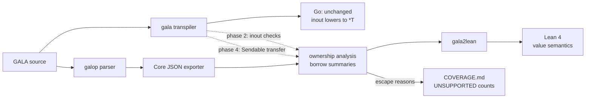
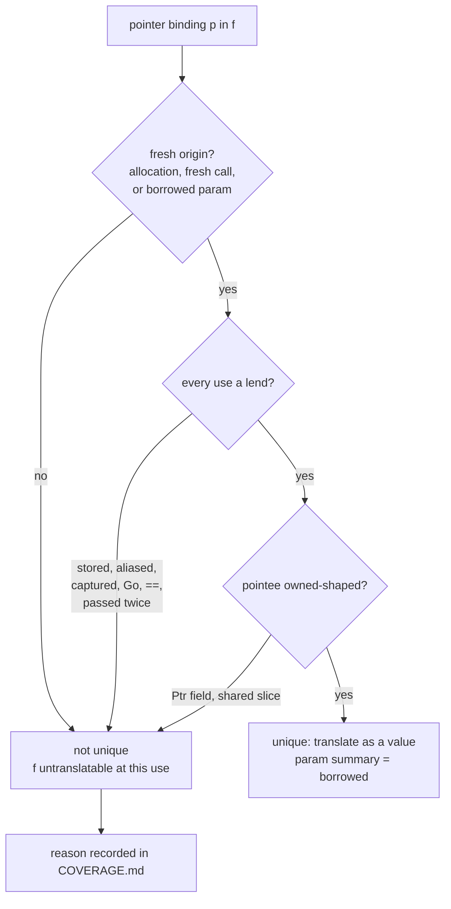
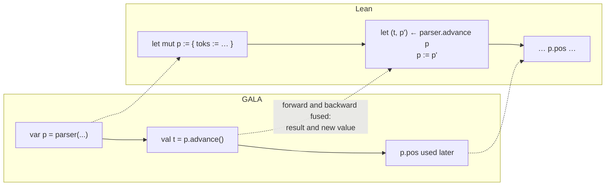
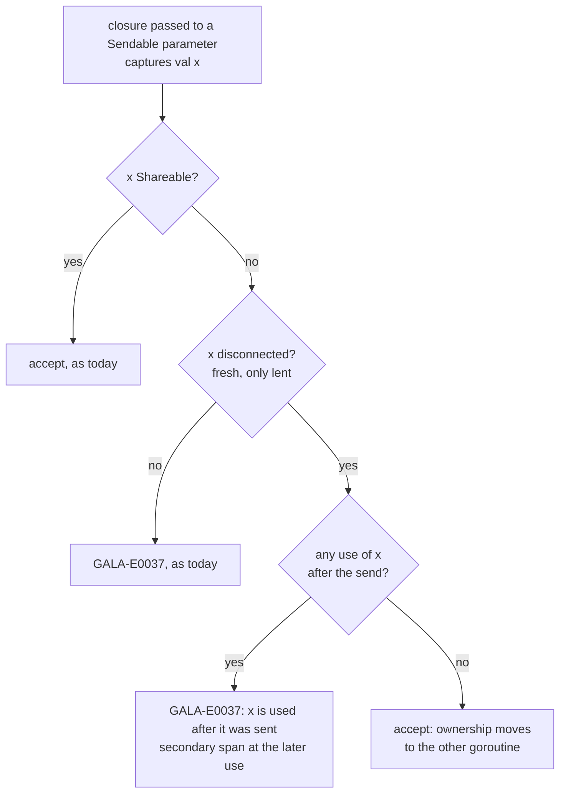
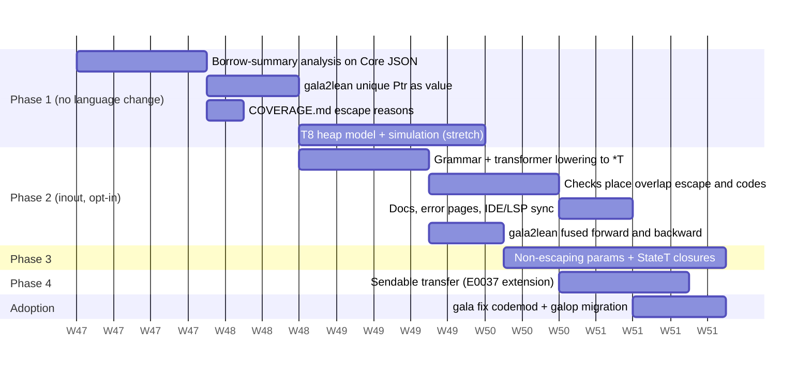

# Ownership: Inferred Uniqueness and `inout` Parameters

Status: **proposal**, for maintainer review. Nothing here is implemented.
Discussion: [#961](https://github.com/martianoff/gala/discussions/961).
Related: [FORMAL_SEMANTICS.MD](FORMAL_SEMANTICS.MD), [CONCURRENCY_SAFETY.MD](CONCURRENCY_SAFETY.MD).

This document proposes an ownership discipline for GALA. It exists for two reasons:

1. A deterministic GALA → Lean translator (`gala2lean`) can translate a function only if
   every mutable value it touches has a single owner. Shared mutable state behind a
   pointer has no faithful value-semantics translation.
2. The `Sendable` boundary ([GALA-E0037](errors/GALA-E0037.md)) rejects every
   non-`Shareable` capture, even a freshly built buffer that the sending goroutine never
   touches again. Ownership can prove such a hand-off safe.

Ownership is a language-level decision, so this is a design to review. No code changes
come with it.

## Summary

- **Phase 1: inferred uniqueness.** This is an analysis with no syntax and no new
  errors. It decides which `Ptr[T]` values have a single owner and are only lent
  downward, and gives each function a *borrow summary*. The translator and the coverage
  report use it. On the measured code it recovers about **209 functions (3.1% of 6,669)**.
- **Phase 2: `inout` parameters.** These are opt-in, second-class and have no lifetimes,
  in the style of Swift and Hylo. In Go they lower to `*T`, exactly the Go a programmer
  writes with `Ptr[T]` today. They turn the inferred summary into a checked contract.
  They also cover what inference cannot see: function types and fields such as
  gala-tui's `Render func(Rect, *Buffer, *HitRegistry)`.
- **Phase 3: non-escaping closures may capture an `inout` place.** This is what
  `rules.ForEach((r) => b.add(r))` needs. It recovers about **69 more functions (1.0%)**.
- **Phase 4: transfer across `Sendable`.** A capture of a disconnected value is accepted
  when nothing uses it after the send. E0037 accepts more programs, and nothing it
  accepts is unsafe.
- **Not proposed:** Rust lifetimes, borrowed results, destructors, or any change to Go's
  GC or to the Go generated for existing programs.
- **Coverage, measured:** translatable functions go from **72.0% to about 75.2%** after
  phases 1 and 2, and **76.2%** after phase 3. With models for owned Go slices and
  captured `var`s, the upper bound is about **79%**. The research estimate of "about 80%"
  was optimistic. Its "about 7%" of pointer-blocked functions includes persistent
  collection internals, escaping pointers, and functions that have a second blocker.



## 1. Goals and non-goals

**Goals**

| # | Goal | Measure |
|---|---|---|
| G1 | **Faithful Lean translation of single-owner mutable state.** A function that mutates state through a uniquely owned pointer translates to a pure Lean function `T → M (R × T)`, with no heap model. | Share of functions that gala2lean translates, reported in `formal/COVERAGE.md`. |
| G2 | **Safe moves across `Future`/`Sendable`.** A freshly built mutable value may be handed to another goroutine when the sender never uses it again. | Programs E0037 rejects today that are race-free by construction. |
| G3 | **No change to the generated Go or to Go's GC.** Existing programs transpile byte for byte as today. `inout` lowers to the `*T` code that `Ptr[T]` produces. | Unchanged golden outputs; no new runtime package. |
| G4 | **Opt-in.** No existing program changes meaning or stops compiling. | Zero source changes required in std, galop, gala-tui, gala-team and gala-acp. |

**Non-goals**

- Lifetimes, lifetime annotations, or borrows that outlive a call.
- Functions that return a borrow (`&mut` results, Swift `_modify`, Hylo subscripts).
  Section 3.8 explains why leaving them out keeps the Lean translation closure-free.
- Deterministic destruction, linear types or move-only types. Resources keep `use`
  and `defer`.
- Translating Go interop (10% of functions) or concurrency (3%). Ownership does not help
  either one.
- Translating mutable collections. `collection_mutable` is *modelled* in Lean, not
  translated.
- Changing what `Ptr[T]`, `*T` or `&x` mean in existing code.

## 2. Measurement

The research scan classifies each of the 6,669 non-test functions in galop, std, the
examples, gala-team, gala-tui and gala-acp by the first feature that blocks a translation.
72% need no ownership. The `pointer` class (438 functions, 6.6%) is the target here.

To size each phase, the scan was extended. For every `pointer` function, it now decides
which mechanism would fix it:

| Sub-class | Meaning |
|---|---|
| `uniq-local` | Every pointer is allocated in the function and only lent downward. |
| `uniq-return` | Same as `uniq-local`, but the fresh pointer is returned (a constructor such as `newBuilder`). |
| `inout` | The pointers are parameters or receivers, used only downward: field reads and writes, method calls, and arguments to GALA calls. |
| `inout-closure` | Same as `inout`, but a lambda or a method value (`p.alternative`) captures the pointer. |
| `escape` | The pointer is stored in a field, collection, constructor or `Option`, aliased into another binding, returned while it is a parameter, or passed to Go. |
| `go-ptr` / `other` | The pointee is a Go type, or no named pointer binding was found (a heuristic miss). |

A function counts as **fixed** only when the pointer is its sole blocker. With the
pointer ignored, it must classify as pure, local-var, go-pure or ptr-read.

| Tree | Funcs | Pointer | uniq | inout | inout-closure | escape | other / go-ptr | Fixed by P1+P2 | Fixed by P3 | Second blocker (Go slice, mutable coll.) |
|---|---|---|---|---|---|---|---|---|---|---|
| galop | 575 | 96 | 0 | 58 | 30 | 6 | 2 | 57 | 30 | 1 |
| gala-tui | 1,363 | 101 | 1 | 57 | 31 | 6 | 6 | 51 | 29 | 12 |
| std | 1,122 | 127 | 1 | 89 | 7 | 18 | 12 | 77 (46 net) | 6 (4 net) | 27 |
| examples | 2,290 | 112 | 5 | 56 | 6 | 14 | 31 | 55 | 6 | 32 |
| gala-team, gala-acp, concurrent | 874 | 2 | 0 | 0 | 0 | 0 | 2 | 0 | 0 | 2 |
| **Total** | **6,669** | **438** | **7** | **260** | **74** | **44** | **53** | **240 (209 net)** | **71 (69 net)** | **74** |

"Net" subtracts 31 + 2 functions in `collection_immutable`'s persistent trees (`Array`,
`TreeMap`, `TreeSet`). Their nodes are shared by structural sharing, so they are not
single-owner. A translation models these collections with Lean's own structures and does
not translate their internals.

| Tree | Today | After P1+P2 | After P3 |
|---|---|---|---|
| galop | 75.3% | 85.2% | 90.4% |
| gala-tui | 86.7% | 90.5% | 92.6% |
| std | 68.4% | 72.5% | 72.8% |
| examples | 75.1% | 77.5% | 77.7% |
| **All** | **72.0%** | **75.2%** | **76.2%** |

Two further steps raise the upper bound to about 79%:

- Captured `var`s (106 functions, 1.6%) use the same non-escaping-closure rule as phase 3.
  The scan cannot tell which of these closures escape, so this is an upper bound.
- Owned Go slices inside owned structs (74 functions) can be modelled as Lean `Array`
  under the freshness rule in section 2.4.

The scan is textual and heuristic. The galop and gala-tui figures were checked by reading
the code. The findings below are what the counts alone do not show.

### 2.1 galop: the ideal case

All of galop's mutable state lives in eight private types: `parser`, `lexer`, `builder`,
`configSet`, `rng`, `memory`, `usage` and `buffer`. Each is allocated once and lent down a
recursive-descent call tree.

- `Lex` allocates `&lexer{...}` locally and calls `Ptr[lexer]` methods. It never stores,
  returns or captures the pointer. This is uniqueness plus borrowed receivers, so the
  whole lexer translates. `lexer.data` is a `[]byte` that is only read, and it is
  modelled as a `ByteArray`.
- `Parse` allocates `&parser{...}` inside a `FlatMap` lambda, local to that lambda.
  `sepBy1(p, "|", p.alternative)` passes `p` and also a method value that captures `p`.
  Under phase 1 that is an alias, and under phase 2 it is an exclusivity error.
  Section 3.9 shows the rewrite: `item func(inout parser) T`. Phase 3 does not help
  here either, because the closure argument captures the place that the same call
  borrows `inout`.
- `newBuilder` returns a fresh `Ptr[builder]` (`uniq-return`). Its
  `rules.ZipWithIndex().ForEach((ri) => { b.ruleStart = ... })` is a non-escaping
  closure that captures `b`, so it needs phase 3. 13 `builder` methods have this shape.
- `sample.walker` stores `Rand Ptr[rng]` and `Used Ptr[usage]` in a value struct. That is
  a real escape. To translate it, `walker` must hold `rng` and `usage` by value and be
  passed `inout`.

### 2.2 gala-tui: inference is not enough

- `Buffer` holds `var cells []Cell` and writes `b.cells[idx] = c`. `NewBuffer` builds a
  fresh slice and `Clone` copies one. A translation needs the owned-slice rule (2.4).
- The widget tree is a public API that passes pointers through **function values**:
  `case CustomW(MinW int, MinH int, Render func(Rect, *Buffer, *HitRegistry))` and the
  backend's `Paint func(*Buffer, *Buffer)`. Inference has no body to summarise behind a
  function value, so a call through one counts as an escape. `renderToInternal` is
  blocked until the function type can say `func(Rect, inout Buffer, inout HitRegistry)`.
  This is the strongest case for phase 2.
- `HitRegistry` entries carry `Payload func(int, int) any`. The registry's own state
  translates, but `any` payloads remain Go interop.

### 2.3 std

- **`json` encoder and decoder (39 functions):** private `Ptr[...Impl]` receivers, lent
  downward. The encoder holds a `bytes.Buffer`, which needs a model for an owned
  `bytes.Buffer`.
- **`strings.StringBuilder`:** its fluent API returns the receiver
  (`func (sb Ptr[StringBuilder]) Append(s Str) Ptr[StringBuilder]`). A second-class
  `inout` cannot return its borrow, so fluent builders stay `Ptr`. This is a deliberate
  limitation. See open question Q9.
- **`lazy.Lazy`:** memoisation through a shared pointer, which is a genuine escape.

### 2.4 Owned Go slices

A Go slice field of an owned struct is modelled as a Lean `Array` only if the field is
**fresh**: every assignment to it is from `SliceWithCapacity`, `SliceEmpty`, a copy, or
`SliceAppend(field, …)` of the field itself. Otherwise two structs could share a backing
array, and the field stays `go-mutable`. This is a modelling trust point. Its Lean model
(`Array.set!`, `Array.push`) belongs in the prelude.

## 3. Design

### 3.1 Phase 1: inferred uniqueness

The analysis runs on the Core representation the exporter already produces. It is part of
the formal tooling, not of `gala build`, so it costs nothing in normal compilation.

**Definitions.** A *place* is a `var` local, an `inout` parameter (phase 2), or a field
path `x.f.g` through `var` fields of a place. A pointer binding is `p: Ptr[T]`, or a `*T`
that is known not to be nil.

A pointer binding `p` in function `f` is **unique** when both of these hold:

1. **Fresh origin.** `p` is bound to one of:
   - an allocation: `&T{…}` or `&T(…)`;
   - a call whose summary is *returns fresh*;
   - a borrowed parameter of `f`, which is unique for the duration of the call (see
     below).

   `&v` of a local `var` is fresh only when `v` is never used directly again. Otherwise
   `v` and `p` are two access paths to the same value.
2. **Every use is a lend.** Each occurrence of `p` is one of:
   - a field read `p.f`, or a field write `p.f = e` where `e` does not mention `p` as a
     whole;
   - a deref read `*p`, which yields a copy;
   - a method call `p.m(…)` whose receiver summary is *borrowed*;
   - an argument to a GALA function whose summary for that parameter is *borrowed*;
   - a `return p` that makes `f`'s summary *returns fresh*. This applies only when `p`
     came from an allocation.

**What counts as escaping.** Any other use is an escape. The table lists them.

| Escape | Example | Why it breaks single ownership |
|---|---|---|
| Stored | `w.Rand = rand`, `walker(…, rand, …)`, `Some(p)`, `(p, 1)` | A second path to the pointee outlives the call. |
| Aliased through a collection | `xs.Append(p)`, `ArrayOf(p)`, `m.Put(k, p)` | Same as stored. |
| Aliased into a binding | `val q = p` | Two names. The analysis could track this, but phase 1 does not. |
| Returned (when not fresh) | `func f(p Ptr[T]) Ptr[T] = p` | The caller now holds a second path. |
| Captured | `() => p.x`, `xs.ForEach((x) => p.add(x))`, the method value `p.alternative` | Go closures capture by reference, and the closure may outlive the call. Phase 3 relaxes this for non-escaping closures. |
| Passed to Go | `bufio.NewWriter(p)`, an `any` or interface conversion, a Go `func(*T)` slot | Go may store it. Ownership does not cross the interop boundary. |
| Compared | `p == q` | Pointer identity has no value-semantics meaning. |
| Passed twice | `f(p, p)`, `p.blit(p)` | The callee sees two aliases. This is an exclusivity violation. |
| Global | a package-level `var` holding a `Ptr` | It is reachable from anywhere. |
| Unknown callee | calling a function value with `p` as an argument | No summary is available. Phase 2's `inout` function types fix this. |

**Shape restriction.** The pointee type `T` must itself be owned-shaped. Every field must
be a value: a primitive, a GALA value type, an immutable collection, or a fresh Go slice
(section 2.4). A `Ptr` or `*U` field makes the pointee a graph, not a tree, and the binding
cannot be translated.

**Summaries and the fixed point.** Every function gets a summary in two parts:

- one bit per pointer parameter and receiver: *borrowed* or *escapes*;
- one bit for the result: *returns fresh*.

Summaries are computed per strongly connected component of the call graph, as a
*greatest* fixed point. Recursive calls start optimistic (borrowed) and are demoted until
nothing changes. The lattice has height 2 per bit, so the cost is linear in program size
times a small constant. Exported functions get summaries too, and they are written into
package metadata, as the non-nil property of a `Ptr` receiver already is. A caller in
another package can then use them.



**Exclusivity at a call site.** A callee with two borrowed parameters assumes they are
disjoint. A caller meets this by construction: an argument must be a unique local or a
borrowed parameter of the caller, and the same binding may not appear twice. A unique
binding has never been stored, so no other argument can reach it.

**Soundness argument.** Take a unique binding `p`. At every program point, the only live
access path to its pointee is `p`, or the borrowed parameter that `p` was lent to while
that call is active. Borrowed parameters follow a stack discipline: a callee cannot store,
return, capture or pass on its parameter except by lending it further down. So a write
through `p` is observable only through `p`.

The proof is a simulation. Relate the heap semantics, where the pointee is a cell, to the
value semantics, where the cell's content is a value threaded through the function and
returned from each borrowing call. The relation holds after every step, by induction on
evaluation: a field write updates the cell and the threaded value identically, and a
borrowing call returns the updated value, which the caller rebinds. Nothing else reads
the cell, so nothing can tell the two semantics apart.

In Lean this becomes a stretch theorem, **T8**: for a program the analysis accepts,
galaspec's evaluation with a heap agrees with the translation in value semantics. T8 needs
galaspec to grow a heap model for `Ptr` (open question Q12).

**Panics.** Go keeps writes made before a panic. If the panic is caught (`Try`, its
combinators, `recover`) while a borrowed place is still live, Go shows the partial update.
A translation that threads the value through the *result* would drop it. Phase 1
therefore treats a borrowing call inside a panic-catching construct as an escape when the
borrowed place is used after the catch. Q5 discusses keeping such places in the monad's
state instead. The prototype's `EStateM` keeps its state when an error is raised.

**Diagnostics.** Phase 1 issues no compile errors and no warnings. It does not change the
language. Its output is translator-facing:

- an `UNSUPPORTED ptr-escape` verdict per function, with the reason and position, for
  example `p captured by method value p.alternative at parser.gala:291`;
- counts per reason in `COVERAGE.md`;
- optionally, an LSP hover line: `Ptr[parser] p: unique (borrowed by 31 methods)`.

**What it covers.** Uniqueness alone covers 4 function bodies. The borrow summaries it
infers cover the 205 net `inout`-class functions, provided the whole call graph is
visible. galop's `parser`, `lexer`, `builder` and `configSet` qualify entirely. Phase 1
does not cover function values, closures, or a gala-tui widget written by a user in
another package.

### 3.2 Phase 2: `inout` parameters

Inference is silent and fragile. One edit to a body, such as storing `p` in a debug
field, makes a whole call tree untranslatable without a single compile error. An `inout`
parameter turns the summary into a checked contract, and it adds three things inference
cannot give:

- `inout` in function types and fields;
- mutation of value types with no `Ptr` in the API;
- precise errors at the line that breaks ownership.

#### 3.2.1 Syntax options

| Option | Declaration | Call site | Assessment |
|---|---|---|---|
| **A. `inout` modifier (recommended)** | `func advance(inout l lexer)`, `func (inout l lexer) advance()` | `advance(&l)`; receiver calls stay `l.advance()` | Mirrors the existing `var n int` parameter modifier. Swift readers know it. `&` at the call site is the Go that gets generated. |
| B. Marker type `Mut[T]` | `func advance(l Mut[lexer])` | `advance(&l)` | Consistent with `Sendable[F]` and `Ptr[T]`, but a type invites `Array[Mut[T]]`, `Option[Mut[T]]` and `Mut` fields, which would all need bans. A second-class *type* is a contradiction. |
| C. `Ptr[T]` parameters are non-escaping by default | unchanged | unchanged | No new syntax, but **mandatory and breaking**. It rejects the 44 escaping functions, std's persistent-node internals, fluent builders, and every Go-facing `*T`. Rejected. |
| D. Reuse `var` parameters | `func advance(var l lexer)` | `advance(&l)` | `var n` already means "a local mutable copy". Changing it changes the meaning of valid programs. Rejected. |
| E. `mut` / `ref` modifier | `func advance(mut l lexer)` | `advance(&l)` or `advance(ref l)` | Equivalent to A. `mut` suggests Rust's `&mut` and its lifetimes; `ref` suggests C#'s, with no exclusivity. A matter of taste (Q2). |

The rest of this section uses option A.

```gala
type parser struct {
    toks Array[Token]
    var pos int
    var err Option[Diagnostic]
}

// A value receiver: reads only.
func (p parser) peek() Token = p.toks.Get(p.pos)

// An inout receiver: the caller's parser is updated in place.
func (inout p parser) advance() Token {
    val t = p.peek()
    if !t.Kind.isTokEOF() {
        p.pos = p.pos + 1
    }
    t
}

func Parse(toks Array[Token]) Either[Diagnostic, Grammar] {
    var p = parser(toks = toks, pos = 0, err = None[Diagnostic]())
    val g = grammar(&p)          // an explicit argument needs &
    p.err match {
        case Some(d) => Left(d)
        case None() => Right(g)
    }
}
```

#### 3.2.2 Flow of an `inout` call

```mermaid
sequenceDiagram
    participant C as caller (var p)
    participant F as callee (inout q)
    participant G as Go (generated)
    C->>C: evaluate arguments left to right
    C->>F: lend place p (exclusive for the call)
    Note over C: p is inaccessible to the caller<br/>and to every closure until F returns
    F->>F: read and write q.pos and q.err,<br/>reassign q, lend q further down with &q
    F-->>C: return result; p holds the final value of q
    Note over G: Go: func grammar(q *parser) Grammar<br/>caller: grammar(&p). Same as Ptr code today
```

#### 3.2.3 Typing rules

| Rule | Statement |
|---|---|
| **Binding** | `inout x T` binds `x` as a *mutable place* of type `T` in the body. `x` can be read, its `var` fields can be written, and `x = e` reassigns it, even when every field of `T` is `val`. This is Hylo's mutable value semantics: an immutable struct is updated by replacement (`p = p.Copy(pos = p.pos + 1)`). |
| **Argument** | At an `inout` position the argument is `&e`, where `e` is a mutable place: a `var` local, an `inout` parameter, a `var` field path of a place, or the pointee of a `Ptr` (`p`, `p.f`). A `val`, a `val` field, a call result, a literal, a collection element or a value receiver is an error. |
| **Receiver** | `func (inout x T) m()` is called as `v.m()` on a `var` (auto-`&`, as a `Ptr` receiver is today), on an `inout` parameter, or on a `Ptr[T]`. On a `val`, a call result or a literal it is an **error**. Compare `Ptr` receivers, which silently mutate a copy through `AddrOfCopy` (Q4). |
| **Exclusivity** | No two `inout` arguments of one call, the receiver included, may name overlapping places: the same root, or a path where one is a prefix of the other (`&p` and `&p.lex`). Disjoint fields of the same `var` (`&p.a`, `&p.b`) are allowed. No other argument of that call may be a closure that captures an overlapping place. Plain reads of the place in other arguments are allowed: they run before the call, left to right, and produce copies. |
| **No escape** | An `inout` binding `x` may be read and lent (`&x` to another `inout` position) but not captured by a lambda or method value (phase 3 allows non-escaping closures). `&x` may not be stored, returned, put in a collection or `Option`, converted to `any` or an interface, passed to a `Ptr[T]` or `*T` parameter, or passed to Go. |
| **Second-class** | `inout` appears only on parameters, receivers and the parameters of function types. It is not a type. A field, local, result or type argument cannot be `inout`. |
| **Function types** | `func(inout T, A) R` is a GALA function type distinct from `func(Ptr[T], A) R`. Both lower to Go's `func(*T, A) R`. A function with an `inout` parameter fills a `func(inout T…)` slot, and also a Go `func(*T)` slot (the Go caller is outside the translation). A `func(*T)` value never fills a `func(inout T)` slot, because it may store its argument. |

**Interactions**

- **`val` / `var`:** only a `var` (or a place reached from one) can be lent. To lend a
  `val`, copy it first: `var c = v; f(&c)`. That is E0076's existing advice.
- **`Ptr[T]`:** a `Ptr` can be lent to an `inout T` with `&*p` or just `p`. This is the
  bridge from existing code. The program compiles either way. Whether the *caller*
  translates depends on phase 1 proving `p` unique.
- **Lambdas:** `(inout b Buffer) => b.Fill(r, c)` is a lambda with an `inout` parameter.
  It fills a `func(inout Buffer)` slot. A lambda may not capture an outer `inout` binding
  until phase 3.
- **Generics:** `inout x T` with `T` a type parameter is allowed. `inout` is not a type,
  so a generic `func(A) R` cannot be instantiated with an `inout` `A`. A higher-order
  function that lends state says so: `func sepBy1[T any](inout p parser, sep string,
  item func(inout parser) T) Array[T]`.
- **Pattern matching:** `x match { … }` on an `inout` binding matches a copy. Pattern
  variables are `val`s. To change the case, assign `x = Some(n + 1)`. `inout` pattern
  bindings (projections into a case) are not part of this proposal (Q10).
- **`Shareable` / `Sendable`:** an `inout` binding can never be captured by a `Sendable`
  closure, because the no-escape rule already forbids the capture. A `Shareable` value
  may be lent `inout`: the *binding* changes, and the old value stays immutable.
- **Method values:** `x.m` where `m` has an `inout` receiver captures `x`, so it is an
  escape unless called on the spot.
- **Interfaces:** an `inout`-receiver method is a Go pointer-receiver method, so the
  method-set rules of `Ptr` receivers apply unchanged (the E0080 family). Q8 asks whether
  an interface may declare that a method is `inout`.
- **Go interop:** `inout x T` lowers to the Go parameter `x *T`:
  - a whole read of `x` becomes `*x`, and `x = e` becomes `*x = e`;
  - `x.f` stays `x.f`, and `&v` stays `&v`;
  - an exported function checks its `inout` parameters for nil on entry, as it does for
    `Ptr` parameters.

  Go code can still call an exported function with two aliasing pointers. Go callers are
  outside the translation.

#### 3.2.4 Error codes

New codes get the next free numbers when they are implemented. Each needs a page in
`docs/errors/` and `website/docs/errors/`.

| Code (to allocate) | Error | Example |
|---|---|---|
| E-inout-place | an `inout` argument is not a mutable place | `advance(&v)` for a `val v`; `advance(&f())` |
| E-inout-amp | an `inout` argument is missing its `&` | `advance(p)` for a `var p parser` |
| E-inout-overlap | overlapping access in one call | `blit(&b, &b)`; `sepBy1(&p, "\|", p.alternative)` |
| E-inout-escape | an `inout` binding escapes | `w.Rand = &r`; `() => r.next()`; `bufio.NewWriter(&w)` |
| E-inout-receiver | an `inout`-receiver method is called on a non-place | `parser(…).advance()`; on a `val` |
| E-inout-position | `inout` where only a parameter may have it | a field, local, result or type argument (a parse error, if the grammar allows) |
| E0037 (extended, phase 4) | a value is used after it was sent | see 3.4 |

#### 3.2.5 Lean translation

Aeneas translates a Rust function that takes `&mut T` into a *forward* function, which
computes the result, and a *backward* function, which computes the final value of the
borrowed input. Current Aeneas fuses the two: the function returns its result together
with the updated input. Because `inout` borrows are second-class and never returned, every
GALA case is the simple one:

```
func f(inout x T, a A) R      ⟶      def f (x : T) (a : A) : M (R × T)
```

`M` is the prototype's monad, `EStateM Panic St`. With several `inout` parameters the
tuple grows: `M (R × T₁ × T₂)`. A call rebinds every lent place, as in Lean's `do`
notation with `let mut`.



**Worked example 1: an `inout` receiver.** The GALA code is `parser.advance` from 3.2.1.

```lean
structure parser where
  toks : Array Token
  pos  : Int64
  err  : Option Diagnostic

-- a value receiver: a pure forward function
def parser.peek (p : parser) : M Token := arrayGet p.toks p.pos

-- an inout receiver: forward and backward fused
def parser.advance (p : parser) : M (Token × parser) := do
  let mut p := p
  let t ← parser.peek p
  if !(t.Kind.isTokEOF) then
    p := { p with pos := p.pos + 1 }
  return (t, p)

def Parse (toks : Array Token) : M (Either Diagnostic Grammar) := do
  let mut p : parser := { toks := toks, pos := 0, err := none }
  let (g, p') ← grammar p
  p := p'
  match p.err with
  | some d => return .left d
  | none   => return .right g
```

**Worked example 2: field projection and two `inout` places.**

```gala
type front struct {
    var lex lexer
    var par parser
}

func step(inout l lexer, inout p parser) { … }

func (inout f front) pump() {
    step(&f.lex, &f.par)       // disjoint fields of one place: allowed
    f.lex.advance()            // auto-& on a field path
}
```

```lean
def front.pump (f : front) : M (Unit × front) := do
  let mut f := f
  let ((), l', p') ← step f.lex f.par
  f := { f with lex := l', par := p' }
  let ((), l'') ← lexer.advance f.lex
  f := { f with lex := l'' }
  return ((), f)
```

**Worked example 3: a loop.** `for p.ok() && p.acceptPunct(sep) { items = items.Append(item(&p)) }`
becomes a `while` in `do` notation. `let mut p` and `let mut items` are reassigned after
each call. This is the rule the prototype already uses for local `var`.

**Why the translation stays closure-free.** A Rust function that *returns* `&mut U` into
its argument needs a backward function that is a closure (`U → T`). That closure is what
makes Aeneas's output and proofs heavier. Leaving out borrowed results (a non-goal) means
every backward part is a plain returned value. Lean's own runtime then helps: a value
threaded this way has reference count 1, so `{ p with pos := … }` and `Array.set!` update
in place (see Prior art). The translated Lean is efficient as well as faithful.

### 3.3 Phase 3: non-escaping closures may capture `inout` places

galop's `builder` (13 functions), most of gala-tui's `inout-closure` group (29), and
captured local `var`s (106 functions) all share one shape. A closure that mutates the
caller's state is passed to a function that only calls it during the call:

```gala
rules.ZipWithIndex().ForEach((ri) => {
    b.ruleStart = b.ruleStart.Append(b.state(ri.V2, RuleStartState()))
})
```

This follows Swift's rule: a closure may capture an `inout` place if the closure is
**non-escaping**. A function parameter `f` is non-escaping when the callee only calls
`f`. It never stores, returns or captures `f`, and never passes it to a parameter that
escapes.

- **Inferred,** like the borrow summaries. It is written to package metadata and holds
  for std's `ForEach`, `Map`, `FoldLeft`, `Filter` and the rest.
- **Exclusive:** while the closure is live, the captured place is lent to it, so the call
  may not also lend the place `inout` (this is `sepBy1`'s problem).
- **`Sendable` parameters always escape.** A `Future` body runs later on another
  goroutine.

**Lean.** The closure becomes a computation in `StateT S M`, where `S` is the tuple of the
places it captures. The higher-order function runs in that monad:

```lean
let ((), b') ← (rules.zipWithIndex.forM fun ri => do
    let b ← get
    let (s, b) ← builder.state b ri.2 .RuleStartState
    set { b with ruleStart := b.ruleStart.push s }).run b
b := b'
```

std's higher-order functions need monad-polymorphic Lean models (`forM`, `mapM`,
`foldlM`). A GALA-defined higher-order function is translated generically over
`[Monad m] [MonadLiftT M m]` when it has a non-escaping function parameter (Q6).

### 3.4 Phase 4: transfer across `Sendable` boundaries

Today E0037 rejects this, although the program is race-free:

```gala
val buf = collection_mutable.ArrayOf(1, 2, 3)
buf.Append(4)
Future(() => buf.Size())     // GALA-E0037 today
// buf is never used again
```

Swift solved the same problem with region-based isolation and `sending`. The rule here
is: a captured `val` `x` of non-`Shareable` type is accepted at a `Sendable` boundary when
all of these hold:

1. **`x` is disconnected.** It was built in this function by constructors, literals,
   `&T{…}` or mutable-collection constructors, from arguments that are `Shareable` or
   themselves disconnected. Since then it has only been lent (phase 1 summaries). It was
   never stored, aliased, captured by another closure, or passed to Go.
2. **The closure holds the last use of `x`.** No path from the boundary call reaches
   another use of `x`.
3. **The closure is created once.** It is not created inside a loop that would send the
   same `x` twice.

A `var` capture is still rejected, because the binding slot itself is shared.



The generated Go is unchanged: the closure captures `x` exactly as it does now. The check
only accepts more programs, and only ones that are race-free by construction. AGENTS.md
rule 8 forbids weakening checks, so this needs the maintainer's explicit approval, as
does the sending of non-`Shareable` `Future` results back to the awaiting goroutine (Q7).

## 4. Migration and breaking-change analysis

**Opt-in, not mandatory.** Every phase adds capability without changing what existing
programs mean.

| Phase | Language change | Breaks existing code? | Required edits |
|---|---|---|---|
| 1 | none (analysis only) | no | 0 |
| 2 | the keyword `inout` | Only if reserved, and only identifiers named `inout`. The scan found **0** in std, galop, the examples, gala-tui, gala-team and gala-acp. | 0 |
| 3 | none (inferred) | no | 0 |
| 4 | E0037 accepts more | no | 0 |

**What a mandatory design would cost.** This is option C: `Ptr`/`*T` parameters
non-escaping by default. At least 75 functions would stop compiling: the 44 escaping
ones, std's 31 persistent-node internals, and every function-typed field that takes a
pointer. Their callers and fluent builders would follow. `*T` is also Go's pointer, so
non-escaping by default would break Go interop. Not recommended.

**Opting in, to gain translatability:**

| Repository | What changes | API impact |
|---|---|---|
| galop | About 90 receivers on 8 private types, `Ptr[parser]` → `inout parser` and so on. Receiver call sites are unchanged. Explicit argument sites gain `&`. `sepBy1` takes `item func(inout parser) T`. `walker` holds `rng` and `usage` by value. | None: all the types are unexported. |
| gala-tui | 125 mentions of `*Buffer` and `*HitRegistry` in 15 non-test files, including the public `Custom(minW, minH, render func(Rect, *Buffer, *HitRegistry))` and every widget's render signature. | **Breaking for gala-tui users** (custom widgets). It would ship as a gala-tui minor release with the maintainer's approval, under the "confirm every breaking change" rule. |
| std | Optional: `json`'s private encoder and decoder. `StringBuilder`'s fluent `Ptr` API stays. | None. |
| gala-team, gala-acp | No pointer functions. | None. |

**A safe codemod.** Phase 1's summaries say exactly which `Ptr` receivers and parameters
are *borrowed*. A `gala fix` rewrite, `Ptr[T]` → `inout T` plus `&` at argument sites, is
safe for exactly those, and it would never produce an E-inout error. That makes migration
mechanical.

**IDE and LSP impact**

- **Grammar:** `inout` in parameter, receiver and function-type-parameter positions, in
  `gala.g4`. galop regenerates the native parser. Then run the `gala-ide-sync` skill for
  the IntelliJ plugin's lexer and keyword lists and for the LSP keyword data.
- **LSP:**
  - hover shows `inout` in signatures;
  - signature help marks the `inout` parameters;
  - completion offers `inout` in parameter position;
  - diagnostics for the new codes;
  - code actions "add `&`" and "convert `Ptr` receiver to `inout`" (the latter driven by
    the phase 1 summaries);
  - optionally, a phase 1 hover line for uniqueness.
- **Docs:** `docs/GALA.MD` (parameters, receivers, pointers), `docs/TYPE_INFERENCE.MD`
  (function types), `docs/CONCURRENCY_SAFETY.MD` (phase 4), the website mirror, and the
  error-code pages.

## 5. Prior art

| System | Mechanism | What GALA takes | What GALA leaves |
|---|---|---|---|
| [Rust](https://doc.rust-lang.org/book/ch04-00-understanding-ownership.html) | Ownership, `&`/`&mut` borrows with lifetimes, a borrow checker | Exclusive mutable access; the escape table | Lifetimes, borrowed results, moves of every value |
| [Aeneas](https://github.com/AeneasVerif/aeneas) ([ICFP 2022](https://dl.acm.org/doi/10.1145/3547647), [symbolic borrow checking, ICFP 2024](https://arxiv.org/abs/2404.02680)) | Translates safe Rust to pure Lean with forward and backward functions; current versions fuse them | `T → M (R × T)` for every `inout` | Backward *closures*, which only borrowed results need |
| [Swift `inout`](https://docs.swift.org/swift-book/documentation/the-swift-programming-language/functions/#In-Out-Parameters), [exclusivity (SE-0176)](https://github.com/swiftlang/swift-evolution/blob/main/proposals/0176-enforce-exclusive-access-to-memory.md), [ownership manifesto](https://github.com/swiftlang/swift/blob/main/docs/OwnershipManifesto.md) | Second-class `inout` with `&` at the call site; the Law of Exclusivity; non-escaping closures may capture `inout` | The keyword, `&`, exclusivity, the closure rule (phase 3) | Dynamic exclusivity checks (GALA's are all static), `_modify` accessors |
| [Swift region isolation (SE-0414)](https://github.com/swiftlang/swift-evolution/blob/main/proposals/0414-region-based-isolation.md), [`sending` (SE-0430)](https://github.com/swiftlang/swift-evolution/blob/main/proposals/0430-transferring-parameters-and-results.md) | Non-`Sendable` values cross isolation boundaries when their region is disconnected and unused afterwards | Phase 4, nearly verbatim | The explicit `sending` marker, for now (Q7) |
| [Hylo](https://www.hylo-lang.org) ([mutable value semantics, JOT 2022](https://www.jot.fm/issues/issue_2022_02/article2.pdf)) | Every type has value semantics; parameter conventions `let`/`inout`/`sink`/`set`; projections instead of references | `inout` that reassigns an immutable struct; no references in APIs | `sink`/`set` conventions and subscripts/projections (Q10) |
| [Vale](https://vale.dev) ([regions](https://verdagon.dev/blog/zero-cost-memory-safety-regions-overview)) | Generational references plus region borrowing; immutable regions skip checks | The idea that freezing a region (`Shareable`) is cheap | Runtime generation checks: GALA keeps Go's GC |
| [Koka FBIP](https://www.microsoft.com/en-us/research/publication/fp2-fully-in-place-functional-programming/) ([Perceus, PLDI 2021](https://www.microsoft.com/en-us/research/publication/perceus-garbage-free-reference-counting-with-reuse/)) | Precise reference counting; reuse when unique; `fip` functions checked to run in place | Uniqueness as an *inferred* property, as in phase 1 | Reference counting in the target: Go keeps its GC |
| [Lean 4](https://lean-lang.org) ([Counting Immutable Beans, IFL 2019](https://arxiv.org/abs/1908.05647)) | Reference counting with destructive update when the count is 1 (`Array.set!`, structure update) | The reason the translation is efficient: a GALA-unique value is RC = 1 in Lean | Nothing to change: the translation relies on it |

## 6. Phased plan

The estimates assume one maintainer working with AI agents, as in FORMAL_SEMANTICS.MD.



| Phase | Deliverable | Effort | Done when |
|---|---|---|---|
| 1 | Borrow summaries and freshness, written to package metadata; gala2lean translates unique `Ptr`s as values; `COVERAGE.md` lists escape reasons | 2–3 weeks | galop's `lexer` and `configSet` round-trip through Lean and agree with Go on their tests; coverage up about 3 points |
| 1b (stretch) | A galaspec heap model and theorem T8 | 2 weeks | T8 proved for S1 plus `Ptr` |
| 2 | `inout` syntax, lowering, the five checks and their codes, docs, IDE/LSP | 3–4 weeks | The generated Go for existing examples is byte-identical; new examples cover each code; gala-tui's `Custom` can be written with `inout` |
| 3 | Inferred non-escaping function parameters; `StateT` closure translation; monadic std models | 2–3 weeks | galop's `builder` translates; coverage about 76% |
| 4 | Sendable transfer | 1–2 weeks | The `ArrayOf` example above compiles; a use after the send is E0037 with a secondary span |
| Adoption | `gala fix` codemod; galop migrated; gala-tui only with approval | 1 week, plus gala-tui | galop at about 90% translatable |

## 7. Decisions

The maintainer answered the open questions below on 2026-11-13. Phase 1 is approved and in progress. Answers for later phases are provisional and will be confirmed once phase 1's escape reasons are in `COVERAGE.md`.

| # | Decision |
|---|---|
| Q1 | **Build phase 1 now.** Decide phase 2 after phase 1's data is in. |
| Q2 | Keyword **`inout`, reserved**. |
| Q3 | **`&` marks `inout` arguments**; receivers stay implicit. |
| Q4 | Calling a mutating method on a `val` is a compile error, **for `inout` receivers and also for today's `Ptr` receivers** (no more silent `AddrOfCopy` mutation of a hidden copy). The `Ptr` part is a breaking change, approved and scheduled independently of phase 2. |
| Q5 | Mutating an `inout` place inside a `Try`/recover region is a compile error, at least at first. |
| Q6 | Non-escaping function parameters are **inferred** and recorded in package metadata. |
| Q7 | A transfer across a `Sendable` boundary is **inferred from last use**. Transfer of `Future` results is decided separately. |
| Q8 | **Interfaces may declare `inout` method requirements**, lowered to pointer-receiver method-set requirements in Go. |
| Q9 | **Std's fluent builders (`StringBuilder`, …) will be redesigned** in the `inout`/value style when phase 2 lands. Breaking; approved. |
| Q10 | Projections (`inout` pattern bindings, `inout` locals) are out of scope. |
| Q11 | gala-tui's public `*Buffer` API stays as is. Ask again after phase 2. |
| Q12 | A galaspec heap model and theorem T8 are a **stretch goal of phase 1**. |

## 8. Open questions for the maintainer (answered above)

| # | Question | Recommendation |
|---|---|---|
| Q1 | Is phase 1 alone enough for now? It gives most of the measured gain with no language change. | Yes, start there. Decide on phase 2 once phase 1's escape reasons are in `COVERAGE.md`. |
| Q2 | Keyword: `inout`, `mut` or `ref`? Reserved or contextual? | `inout`, reserved: 0 identifiers named `inout` exist, and a reserved word keeps the grammar and IDE simpler. |
| Q3 | Mark `inout` arguments with `&` (Swift), or leave them implicit? | `&` for arguments, implicit for receivers, as `Ptr` receivers are today. |
| Q4 | Today a `Ptr`-receiver call on a `val` mutates a hidden copy (`AddrOfCopy`). Should `inout` receivers reject it, as proposed, while `Ptr` keeps the current behaviour? | Reject for `inout`. Leave `Ptr` alone. Changing it would be breaking. |
| Q5 | When a panic is caught after a partial write: thread the place through the result and reject `inout` mutation under `Try`/`recover` (proposed), or keep live places in the monad's state? | Reject first. Revisit if real code needs it. |
| Q6 | Non-escaping function parameters: inferred (proposed) or declared, with Swift's `@escaping` default inverted? | Inferred, in package metadata, like `Ptr` non-nullness. |
| Q7 | Sendable transfer: inferred last use (proposed), or an explicit `sending`/`move` marker? Should a non-`Shareable` `Future[T]` result transfer back too? | Inferred for captures. Decide on results separately. |
| Q8 | May an interface declare a method `inout` (a mutating method requirement)? | Not in phase 2. Go interfaces cannot express it. |
| Q9 | Fluent builders that return `Ptr[Self]` (`StringBuilder`) cannot become `inout`. Keep them as `Ptr`, untranslated? | Keep them. Model `StringBuilder` in the Lean prelude. |
| Q10 | Hylo-style projections: `inout` pattern bindings, or `inout` locals (`inout l = &p.lex`)? | Out of scope. They need borrowed results, the one thing that brings back backward closures. |
| Q11 | Migrating gala-tui's public `*Buffer` API to `inout Buffer` breaks gala-tui users. Is it worth it? | Only after phase 2 is stable, and only with your approval. |
| Q12 | Should galaspec gain a heap model for `Ptr`, so that T8 (uniqueness implies the two semantics agree) can be proved? | Yes, as a stretch goal for phase 1. Without it, phase 1's soundness rests on the argument in 3.1 and on differential testing. |
