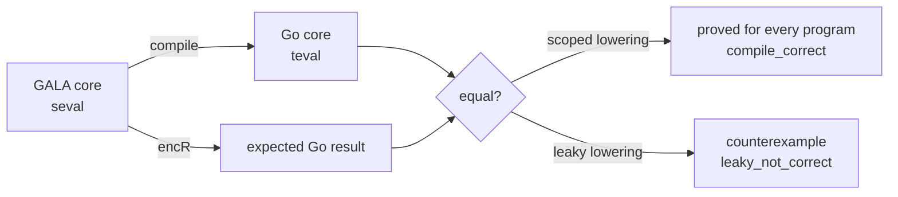

# formal/: the Lean semantics of GALA

This directory holds a machine-checked definition of what GALA programs mean, written in
[Lean 4](https://lean-lang.org). The design, plan and rules are in
[docs/FORMAL_SEMANTICS.MD](../docs/FORMAL_SEMANTICS.MD). What is covered today is in
[COVERAGE.md](COVERAGE.md).

It is a Lake project with no dependencies (no Mathlib). Nothing here is part of the Bazel
build, the `gala` CLI or a GALA release.

## What is modelled

One lowering model so far, `Gala/MatchLowering.lean`: sealed-type constructors and `match`
in a small GALA core, and the Go constructs the transpiler lowers them to (tagged struct,
`Unapply` chain, panic). [COVERAGE.md](COVERAGE.md) lists what is modelled and proved.



Every definition says in its doc comment what it models and which `docs/GALA.MD` section
it reflects.

## Layout

| Path | Purpose |
|---|---|
| `lean-toolchain` | The pinned Lean version. elan reads it. |
| `lakefile.toml` | The Lake project: one library, `Gala`, built from `Gala.lean` and every file under `Gala/`. |
| `lake-manifest.json` | Lake's lock file; empty while there are no dependencies. |
| `Gala.lean` | Root module, for `import Gala`. The build and the proof check find modules by directory, not through it. |
| `Gala/*.lean` | The models and proofs. |
| `scripts/ProofCheck.lean` | The proof check (below). |
| `COVERAGE.md` | What is modelled, tested and proved. |

## Building

Install Lean with [elan](https://github.com/leanprover/elan). It reads `lean-toolchain`
and fetches that version from Lean's official releases. Then, in this directory:

```shell
lake build --wfail                         # build and check every proof; warnings fail
lake env lean --run scripts/ProofCheck.lean  # fail on sorry or non-standard axioms
```

The proof check is needed because Lean only *warns* when a proof uses `sorry`. The script
imports every module of the library and fails if any declaration depends on `sorry` or on
an axiom other than `propext`, `Quot.sound` and `Classical.choice`. Run `lake build`
first: it checks the built modules, so a stale or missing build fails the check.

CI runs both in [`.github/workflows/formal.yml`](../.github/workflows/formal.yml) on every
pull request that touches `formal/`.

### Bazel

Lean is built with Lake, not Bazel, and `formal/` is in `.bazelignore`. A plain
`bazel build //...` never sees it and never downloads Lean. The planned Bazel path is
[rules_lean](https://github.com/martianoff/rules_lean), added as an opt-in module once it
is in the Bazel Central Registry (see "CI and build" in the design).

## Honest coverage

These rules apply to every doc, release note and PR that mentions this work:

- **"Proved"** means a kernel-checked theorem about the spec, with no `sorry` and only
  Lean's standard axioms. Nothing else is called proved.
- **"Tested against the spec"** means differential results: generated programs and
  examples agree with the spec. Nothing is in this tier yet.
- Neither word is used for constructs outside the modelled subset.
- We never claim the transpiler is verified. A lowering model proves what a correct
  lowering must do, not that the transpiler does it.

## Licensing

The files here are licensed like the rest of the repository. Lean is Apache 2.0, but its
release binaries bundle LGPL components, so:

- No Lean-built binary ships in GALA releases, the CLI, Docker images or the playground.
- The Lean toolchain is never vendored, committed, mirrored or re-hosted. CI fetches it
  from the official releases.
- Lake dependencies must be Apache 2.0, MIT or BSD.

Details are in the "Licensing" section of the design.
