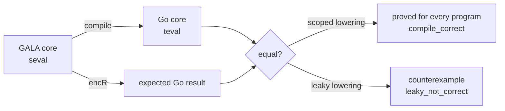

# formal/: the Lean semantics of GALA

This directory holds a machine-checked definition of what GALA programs mean, written in
[Lean 4](https://lean-lang.org). The design, plan and rules are in
[docs/FORMAL_SEMANTICS.MD](../docs/FORMAL_SEMANTICS.MD). What is covered today is in
[COVERAGE.md](COVERAGE.md).

It is a Lake project with no dependencies (no Mathlib). It also builds with Bazel through
[rules_lean](https://github.com/martianoff/rules_lean), but only on request (see
[Building with Bazel](#building-with-bazel)). Nothing here is part of the `gala` CLI or a
GALA release.

## What is modelled

- **`galaspec`, the reference interpreter for subset S1 and part of S2**: the executable
  semantics of int/bool/string operators, `val`/`var`, blocks, `if`, functions and
  recursion, structs, sealed types, `match`, `Println`/`Print` and, from S2, interpolated
  strings `s"..."`, lambdas and closures, named arguments and default values. It reads a program as Core JSON (written
  by `internal/formal/coreexport`) and prints what the program prints, plus how it ends.

  ```mermaid
  flowchart LR
      J[Core JSON] --> D[Gala/Json.lean<br/>decode]
      D --> S[Gala/Syntax.lean<br/>surface AST]
      S --> E[Gala/Eval.lean<br/>big-step, fuel]
      SC[Gala/Scope.lean<br/>name resolution] --> E
      E --> P[Gala/Print.lean<br/>Println / Print]
      E --> O[stdout + outcome]
  ```

- **A lowering model**, `Gala/MatchLowering.lean`: sealed-type constructors and `match`
  in a small GALA core, and the Go constructs the transpiler lowers them to (tagged
  struct, `Unapply` chain, panic).

[COVERAGE.md](COVERAGE.md) lists what is modelled, tested and proved.



Each definition's doc comment says what it models, and each file's header names the
`docs/GALA.MD` sections it reflects.

## Layout

| Path | Purpose |
|---|---|
| `lean-toolchain` | The pinned Lean version. elan reads it locally; CI also needs its SHA-256 in `formal.yml` (see below). |
| `lakefile.toml` | The Lake project: the library `Gala`, built from `Gala.lean` and every file under `Gala/`, and the executables `galaspec` and `galaspec-tests`. |
| `lake-manifest.json` | Lake's lock file; empty while there are no dependencies. |
| `BUILD.bazel` | The Bazel build of the same modules, with rules_lean. Hand-written; gazelle skips `formal/`. |
| `lean.bzl` | Wrappers of the rules_lean rules that put every Lean target behind `--config=formal`. Load Lean rules from here, not from `@rules_lean`. |
| `Gala.lean` | Root module, for `import Gala`. It imports every module, so it comes last in `GALA_SRCS` in `BUILD.bazel`. Lake and the Lake proof check find modules by directory, not through it. |
| `Gala/*.lean` | The models and proofs. `Syntax`, `Json`, `Scope`, `Eval`, `Print` and `Cli` are galaspec, `Main` its executable, `Theorems` the theorems about it. |
| `tests/` | galaspec's tests: `GalaTests.lean`, Core JSON fixtures with their expected `.out` and `.outcome`, the GALA sources in `tests/src/`, and `export.sh`, which re-exports the fixtures. |
| `galaspec_tests.sh` | Runs the galaspec fixture tests under Bazel, from `formal/` in the runfiles. |
| `scripts/ProofCheck.lean` | The proof check (below). |
| `COVERAGE.md` | What is modelled, tested and proved. |

## Building

Install Lean with [elan](https://github.com/leanprover/elan). It reads `lean-toolchain`
and fetches that version from Lean's official releases. Then, in this directory:

```shell
lake build --wfail                         # build and check every proof; warnings fail
lake env lean --run scripts/ProofCheck.lean  # fail on sorry or non-standard axioms
```

The proof check is needed because Lean only *warns* when a proof uses `sorry`. The script
imports every module of the library and fails if any declaration depends on `sorry` or on
an axiom other than `propext`, `Quot.sound` and `Classical.choice`, private declarations
included. It also fails if a theorem that COVERAGE.md calls proved is missing. Run
`lake build` first: the script checks the built modules, so it fails without a build and
checks old code after a stale one.

CI runs both, and the galaspec tests below, in
[`.github/workflows/formal.yml`](../.github/workflows/formal.yml) on every pull request
that touches `formal/`. It does not use elan: it downloads the release `lean-toolchain`
pins, checks it against a SHA-256 in the workflow, and puts its `bin/` on `PATH`. Bumping
`lean-toolchain` therefore needs the new release's Linux SHA-256 added to the workflow;
without it the job fails. Lake is the primary build; the Bazel build below is the second
path.

## Running galaspec

```shell
lake build galaspec
lake exe galaspec run prog.json             # or .lake/build/bin/galaspec run prog.json
lake exe galaspec run --fuel 100000000 prog.json
```

`prog.json` is a Core JSON document. To export one from GALA source, from the repository
root:

```shell
bazel run //internal/formal/coreexport/galacore -- "$PWD/main.gala" > prog.json
```

galaspec prints the program's output on stdout, exactly, and on stderr ends with the
line `galaspec: outcome=<outcome>`. The exit code says the same:

| Exit | Outcome | Meaning |
|---|---|---|
| 0 | `ok` | The program ran to the end. |
| 1 | `panic:CLASS` | It panicked. CLASS is `match` (no arm matched), `divide` (integer division by zero), `index` or `other` (a negative shift count). |
| 2 | `fuel` | It used up its steps (10^6 unless `--fuel N`). Inconclusive, never agreement. |
| 3 | `unsupported:KIND` | Execution reached a construct outside S1. KIND is the exporter's `unsupported` name, or one listed in [COVERAGE.md](COVERAGE.md#where-galaspec-stops). |
| 4 | `malformed` | The input is not a Core JSON document of the version galaspec reads, or the command line is wrong. |

The line before the outcome line, when there is one, says more: the panic message, or
what was unsupported.

### Tests

```shell
lake exe galaspec-tests
```

runs every fixture `tests/<name>.json` and compares its output and outcome with
`tests/<name>.out` and `tests/<name>.outcome`. After changing the exporter or a source in
`tests/src/`, re-export the fixtures with `formal/tests/export.sh` from the repository
root, and check any changed `.out` against `gala run`.

## Building with Bazel

The same modules also build with [rules_lean](https://github.com/martianoff/rules_lean),
a dev dependency in `MODULE.bazel`. Its Lean targets are **opt-in**: they build only under
`--config=formal`. From the repository root:

```shell
bazel test --config=formal //formal/...   # build every module, check the proofs, test galaspec
```

No elan is needed: rules_lean downloads the Lean release that `MODULE.bazel` pins (the
same version as `lean-toolchain`) from Lean's official release hosts and verifies its
checksum. The download is about 600 MB and unpacks to 3.3 GB in each Bazel output base, so
it happens only under `--config=formal`. Without the config, `bazel build //...` and
`bazel test //...` skip the Lean targets and never download Lean. Switching the config
on and off in one output base makes Bazel discard its analysis cache each time.

The Bazel build is held to the same rules as Lake's: every library is built with
`warnings_as_errors` (`formal/lean.bzl` sets it), like `lake build --wfail`, and
`//formal:proofs` checks what `scripts/ProofCheck.lean` checks, with one difference: it
skips compiler-generated auxiliary declarations (`_proof_1` and the like), whose axioms
show up in the declarations that use them.

| Target | What it is |
|---|---|
| `//formal:gala` | `lean_library` of what `import Gala` covers: every module under `Gala/` except `Main`, built on `:galaspec_lib` (the interpreter modules that `galaspec` and its tests link). Module names are `Gala.X`, as with Lake. |
| `//formal:proofs` | `lean_proof_test` over every module under `Gala/`: fails on `sorry` and on axioms other than `propext`, `Quot.sound` and `Classical.choice` in any declaration, private ones included, and when a theorem in `REQUIRED_THEOREMS` (the ones COVERAGE.md calls proved) is missing. `tools/check_repo_policy.sh` keeps that list equal to `requiredTheorems` in `scripts/ProofCheck.lean`. |
| `//formal:galaspec` | `lean_binary` of `Gala.Main`: the same `galaspec` as `lake exe galaspec` (`bazel run --config=formal //formal:galaspec -- run "$PWD/prog.json"`; `bazel run` starts it in its runfiles, so pass an absolute path). |
| `//formal:galaspec_tests` | Runs the fixtures in `tests/`, like `lake exe galaspec-tests`. |
| `//formal:galaspec_cli_test` | Checks the command-line contract the differential harness relies on (exit code and outcome line on a panic, deep recursion with `--fuel`), like the smoke steps of the Lake job. |

The differential run uses `//formal:galaspec` under the config, so it too needs nothing
but Bazel:

```shell
bazel test --config=formal //internal/formal/difftest/differential:differential_test
```

To use another galaspec, e.g. a Lake-built one, run it without the config and pass
`GALA_SPEC_BIN` (with `--test_env=GALA_SPEC_BIN`). It also overrides the Bazel-built one
under the config, but the config builds that one anyway.

**Adding a module:** add the file under `Gala/` and to `BUILD.bazel`: to `GALASPEC_SRCS`
if galaspec needs it, otherwise to `GALA_SRCS` before `Gala.lean`; in both, after the
modules it imports (rules_lean compiles `srcs` in order). Loading `//formal` fails if a
module under `Gala/` is in neither list.
**Changing the Lean version:** change `lean-toolchain` and `lean.toolchain(version = …)`
in `MODULE.bazel` together (`tools/check_repo_policy.sh` fails if they differ); rules_lean
must know the version.
**Proving a theorem COVERAGE.md lists:** add it to `requiredTheorems` in
`scripts/ProofCheck.lean` and to `REQUIRED_THEOREMS` in `BUILD.bazel`.

## Honest coverage

These rules apply to every doc, release note and PR that mentions this work:

- **"Proved"** means a kernel-checked theorem about the spec, with no `sorry` and only
  Lean's standard axioms. Nothing else is called proved.
- **"Tested against the spec"** means differential results: generated programs and
  examples agree with the spec. Nothing is in this tier yet.
- Neither word is used for constructs outside the modelled subset.
- We never claim the transpiler is verified. A lowering model proves what a correct
  lowering must do, not that the transpiler does it.

## Licensing

The files here are licensed like the rest of the repository. Lean is Apache 2.0, but its
release binaries bundle LGPL components, so:

- No Lean-built binary ships in GALA releases, the CLI, Docker images or the playground.
- The Lean toolchain is never vendored, committed, mirrored or re-hosted. CI and
  rules_lean fetch it from Lean's official releases and check a pinned SHA-256.
- Lake dependencies must be Apache 2.0, MIT or BSD.

Details are in the "Licensing" section of the design.
