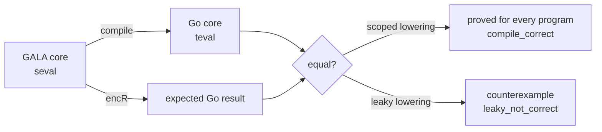

# formal/: the Lean semantics of GALA

This directory holds a machine-checked definition of what GALA programs mean, written in
[Lean 4](https://lean-lang.org). The design, plan and rules are in
[docs/FORMAL_SEMANTICS.MD](../docs/FORMAL_SEMANTICS.MD). What is covered today is in
[COVERAGE.md](COVERAGE.md).

It is a Lake project with no dependencies (no Mathlib). Nothing here is part of the Bazel
build, the `gala` CLI or a GALA release.

## What is modelled

- **`galaspec`, the reference interpreter for subset S1**: the executable semantics of
  int/bool/string operators, `val`/`var`, blocks, `if`, functions and recursion, structs,
  sealed types, `match` and `Println`/`Print`. It reads a program as Core JSON (written
  by `internal/formal/coreexport`) and prints what the program prints, plus how it ends.

  ```mermaid
  flowchart LR
      J[Core JSON] --> D[Gala/Json.lean<br/>decode]
      D --> S[Gala/Syntax.lean<br/>surface AST]
      S --> E[Gala/Eval.lean<br/>big-step, fuel]
      SC[Gala/Scope.lean<br/>name resolution] --> E
      E --> P[Gala/Print.lean<br/>Println / Print]
      E --> O[stdout + outcome]
  ```

- **A lowering model**, `Gala/MatchLowering.lean`: sealed-type constructors and `match`
  in a small GALA core, and the Go constructs the transpiler lowers them to (tagged
  struct, `Unapply` chain, panic).

[COVERAGE.md](COVERAGE.md) lists what is modelled, tested and proved.



Each definition's doc comment says what it models, and each file's header names the
`docs/GALA.MD` sections it reflects.

## Layout

| Path | Purpose |
|---|---|
| `lean-toolchain` | The pinned Lean version. elan reads it. |
| `lakefile.toml` | The Lake project: the library `Gala`, built from `Gala.lean` and every file under `Gala/`, and the executables `galaspec` and `galaspec-tests`. |
| `lake-manifest.json` | Lake's lock file; empty while there are no dependencies. |
| `Gala.lean` | Root module, for `import Gala`. The build and the proof check find modules by directory, not through it. |
| `Gala/*.lean` | The models and proofs. `Syntax`, `Json`, `Scope`, `Eval`, `Print` and `Cli` are galaspec, `Main` its executable, `Theorems` the theorems about it. |
| `tests/` | galaspec's tests: `GalaTests.lean`, Core JSON fixtures with their expected `.out` and `.outcome`, the GALA sources in `tests/src/`, and `export.sh`, which re-exports the fixtures. |
| `scripts/ProofCheck.lean` | The proof check (below). |
| `COVERAGE.md` | What is modelled, tested and proved. |

## Building

Install Lean with [elan](https://github.com/leanprover/elan). It reads `lean-toolchain`
and fetches that version from Lean's official releases. Then, in this directory:

```shell
lake build --wfail                         # build and check every proof; warnings fail
lake env lean --run scripts/ProofCheck.lean  # fail on sorry or non-standard axioms
```

The proof check is needed because Lean only *warns* when a proof uses `sorry`. The script
imports every module of the library and fails if any declaration depends on `sorry` or on
an axiom other than `propext`, `Quot.sound` and `Classical.choice`, private declarations
included. It also fails if a theorem that COVERAGE.md calls proved is missing. Run
`lake build` first: the script checks the built modules, so it fails without a build and
checks old code after a stale one.

CI runs both, and the galaspec tests below, in
[`.github/workflows/formal.yml`](../.github/workflows/formal.yml) on every pull request
that touches `formal/`. It does not use elan: it downloads the release `lean-toolchain`
pins, checks it against a SHA-256 in the workflow, and puts its `bin/` on `PATH`. Bumping
`lean-toolchain` therefore needs the new release's Linux SHA-256 added to the workflow;
without it the job fails.

## Running galaspec

```shell
lake build galaspec
lake exe galaspec run prog.json             # or .lake/build/bin/galaspec run prog.json
lake exe galaspec run --fuel 100000000 prog.json
```

`prog.json` is a Core JSON document. To export one from GALA source, from the repository
root:

```shell
bazel run //internal/formal/coreexport/galacore -- "$PWD/main.gala" > prog.json
```

galaspec prints the program's output on stdout, exactly, and on stderr ends with the
line `galaspec: outcome=<outcome>`. The exit code says the same:

| Exit | Outcome | Meaning |
|---|---|---|
| 0 | `ok` | The program ran to the end. |
| 1 | `panic:CLASS` | It panicked. CLASS is `match` (no arm matched), `divide` (integer division by zero), `index` or `other` (a negative shift count). |
| 2 | `fuel` | It used up its steps (10^6 unless `--fuel N`). Inconclusive, never agreement. |
| 3 | `unsupported:KIND` | Execution reached a construct outside S1. KIND is the exporter's `unsupported` name, or one listed in [COVERAGE.md](COVERAGE.md#where-galaspec-stops). |
| 4 | `malformed` | The input is not a Core JSON v1 document, or the command line is wrong. |

The line before the outcome line, when there is one, says more: the panic message, or
what was unsupported.

### Tests

```shell
lake exe galaspec-tests
```

runs every fixture `tests/<name>.json` and compares its output and outcome with
`tests/<name>.out` and `tests/<name>.outcome`. After changing the exporter or a source in
`tests/src/`, re-export the fixtures with `formal/tests/export.sh` from the repository
root, and check any changed `.out` against `gala run`.

### Bazel

Lean is built with Lake, not Bazel, and `formal/` is in `.bazelignore`. A plain
`bazel build //...` never sees it and never downloads Lean. The planned Bazel path is
[rules_lean](https://github.com/martianoff/rules_lean), added as an opt-in module once it
is in the Bazel Central Registry (see "CI and build" in the design).

## Honest coverage

These rules apply to every doc, release note and PR that mentions this work:

- **"Proved"** means a kernel-checked theorem about the spec, with no `sorry` and only
  Lean's standard axioms. Nothing else is called proved.
- **"Tested against the spec"** means differential results: generated programs and
  examples agree with the spec. Nothing is in this tier yet.
- Neither word is used for constructs outside the modelled subset.
- We never claim the transpiler is verified. A lowering model proves what a correct
  lowering must do, not that the transpiler does it.

## Licensing

The files here are licensed like the rest of the repository. Lean is Apache 2.0, but its
release binaries bundle LGPL components, so:

- No Lean-built binary ships in GALA releases, the CLI, Docker images or the playground.
- The Lean toolchain is never vendored, committed, mirrored or re-hosted: no public
  mirror, no committed archive, no published image or cache that others download from.
  CI fetches it from Lean's official releases and checks a pinned SHA-256; keeping it in
  the repository's own GitHub Actions cache is allowed, since that cache is private to CI.
- Lake dependencies must be Apache 2.0, MIT or BSD.

Details are in the "Licensing" section of the design.
