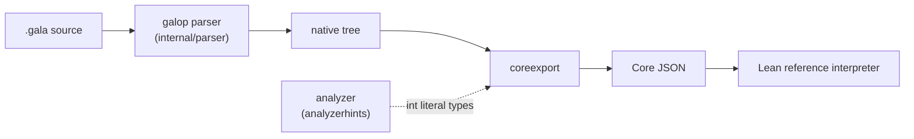

# Core JSON, version 3

Core JSON is the surface syntax of a GALA program as the formal semantics reads it
(see [docs/FORMAL_SEMANTICS.MD](../../../docs/FORMAL_SEMANTICS.MD)). The exporter in
this package writes it from galop's native parse tree. It covers subset S1 and
the parts of S2 listed here:

- int, bool and string literals and their operators;
- `val`, `var`, `if` and blocks;
- functions and recursion, structs and sealed types;
- `match` with nested, tuple, literal and wildcard patterns, and guards;
- `Println` and `Print`;
- interpolated strings, `s"..."` (S2);
- lambdas, function types and functions as values (S2).

The Go types in [schema.go](schema.go) are the same schema. `schema_test.go` checks
that every kind and field there is documented here, and that the two lists of
unsupported constructs agree.



## What the exporter does not do

Core JSON is a faithful syntax dump. The exporter does **not**:

- resolve names: an identifier is a `name` (or a `pat-name` in a pattern), whatever it
  refers to;
- fill in default arguments, or reorder named arguments;
- desugar `match`: arms, patterns and guards appear as written, in source order;
- decide precedence beyond the grammar's: binary chains nest left to right, level by
  level, exactly as the grammar groups them.

The spec does each of those itself; they are the transpiler steps under test.

## Document

```json
{
  "core": 3,
  "files": [ { "kind": "file", ... } ]
}
```

- `core` is the schema version. A consumer rejects a version it does not know.
- `files` holds one `file` node per source file, in the order they were given.

## Common fields

Every supported node is a JSON object that starts with:

- `kind`: one of the kinds below.
- `pos`: where the node is.
  - `line`: line of its first token, from 1.
  - `col`: column of its first token, from 1, counted in code points.
  - `off`, `end`: byte offsets of the start of its first token and the end of its
    last token. `source[off:end]` is the node's text.

  Positions are in the file as given, a leading byte order mark included.

A child's span lies within its parent's.

Optional child nodes are `null` when absent. Lists are never `null`; an empty list is
`[]`.

## Unsupported nodes

A construct outside the subset is exported in place of the node it would be, as

```json
{ "unsupported": "for", "pos": { "line": 3, "col": 5, "off": 32, "end": 70 } }
```

It has `unsupported` instead of `kind`, and a `pos`. It never makes the export fail. A
program is wholly inside the subset when its document contains no such node.

An unsupported node has no children: whatever lies inside the construct is not exported,
so an unsupported construct nested in another one is not counted.
[Unsupported constructs](#unsupported-constructs) lists every name.

## Type hints

Where meaning depends on a type, a node carries the analyzer's type in an optional
`hint` field: `{"type": "int"}`. In S1 only `int` literals have one, and only when the
exporter is given a `LiteralType` (`analyzerhints.LiteralType` is the analyzer's). A
hint is a checked hint: the spec checks it against its own typing rules, and the
node's meaning never rests on it alone.

The analyzer types a literal on its own, without its context. Its hint is the type the
untyped constant takes by default (`int` for every integer literal), not the type the
context gives it: in `val x int64 = 1` the literal's hint is still `int`. The spec
applies the context itself, from the declared types, which are in the document.

## Node kinds

Fields are listed after the common `kind` and `pos`. In examples, `pos` is shortened to
`…`.

### `file`

One source file.

- `path` (string): the path the file was given as.
- `package` (string): the name in its `package` clause.
- `decls` (list): its declarations: the `import`s (always unsupported) first, then the
  top-level declarations, in source order.

```json
{ "kind": "file", "pos": "…", "path": "main.gala", "package": "main", "decls": [] }
```

### `val`

`val a = 1`, `val b int = 2`, `val (x, y) = pair`.

- `names` (list of strings): the names bound, in order.
- `destructure` (bool): true for the tuple form `val (x, y) = ...`.
- `type` (type or null): the declared type.
- `values` (list of expressions): the right-hand side.

```json
{ "kind": "val", "pos": "…", "names": ["a"], "destructure": false, "type": null,
  "values": [ { "kind": "int", "pos": "…", "text": "1", "hint": { "type": "int" } } ] }
```

### `var`

`var c = 1`, `var d int`. The fields are those of `val`.

- `names` (list of strings), `destructure` (bool), `type` (type or null).
- `values` (list of expressions): empty when there is no `=`.

```json
{ "kind": "var", "pos": "…", "names": ["d"], "destructure": false,
  "type": { "kind": "type-name", "pos": "…", "name": "int" }, "values": [] }
```

### `func`

A function declaration, at top level or in a block. A method (a function with a
receiver) and a generic function are unsupported.

- `name` (string).
- `params` (list of `param`).
- `result` (type or null): the declared result type.
- `body` (`block` or expression): a block, or the expression of the `= expr` form.

```json
{ "kind": "func", "pos": "…", "name": "id", "params": [ { "kind": "param", "pos": "…", "name": "n",
  "type": { "kind": "type-name", "pos": "…", "name": "int" } } ],
  "result": { "kind": "type-name", "pos": "…", "name": "int" },
  "body": { "kind": "name", "pos": "…", "name": "n" } }
```

### `param`

A function or lambda parameter. Defaults, variadic parameters and `val`/`var` modifiers
are unsupported.

- `name` (string).
- `type` (type or null): null when left out.

```json
{ "kind": "param", "pos": "…", "name": "n", "type": { "kind": "type-name", "pos": "…", "name": "int" } }
```

### `struct`

`type Point struct { X int }`, or the shorthand `struct Pair(Left int, Right string)`.

- `name` (string).
- `shorthand` (bool): true for the `struct Name(...)` form.
- `fields` (list of `field`).

```json
{ "kind": "struct", "pos": "…", "name": "Pair", "shorthand": true, "fields": [
  { "kind": "field", "pos": "…", "name": "Left", "type": { "kind": "type-name", "pos": "…", "name": "int" },
    "mutable": false } ] }
```

### `field`

A field of a struct or of a sealed variant. A field with a default is unsupported.

- `name` (string).
- `type` (type, or null for a shorthand field written without one).
- `mutable` (bool): true for a `var` field.

```json
{ "kind": "field", "pos": "…", "name": "Y", "type": { "kind": "type-name", "pos": "…", "name": "int" },
  "mutable": true }
```

### `sealed`

`sealed type Shape { case Circle(Radius int) case Empty }`. A generic sealed type is
unsupported.

- `name` (string).
- `variants` (list of `variant`), in source order.

```json
{ "kind": "sealed", "pos": "…", "name": "Shape", "variants": [
  { "kind": "variant", "pos": "…", "name": "Empty", "default": false, "fields": [] } ] }
```

### `variant`

One `case` of a sealed type. `case Empty` and `case Empty()` are the same variant.

- `name` (string).
- `default` (bool): true for `default case`.
- `fields` (list of `field`).

```json
{ "kind": "variant", "pos": "…", "name": "Circle", "default": false, "fields": [
  { "kind": "field", "pos": "…", "name": "Radius", "type": { "kind": "type-name", "pos": "…", "name": "int" },
    "mutable": false } ] }
```

### `type-name`

A type written as a plain name: `int`, `string`, `Point`. Generic, qualified, slice,
pointer and map types are unsupported; a function type is a [`type-func`](#type-func).

- `name` (string).

```json
{ "kind": "type-name", "pos": "…", "name": "int" }
```

### `block`

`{ ... }`.

- `stmts` (list): its statements in order. Each is a declaration (`val`, `var`, `func`,
  `struct`), a statement (`if`, `return`, `assign`, `incdec`) or an expression.

```json
{ "kind": "block", "pos": "…", "stmts": [ { "kind": "return", "pos": "…", "value": null } ] }
```

### `if`

The statement `if cond { ... } else ...`. An `if` with an init statement is
unsupported.

- `cond` (expression).
- `then` (`block`).
- `else` (`block`, `if` for `else if`, or null).

```json
{ "kind": "if", "pos": "…", "cond": { "kind": "name", "pos": "…", "name": "ok" },
  "then": { "kind": "block", "pos": "…", "stmts": [] }, "else": null }
```

### `return`

`return` or `return value`.

- `value` (expression or null).

```json
{ "kind": "return", "pos": "…", "value": { "kind": "name", "pos": "…", "name": "n" } }
```

### `assign`

`targets op values`.

- `op` (string): one of `=`, `+=`, `-=`, `*=`, `/=`.
- `targets` (list of expressions).
- `values` (list of expressions).

```json
{ "kind": "assign", "pos": "…", "op": "+=", "targets": [ { "kind": "name", "pos": "…", "name": "c" } ],
  "values": [ { "kind": "int", "pos": "…", "text": "2" } ] }
```

### `incdec`

`target++` or `target--`.

- `op` (string): `++` or `--`.
- `target` (expression).

```json
{ "kind": "incdec", "pos": "…", "op": "++", "target": { "kind": "name", "pos": "…", "name": "d" } }
```

### `int`

An integer literal.

- `text` (string): as written: decimal, `0x`, `0b` or `0o`. The spec reads the value.
- `hint` (optional object): the analyzer's type for the literal on its own,
  `{"type": "int"}`. See [Type hints](#type-hints).

```json
{ "kind": "int", "pos": "…", "text": "0x1F", "hint": { "type": "int" } }
```

### `bool`

`true` or `false`.

- `value` (bool).

```json
{ "kind": "bool", "pos": "…", "value": true }
```

### `string`

A string literal, `"..."` or `` `...` ``. An interpolated string `s"..."` is an
[`interp`](#interp); a format string `f"..."` is unsupported.

- `text` (string): as written, quotes included.
- `value` (string): its contents, with escapes decoded as Go decodes them (the
  transpiler emits string literals unchanged).
- `raw` (bool): true for a backquoted literal, whose `value` is its text without the
  quotes and, as in Go, without carriage returns.

```json
{ "kind": "string", "pos": "…", "text": "\"a\\tb\"", "value": "a\tb", "raw": false }
```

### `name`

An identifier used as an expression. It is not resolved: it may name a local, a
parameter, a function, a struct, a variant or a builtin such as `Println`.

- `name` (string).

```json
{ "kind": "name", "pos": "…", "name": "Println" }
```

### `unary`

`op operand`. Pointer dereference, address-of and channel receive are unsupported.

- `op` (string): one of `-`, `+`, `!`, `^`.
- `operand` (expression).

```json
{ "kind": "unary", "pos": "…", "op": "!", "operand": { "kind": "bool", "pos": "…", "value": false } }
```

### `binary`

`left op right`. The grammar's precedence levels are, loosest first: `||`; `&&`;
`==` `!=`; `<` `<=` `>` `>=`; `+` `-` `|` `^`; `*` `/` `%` `<<` `>>` `&` `&^`. A chain at
one level nests to the left: `a - b - c` is `(a - b) - c`.

- `op` (string).
- `left`, `right` (expressions).

```json
{ "kind": "binary", "pos": "…", "op": "+", "left": { "kind": "int", "pos": "…", "text": "1" },
  "right": { "kind": "int", "pos": "…", "text": "2" } }
```

### `call`

`callee(args)`. Struct and variant construction (`Point(1, 2)`) and printing
(`Println(x)`) are calls too: the exporter does not tell them apart. Named arguments and
spread arguments are unsupported; a lambda argument is a [`lambda`](#lambda).

- `callee` (expression).
- `args` (list of expressions), in source order.

```json
{ "kind": "call", "pos": "…", "callee": { "kind": "name", "pos": "…", "name": "Println" },
  "args": [ { "kind": "string", "pos": "…", "text": "\"hi\"", "value": "hi", "raw": false } ] }
```

### `select`

`target.name`. It is not resolved: a field, a method or a package member.

- `target` (expression).
- `name` (string).

```json
{ "kind": "select", "pos": "…", "target": { "kind": "name", "pos": "…", "name": "p" }, "name": "X" }
```

### `paren`

`(expr)`.

- `expr` (expression).

```json
{ "kind": "paren", "pos": "…", "expr": { "kind": "name", "pos": "…", "name": "x" } }
```

### `tuple`

`(a, b, ...)`, two or more elements. `()` and `(a,)` are unsupported.

- `elems` (list of expressions).

```json
{ "kind": "tuple", "pos": "…", "elems": [ { "kind": "name", "pos": "…", "name": "a" },
  { "kind": "name", "pos": "…", "name": "b" } ] }
```

### `if-expr`

The expression `if (cond) a else b`.

- `cond` (expression).
- `then`, `else` (each a `block` or an expression).

```json
{ "kind": "if-expr", "pos": "…", "cond": { "kind": "name", "pos": "…", "name": "ok" },
  "then": { "kind": "int", "pos": "…", "text": "1" }, "else": { "kind": "int", "pos": "…", "text": "0" } }
```

### `match`

`subject match { case ... }`. A partial function literal `{ case ... }` is unsupported.

- `subject` (expression).
- `cases` (list of `case`), in source order.

```json
{ "kind": "match", "pos": "…", "subject": { "kind": "name", "pos": "…", "name": "e" },
  "cases": [ { "kind": "case", "pos": "…", "pattern": { "kind": "pat-wild", "pos": "…" }, "guard": null,
    "body": { "kind": "int", "pos": "…", "text": "0" } } ] }
```

### `case`

`case pattern if guard => body`.

- `pattern` (pattern).
- `guard` (expression or null).
- `body`: a `block`, an expression, or a statement (`assign`, `incdec`).

```json
{ "kind": "case", "pos": "…", "pattern": { "kind": "pat-name", "pos": "…", "name": "n" },
  "guard": { "kind": "binary", "pos": "…", "op": ">", "left": { "kind": "name", "pos": "…", "name": "n" },
    "right": { "kind": "int", "pos": "…", "text": "10" } },
  "body": { "kind": "name", "pos": "…", "name": "n" } }
```

### `pat-wild`

The wildcard pattern `_`. No fields.

```json
{ "kind": "pat-wild", "pos": "…" }
```

### `pat-name`

A bare name in a pattern. It is not resolved: it either binds a new variable or names a
variant without fields (`case Empty =>`). The spec decides which.

- `name` (string).

```json
{ "kind": "pat-name", "pos": "…", "name": "v" }
```

### `pat-lit`

A literal pattern.

- `value`: an `int`, `bool` or `string` node, or a `unary` `-` applied to an `int` (for
  `case -1 =>`).

```json
{ "kind": "pat-lit", "pos": "…", "value": { "kind": "unary", "pos": "…", "op": "-",
  "operand": { "kind": "int", "pos": "…", "text": "1" } } }
```

### `pat-tuple`

The pattern `(p1, p2, ...)`, two or more elements.

- `elems` (list of patterns).

```json
{ "kind": "pat-tuple", "pos": "…", "elems": [ { "kind": "pat-wild", "pos": "…" },
  { "kind": "pat-name", "pos": "…", "name": "s" } ] }
```

### `pat-extract`

`callee(p1, p2, ...)`: a variant, or any other extractor, applied to sub-patterns.

- `callee` (`name`, or `select` for a qualified name). Not resolved.
- `args` (list of patterns), in source order.

```json
{ "kind": "pat-extract", "pos": "…", "callee": { "kind": "name", "pos": "…", "name": "Num" },
  "args": [ { "kind": "pat-name", "pos": "…", "name": "v" } ] }
```

### `lambda`

A lambda, `(x int) => x * x` or `(n int) int => { ... }` (S2), wherever it is written: as
a value, a call argument or a function's result.

- `params` (list of `param`): a parameter's `type` is null when it is left out, to be
  inferred from the context.
- `result` (type or null): the declared result type.
- `body` (`block` or expression).

```json
{ "kind": "lambda", "pos": "…", "params": [ { "kind": "param", "pos": "…", "name": "x", "type": null } ],
  "result": null, "body": { "kind": "name", "pos": "…", "name": "x" } }
```

### `type-func`

A function type, `func(int, string) bool` (S2). A parameter written with a name,
`func(x int) bool`, is exported as its type alone.

- `params` (list of types), in order.
- `result` (type or null): null for a function without a result.

```json
{ "kind": "type-func", "pos": "…", "params": [ { "kind": "type-name", "pos": "…", "name": "int" } ],
  "result": { "kind": "type-name", "pos": "…", "name": "bool" } }
```

### `interp`

An interpolated string, `s"..."` (S2). The exporter splits its text with the lexical
rules of the `s"..."` token (`internal/interpolation`, which the transpiler uses too):
`$name` and `${expr}` embed an expression, `$$` is a `$`, and everything else is literal
text. Each embedded expression is parsed on its own, at its place in the file, and
exported like any other expression. The format verb the transpiler picks for each part
is not exported: the spec decides how a value prints.

- `text` (string): as written, `s` and quotes included.
- `parts` (list): in source order, each an [`interp-text`](#interp-text) or an expression.

```json
{ "kind": "interp", "pos": "…", "text": "s\"n=$n\"", "parts": [
  { "kind": "interp-text", "pos": "…", "value": "n=" },
  { "kind": "name", "pos": "…", "name": "n" } ] }
```

### `interp-text`

A literal run of an `interp`, never empty.

- `value` (string): the run's text with `$$` read as `$` and escapes decoded as in a
  string literal (the transpiler writes the run into a Go string literal).

```json
{ "kind": "interp-text", "pos": "…", "value": "price: $" }
```

## Unsupported constructs

Every name an `unsupported` node can carry.

| Name | Construct |
|---|---|
| `import` | an `import` declaration |
| `embed` | an `embed val` declaration |
| `opaque-type` | an `opaque type` declaration |
| `defined-type` | a `type` declaration that is neither a struct nor an interface, `type ID int` |
| `interface` | an interface type declaration |
| `generic-decl` | a function, struct or sealed type with type parameters |
| `method` | a function with a receiver |
| `go-results` | a Go-style multiple result list `(T1, T2)` |
| `param-modifier` | a function parameter marked `val` or `var` |
| `param-default` | a parameter or field with a default value |
| `variadic-param` | a variadic parameter or field, `xs ...T` |
| `unnamed-param` | a parameter or field with a type and no name |
| `bind` | a `bind` declaration |
| `also` | an `also` declaration |
| `use` | a `use` declaration |
| `for` | a `for` loop |
| `if-init` | an `if` statement with an init statement, `if x := f(); x > 0` |
| `short-var-decl` | `a := e` |
| `partial-function` | a partial function literal, `{ case ... }` |
| `placeholder-lambda` | a placeholder lambda, `_ * 2`, which the transpiler rewrites from the expected type |
| `composite-literal` | a Go composite literal, `T{...}` |
| `index` | indexing or explicit type arguments, `x[i]` |
| `named-arg` | a named argument, `f(x = 1)` |
| `spread-arg` | a spread argument, `f(xs...)` |
| `unit` | `()` |
| `one-tuple` | `(a,)` |
| `leading-zero` | an integer literal with a leading zero, `0755`, which Go reads as octal |
| `float-literal` | a floating-point literal |
| `char-literal` | a rune literal, `'c'` |
| `nil` | `nil` |
| `interpolated-string` | an `s"..."` string one of whose embedded expressions does not parse |
| `format-string` | `f"..."` |
| `interpolated-escape` | an embedded expression written with a backslash, such as an escaped quote, `s"${f(\"a\")}"` |
| `string-escape` | a string literal whose escapes Go does not accept |
| `generic-type` | a type with type arguments, `Option[int]` |
| `qualified-type` | a type from another package, `pkg.T` |
| `slice-type` | `[]T` |
| `pointer-type` | `*T` |
| `map-type` | `map[K]V` |
| `func-type` | a function type written as an expression, `EmptyArray[func() int]()` |
| `other-type` | a form of type the grammar gained after this exporter was written |
| `deref` | `*p` |
| `address-of` | `&x` |
| `receive` | `<-ch` |
| `typed-pattern` | a type pattern `x: T`, or one used as a call argument |
| `rest-pattern` | a rest pattern `xs...` |
| `select-pattern` | a qualified name alone as a pattern, `case Color.Red =>` |
| `expression-pattern` | any other expression used as a pattern, `case 1 + 2 =>` |
| `paren-pattern` | a parenthesised pattern, `case (p) =>` |

## Versioning

The `core` version goes up whenever a consumer of the old version would misread or
reject a new document: a kind or field is added, removed or renamed, or a field's
meaning changes. Turning an unsupported construct into a supported kind adds a kind, so
it bumps the version too. A new name in the unsupported list does not: a consumer
treats every `unsupported` node alike.
