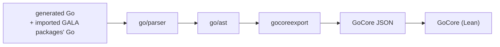

# GoCore JSON, version 1

GoCore JSON is the syntax of a Go program as GoCore, the Lean model of the Go the
transpiler emits, reads it (see [docs/FORMAL_SEMANTICS.MD](../../../docs/FORMAL_SEMANTICS.MD),
"M4: GoCore and the Go AST exporter"). The exporter in this package writes it from
`go/ast`: the transpiler's output for a program, and the Go of every GALA package the
program imports, the standard library's generated and hand-written files alike.

The Go types in [schema.go](schema.go) are the same schema. `schema_test.go` checks that
every kind, field and unrepresentable node there is documented here.



## What the exporter does not do

GoCore JSON is a plain syntax dump: every Go construct has a kind of its own, and which
of them GoCore runs is decided by the Lean decoder and evaluator alone. The exporter does
**not**:

- resolve names: an identifier is an `ident`, whatever it refers to; `std.Some` is a
  `selector` whether `std` is a package or a variable;
- infer or check types, or tell a conversion `T(x)` from a call;
- fold constants, or repeat a `const` spec's expression in the specs after it that have
  none;
- decide anything about what the program does, or which constructs GoCore covers.

It reads literals as the Go type checker does (`go/constant`), by the Go specification
("Integer literals", "Floating-point literals", "Imaginary literals", "Rune literals",
"String literals"): an integer's value in decimal, arbitrarily large; a float's exact
value; a rune's value (`'\xff'` is 255); a string's value, escapes interpreted.

It drops nothing but comments (and with them `//line` directives). The round-trip test
prints every exported file back as Go and checks that it parses to the source's syntax
tree, positions, comments and the spelling of literals aside. It runs on the Go output of
every example and of every GALA package they import, and lists the files it could not
print: those with an [unrepresentable node](#unrepresentable-nodes).

## Document

```json
{
  "gocore": 1,
  "packages": [ { "path": "main", "name": "main", "files": [ { "kind": "file", ... } ] } ]
}
```

- `gocore` is the schema version. A consumer rejects a version it does not know.
- `packages` holds the packages in the order they were given, each with its import
  path, its package name and its files, sorted by file name. `partial: true` marks a
  package of which only some files are given (Go's standard library's runnable
  files, `RunnableStdlib`): a name it lacks is in a file left out, which a consumer
  reports as outside what it runs, not as an error.

## Common fields

Every node but an unrepresentable one is a JSON object that starts with:

- `kind`: one of the kinds below.
- `pos`: where the node starts, `{"line": 3, "col": 5}`, as `go/token` reports it:
  both from 1, the column in bytes.

Optional child nodes are `null` when absent. Lists are never `null`; an empty list is
`[]`.

A parameter, result, receiver, type parameter, struct field or interface element is a
*field object*, not a node: `{"names": ["a", "b"], "type": <node>, "tag": ""}`, with no
names for an unnamed parameter or an embedded field, and a struct field's tag value in
`tag` (`""` for none).

## Unrepresentable nodes

A node JSON cannot carry exactly is exported in place of the node it would be, as

```json
{ "unrepresentable": "invalid-utf8", "pos": { "line": 3, "col": 7 } }
```

It has `unrepresentable` instead of `kind`, and a `pos`. It never makes the export fail: a
consumer that reaches it stops, naming it. It has no children. It is never used for a
construct outside GoCore; [the table](#unrepresentable-names) lists every name.

## Node kinds

### `file`

One source file: `name` (string), `imports` (list of `{"name", "path"}`, `name` being
`""` for none, `"."` or `"_"`), `decls` (list of the declarations other than imports, in
source order).

### `func-decl`

A function or method: `name`, `recv` (a field object, `null` for a function),
`typeParams` (field objects), `type` (its signature, a `func-type`), `body` (a `block`,
`null` without one).

### `type-decl`

A `type` declaration: `specs`, each `{"name", "namePos", "typeParams", "alias", "type"}`
for `type name[typeParams] type`, `alias` set for `type name = type`. `namePos` is where
the name is in the file as written, `{"line", "col"}` like `pos` but not changed by a
`//line` directive: a type declared in a function body is one type per declaration
(Go spec, "Type declarations"), and GoCore tells two such declarations apart by it.

### `value-decl`

A `var` or `const` declaration: `const` (bool) and `specs`, each
`{"names", "type", "values"}`, `type` `null` and `values` `[]` when absent. A const
spec's index in `specs` is its `iota`.

### `struct-type`

`struct { ... }`: `fields` (field objects).

### `interface-type`

`interface { ... }`: `elems`, field objects: a method has one name and a `func-type`, an
embedded type or type union none.

### `func-type`

`func(params) results`: `params`, `results` (field objects) and `variadic` (the last
parameter is `...T`; its field's type is `T`).

### `array-type`

`[len]elt`, or the slice type `[]elt` when `len` is `null`: `len`, `elt`.

### `ellipsis`

The `...` length of `[...]T`; no fields.

### `map-type`

`map[key]value`: `key`, `value`.

### `chan-type`

A channel type: `dir` (`"both"` for `chan T`, `"send"` for `chan<- T`, `"recv"` for
`<-chan T`) and `value`.

### `ident`

A name: `name`.

### `int-lit`

An integer literal: `value`, its value in decimal, as a string.

### `float-lit`

A floating-point literal: `value`, its exact value as `go/constant` writes it (a
fraction `p/q`, or an integer).

### `imag-lit`

An imaginary literal: `value`, the exact value of its imaginary part, as `float-lit`'s.

### `string-lit`

A string literal: `value`, its value (valid UTF-8; see above).

### `char-lit`

A rune literal: `value`, its value.

### `composite-lit`

`type{elts}`: `type` (`null` when elided inside another composite literal) and `elts`.

### `key-value`

`key: value` in a composite literal: `key`, `value`.

### `func-lit`

A function literal: `type` (a `func-type`) and `body` (a `block`).

### `paren`

`(x)`: `x`.

### `selector`

`x.sel`: `x` and `sel` (a string).

### `index`

`x[indices]`: an index expression, or a generic function or type instantiated with
type arguments: `x` and `indices`.

### `slice-expr`

`x[low:high]`, or `x[low:high:max]` when `slice3` is set: `x`, `low`, `high`, `max` (each
index may be `null`) and `slice3`.

### `type-assert`

`x.(T)`: `x` and `type`, which is `null` for `x.(type)` in a type switch.

### `call`

`fun(args)`: `fun`, `args` and `ellipsis` (`fun(args...)`). Conversions and builtin
calls are calls too.

### `star`

`*x`, a pointer type or an indirection: `x`.

### `unary`

`op x`, `op` one of `-`, `+`, `!`, `^`, `&`, `<-` and `~`: `op`, `x`.

### `binary`

`x op y`: `op`, `x`, `y`.

### `block`

`{ stmts }`: `stmts`.

### `decl-stmt`

A declaration inside a function: `decl`, a `value-decl` or a `type-decl`.

### `expr-stmt`

An expression statement: `x`.

### `inc-dec`

`x++` or `x--`: `op`, `x`.

### `assign`

`lhs tok rhs`, `tok` one of `=`, `:=` and the `op=` forms: `tok`, `lhs`, `rhs`.

### `return`

`return results`: `results`.

### `branch`

`break`, `continue`, `goto` or `fallthrough`: `tok` and `label` (`""` for none).

### `labeled`

`label: stmt`: `label`, `stmt`.

### `if`

`if init; cond { body } else ...`: `init` (a statement or `null`), `cond`, `body` (a
`block`), `else` (a `block`, an `if` or `null`).

### `switch`

An expression switch: `init`, `tag` (`null` for `switch {`), `clauses`, each
`{"list", "body"}`, an empty `list` being `default:`.

### `type-switch`

`switch init; assign { clauses }`: `init`, `assign` (an `assign` or `expr-stmt` whose
expression is a `type-assert` with a `null` type) and `clauses`, as `switch`'s, their
lists holding types.

### `select`

`select { clauses }`: `clauses`, each `{"comm", "body"}`, `comm` being the send or
receive statement, or `null` for `default:`.

### `for`

`for init; cond; post { body }`: `init`, `cond`, `post` (each may be `null`) and `body`.

### `range`

`for key, value tok range x { body }`: `key`, `value` (each may be `null`), `tok` (`:=`,
`=` or `""`), `x`, `body`.

### `send`

`ch <- value`: `chan`, `value`.

### `go`

`go call`: `call`.

### `defer`

`defer call`: `call`.

### `empty`

The empty statement; no fields.

## Unrepresentable names

| Name | Node |
|---|---|
| `invalid-utf8` | a string literal, or a struct type with a tag, whose value is not valid UTF-8 |
| `bad-node` | a node `go/parser` marks bad, or a method with no receiver or two, which `go/parser` accepts and no Go type checker does |
