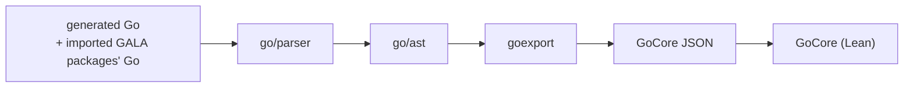

# GoCore JSON, version 1

GoCore JSON is the syntax of a Go program as GoCore, the Lean model of the Go the
transpiler emits, reads it (see [docs/FORMAL_SEMANTICS.MD](../../../docs/FORMAL_SEMANTICS.MD),
"M4: GoCore and the Go AST exporter"). The exporter in this package writes it from
`go/ast`: the transpiler's output for a program, and the Go of every GALA package the
program imports, the standard library's generated and hand-written files alike.

The Go types in [schema.go](schema.go) are the same schema. `schema_test.go` checks that
every kind, field and unsupported construct there is documented here.



## What the exporter does not do

GoCore JSON is a plain syntax dump. The exporter does **not**:

- resolve names: an identifier is an `ident`, whatever it refers to; `std.Some` is a
  `selector` whether `std` is a package or a variable;
- infer or check types, or tell a conversion `T(x)` from a call;
- fold constants, or repeat a `const` spec's expression in the specs after it that have
  none;
- decide anything about what the program does.

It reads literals lexically, as the Go specification defines their values ("Integer
literals", "Rune literals", "String literals"): an integer's value in decimal, any base
and `_` separators read, arbitrarily large; a string's and a rune's with their escapes
interpreted.

It keeps everything GoCore needs and drops only what has no meaning in a run: comments,
`//line` directives and struct tags. The round-trip test prints every exported document
back as Go and checks that it parses to the source's syntax tree, positions, comments,
tags and the spelling of literals aside.

## Document

```json
{
  "gocore": 1,
  "packages": [ { "path": "main", "name": "main", "files": [ { "kind": "file", ... } ] } ]
}
```

- `gocore` is the schema version. A consumer rejects a version it does not know.
- `packages` holds the packages in the order they were given, each with its import
  path, its package name and its files, sorted by file name.

## Common fields

Every supported node is a JSON object that starts with:

- `kind`: one of the kinds below.
- `pos`: where the node starts, `{"line": 3, "col": 5}`, as `go/token` reports it:
  both from 1, the column in bytes.

Optional child nodes are `null` when absent. Lists are never `null`; an empty list is
`[]`.

A parameter, result, receiver, type parameter, struct field or interface element is a
*field object*, not a node: `{"names": ["a", "b"], "type": <node>}`, with no names for an
unnamed parameter or an embedded field.

## Unsupported nodes

A construct outside GoCore is exported in place of the node it would be, as

```json
{ "unsupported": "defer", "pos": { "line": 3, "col": 2 } }
```

It has `unsupported` instead of `kind`, and a `pos`. It never makes the export fail: a
consumer that reaches it stops, naming the construct. It has no children.
[Unsupported constructs](#unsupported-constructs) lists every name.

## Node kinds

### `file`

One source file: `name` (string), `imports` (list of `{"name", "path"}`, `name` being
`""` for none, `"."` or `"_"`), `decls` (list of the declarations other than imports, in
source order).

### `func-decl`

A function or method: `name`, `recv` (a field object, `null` for a function),
`typeParams`, `params`, `results` (lists of field objects), `variadic` (the last
parameter is `...T`; its field's type is `T`), `body` (a `block`, `null` without one).

### `type-decl`

`type name[typeParams] type`: `name`, `typeParams`, `alias` (`type name = type`),
`type`. A grouped `type ( ... )` gives one `type-decl` per spec.

### `value-decl`

A `var` or `const` declaration: `const` (bool) and `specs`, each
`{"names", "type", "values"}`, `type` `null` and `values` `[]` when absent. A const
spec's index in `specs` is its `iota`.

### `struct-type`

`struct { ... }`: `fields` (field objects).

### `interface-type`

`interface { ... }`: `elems`, field objects: a method has one name and a `func-type`, an
embedded type or type union none.

### `func-type`

`func(params) results`: `params`, `results`, `variadic`.

### `ident`

A name: `name`.

### `int-lit`

An integer literal: `value`, its value in decimal, as a string.

### `string-lit`

A string literal: `value`, its value.

### `char-lit`

A rune literal: `value`, its code point.

### `composite-lit`

`type{elts}`: `type` (`null` when elided inside another composite literal) and `elts`.

### `key-value`

`key: value` in a composite literal: `key`, `value`.

### `func-lit`

A function literal: `type` (a `func-type`) and `body` (a `block`).

### `paren`

`(x)`: `x`.

### `selector`

`x.sel`: `x` and `sel` (a string).

### `index`

`x[indices]`: an index expression, or a generic function or type instantiated with
type arguments: `x` and `indices`.

### `type-assert`

`x.(type)`: `x` and `type`.

### `call`

`fun(args)`: `fun`, `args` and `ellipsis` (`fun(args...)`). Conversions and builtin
calls are calls too.

### `star`

`*x`, a pointer type or an indirection: `x`.

### `unary`

`op x`, `op` one of `-`, `+`, `!`, `^`, `&`: `op`, `x`.

### `binary`

`x op y`: `op`, `x`, `y`.

### `block`

`{ stmts }`: `stmts`.

### `decl-stmt`

A declaration inside a function: `decls`, one `value-decl`, or a `type-decl` per spec.

### `expr-stmt`

An expression statement: `x`.

### `inc-dec`

`x++` or `x--`: `op`, `x`.

### `assign`

`lhs tok rhs`, `tok` one of `=`, `:=` and the `op=` forms: `tok`, `lhs`, `rhs`.

### `return`

`return results`: `results`.

### `branch`

`break` or `continue` without a label: `tok`.

### `if`

`if init; cond { body } else ...`: `init` (a statement or `null`), `cond`, `body` (a
`block`), `else` (a `block`, an `if` or `null`).

### `switch`

An expression switch: `init`, `tag` (`null` for `switch {`), `clauses`, each
`{"list", "default", "body"}`, `default` set for `default:`.

### `for`

`for init; cond; post { body }`: `init`, `cond`, `post` (each may be `null`) and `body`.

### `range`

`for key, value tok range x { body }`: `key`, `value` (each may be `null`), `tok` (`:=`,
`=` or `""`), `x`, `body`.

### `empty`

The empty statement; no fields.

## Unsupported constructs

| Name | Construct |
|---|---|
| `float-literal` | a floating-point literal |
| `imag-literal` | an imaginary literal |
| `slice-expr` | `a[i:j]` |
| `array-type` | `[n]T` and `[]T` |
| `map-type` | `map[K]V` |
| `chan-type` | `chan T` |
| `ellipsis` | `...` anywhere but a last parameter (`[...]T`) |
| `labeled-stmt` | a labeled statement |
| `labeled-branch` | `break L`, `continue L` |
| `goto` | `goto` |
| `fallthrough` | `fallthrough` |
| `send` | `ch <- v` |
| `receive` | `<-ch` |
| `go` | a `go` statement |
| `defer` | a `defer` statement |
| `select` | a `select` statement |
| `type-switch` | a type switch |
| `bad-node` | a node `go/ast` marks bad, or a literal that does not read |
