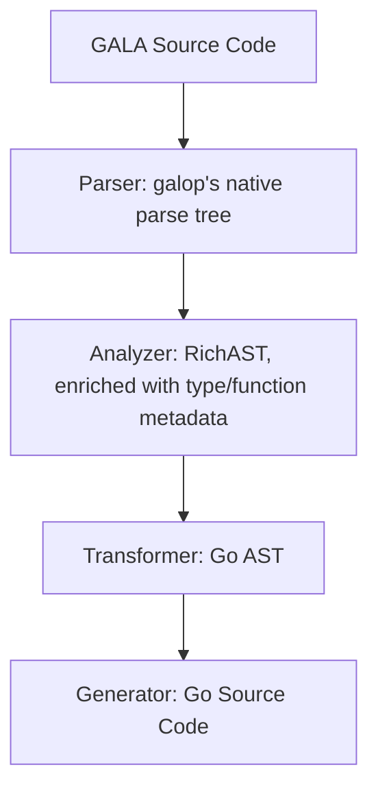

# GALA Transpiler Architecture

This document describes the architecture of the GALA-to-Go transpiler for internal developers and LLM assistance.

## Pipeline Overview

The transpiler follows a classic 4-stage pipeline:



## Component Responsibilities

### 1. Parser (`parser.go`)

**Interface:** `GalaParser`

Thin wrapper around `internal/parser`, which parses GALA source text with galop's
generated native lexer and parser into galop's native tree (`parser.Parsed`, with the
tree in `Parsed.Native`, the syntax errors and the doc comments).

**Key files:**
- `parser.go` - Adapter wrapping `internal/parser`

**Note:** Never hand-write or check in the generated parser (`internal/parser/native`) -
galop generates it in Bazel from `internal/parser/grammar/gala.g4`.

### 2. Analyzer (`analyzer/`)

**Interface:** `Analyzer`

Performs semantic analysis on the parse tree to produce a `RichAST` containing:
- Type metadata (fields, methods, type parameters)
- Function metadata (parameters, return types)
- Package imports and aliases
- Companion object metadata (for pattern matching)

**Key files:**
- `analyzer/analyzer.go` - Main analysis logic

**Key behaviors:**
- Caches analyzed packages to prevent re-analysis
- Automatically loads prelude packages (std)
- Detects naming conflicts with prelude exports
- Resolves cross-package type references

### 3. Transformer (`transformer/`)

**Interface:** `ASTTransformer`

The largest component. Transforms the enriched GALA AST into a Go AST.

**Key files:**
- `transformer.go` - Entry point and orchestration
- `expressions.go` - Core expression dispatch, binary/unary operators
- `calls.go` - Function calls, method calls, Apply transformation
- `constructors.go` - Struct construction, composite literals
- `lambdas.go` - Lambda expressions, closures, partial functions
- `postfix.go` - Postfix operations, field access, tuple literals
- `types.go` - Core type transformation
- `type_inference.go` - Manual type inference, type resolution
- `match.go` - Main match expression dispatch
- `patterns.go` - Pattern transformation and extractors
- `declarations.go` - Top-level declarations
- `statements.go` - Statement transformation
- `methods.go` - Method handling
- `scope.go` - Variable scope management
- `imports.go` - Import management
- `utils.go` - Utility functions

**Key responsibilities:**
- Type inference (local and bidirectional: synthesis plus expected-type checking)
- Immutable variable handling (auto-wrap/unwrap)
- Generic method transformation
- Pattern matching compilation
- Import alias management

### 4. Generator (`generator/`)

**Interface:** `CodeGenerator`

Minimal component that formats Go AST into Go source code using `go/format`.

**Key files:**
- `generator/generator.go` - Go code formatting

## Type System

Defined in `types.go`:

| Type | Description |
|------|-------------|
| `BasicType` | Primitives: int, string, bool |
| `NamedType` | Package-qualified: std.Option |
| `GenericType` | Parameterized: Immutable[int] |
| `ArrayType` | Slices: []T |
| `MapType` | Maps: map[K]V |
| `PointerType` | Pointers: *T |
| `FuncType` | Functions: func(A) B |
| `NilType` | Unknown/unresolved |
| `VoidType` | Side-effect only |

## Type Inference

Local, bidirectional inference:

1. **Synthesis** (`getExprTypeName`) - an expression's type from its parts
2. **Checking** (`lowerAgainst`) - a value lowered against the slot type it fills

See `docs/TYPE_INFERENCE.MD` for detailed rules.

## Type and Function Resolution

The transformer uses unified resolution with documented precedence:

**Resolution Order:**
1. Exact match
2. Current package prefix (a package's own declarations shadow every import, std included)
3. std package prefix (for standard library types)
4. Dot-imported packages

A named (non-dot) import binds only its qualifier: its names are reached as `pkg.Name`, never bare.

**Key Methods:**
- `resolveTypeName(name, exists)` - Core resolution with callback
- `resolveTypeMetaName(name)` - Resolve to typeMetas key
- `resolveStructTypeName(name)` - Resolve to structFields key
- `getTypeMeta(name)` - Resolve and return TypeMetadata (preferred)
- `getFunction(name)` - Resolve and return FunctionMetadata
- `getType(name)` - Resolve type for scope lookup

**Best Practice:** Use `getTypeMeta(name)` instead of direct `typeMetas[name]` access to ensure proper resolution across packages.

## Key Data Structures

### RichAST

```go
type RichAST struct {
    Native           *galaparser.Native // galop's native tree of the file
    PackageName      string
    Types            map[string]*TypeMetadata
    Functions        map[string]*FunctionMetadata
    Packages         map[string]string  // importPath -> pkgName
    CompanionObjects map[string]*CompanionObjectMetadata
}
```

### TypeMetadata

```go
type TypeMetadata struct {
    Name       string
    Package    string
    Methods    map[string]*MethodMetadata
    Fields     map[string]Type
    FieldNames []string  // Preserve order
    TypeParams []string
    ImmutFlags []bool    // Per-field immutability
}
```

## Interfaces

All components implement well-defined interfaces for testability:

```go
type GalaParser interface {
    ParseFile(input string) *galaparser.Parsed
}

type Analyzer interface {
    AnalyzeParsed(parsed *galaparser.Parsed, filePath string) (*RichAST, error)
}

type ASTTransformer interface {
    Transform(richAST *RichAST) (*token.FileSet, *ast.File, error)
}

type CodeGenerator interface {
    Generate(fset *token.FileSet, file *ast.File) (string, error)
}
```

## Build Commands

```bash
# Build everything
bazel build //...

# Run all tests
bazel test //...

# Regenerate BUILD files after adding/removing files
bazel run //:gazelle
```

## Testing Strategy

- Unit tests in each package (`*_test.go`)
- Integration tests via examples in `examples/`
- Each example has expected `.out` file for verification

## Transformer File Structure

The transformer package has been split into focused files for maintainability:

### Expression Processing
| File | Lines | Contents |
|------|-------|----------|
| `expressions.go` | ~520 | Core dispatch, binary/unary operators |
| `calls.go` | ~985 | Function calls, method calls, Apply |
| `constructors.go` | ~140 | Struct construction, composite literals |
| `lambdas.go` | ~690 | Lambda expressions, closures, partial functions |
| `postfix.go` | ~390 | Postfix operations, field access, tuple literals |

### Pattern Matching
| File | Lines | Contents |
|------|-------|----------|
| `match.go` | ~540 | Main match expression dispatch, type inference helpers |
| `patterns.go` | ~1690 | Pattern transformation, extractors, struct matching |

### Type System
| File | Lines | Contents |
|------|-------|----------|
| `types.go` | ~630 | Core type transformation, type-to-expr conversion |
| `type_inference.go` | ~1030 | Manual type inference, type resolution, substitution |

### Other Components
| File | Lines | Contents |
|------|-------|----------|
| `transformer.go` | ~310 | Entry point, orchestration |
| `declarations.go` | ~915 | Top-level declarations (structs, functions, etc.) |
| `statements.go` | ~390 | Statement transformation |
| `methods.go` | ~430 | Method handling, generic method extraction |
| `scope.go` | ~110 | Variable scope management |
| `imports.go` | ~260 | Import management |
| `utils.go` | ~80 | Utility functions |
